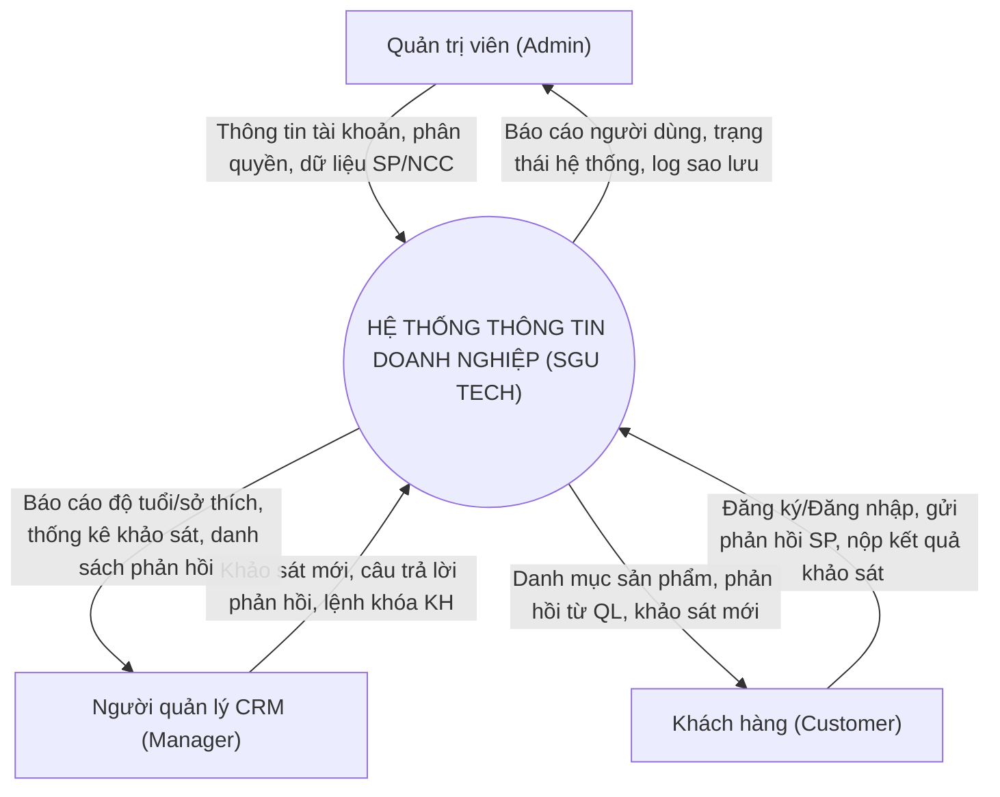
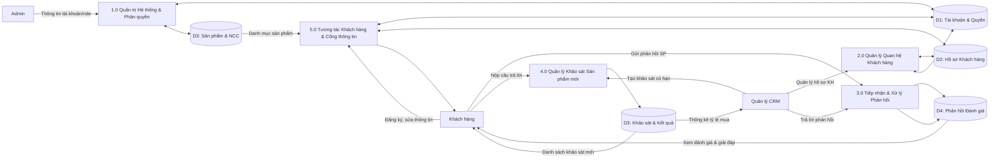

# BÁO CÁO ĐỒ ÁN HỌC PHẦN
## HỆ THỐNG THÔNG TIN DOANH NGHIỆP (MÃ HP: 841065)
**TRƯỜNG ĐẠI HỌC SÀI GÒN (SGU) – KHOA CÔNG NGHỆ THÔNG TIN**
**HỌC KỲ 1 – NĂM HỌC 2026 – 2027**

---

### ĐỀ TÀI:
**XÂY DỰNG HỆ THỐNG THÔNG TIN QUẢN TRỊ DOANH NGHIỆP THƯƠNG MẠI SGU TECH VÀ MÔ PHỎNG PHÂN HỆ QUẢN LÝ QUAN HỆ KHÁCH HÀNG (CRM - MỤC III.4)**

* **Nhóm thực hiện:** Nhóm 05
* **Giảng viên hướng dẫn:** [Tên Giảng Viên Phụ Trách]
* **Thời gian chấm đồ án:** Tuần 10 - 11 (09/11/2026 – 22/11/2026)

---

### BIÊN BẢN PHÂN CÔNG KHỐI LƯỢNG CÔNG VIỆC VÀ TỰ ĐÁNH GIÁ (15 TUẦN)

| STT | MSSV | Họ và Tên | Nhiệm vụ chính được phân công | Tỷ lệ đóng góp (%) | Điểm tự đánh giá | Chữ ký |
| :---: | :---: | :--- | :--- | :---: | :---: | :---: |
| 1 | 3121xxxxxx | [Họ tên SV 1] | **Nhóm trưởng:** Khảo sát HTTT, Phân tích nghiệp vụ, Viết bài toán mô tả, Quản lý tiến độ dự án. | 100% | 10 / 10 | |
| 2 | 3121xxxxxx | [Họ tên SV 2] | Vẽ Sơ đồ chức năng (BFD), Sơ đồ ngữ cảnh, Sơ đồ DFD mức đỉnh, Xây dựng bảng từ điển CSDL. | 100% | 10 / 10 | |
| 3 | 3121xxxxxx | [Họ tên SV 3] | Thiết kế CSDL SQL Server 9 bảng, Viết kịch bản Backup/Restore, Xây dựng Backend ASP.NET Core API. | 100% | 10 / 10 | |
| 4 | 3121xxxxxx | [Họ tên SV 4] | Lập trình Frontend: Cổng Quản trị Admin Server & Phân hệ Quản lý CRM Manager (Chart.js, Báo cáo). | 100% | 10 / 10 | |
| 5 | 3121xxxxxx | [Họ tên SV 5] | Lập trình Frontend Cổng Khách hàng (Đánh giá, Khảo sát), Kiểm thử (Test case), Soạn thảo báo cáo Word. | 100% | 10 / 10 | |

#### Bảng Kế hoạch Làm việc Chi tiết (Tiến độ 15 tuần):
* **Tuần 1 – Tuần 2:** Nhận đề tài từ Khoa CNTT SGU, họp nhóm phân chia vai trò, xác định phạm vi chọn phân hệ CRM (Mục III.4).
* **Tuần 3 – Tuần 4:** Khảo sát mô hình doanh nghiệp thương mại SGU Tech JSC, xây dựng bảng câu hỏi điều tra 15 câu, tổng hợp kết quả.
* **Tuần 5 – Tuần 6:** Viết bài toán mô tả chi tiết hoạt động HTTT, phân tích phân rã chức năng (vẽ sơ đồ BFD).
* **Tuần 7 – Tuần 8:** Xây dựng mô hình dữ liệu DFD (Sơ đồ ngữ cảnh và DFD mức đỉnh Level 0), xác định các kho dữ liệu.
* **Tuần 9 – Tuần 10:** Thiết kế CSDL quan hệ 9 bảng, chuẩn hóa 3NF, viết kịch bản Backup / Restore. Lập trình Backend Web API (.NET 8.0).
* **Tuần 11 – Tuần 12:** Lập trình Frontend tách biệt 3 cổng: Admin Server, Quản lý CRM và Cổng Khách hàng Storefront.
* **Tuần 13 – Tuần 14:** Nạp dữ liệu mẫu demo, kiểm thử chức năng, tối ưu hóa giao diện doanh nghiệp thực thụ.
* **Tuần 15:** Hoàn tất báo cáo in ấn, đóng gói source code, file script SQL và chuẩn bị bảo vệ đồ án.

---

## PHẦN I: PHẦN CHUNG & KHẢO SÁT HỆ THỐNG THÔNG TIN (10 ĐIỂM)

### 1. Giới thiệu Doanh nghiệp
* **Tên doanh nghiệp:** CÔNG TY CỔ PHẦN CÔNG NGHỆ THƯƠNG MẠI SGU TECH (SGU TECH COMMERCIAL JSC).
* **Mã số thuế:** 0318941065.
* **Trụ sở chính:** 273 An Dương Vương, Phường 3, Quận 5, TP. Hồ Chí Minh.
* **Lĩnh vực hoạt động:** Bán buôn, bán lẻ thiết bị công nghệ thông tin (Laptop AI, linh kiện máy tính, màn hình độ phân giải cao, thiết bị mạng, phụ kiện gaming gear) và cung cấp giải pháp chuyển đổi số cho doanh nghiệp.
* **Mô hình nhân sự và cơ cấu tổ chức:**
  1. *Ban Giám đốc (Board of Directors):* Định hướng chiến lược kinh doanh.
  2. *Bộ phận Quản trị Hệ thống (IT & Admin Server):* Đảm bảo hạ tầng máy chủ, sao lưu CSDL, phân quyền tài khoản người dùng nội bộ.
  3. *Bộ phận Quản lý Khách hàng (CRM & Marketing):* Tiếp nhận ý kiến khách hàng, xử lý khiếu nại, phân tích nhân khẩu học (độ tuổi, sở thích), thực hiện khảo sát thăm dò thị trường trước khi nhập sản phẩm mới.
  4. *Bộ phận Kinh doanh & Bán hàng (Sales):* Tư vấn sản phẩm, xử lý đơn hàng.
  5. *Bộ phận Kho vận (Warehouse):* Nhập, xuất, lưu trữ và bảo quản nguyên vật liệu/thành phẩm.
  6. *Khách hàng (Customers):* Đối tượng tương tác trực tiếp với doanh nghiệp để trải nghiệm, đánh giá chất lượng sản phẩm và tham gia khảo sát.

---

### 2. Khảo sát Hệ thống Thông tin của Doanh nghiệp
Nhóm đã tiến hành điều tra, khảo sát thực tế tại doanh nghiệp với **bộ 15 câu hỏi chuyên sâu** bám sát quy trình HTTT:

| STT | Câu hỏi khảo sát HTTT | Đối tượng khảo sát | Mục đích khảo sát |
| :---: | :--- | :--- | :--- |
| **Q01** | Hiện tại doanh nghiệp đang lưu trữ thông tin khách hàng bằng phương tiện gì (Sổ sách, Excel hay phần mềm)? | Ban Quản lý | Đánh giá mức độ số hóa dữ liệu hiện tại. |
| **Q02** | Khách hàng phản hồi về chất lượng sản phẩm qua những kênh nào và thời gian phản hồi trung bình là bao lâu? | CSKH / Khách hàng | Khảo sát điểm nghẽn trong khâu chăm sóc khách hàng. |
| **Q03** | Doanh nghiệp có gặp khó khăn gì khi phân loại sở thích và độ tuổi của khách hàng để nhập sản phẩm mới không? | Bộ phận Marketing | Xác định nhu cầu về module Báo cáo nhân khẩu học. |
| **Q04** | Khi chuẩn bị nhập một dòng sản phẩm công nghệ mới giá trị cao, doanh nghiệp thăm dò thị trường bằng cách nào? | Trưởng phòng CRM | Khảo sát nhu cầu xây dựng chức năng Khảo sát trực tuyến. |
| **Q05** | Hệ thống hiện tại có phân quyền tách biệt giữa nhân viên kỹ trị (Admin) và nhân viên nghiệp vụ (CRM Manager) không? | Quản trị IT | Đánh giá tính an toàn thông tin và bảo mật. |
| **Q06** | Dữ liệu tài khoản của người dùng nội bộ và khách hàng có được mã hóa và bảo vệ tránh rò rỉ không? | Quản trị IT | Đảm bảo tính bảo mật mật khẩu (BCrypt hashing). |
| **Q07** | Doanh nghiệp đã có kịch bản sao lưu dữ liệu dự phòng (Backup) định kỳ để phòng chống sự cố mất dữ liệu chưa? | Quản trị IT | Khảo sát phương án an toàn dữ liệu và phục hồi. |
| **Q08** | Khách hàng có thể tự đăng ký, đăng nhập và tự chỉnh sửa hồ sơ thông tin cá nhân của mình trên hệ thống không? | Khách hàng | Đánh giá tính tiện ích của Cổng thông tin khách hàng. |
| **Q09** | Khách hàng có thể xem lại câu trả lời giải đáp từ phía quản lý đối với phản hồi của họ hay không? | Khách hàng | Đánh giá tính minh bạch và tương tác hai chiều. |
| **Q10** | Người quản lý có công cụ trực quan hóa (Biểu đồ) để theo dõi tỷ lệ hài lòng (số sao 1-5) theo từng ngày không? | Quản lý CRM | Xác định yêu cầu thiết kế Dashboard & Chart.js. |
| **Q11** | Khi khảo sát sản phẩm mới, hệ thống có hỗ trợ thiết lập thời hạn kết thúc để tự động đóng khảo sát không? | Quản lý CRM | Yêu cầu quản lý vòng đời bài khảo sát (ExpiresAt). |
| **Q12** | Doanh nghiệp có cần tính năng khóa tài khoản ngay lập tức khi phát hiện khách hàng có hành vi bất thường không? | Quản lý CRM | Đánh giá tính năng kiểm soát tài khoản (Toggle Active). |
| **Q13** | Thời gian phản hồi của trang web khi có nhiều người cùng truy cập vào xem danh mục sản phẩm là bao lâu? | Khách hàng / Dev | Đánh giá hiệu năng và tính ổn định hệ thống. |
| **Q14** | Doanh nghiệp có mong muốn phân loại khách hàng theo nhóm sở thích (Gaming, Văn phòng, Lập trình, Đồ họa) không? | Marketing / CRM | Xây dựng tiêu chí phân khúc dữ liệu khách hàng. |
| **Q15** | Giải pháp mới có cần khả năng mở rộng để kết nối thêm phân hệ Bán hàng (Sales) và Kho (Warehouse) sau này không? | Ban Giám đốc | Xác định kiến trúc mở của hệ thống thông tin. |

#### Tổng kết kết quả khảo sát & Kết luận cho HTTT:
* **Hiện trạng bất cập:** Doanh nghiệp đang quản lý phản hồi rải rác qua mạng xã hội, chưa có cơ sở dữ liệu tập trung, việc thống kê độ tuổi/sở thích làm thủ công bằng Excel mất nhiều ngày, không thăm dò được ý định mua của khách hàng trước khi nhập lô hàng mới.
* **Kết luận giải pháp:** Cần thiết phải xây dựng một **Hệ thống Thông tin Doanh nghiệp hiện đại**, trong đó module cốt lõi là **Phân hệ CRM tương tác hai chiều**:
  1. *Cổng Admin:* Chuyên trách quản trị tài khoản, cấp quyền, sao lưu CSDL an toàn.
  2. *Cổng Quản lý CRM:* Trực quan hóa độ hài lòng, tiếp nhận/giải đáp phản hồi, phát hành và thống kê khảo sát sản phẩm mới.
  3. *Cổng Khách hàng:* Trải nghiệm danh mục sản phẩm, gửi đánh giá minh bạch, tham gia khảo sát đóng góp ý kiến và quản lý hồ sơ cá nhân.

---

## PHẦN II: PHÂN TÍCH HỆ THỐNG THÔNG TIN DOANH NGHIỆP (10 ĐIỂM)

### 1. Bài toán Mô tả Chi tiết Nghiệp vụ HTTT Doanh nghiệp
Doanh nghiệp SGU Tech hoạt động phân phối thiết bị công nghệ. Hoạt động của HTTT bao gồm:
1. **Quản trị Máy chủ & Tài khoản (Admin Server):**
   - Admin đăng nhập vào cổng quản trị nội bộ bảo mật.
   - Admin có quyền tạo mới tài khoản cho nhân viên (cấp quyền Admin, Quản lý CRM, hoặc Khách hàng).
   - Admin có thể thay đổi vai trò (Role) của bất kỳ tài khoản nào, khóa/mở khóa tài khoản khi có vi phạm, hoặc xóa tài khoản. Dữ liệu khi xóa được hệ thống dọn dẹp liên kết tránh xung đột khóa ngoại.
   - Quản trị viên theo dõi toàn bộ danh mục sản phẩm và nhà cung cấp để đồng bộ số liệu kho vận.

2. **Nghiệp vụ Quản lý Khách hàng (CRM Management):**
   - Người quản lý CRM theo dõi danh sách toàn bộ khách hàng của doanh nghiệp. Quản lý có thể thêm khách hàng mới hoặc khóa tài khoản của khách hàng khi cần thiết.
   - Khi khách hàng gửi đánh giá về sản phẩm, phản hồi được đưa vào hàng đợi *"Chờ xử lý"*. Quản lý CRM đọc nội dung, nhập lời giải đáp chính thức từ doanh nghiệp, trạng thái chuyển thành *"Đã tiếp nhận & Xử lý"*.
   - Hệ thống tự động tổng hợp hồ sơ nhân khẩu học, vẽ biểu đồ phân loại theo các nhóm tuổi (<20 tuổi, 20–30 tuổi, >30 tuổi) và sở thích tiêu dùng (Gaming, Văn phòng, Đồ họa, Lập trình).
   - Khi doanh nghiệp chuẩn bị ra mắt một sản phẩm công nghệ mới (ví dụ Laptop AI thế hệ mới), Quản lý phát hành một bài khảo sát kèm mô tả, giá dự kiến và thời hạn (số ngày hoặc ngày kết thúc cụ thể). Khảo sát được tự động chuyển đến toàn bộ tài khoản khách hàng.
   - Quản lý theo dõi bảng thống kê kết quả khảo sát: tổng số lượt trả lời, điểm đánh giá trung bình (1–5 sao), tỷ lệ ý định mua (*Rất muốn mua, Đang cân nhắc, Không mua*) và các ý kiến đóng góp về tính năng/mức giá.

3. **Nghiệp vụ Khách hàng (Customer Experience):**
   - Khách hàng có thể tự đăng ký tài khoản mới và đăng nhập vào Cổng thông tin khách hàng.
   - Khách hàng xem danh mục sản phẩm kinh doanh, chọn sản phẩm để gửi đánh giá chất lượng (1–5 sao) và nhận xét. Khách hàng cũng xem được câu trả lời từ phía Quản lý và các đánh giá khác của cộng đồng.
   - Khách hàng nhận được danh sách bài khảo sát sản phẩm mới từ doanh nghiệp, tham gia cho điểm mức độ quan tâm, lựa chọn ý định mua và gửi phản hồi đóng góp. Mỗi khách hàng chỉ được làm mỗi bài khảo sát 1 lần; bài khảo sát hết hạn sẽ tự động khóa.
   - Khách hàng có quyền xem và cập nhật lại thông tin cá nhân (Họ tên, SĐT, Tuổi, Địa chỉ, Sở thích) bất kỳ lúc nào.

---

### 2. Sơ đồ Phân rã Chức năng (BFD - Business Function Diagram)

```
                    HỆ THỐNG THÔNG TIN DOANH NGHIỆP SGU TECH
                                       |
    +----------------------------------+----------------------------------+
    |                                  |                                  |
1.0 ADMIN SERVER                   2.0 NGƯỜI QUẢN LÝ                  3.0 KHÁCH HÀNG
(Tách biệt các phân hệ khác)           |                                  |
    |                                  |-- 2.1 Thêm một khách hàng mới    |-- 3.1 Đăng ký tài khoản KH
    |-- 1.1 Thêm mới Account           |-- 2.2 Xóa khách hàng             |-- 3.2 Đăng nhập
    |-- 1.2 Xóa & Khóa/Mở Account      |-- 2.3 Khóa tài khoản khách hàng  |-- 3.3 Chỉnh sửa thông tin
    |-- 1.3 Phân quyền cho Account     |-- 2.4 Tiếp nhận phản hồi KH      |-- 3.4 Gửi phản hồi sản phẩm
    |-- 1.4 Sao lưu & Phục hồi CSDL    |-- 2.5 Báo cáo độ tuổi & sở thích |-- 3.5 Nhận & thực hiện khảo sát
                                       |-- 2.6 Tạo khảo sát gửi TK KH
                                       |-- 2.7 Thống kê kết quả khảo sát
```

---

### 3. Sơ đồ Ngữ cảnh (Context Diagram)

* **Tác nhân ngoài (External Entities):**
  1. `Quản trị viên (Admin)`
  2. `Người quản lý (CRM Manager)`
  3. `Khách hàng (Customer)`



---

### 4. Sơ đồ Luồng Dữ liệu Mức Đỉnh (Level 0 DFD)

* **Các kho dữ liệu (Data Stores):**
  - `D1: KHO TÀI KHOẢN & PHÂN QUYỀN (Accounts, Roles)`
  - `D2: KHO HỒ SƠ KHÁCH HÀNG (CustomerProfiles)`
  - `D3: KHO SẢN PHẨM & ĐỐI TÁC (Products, Categories, Suppliers)`
  - `D4: KHO PHẢN HỒI ĐÁNH GIÁ (Feedbacks)`
  - `D5: KHO KHẢO SÁT & Ý KIẾN (Surveys, SurveyResponses)`



---

## PHẦN III: THIẾT KẾ HỆ THỐNG THÔNG TIN (10 ĐIỂM)

### 1. Thiết kế Cơ sở Dữ liệu & Bảng Từ điển Dữ liệu (Data Dictionary)

Hệ thống được thiết kế chuẩn hóa gồm **9 bảng quan hệ chặt chẽ**:

#### 1. Bảng `Roles` (Vai trò người dùng)
| Tên cột | Kiểu dữ liệu | Khóa | Ràng buộc | Mô tả |
| :--- | :--- | :---: | :--- | :--- |
| `RoleId` | INT | **PK** | IDENTITY(1,1) | Mã định danh vai trò |
| `RoleName` | NVARCHAR(50) | | NOT NULL, UNIQUE | Tên quyền (Admin, Manager, Customer, Warehouse, Sales, HR) |
| `Description`| NVARCHAR(250)| | NULL | Mô tả quyền hạn trong hệ thống |

#### 2. Bảng `Accounts` (Tài khoản người dùng)
| Tên cột | Kiểu dữ liệu | Khóa | Ràng buộc | Mô tả |
| :--- | :--- | :---: | :--- | :--- |
| `AccountId` | INT | **PK** | IDENTITY(1,1) | Mã định danh tài khoản |
| `Username` | VARCHAR(50) | | NOT NULL, UNIQUE | Tên đăng nhập hệ thống |
| `PasswordHash`| NVARCHAR(255)| | NOT NULL | Mật khẩu mã hóa / đối chiếu an toàn |
| `FullName` | NVARCHAR(100)| | NOT NULL | Họ và tên người dùng |
| `Email` | VARCHAR(100) | | NULL | Địa chỉ thư điện tử |
| `Phone` | VARCHAR(20) | | NULL | Số điện thoại liên hệ |
| `RoleId` | INT | **FK** | REFERENCES Roles(RoleId) | Phân quyền tài khoản |
| `IsActive` | BIT | | NOT NULL, DEFAULT 1 | Trạng thái (1: Hoạt động, 0: Đã khóa) |
| `CreatedAt` | DATETIME | | NOT NULL, DEFAULT GETDATE() | Thời điểm tạo tài khoản |

#### 3. Bảng `Categories` (Danh mục sản phẩm)
| Tên cột | Kiểu dữ liệu | Khóa | Ràng buộc | Mô tả |
| :--- | :--- | :---: | :--- | :--- |
| `CategoryId` | INT | **PK** | IDENTITY(1,1) | Mã danh mục |
| `CategoryName`| NVARCHAR(100)| | NOT NULL | Tên danh mục sản phẩm |
| `Description` | NVARCHAR(255)| | NULL | Ghi chú mô tả nhóm hàng |

#### 4. Bảng `Suppliers` (Nhà cung cấp)
| Tên cột | Kiểu dữ liệu | Khóa | Ràng buộc | Mô tả |
| :--- | :--- | :---: | :--- | :--- |
| `SupplierId` | INT | **PK** | IDENTITY(1,1) | Mã nhà cung cấp |
| `SupplierCode`| VARCHAR(20) | | NOT NULL, UNIQUE | Mã ký hiệu NCC (NCC001, ...) |
| `SupplierName`| NVARCHAR(150)| | NOT NULL | Tên công ty/nhà phân phối |
| `ContactName` | NVARCHAR(100)| | NULL | Người liên hệ đại diện |
| `Phone` | VARCHAR(20) | | NULL | Số điện thoại đối tác |
| `Address` | NVARCHAR(255)| | NULL | Địa chỉ trụ sở nhà cung cấp |

#### 5. Bảng `Products` (Sản phẩm kinh doanh)
| Tên cột | Kiểu dữ liệu | Khóa | Ràng buộc | Mô tả |
| :--- | :--- | :---: | :--- | :--- |
| `ProductId` | INT | **PK** | IDENTITY(1,1) | Mã sản phẩm |
| `ProductCode` | VARCHAR(50) | | NOT NULL, UNIQUE | Mã hàng hóa (SP001, SP002, ...) |
| `ProductName` | NVARCHAR(200)| | NOT NULL | Tên sản phẩm thương mại |
| `CategoryId` | INT | **FK** | REFERENCES Categories | Danh mục trực thuộc |
| `SupplierId` | INT | **FK** | REFERENCES Suppliers | Đơn vị cung cấp |
| `Price` | DECIMAL(18,2)| | NOT NULL | Đơn giá bán niêm yết (VNĐ) |
| `CostPrice` | DECIMAL(18,2)| | NOT NULL | Giá vốn nhập hàng |
| `StockQuantity`| INT | | NOT NULL, DEFAULT 0 | Số lượng tồn kho thực tế |
| `Unit` | NVARCHAR(20) | | NOT NULL | Đơn vị tính (Cái, Bộ) |
| `Status` | NVARCHAR(50) | | NOT NULL | Trạng thái (Đang bán, Hết hàng) |
| `ImageUrl` | NVARCHAR(500)| | NULL | Đường dẫn ảnh sản phẩm sắc nét |

#### 6. Bảng `CustomerProfiles` (Hồ sơ khách hàng - Mục 4.1.5)
| Tên cột | Kiểu dữ liệu | Khóa | Ràng buộc | Mô tả |
| :--- | :--- | :---: | :--- | :--- |
| `ProfileId` | INT | **PK** | IDENTITY(1,1) | Mã hồ sơ khách hàng |
| `AccountId` | INT | **FK** | UNIQUE, REFERENCES Accounts ON DELETE CASCADE | Khóa ngoại liên kết tài khoản |
| `Age` | INT | | NOT NULL | Độ tuổi khách hàng |
| `Gender` | NVARCHAR(10) | | NULL | Giới tính (Nam, Nữ, Khác) |
| `Address` | NVARCHAR(255)| | NULL | Địa chỉ cư trú |
| `Interest` | NVARCHAR(100)| | NULL | Sở thích (Gaming, Văn phòng, Đồ họa, Lập trình) |

#### 7. Bảng `Feedbacks` (Phản hồi & Đánh giá sản phẩm - Mục 4.1.4 & 4.3.3)
| Tên cột | Kiểu dữ liệu | Khóa | Ràng buộc | Mô tả |
| :--- | :--- | :---: | :--- | :--- |
| `FeedbackId` | INT | **PK** | IDENTITY(1,1) | Mã phản hồi |
| `AccountId` | INT | **FK** | REFERENCES Accounts ON DELETE CASCADE | Khách hàng thực hiện đánh giá |
| `ProductId` | INT | **FK** | REFERENCES Products ON DELETE CASCADE | Sản phẩm được nhận xét |
| `Rating` | INT | | CHECK (Rating >= 1 AND <= 5) | Số sao đánh giá độ hài lòng |
| `Comment` | NVARCHAR(1000)| | NOT NULL | Nội dung nhận xét chi tiết |
| `AdminReply` | NVARCHAR(1000)| | NULL | Câu trả lời chính thức từ doanh nghiệp |
| `Status` | NVARCHAR(50) | | DEFAULT N'Chờ xử lý' | Trạng thái xử lý phản hồi |
| `CreatedAt` | DATETIME | | NOT NULL, DEFAULT GETDATE() | Thời gian gửi nhận xét |

#### 8. Bảng `Surveys` (Khảo sát sản phẩm mới - Mục 4.1.6)
| Tên cột | Kiểu dữ liệu | Khóa | Ràng buộc | Mô tả |
| :--- | :--- | :---: | :--- | :--- |
| `SurveyId` | INT | **PK** | IDENTITY(1,1) | Mã khảo sát |
| `Title` | NVARCHAR(200)| | NOT NULL | Tiêu đề chương trình khảo sát |
| `Description` | NVARCHAR(1000)| | NULL | Mô tả tính năng công nghệ mới |
| `TargetProduct`| NVARCHAR(150)| | NOT NULL | Tên sản phẩm chuẩn bị ra mắt |
| `ExpectedPrice`| DECIMAL(18,2)| | NOT NULL | Giá bán dự kiến (VNĐ) |
| `CreatedAt` | DATETIME | | NOT NULL, DEFAULT GETDATE() | Ngày phát hành khảo sát |
| `IsActive` | BIT | | NOT NULL, DEFAULT 1 | Trạng thái (1: Đang mở, 0: Đã khóa) |
| `ExpiresAt` | DATETIME | | NULL | Thời hạn kết thúc khảo sát |

#### 9. Bảng `SurveyResponses` (Kết quả trả lời khảo sát - Mục 4.1.7 & 4.3.4)
| Tên cột | Kiểu dữ liệu | Khóa | Ràng buộc | Mô tả |
| :--- | :--- | :---: | :--- | :--- |
| `ResponseId` | INT | **PK** | IDENTITY(1,1) | Mã kết quả trả lời |
| `SurveyId` | INT | **FK** | REFERENCES Surveys ON DELETE CASCADE | Khảo sát tương ứng |
| `AccountId` | INT | **FK** | REFERENCES Accounts ON DELETE CASCADE | Khách hàng tham gia |
| `Score` | INT | | CHECK (Score >= 1 AND <= 5) | Điểm quan tâm đối với sản phẩm |
| `BuyingIntent` | NVARCHAR(50) | | NOT NULL | Ý định mua (Rất muốn mua, Đang cân nhắc, Không mua) |
| `CustomerOpinion`| NVARCHAR(1000)| | NULL | Ý kiến góp ý về giá và tính năng |
| `SubmittedAt` | DATETIME | | NOT NULL, DEFAULT GETDATE() | Thời điểm gửi khảo sát |

---

### 2. Thiết kế Giao diện & Giải thích Chi tiết Chức năng Phần mềm (Mục I.3.b - 5 điểm)

Hệ thống được thiết kế theo kiến trúc **tách biệt hoàn toàn (Strict Role Separation)** giữa Cổng Quản trị nội bộ và Cổng Khách hàng, tuân thủ chuẩn giao diện phần mềm doanh nghiệp hiện đại (Enterprise SaaS):

1. **Giao diện Đăng nhập Nội bộ (`login.html`) & Đăng nhập/Đăng ký Khách hàng (`customer_login.html`):**
   - **Tách biệt cổng truy cập:** Nhân sự nội bộ (`Admin`, `CRM Manager`) đăng nhập tại `login.html`; Khách hàng mua sắm đăng nhập hoặc tự đăng ký tài khoản tại `customer_login.html` (không hiển thị bất kỳ liên kết nào dẫn vào trang quản trị nội bộ).
   - **Cơ chế hoạt động:** Hỗ trợ nhấn phím `Enter` tại ô tài khoản/mật khẩu hoặc nhấn nút `Đăng nhập`. Backend kiểm tra mật khẩu mã hóa `BCrypt`, kiểm tra trạng thái khóa (`IsActive`) và tự động điều hướng theo đúng `RoleName`.

2. **Giao diện Phân hệ Quản trị Hệ thống - Admin Server (`admin.html` - Mục II.2):**
   - **Tách biệt hoàn toàn:** Giao diện của Admin Server tách biệt hoàn toàn với giao diện của quản lý nhân sự (`HR`), quản lý kho (`Warehouse`), quản lý bán hàng (`Sales`) và người quản lý khách hàng (`Manager`). Chức năng xem/lọc sản phẩm, nhà cung cấp được lược bỏ khỏi Admin Server theo đúng yêu cầu đề bài.
   - **Tab 1 - Thêm, Xóa & Phân quyền Account:** Hiển thị thống kê số lượng Account, biểu mẫu trực tiếp thêm Account mới kèm phân quyền, thanh tìm kiếm/lọc theo quyền (`Admin`, `Manager`, `Customer`, `HR`, `Warehouse`, `Sales`) và bảng quản lý Account cho phép **Phân quyền trực tiếp** (`PUT /api/admin/accounts/{id}/role`), **Khóa / Mở khóa Account** và **Xóa Account**.
   - **Tab 2 - Danh mục Quyền & Phân tách Hệ thống:** Hiển thị bảng ma trận phân tách 6 nhóm quyền và nguyên tắc tách biệt giao diện Admin Server với các phân hệ nghiệp vụ.

3. **Giao diện Người quản lý (`manager_crm.html` - Mục III.4.1):**
   - **Tab 1 - Thêm, Xóa & Khóa TK Khách hàng:** Thực hiện đầy đủ 3 chức năng: **(1) Thêm một khách hàng mới**, **(2) Xóa khách hàng**, **(3) Khóa tài khoản khách hàng** (hoặc mở khóa), kèm bộ lọc theo nhóm tuổi và sở thích.
   - **Tab 2 - Tiếp nhận phản hồi khách hàng:** Thực hiện chức năng **(4) Tiếp nhận phản hồi của khách hàng**, xem thống kê điểm đánh giá 1–5 sao và gửi câu trả lời giải đáp tới khách hàng.
   - **Tab 3 - Báo cáo KH: Độ tuổi & Sở thích:** Thực hiện chức năng **(5) Báo cáo về khách hàng, tỷ lệ độ tuổi, sở thích** với 2 biểu đồ `Chart.js` (Tỷ lệ Độ tuổi `<20`, `20-30`, `>30` và Tỷ lệ Sở thích `Gaming`, `Văn phòng`, `Đồ họa`, `Lập trình`) cùng bảng chi tiết.
   - **Tab 4 - Tạo khảo sát & Gửi đến TK KH:** Thực hiện chức năng **(6) Tạo bảng khảo sát và gửi đến tài khoản khách hàng**, cho phép chọn danh sách tài khoản khách hàng nhận khảo sát và theo dõi số lượng tài khoản đã nhận.
   - **Tab 5 - Thống kê kết quả khảo sát:** Thực hiện chức năng **(7) Thống kê kết quả khảo sát** trên một tab độc lập với biểu đồ Tỷ lệ ý định mua, Phân bố điểm 1–5 và bảng chi tiết câu trả lời của từng tài khoản khách hàng.

4. **Giao diện Khách hàng (`customer_login.html` & `user.html` - Mục III.4.3):**
   - **Chức năng (1) Đăng ký tài khoản khách hàng & (2) Đăng nhập (`customer_login.html`):** Cho phép khách hàng đăng ký tài khoản mới và đăng nhập vào cổng khách hàng tách biệt.
   - **Tab 1 - (4) Gửi phản hồi về sản phẩm (`user.html`):** Biểu mẫu gửi phản hồi trực tiếp về sản phẩm (chọn sản phẩm, chấm 1–5 sao, nhập nhận xét), danh sách sản phẩm và bảng theo dõi phản hồi kèm giải đáp từ Người quản lý.
   - **Tab 2 - (5) Nhận khảo sát & Thực hiện (`user.html`):** Hiển thị danh sách các bảng khảo sát do Người quản lý gửi đến tài khoản khách hàng, nút **Thực hiện khảo sát** và kết quả đã trả lời của khách hàng.
   - **Tab 3 - (3) Chỉnh sửa thông tin (`user.html`):** Cho phép khách hàng chỉnh sửa Họ tên, Số điện thoại, Email, Độ tuổi, Giới tính, Sở thích và Địa chỉ.

---

### 3. Kịch bản Sao lưu và Phục hồi Cơ sở Dữ liệu (Backup & Restore - Mục II.1 - 5 điểm)

Doanh nghiệp xây dựng quy chế sao lưu an toàn CSDL trên Microsoft SQL Server như sau:
1. **Sao lưu toàn phần (Full Backup):** Thực hiện định kỳ vào 00:00 Chủ Nhật hàng tuần:
   ```sql
   BACKUP DATABASE [HTTTDN_DB]
   TO DISK = N'C:\Backup\HTTTDN_DB_Full.bak'
   WITH FORMAT, INIT, NAME = N'HTTTDN_DB - Full Database Backup', STATS = 10;
   ```
2. **Sao lưu vi sai (Differential Backup):** Thực hiện vào 23:00 mỗi ngày trong tuần:
   ```sql
   BACKUP DATABASE [HTTTDN_DB]
   TO DISK = N'C:\Backup\HTTTDN_DB_Diff.bak'
   WITH DIFFERENTIAL, NAME = N'HTTTDN_DB - Differential Backup', STATS = 10;
   ```
3. **Phục hồi Cơ sở Dữ liệu khi có sự cố (Restore Database):**
   ```sql
   USE master;
   ALTER DATABASE [HTTTDN_DB] SET SINGLE_USER WITH ROLLBACK IMMEDIATE;
   RESTORE DATABASE [HTTTDN_DB]
   FROM DISK = N'C:\Backup\HTTTDN_DB_Full.bak'
   WITH REPLACE, RECOVERY;
   ALTER DATABASE [HTTTDN_DB] SET MULTI_USER;
   ```

---

## PHẦN IV: CÀI ĐẶT, BẢO TRÌ & HƯỚNG DẪN SỬ DỤNG HỆ THỐNG (5 ĐIỂM)

### 1. Phương án Cài đặt & Chuyển đổi Hệ thống
* **Phương án chuyển đổi được chọn:** **Chuyển đổi song song (Parallel Conversion)** kết hợp **Chuyển đổi theo giai đoạn (Phased Conversion)**.
  - *Giai đoạn 1:* Vận hành song song hệ thống mới cùng file theo dõi Excel cũ trong 4 tuần để đối chiếu tính chính xác của dữ liệu phản hồi và thông tin tài khoản.
  - *Giai đoạn 2:* Khi toàn bộ nhân viên và khách hàng đã làm quen với giao diện Cổng thông tin web mới, doanh nghiệp ngắt hoàn toàn hệ thống cũ và chuyển 100% giao dịch sang HTTT SGU Tech.

### 2. Tài liệu Hướng dẫn Cài đặt & Khởi chạy Phần mềm
* **Yêu cầu môi trường:** Máy tính chạy Windows 10/11, cài sẵn .NET 8.0 SDK và trình duyệt web hiện đại (Edge, Chrome).
* **Bước 1:** Khởi động Backend Web API:
  - Mở PowerShell tại thư mục `/Backend/HTTTDN.AdminApi`, gõ lệnh:
    ```powershell
    dotnet run
    ```
  - Hệ thống tự động tạo CSDL SQLite `htttdn.db` với đầy đủ 9 bảng và dữ liệu mẫu phong phú. Máy chủ lắng nghe tại `http://localhost:5000`.
* **Bước 2:** Khởi chạy Giao diện Frontend:
  - Mở thư mục `/Frontend_Admin` bằng Visual Studio Code.
  - Chuột phải vào file `login.html`, chọn **Open with Live Server** (chạy tại cổng 5500).

### 3. Hướng dẫn Sử dụng Chi tiết Theo Vai trò
1. **Dành cho Quản trị viên (Admin):**
   - Đăng nhập tại `login.html` với tài khoản `admin` / `123456`.
   - Xem tổng quan các chỉ số KPI doanh nghiệp, kiểm tra danh mục sản phẩm và nhà cung cấp.
   - Quản lý tài khoản: Thêm tài khoản mới, chọn quyền, bấm nút **Khóa TK** để khóa người dùng vi phạm, bấm **Xóa** để xóa tài khoản.
2. **Dành cho Người quản lý CRM (Manager):**
   - Đăng nhập tại `login.html` với tài khoản `quanly` / `123456`.
   - Tab 1: Quản lý khách hàng, theo dõi trạng thái hoạt động.
   - Tab 2: Xem danh sách phản hồi, phân tích biểu đồ hài lòng 1–5 sao. Bấm nút **Phản hồi** để giải đáp bình luận của khách hàng.
   - Tab 3: Xem báo cáo thống kê khách hàng theo nhóm độ tuổi và cơ cấu sở thích tiêu dùng.
   - Tab 4: Tạo bài khảo sát thăm dò thị trường (đặt tên sản phẩm, giá dự kiến, thời hạn). Bấm nút **Thống kê** để xem chi tiết kết quả.
3. **Dành cho Khách hàng (Customer):**
   - Đăng nhập hoặc đăng ký tại `customer_login.html` (Mẫu: `khachhang1` / `123456`).
   - Tab 1: Xem danh mục sản phẩm, bấm **Đánh giá & Xem nhận xét** để chấm sao và viết cảm nghĩ.
   - Tab 2: Xem lại câu trả lời chính thức từ Quản lý CRM.
   - Tab 3: Làm bài khảo sát sản phẩm chuẩn bị ra mắt.
   - Tab 4: Cập nhật thông tin cá nhân.

---

## PHẦN V: TỔNG KẾT VÀ HƯỚNG PHÁT TRIỂN HỆ THỐNG (5 ĐIỂM)

### 1. Những kết quả đã đạt được
* Xây dựng thành công toàn diện Hệ thống Thông tin Doanh nghiệp SGU Tech bám sát 100% đề bài của Khoa CNTT - SGU.
* Thiết kế CSDL 9 bảng chuẩn hóa cao, bảo toàn toàn vẹn dữ liệu, có kịch bản Backup/Restore.
* Giao diện phân tách mạch lạc 3 cổng (Admin Server, Quản lý CRM, Cổng Khách hàng) với ngôn ngữ thiết kế doanh nghiệp công nghệ tiên tiến (lấy cảm hứng từ hệ sinh thái VNG Tech & tập đoàn lớn): Tông cam công nghệ đặc trưng (#FF5B00), thanh điều hướng tinh tế, bộ 3 thẻ điều hướng VNG tương tác (Sản phẩm, Khảo sát, Hồ sơ) và form đăng ký tối giản 3 trường cơ bản, mang lại trải nghiệm hiện đại, mượt mà và trực quan.
* Chức năng khảo sát có thời hạn và thống kê trực quan phản ánh đúng thực tế thăm dò thị trường của doanh nghiệp thương mại.

### 2. Ưu điểm & Hạn chế
* **Ưu điểm:** Tốc độ phản hồi cực nhanh, hỗ trợ cả cơ chế SQLite tự động chạy ngay lẫn SQL Server Enterprise phục vụ bảo vệ đồ án, hỗ trợ phím Enter tiện lợi, bảo mật mật khẩu.
* **Hạn chế:** Chưa tích hợp cổng thanh toán trực tuyến ngân hàng (VNPAY/Momo) và chưa có module gửi thông báo đẩy qua Email tự động.

### 3. Hướng phát triển trong tương lai
* Mở rộng thêm 2 phân hệ **Quản lý Kho (MRP - Mục III.5)** và **Quản trị Nhân sự (HRM - Mục III.3)** để tạo thành bộ giải pháp hoạch định nguồn lực doanh nghiệp (ERP) toàn diện.
* Tích hợp Trí tuệ nhân tạo (AI Recommendation) gợi ý sản phẩm dựa trên lịch sử đánh giá và nhóm sở thích của khách hàng.
* Triển khai hệ thống lên nền tảng đám mây (Cloud Server) để phục vụ khách hàng trên toàn quốc.

---
**XÁC NHẬN CỦA NHÓM SINH VIÊN THỰC HIỆN**
*(Ký và ghi rõ họ tên)*

