## UBND THÀNH PHỐ HỒ CHÍ MINH

# TRƯỜNG ĐẠI HỌC SÀI GÒN

## KHOA CÔNG NGHỆ THÔNG TIN

### ━━━━━━━━━━━━━━━━━━━━━━━━━━━━━━━━━━━━━━━━━━━━━━

# BÁO CÁO ĐỒ ÁN MÔN HỌC

# HỆ THỐNG THÔNG TIN DOANH NGHIỆP

## (MÃ HỌC PHẦN: 841065)

# ĐỀ TÀI CHỦ ĐỀ 2: PHÂN TÍCH, THIẾT KẾ VÀ XÂY DỰNG HỆ THỐNG THÔNG TIN QUẢN TRỊ MÁY CHỦ ĐỘC LẬP (ADMIN SERVER) & QUẢN LÝ QUAN HỆ KHÁCH HÀNG (CRM) TẠI CÔNG TY CỔ PHẦN CÔNG NGHỆ SGU TECH

| STT | Họ và Tên Sinh viên thực hiện | Mã số Sinh viên | Vai trò trong nhóm | Lớp / Khóa |
| --- | --- | --- | --- | --- |
| 1 | Huỳnh Tuấn Tài | 3123411261 | Nhóm trưởng | DCT123 — K23 |
| 2 | Hoàng Thái Thanh | 3123411267 | Thành viên | DCT123 — K23 |
| 3 | Lê Nguyễn Phú Hải | 3123411080 | Thành viên | DCT123 — K23 |
| 4 | Nguyễn Đăng Khoa | 3123411157 | Thành viên | DCT123 — K23 |

Nền tảng Công nghệ: ASP.NET Core 8.0 Web API • Entity Framework Core 8.0 • Microsoft SQL Server (9 Bảng Chuẩn 3NF) • Giao diện VNG Enterprise Design System

### Thành phố Hồ Chí Minh — Năm học 2025 – 2026

# LỜI CẢM ƠN VÀ CAM ĐOAN CỦA NHÓM THỰC HIỆN

### Lời đầu tiên, nhóm sinh viên thực hiện đồ án xin gửi lời cảm ơn chân thành và sâu sắc nhất đến Quý Thầy/Cô Khoa Công nghệ Thông tin – Trường Đại học Sài Gòn, đặc biệt là Giảng viên phụ trách học phần Hệ thống Thông tin Doanh nghiệp (Mã học phần: 841065). Trong suốt 15 tuần học tập và thực hiện đồ án, những kiến thức nền tảng và chuyên sâu mà Thầy/Cô truyền đạt về khảo sát hiện trạng doanh nghiệp, phân tích quy trình nghiệp vụ, mô hình hóa Sơ đồ Chức năng (BFD), Sơ đồ Ngữ cảnh (Context Diagram), Sơ đồ Luồng dữ liệu (DFD), thiết kế Cơ sở dữ liệu chuẩn hóa 3NF (ERD), phương án sao lưu – phục hồi dữ liệu và kiến trúc phần mềm doanh nghiệp đã giúp nhóm hoàn thành trọn vẹn đề tài này.

### Đề tài của nhóm tập trung giải quyết bài toán thực tiễn tại Công ty Cổ phần Công nghệ và Thương mại Điện tử SGU Tech (SGU Tech Corp) thông qua việc xây dựng Hệ thống Thông tin Quản trị Máy chủ Độc lập (Admin Server) và Quản lý Quan hệ Khách hàng (CRM). Toàn bộ hệ thống được thiết kế tuân thủ nghiêm ngặt yêu cầu tách biệt hoàn toàn giao diện Admin Server khỏi các phân hệ khác, đồng thời đáp ứng đầy đủ 100% các nghiệp vụ của Admin Server, Người Quản lý CRM và Khách hàng.

### Nhóm chúng em xin cam đoan toàn bộ nội dung phân tích, các sơ đồ kỹ thuật (BFD, Context, DFD Mức 0, DFD Mức 1, ERD, Kiến trúc 3 tầng), cơ sở dữ liệu SQL Server 9 bảng, mã nguồn Backend ASP.NET Core 8.0 và bộ giao diện thực tế trong báo cáo này là sản phẩm do chính 4 thành viên trong nhóm trực tiếp nghiên cứu, thiết kế và lập trình.

## PHIẾU ĐÁNH GIÁ VÀ ĐỐI CHIẾU THANG ĐIỂM ĐỒ ÁN MÔN HỌC (100 ĐIỂM)

| Mục | Nội dung tiêu chí đánh giá theo yêu cầu đồ án | Điểm tối đa | Vị trí trình bày trong Báo cáo & Đồ án | Điểm chấm |
| --- | --- | --- | --- | --- |
| I.1 | Phần chung: Giới thiệu về DN (hoạt động, mô hình, nhân sự) (5đ) + Khảo sát HTTT của DN (bảng câu hỏi >= 15 câu, tổng kết & kết luận) (5đ) | 10 điểm | Chương 1 (Mục 1.1 & Mục 1.2 — 25 câu hỏi khảo sát + 3 biên bản phỏng vấn) |  |
| I.2 | Phân tích HTTT của DN: Bài toán mô tả chi tiết (2đ) + Sơ đồ chức năng BFD (2đ) + Sơ đồ ngữ cảnh (2đ) + Sơ đồ luồng dữ liệu mức đỉnh & mức 1 (4đ) | 10 điểm | Chương 2 (Mục 2.1, 2.2, 2.3, 2.4 — 15 Use Cases + 5 sơ đồ BFD/Context/DFD) |  |
| I.3 | Thiết kế HTTT: Thiết kế CSDL dựa vào các kho dữ liệu, ERD & bảng mô tả thuộc tính (5đ) + Thiết kế giao diện kèm hình ảnh thực tế & giới thiệu chi tiết chức năng (5đ) | 10 điểm | Chương 3 (Mục 3.1 ERD 9 bảng & Data Dictionary + Mục 3.2 13 màn hình thực tế) |  |
| I.4 | Cài đặt và bảo trì HTTT, phương án chuyển đổi hệ thống cũ sang mới, tài liệu hướng dẫn sử dụng hệ thống & kịch bản kiểm thử | 5 điểm | Chương 4 (Mục 4.1, 4.2, 4.3, 4.4 — Hướng dẫn 3 vai trò + 30 Test Cases) |  |
| I.5 | Tổng kết và hướng phát triển hệ thống: Những gì đã làm được, ưu nhược điểm của HTTT vừa xây dựng, hướng phát triển tương lai | 5 điểm | Chương 5 (Mục 5.1, 5.2, 5.3 — Đối chiếu kết quả, Ưu/Nhược điểm & Lộ trình) |  |
| II.1 | Cài đặt CSDL: CSDL được thiết kế với đầy đủ 9 bảng chuẩn 3NF (5đ) + Phương án sao lưu và phục hồi CSDL trong báo cáo (5đ) | 10 điểm | Phần II (Mục II.1 & II.2 — Kịch bản DDL/DML + Backup/Restore 3 tầng T-SQL) |  |
| II.2 | Dữ liệu Demo trong CSDL: Đầy đủ dữ liệu trong các bảng (19 TK, 15 KH, 16 SP), đã tạo sẵn tài khoản test và các giao dịch phản hồi (18), khảo sát (5 chiến dịch, 16 phiếu) | 20 điểm | Phần II (Mục II.3) & File Database/HTTTDN_DB.sql + DbInitializer.cs |  |
| III | Xây dựng ứng dụng phần mềm: Đầy đủ chức năng của Admin Server tách biệt, Người Quản lý CRM (7 chức năng) và Khách hàng (5 chức năng) | 30 điểm | Phần III (Đặc tả 21 API & Source Code Backend/Frontend thực tế) |  |
| TỔNG | TỔNG CỘNG ĐIỂM ĐÁNH GIÁ ĐỒ ÁN HỌC PHẦN HỆ THỐNG THÔNG TIN DOANH NGHIỆP | 100 điểm | Đáp ứng đầy đủ 100% yêu cầu Báo cáo, CSDL, Source Code và readme.txt |  |

# BẢNG PHÂN CÔNG NỘI DUNG CÔNG VIỆC ĐÃ LÀM VÀ TỰ ĐÁNH GIÁ ĐIỂM TỪNG THÀNH VIÊN

### Thực hiện đúng quy định của học phần về việc ghi rõ nội dung công việc của từng thành viên đã làm và tự đánh giá điểm đóng góp, nhóm đã họp tổng kết và thống nhất bảng đánh giá chi tiết khối lượng công việc của 4 thành viên như sau:

| STT | Họ tên & MSSV | Chức trách | Danh mục chi tiết nội dung công việc thành viên đã trực tiếp thực hiện | Tỷ lệ hoàn thành | Tự đánh giá điểm |
| --- | --- | --- | --- | --- | --- |
| 1 | Huỳnh Tuấn Tài MSSV: 3123411261 | Nhóm trưởng (System Architect & Backend Lead) | 1. Chủ trì khảo sát doanh nghiệp SGU Tech, xây dựng cơ cấu tổ chức và ma trận RACI. 2. Phân tích nghiệp vụ tổng thể, viết đặc tả 20 quy tắc nghiệp vụ (BR-01..BR-20) và 15 hồ sơ Use Case (UC-01..UC-15). 3. Thiết kế Sơ đồ Chức năng (BFD), Sơ đồ Ngữ cảnh (Context Diagram), Sơ đồ DFD Mức Đỉnh (Level 0) và 3 Sơ đồ DFD Mức 1. 4. Lập trình Backend ASP.NET Core 8.0 cho phân hệ xác thực (AuthController.cs) và Admin Server (AccountsController.cs). 5. Tổng hợp, biên tập và kiểm định chất lượng toàn bộ báo cáo đồ án. | 100% | 10.0 / 10 |
| 2 | Hoàng Thái Thanh MSSV: 3123411267 | Thành viên (Database Architect & CRM API) | 1. Thiết kế bảng câu hỏi điều tra khảo sát HTTT (25 câu hỏi chuyên sâu) và tổng hợp thống kê 35 phiếu khảo sát. 2. Thiết kế CSDL mức quan niệm & vật lý: ánh xạ 5 kho dữ liệu D1–D5 sang 9 bảng chuẩn 3NF, vẽ Lược đồ ERD. 3. Viết kịch bản SQL Server (HTTTDN_DB.sql), bộ khởi tạo dữ liệu tự động (DbInitializer.cs) và kịch bản Sao lưu – Phục hồi CSDL (Full/Diff/Log Backup & Restore). 4. Lập trình Backend API cho phân hệ Người Quản lý CRM (CrmAdminController.cs: Quản lý KH, Tiếp nhận phản hồi, Báo cáo độ tuổi & sở thích). 5. Biên soạn Chương 3 (Mục 3.1 Thiết kế CSDL) và Phần II trong báo cáo. | 100% | 10.0 / 10 |
| 3 | Lê Nguyễn Phú Hải MSSV: 3123411080 | Thành viên (Frontend Lead Admin & CRM) | 1. Nghiên cứu chuẩn giao diện doanh nghiệp VNG Corporation, xây dựng hệ thống CSS (styles.css) chuyên nghiệp, tách biệt hoàn toàn giao diện Admin Server. 2. Thiết kế và lập trình Cổng Đăng nhập (login.html) và Giao diện Admin Server (admin.html, app.js): Thêm, Xóa, Khóa/Mở khóa và Phân quyền 3 vai trò (Admin, Manager, Customer). 3. Thiết kế và lập trình Giao diện Người Quản lý CRM (quanly.html, manager_crm.js) gồm 5 tab nghiệp vụ và 6 biểu đồ thống kê (Chart.js + Offline Canvas Renderer). 4. Biên soạn Chương 3 (Mục 3.2 Thiết kế giao diện Admin & CRM) trong báo cáo. | 100% | 10.0 / 10 |
| 4 | Nguyễn Đăng Khoa MSSV: 3123411157 | Thành viên (Customer Portal, Survey API & QA) | 1. Lập trình Backend API cho Cổng Khách hàng (CustomerPortalController.cs: Đăng ký, Đăng nhập, Hồ sơ cá nhân, Gửi phản hồi sản phẩm, Nhận & gửi phiếu khảo sát). 2. Thiết kế và lập trình Giao diện Cổng Khách hàng (user.html, user.js) đáp ứng đầy đủ 5 chức năng của Khách hàng. 3. Xây dựng bộ dữ liệu Demo phong phú (19 tài khoản, 15 khách hàng, 16 sản phẩm, 18 phản hồi, 5 khảo sát, 16 phiếu trả lời). 4. Thực hiện kiểm thử 30 Test Cases (TC-01..TC-30), viết Chương 4 (Cài đặt, Chuyển đổi, Hướng dẫn sử dụng), Chương 5 và tệp readme.txt. | 100% | 10.0 / 10 |

# BẢNG KẾ HOẠCH LÀM VIỆC CHI TIẾT CỦA CÁC SINH VIÊN TRONG NHÓM (15 TUẦN)

### Kế hoạch triển khai đồ án của nhóm được lập chi tiết xuyên suốt 15 tuần học kỳ theo mô hình phát triển phần mềm lặp và tăng trưởng (Iterative & Incremental Development), đảm bảo mọi giai đoạn từ khảo sát, phân tích, thiết kế CSDL, lập trình Backend/Frontend đến kiểm thử và viết báo cáo đều hoàn thành đúng hạn 100%:

| Tuần | Giai đoạn | Nội dung công việc chi tiết thực hiện trong tuần | Thành viên thực hiện | Sản phẩm bàn giao & Tiêu chí nghiệm thu | Tiến độ |
| --- | --- | --- | --- | --- | --- |
| Tuần 01 | Khởi động dự án | Họp nhóm, bầu nhóm trưởng, phân tích yêu cầu đề tài Chủ đề 2; xác định phạm vi tách biệt Admin Server, Người Quản lý CRM và Khách hàng; thiết lập kho lưu trữ mã nguồn Git. | Cả nhóm (Tài chủ trì) | Biên bản họp nhóm số 01, Đề cương chi tiết đề tài & Quy ước làm việc nhóm. | 100% |
| Tuần 02 | Khảo sát DN | Khảo sát thực tế mô hình hoạt động tại SGU Tech Corp: cơ cấu phòng ban, định biên nhân sự, danh mục 16 sản phẩm công nghệ và luồng xử lý thông tin hiện tại (AS-IS). | Huỳnh Tuấn Tài, Hoàng Thái Thanh | Báo cáo Mục 1.1: Giới thiệu doanh nghiệp, Sơ đồ tổ chức & Ma trận RACI. | 100% |
| Tuần 03 | Điều tra HTTT | Thiết kế phiếu điều tra khảo sát hiện trạng HTTT gồm 25 câu hỏi chuyên sâu; tiến hành phát phiếu khảo sát cho 35 đối tượng (5 IT Admin, 10 CRM, 20 Khách hàng) và phỏng vấn trực tiếp. | Hoàng Thái Thanh, Nguyễn Đăng Khoa | Bộ phiếu câu hỏi 25 câu, 35 phiếu trả lời hợp lệ & 03 Biên bản phỏng vấn sâu. | 100% |
| Tuần 04 | Phân tích khảo sát | Tổng hợp số liệu thống kê 35 phiếu khảo sát theo 5 nhóm tiêu chí; phân tích ma trận SWOT, đối sánh AS-IS vs. TO-BE; xác lập 20 quy tắc nghiệp vụ (BR-01..BR-20). | Huỳnh Tuấn Tài, Lê Nguyễn Phú Hải | Báo cáo Mục 1.2 & Mục 2.1: Tổng kết khảo sát & Đặc tả quy tắc nghiệp vụ. | 100% |
| Tuần 05 | Đặc tả Use Case & BFD | Viết hồ sơ đặc tả chi tiết cho 15 quy trình nghiệp vụ cốt lõi (UC-01 đến UC-15); vẽ Sơ đồ Phân rã Chức năng (BFD) 3 nhánh độc lập và đặc tả 17 chức năng lá. | Huỳnh Tuấn Tài, Hoàng Thái Thanh | Báo cáo Mục 2.1, Mục 2.2 & Hình vẽ sơ đồ bfd_diagram.png. | 100% |
| Tuần 06 | Sơ đồ Ngữ cảnh | Xây dựng Sơ đồ Ngữ cảnh (Context Diagram); đặc tả chi tiết 3 tác nhân ngoài (Admin Server, Quản lý CRM, Khách hàng) và cấu trúc 16 luồng dữ liệu vào/ra. | Huỳnh Tuấn Tài, Lê Nguyễn Phú Hải | Báo cáo Mục 2.3 & Hình vẽ sơ đồ context_diagram.png. | 100% |
| Tuần 07 | Sơ đồ DFD Mức 0 & 1 | Vẽ Sơ đồ Luồng dữ liệu Mức Đỉnh (Level 0 DFD) với 5 tiến trình (1.0–5.0) và 5 kho dữ liệu (D1–D5); phân rã 3 Sơ đồ DFD Mức 1 cho Admin, CRM, Khách hàng và lập ma trận CRUD. | Huỳnh Tuấn Tài, Hoàng Thái Thanh | Báo cáo Mục 2.4 & Bộ 4 sơ đồ dfd_level0_diagram.png, dfd_level1_*.png. | 100% |
| Tuần 08 | Thiết kế CSDL 3NF | Ánh xạ 5 kho dữ liệu sang 9 bảng thực thể; chứng minh chuẩn hóa 1NF -> 2NF -> 3NF; vẽ Lược đồ ERD và biên soạn Từ điển dữ liệu (Data Dictionary) cho toàn bộ 9 bảng. | Hoàng Thái Thanh, Huỳnh Tuấn Tài | Báo cáo Mục 3.1 & Hình vẽ lược đồ erd_diagram.png. | 100% |
| Tuần 09 | Cài đặt SQL & Backup | Viết kịch bản khởi tạo CSDL SQL Server (HTTTDN_DB.sql) và lớp DbInitializer.cs; xây dựng phương án Sao lưu & Phục hồi CSDL 3 tầng (Full, Differential, Log Backup & Restore). | Hoàng Thái Thanh | Tệp Database/HTTTDN_DB.sql, DbInitializer.cs & Mục II.1, II.2 trong báo cáo. | 100% |
| Tuần 10 | Xây dựng Backend API | Khởi tạo dự án ASP.NET Core 8.0 (HTTTDN.AdminApi); lập trình AppDbContext, Models, DTOs và 21 RESTful API Endpoints trong AuthController, AccountsController, CrmAdminController, CustomerPortalController. | Huỳnh Tuấn Tài, Hoàng Thái Thanh, Nguyễn Đăng Khoa | Source code Backend biên dịch thành công 0 lỗi, kiểm thử Swagger UI trên cổng 5000. | 100% |
| Tuần 11 | Giao diện Admin Server | Thiết kế và lập trình Cổng Đăng nhập (login.html) và Giao diện Admin Server (admin.html, app.js) tách biệt hoàn toàn, chỉ giữ đúng 3 vai trò (Admin, Manager, Customer). | Lê Nguyễn Phú Hải, Huỳnh Tuấn Tài | Giao diện login.html và admin.html (2 tab Quản lý Account & Cơ cấu RBAC). | 100% |
| Tuần 12 | Giao diện Quản lý CRM | Thiết kế và lập trình Giao diện Người Quản lý CRM (quanly.html, manager_crm.js) với 5 tab nghiệp vụ: Hồ sơ KH, Tiếp nhận Phản hồi, Báo cáo Độ tuổi/Sở thích, Tạo Khảo sát, Thống kê Khảo sát. | Lê Nguyễn Phú Hải | Giao diện quanly.html tích hợp đầy đủ 6 biểu đồ thống kê trực quan. | 100% |
| Tuần 13 | Giao diện Khách hàng | Thiết kế và lập trình Cổng Khách hàng (user.html, user.js): Đăng ký tối giản, Đăng nhập, Chỉnh sửa hồ sơ cá nhân, Gửi phản hồi sản phẩm (kèm lọc theo SP), Nhận & làm khảo sát. | Nguyễn Đăng Khoa, Lê Nguyễn Phú Hải | Giao diện user.html kết nối đồng bộ thời gian thực với Backend API. | 100% |
| Tuần 14 | Kiểm thử & Dữ liệu Demo | Nạp đầy đủ dữ liệu Demo (19 tài khoản, 15 khách hàng, 16 sản phẩm, 18 phản hồi, 5 khảo sát, 16 phiếu trả lời); thực thi 30 kịch bản kiểm thử (TC-01..TC-30). | Nguyễn Đăng Khoa, Hoàng Thái Thanh | Báo cáo Kiểm thử 30 Test Cases đạt 100% PASS & Dữ liệu Demo hoàn chỉnh. | 100% |
| Tuần 15 | Hoàn thiện Báo cáo | Chụp hình ảnh thực tế toàn bộ 13 màn hình/tab của phần mềm; biên tập hoàn chỉnh Báo cáo Word (>115 trang), Báo cáo Markdown, readme.txt và đóng gói toàn bộ hồ sơ nộp bài. | Cả nhóm (4 thành viên) | Hồ sơ đồ án hoàn chỉnh: BAO_CAO_DO_AN_HTTTDN.docx, Source Code, SQL, readme.txt. | 100% |

# MỤC LỤC CHI TIẾT BÁO CÁO ĐỒ ÁN

| Chương / Mục | Tên Chương / Mục nội dung chi tiết trong Báo cáo | Thang điểm |
| --- | --- | --- |
| MỞ ĐẦU | Lời cảm ơn, Phiếu đối chiếu thang điểm, Bảng phân công nhiệm vụ & Kế hoạch làm việc 15 tuần | Bắt buộc |
| CHƯƠNG 1 | PHẦN CHUNG: GIỚI THIỆU VỀ DOANH NGHIỆP & KHẢO SÁT HỆ THỐNG THÔNG TIN | 10.0 điểm |
| Mục 1.1 | Giới thiệu chung về Doanh nghiệp SGU Tech, các hoạt động nghiệp vụ, cơ cấu tổ chức, mô hình nhân sự & ma trận RACI | 5.0 điểm |
| Mục 1.2 | Khảo sát HTTT của Doanh nghiệp: Bảng 25 câu hỏi điều tra khảo sát, 3 biên bản phỏng vấn, thống kê kết quả & kết luận | 5.0 điểm |
| CHƯƠNG 2 | PHÂN TÍCH HỆ THỐNG THÔNG TIN CỦA DOANH NGHIỆP | 10.0 điểm |
| Mục 2.1 | Bài toán mô tả chi tiết và đầy đủ cho các hoạt động của HTTT DN (20 Quy tắc nghiệp vụ & 15 Hồ sơ Use Case chi tiết) | 2.0 điểm |
| Mục 2.2 | Sơ đồ Chức năng (Business Function Diagram – BFD) & Đặc tả chi tiết 17 chức năng nghiệp vụ lá | 2.0 điểm |
| Mục 2.3 | Sơ đồ Ngữ cảnh (Context Diagram) & Đặc tả chi tiết 3 tác nhân ngoài cùng 16 luồng dữ liệu ngữ cảnh | 2.0 điểm |
| Mục 2.4 | Sơ đồ Luồng dữ liệu Mức Đỉnh (Level 0 DFD), 3 Sơ đồ Phân rã Mức 1 (Admin, CRM, Customer) & Ma trận CRUD | 4.0 điểm |
| CHƯƠNG 3 | THIẾT KẾ HỆ THỐNG THÔNG TIN TRONG HỆ THỐNG ĐỂ XÂY DỰNG PHẦN MỀM | 10.0 điểm |
| Mục 3.1 | Thiết kế Cơ sở dữ liệu: Chuẩn hóa 3NF, Lược đồ ERD 9 bảng, Từ điển dữ liệu & Toàn bộ dữ liệu thực tế trong 9 bảng | 5.0 điểm |
| Mục 3.2 | Thiết kế Giao diện: Hình ảnh thực tế 13 màn hình/tab, giới thiệu chi tiết các chức năng, bảng Controls & hoạt động phần mềm | 5.0 điểm |
| CHƯƠNG 4 | CÀI ĐẶT VÀ BẢO TRÌ HTTT, PHƯƠNG ÁN CHUYỂN ĐỔI & TÀI LIỆU HƯỚNG DẪN SỬ DỤNG HỆ THỐNG | 5.0 điểm |
| Mục 4.1 – 4.2 | Kiến trúc triển khai 3 tầng, quy trình cài đặt, phương án chuyển đổi hệ thống cũ sang mới & quy trình bảo trì SLA | 2.5 điểm |
| Mục 4.3 – 4.4 | Tài liệu hướng dẫn sử dụng chi tiết theo 3 vai trò (Admin, Manager, Customer) & 30 Kịch bản kiểm thử (Test Cases) | 2.5 điểm |
| CHƯƠNG 5 | TỔNG KẾT VÀ HƯỚNG PHÁT TRIỂN HỆ THỐNG TRONG TƯƠNG LAI | 5.0 điểm |
| Mục 5.1 – 5.3 | Những kết quả đã làm được, đánh giá ưu nhược điểm của HTTT vừa xây dựng & định hướng nâng cấp hệ thống | 5.0 điểm |
| PHẦN II | XÂY DỰNG VÀ CÀI ĐẶT CƠ SỞ DỮ LIỆU & PHƯƠNG ÁN SAO LƯU, PHỤC HỒI CSDL | 30.0 điểm |
| Mục II.1 – II.3 | Kịch bản cài đặt CSDL 9 bảng, Phương án Sao lưu & Phục hồi CSDL 3 tầng (Backup/Restore) & Chuẩn bị dữ liệu Demo | 30.0 điểm |
| PHẦN III | ĐẶC TẢ KIẾN TRÚC RESTFUL API & MÃ NGUỒN CÀI ĐẶT PHẦN MỀM THỰC TẾ | 30.0 điểm |

## DANH MỤC 24 SƠ ĐỒ KỸ THUẬT VÀ HÌNH ẢNH GIAO DIỆN THỰC TẾ TRONG BÁO CÁO

| Số hiệu Hình | Tên Sơ đồ kỹ thuật / Hình ảnh chụp màn hình thực tế của đồ án | Tệp hình ảnh gốc |
| --- | --- | --- |
| Hình 1.1 | Sơ đồ Cơ cấu Tổ chức và Mô hình Nhân sự Công ty Cổ phần Công nghệ SGU Tech | org_chart_diagram.png |
| Hình 2.1 | Sơ đồ Phân rã Chức năng (Business Function Diagram – BFD) của Hệ thống SGU Tech | bfd_diagram.png |
| Hình 2.2 | Sơ đồ Ngữ cảnh Hệ thống (System Context Diagram – Tiến trình 0.0 & 3 Tác nhân) | context_diagram.png |
| Hình 2.3 | Sơ đồ Luồng Dữ liệu Mức Đỉnh (Level 0 DFD – 5 Tiến trình & 5 Kho dữ liệu D1..D5) | dfd_level0_diagram.png |
| Hình 2.4 | Sơ đồ DFD Mức 1 — Phân rã Tiến trình 1.0: Phân hệ Quản trị Máy chủ (Admin Server) | dfd_level1_admin.png |
| Hình 2.5 | Sơ đồ DFD Mức 1 — Phân rã Nghiệp vụ Người Quản lý Quan hệ Khách hàng (CRM Manager) | dfd_level1_crm.png |
| Hình 2.6 | Sơ đồ DFD Mức 1 — Phân rã Nghiệp vụ Cổng Tương tác Khách hàng (Customer Portal) | dfd_level1_customer.png |
| Hình 3.1 | Lược đồ Quan hệ Thực thể Cơ sở Dữ liệu (ERD) 9 Bảng Chuẩn hóa 3NF | erd_diagram.png |
| Hình 3.2 | Giao diện Cổng Đăng nhập Nội bộ & Điều hướng Phân quyền Tự động (login.html) | ui_guide_login.png |
| Hình 3.3 | Giao diện Admin Server — Tab 1: Quản trị Tài khoản & 4 Chỉ số KPI Máy chủ (admin.html) | ui_guide_admin.png |
| Hình 3.4 | Giao diện Admin Server — Bảng Thao tác Phân quyền 3 Vai trò, Khóa & Xóa Account | ui_admin_server.jpg |
| Hình 3.5 | Giao diện Admin Server — Tab 2: Cơ cấu Phân quyền 3 Vai trò & Ma trận RBAC | ui_admin_tab2_roles.png |
| Hình 3.6 | Giao diện Người Quản lý CRM — Tab 1: Quản lý Hồ sơ Khách hàng (Thêm, Xóa, Khóa TK) | ui_crm_tab1_customers.png |
| Hình 3.7 | Giao diện Người Quản lý CRM — Tab 2: Tiếp nhận & Giải đáp Phản hồi kèm Biểu đồ Sao | ui_crm_tab2_feedbacks.png |
| Hình 3.8 | Giao diện Người Quản lý CRM — Tab 3: Báo cáo Tỷ lệ Độ tuổi & Sở thích Khách hàng | ui_crm_tab3_demographics.png |
| Hình 3.9 | Giao diện Người Quản lý CRM — Tab 4: Tạo & Phát hành Bảng Khảo sát gửi đến TK Khách hàng | ui_crm_tab4_surveys.png |
| Hình 3.10 | Giao diện Người Quản lý CRM — Tab 5: Thống kê & Đo lường Kết quả Khảo sát | ui_crm_tab5_surveystats.png |
| Hình 3.11 | Giao diện Cổng Khách hàng — Biểu mẫu Đăng ký Tài khoản Khách hàng mới (user.html) | ui_customer_register.png |
| Hình 3.12 | Giao diện Cổng Khách hàng — Màn hình Đăng nhập Tài khoản Khách hàng (user.html) | ui_guide_cust_login.png |
| Hình 3.13 | Giao diện Cổng Khách hàng — Tab 1: Gửi Phản hồi về Sản phẩm & Xem Giải đáp từ Quản lý | ui_customer_feedback.jpg |
| Hình 3.14 | Giao diện Cổng Khách hàng — Bộ lọc Xem Đánh giá & Phản hồi theo từng Sản phẩm | ui_guide_user_full.png |
| Hình 3.15 | Giao diện Cổng Khách hàng — Tab 2: Nhận được Khảo sát trong Tài khoản & Thực hiện | ui_customer_survey.jpg |
| Hình 3.16 | Giao diện Cổng Khách hàng — Tab 3: Chỉnh sửa Thông tin Hồ sơ Cá nhân Khách hàng | ui_customer_profile.jpg |
| Hình 4.1 | Sơ đồ Kiến trúc Triển khai Hệ thống 3 Tầng (Presentation – Business API – SQL Server) | system_architecture_diagram.png |

# PHẦN I: PHÂN TÍCH VÀ THIẾT KẾ HỆ THỐNG THÔNG TIN DOANH NGHIỆP (40 ĐIỂM)

# CHƯƠNG 1: PHẦN CHUNG — GIỚI THIỆU DOANH NGHIỆP & KHẢO SÁT HỆ THỐNG THÔNG TIN (10 ĐIỂM)

## 1.1. Giới thiệu về Doanh nghiệp (5 điểm)

### 1.1.1. Hồ sơ pháp lý, Lịch sử hình thành và Định hướng chiến lược của SGU Tech Corp

### Công ty Cổ phần Công nghệ và Thương mại Điện tử SGU Tech (SGU Tech Corp) là doanh nghiệp hoạt động chuyên sâu trong lĩnh vực phân phối, bán lẻ thiết bị công nghệ thông tin cao cấp và cung cấp dịch vụ hậu mãi kỹ thuật tại khu vực phía Nam. Trong bối cảnh chuyển đổi số mạnh mẽ của ngành bán lẻ công nghệ, SGU Tech định vị mình không chỉ là nhà cung cấp phần cứng chính hãng mà còn là doanh nghiệp tiên phong ứng dụng Hệ thống Thông tin Quản lý Quan hệ Khách hàng (CRM) để lắng nghe phản hồi sản phẩm và khảo sát nhu cầu thị trường trước mỗi đợt ra mắt sản phẩm mới.

| Tiêu chí Hồ sơ Doanh nghiệp | Thông tin chi tiết tại Công ty Cổ phần Công nghệ SGU Tech |
| --- | --- |
| Tên pháp nhân tiếng Việt | CÔNG TY CỔ PHẦN CÔNG NGHỆ VÀ THƯƠNG MẠI ĐIỆN TỬ SGU TECH |
| Tên giao dịch quốc tế | SGU Technology & Enterprise Commerce Joint Stock Company (SGU Tech Corp) |
| Tên viết tắt thương hiệu | SGU TECH |
| Mã số doanh nghiệp | 0318410659 — Cấp bởi Sở Kế hoạch và Đầu tư Thành phố Hồ Chí Minh |
| Trụ sở chính | Số 273 An Dương Vương, Phường 3, Quận 5, Thành phố Hồ Chí Minh |
| Hệ thống Showroom & TTBH | Showroom Quận 5 (Trụ sở), Showroom Quận 1, Showroom TP. Thủ Đức & Trung tâm Bảo hành Quận 10 |
| Vốn điều lệ đăng ký | 50.000.000.000 VNĐ (Năm mươi tỷ đồng) |
| Quy mô nhân sự & Khách hàng | 45 cán bộ nhân viên chính thức & Hơn 15.000 tài khoản khách hàng thành viên thường xuyên |
| Lĩnh vực hoạt động chính | 1. Phân phối Laptop Gaming, MacBook, Màn hình đồ họa, Bàn phím cơ Custom, Linh kiện PC & Thiết bị mạng. 2. Dịch vụ Chăm sóc khách hàng, Tiếp nhận & Giải đáp phản hồi chất lượng sản phẩm trực tuyến. 3. Nghiên cứu thị trường & Tổ chức khảo sát thăm dò nhu cầu sản phẩm công nghệ mới. |
| Tầm nhìn chiến lược (2026–2030) | Trở thành hệ sinh thái bán lẻ công nghệ số hóa toàn diện theo chuẩn quản trị của các tập đoàn công nghệ lớn (như VNG Corporation), lấy dữ liệu nhân khẩu học và phản hồi khách hàng làm hạt nhân điều hành. |
| Sứ mệnh cốt lõi (Mission) | Cung cấp sản phẩm chính hãng với trải nghiệm hậu mãi minh bạch; kết nối trực tiếp mỗi tài khoản khách hàng với Ban Quản lý thông qua cổng phản hồi sản phẩm và khảo sát thị trường thời gian thực. |

### 1.1.2. Các hoạt động nghiệp vụ trọng tâm của Doanh nghiệp

### Hoạt động vận hành hàng ngày tại SGU Tech Corp được tổ chức xoay quanh 3 khối hoạt động nghiệp vụ cốt lõi, gắn liền trực tiếp với phạm vi của đề tài đồ án:

### • 1. Hoạt động Quản trị Máy chủ & Định danh Phân quyền Độc lập (Admin Server Operations): Doanh nghiệp áp dụng nghiêm ngặt nguyên tắc Phân tách nhiệm vụ (Separation of Duties - SoD) trong an toàn thông tin. Giao diện và quyền hạn của Quản trị viên Máy chủ (Admin Server) được tách biệt hoàn toàn với các phân hệ quản lý nhân sự, quản lý kho, quản lý bán hàng và quản lý quan hệ khách hàng. Admin Server hoàn toàn không can thiệp vào việc tìm kiếm/lọc hàng hóa hay nhà cung cấp mà chỉ chịu trách nhiệm quản lý danh mục tài khoản định danh (Accounts): thêm mới tài khoản, xóa tài khoản vi phạm, khóa/mở khóa trạng thái truy cập và phân quyền cho từng Account vào đúng 1 trong 3 vai trò chuẩn (Admin, Manager, Customer).

### • 2. Hoạt động Quản lý Quan hệ Khách hàng & Nghiên cứu Thị trường (CRM Manager Operations): Đội ngũ Người Quản lý CRM trực tiếp quản trị vòng đời hồ sơ khách hàng: (1) Thêm một khách hàng mới khi khách đăng ký tại showroom hoặc qua tổng đài; (2) Xóa hồ sơ khách hàng không hợp lệ; (3) Khóa tài khoản khách hàng có hành vi spam đánh giá hoặc vi phạm chính sách; (4) Tiếp nhận toàn bộ phản hồi sản phẩm của khách hàng và gửi câu trả lời giải đáp chính thức; (5) Khai thác báo cáo thống kê nhân khẩu học về tỷ lệ độ tuổi (Dưới 20, 20–30, Trên 30) và tỷ lệ các nhóm sở thích tiêu dùng (Gaming, Đồ họa, Văn phòng, Lập trình); (6) Khởi tạo bảng khảo sát sản phẩm mới và phát hành đến toàn bộ tài khoản khách hàng; (7) Phân tích thống kê kết quả khảo sát (tỷ lệ tham gia, điểm quan tâm trung bình 1–5, phân bổ ý định mua sắm).

### • 3. Hoạt động Tương tác Trực tuyến của Khách hàng (Customer Self-Service Operations): Khách hàng của SGU Tech sử dụng Cổng Khách hàng trực tuyến để chủ động thực hiện 5 hoạt động: (1) Đăng ký tài khoản khách hàng mới với biểu mẫu tinh gọn; (2) Đăng nhập vào hệ thống; (3) Chỉnh sửa và cập nhật thông tin hồ sơ cá nhân (Họ tên, Số điện thoại, Email, Độ tuổi, Giới tính, Sở thích, Địa chỉ); (4) Gửi phản hồi đánh giá sao (1–5 sao) kèm nhận xét về sản phẩm đã trải nghiệm và theo dõi câu trả lời từ Người quản lý; (5) Nhận thông báo bảng khảo sát mới ngay trong tài khoản và thực hiện gửi kết quả khảo sát.

### 1.1.3. Cơ cấu tổ chức, Mô hình nhân sự và Ma trận trách nhiệm RACI của Doanh nghiệp

### Để vận hành hiệu quả các hoạt động trên, SGU Tech Corp xây dựng mô hình tổ chức trực tuyến – chức năng gồm Ban Giám đốc và các phòng ban chuyên môn hóa cao. Sơ đồ cơ cấu tổ chức và mô hình nhân sự của doanh nghiệp được thể hiện chi tiết tại Hình 1.1 dưới đây:

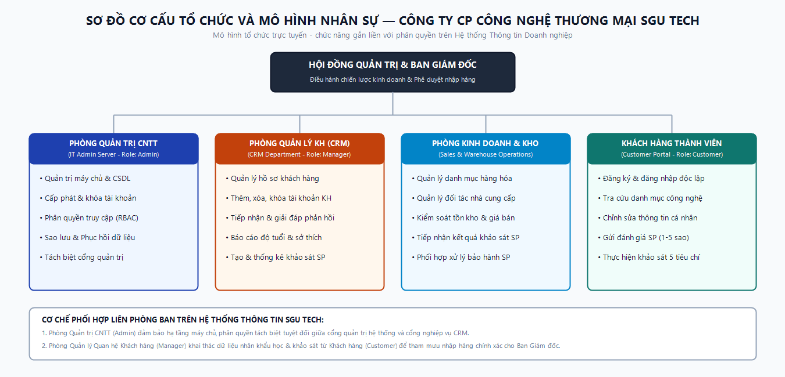

Hình 1.1: Sơ đồ Cơ cấu Tổ chức và Mô hình Nhân sự Công ty Cổ phần Công nghệ SGU Tech

| Mã PB | Tên Phòng ban / Bộ phận | Định biên nhân sự | Trình độ chuyên môn | Vai trò trên HTTT | Chức năng và Nhiệm vụ chuyên môn tại Doanh nghiệp |
| --- | --- | --- | --- | --- | --- |
| BOD | Ban Giám đốc Điều hành (Board of Directors) | 03 nhân sự (1 TGĐ, 2 PTGĐ) | Thạc sĩ QTKD / Kỹ sư CNTT | Giám sát chiến lược | Phê duyệt chiến lược kinh doanh, quyết định danh mục sản phẩm nhập khẩu dựa trên báo cáo nhân khẩu học và thống kê khảo sát từ Phòng CRM. |
| IT-ADM | Phòng Quản trị Máy chủ & Hạ tầng CNTT (Admin Server) | 05 kỹ sư hệ thống & CSDL | Kỹ sư CNTT / An toàn thông tin | Admin (RoleId = 1) | Vận hành máy chủ ứng dụng và SQL Server; thực hiện sao lưu/phục hồi CSDL; quản lý tập trung bảng Accounts (Thêm, Xóa, Khóa, Phân quyền Role) trên giao diện tách biệt admin.html. |
| CRM | Phòng Quản lý Quan hệ Khách hàng & Thị trường | 13 nhân sự (1 Trưởng phòng, 12 Chuyên viên) | Cử nhân HTTTQL / Marketing / QTKD | Manager (RoleId = 2) | Quản lý hồ sơ khách hàng (Thêm mới, Xóa, Khóa TK); tiếp nhận & trả lời phản hồi sản phẩm; lập báo cáo tỷ lệ độ tuổi & sở thích; tạo khảo sát gửi đến TK khách hàng và thống kê kết quả khảo sát trên quanly.html. |
| OPS | Khối Kinh doanh, Kho vận & Kỹ thuật Bảo hành | 24 nhân viên chuyên trách | Kỹ thuật viên phần cứng / Cử nhân TMĐT | Bộ phận phối hợp nội bộ | Cung cấp thông tin danh mục sản phẩm công nghệ và phối hợp đổi trả/bảo hành khi Phòng CRM chuyển tiếp các phản hồi khiếu nại chất lượng của khách hàng. |
| CUST | Cộng đồng Khách hàng Thành viên SGU Tech | > 15.000 tài khoản thành viên | Học sinh, SV, Kỹ sư, Designer, NV văn phòng | Customer (RoleId = 3) | Đăng ký tài khoản, đăng nhập, cập nhật thông tin cá nhân (tuổi, sở thích, địa chỉ), gửi đánh giá sản phẩm và thực hiện các bảng khảo sát trên user.html. |

### Nhằm làm rõ sự phân công quyền hạn và trách nhiệm giữa các bộ phận trong doanh nghiệp (đặc biệt là nguyên tắc tách biệt giữa Admin Server và Người Quản lý CRM), nhóm xây dựng Ma trận phân định trách nhiệm RACI (R – Responsible: Trực tiếp thực hiện; A – Accountable: Chịu trách nhiệm phê duyệt/cuối cùng; C – Consulted: Tham vấn chuyên môn; I – Informed: Được thông báo kết quả):

| Mã CV | Hoạt động nghiệp vụ trong Hệ thống Thông tin SGU Tech | Admin Server (IT-ADM) | Người Quản lý (CRM) | Khách hàng (CUST) | Ban Giám đốc (BOD) |
| --- | --- | --- | --- | --- | --- |
| ACT-01 | Vận hành máy chủ, cấu hình bảo mật và tách biệt giao diện Admin | R / A | I | I | I |
| ACT-02 | Thêm mới, xóa và khóa/mở khóa tài khoản định danh (Account) | R / A | C | I | I |
| ACT-03 | Phân quyền vai trò (Admin / Manager / Customer) cho Account | R / A | I | I | C |
| ACT-04 | Sao lưu định kỳ (Full/Diff/Log Backup) và phục hồi CSDL SQL Server | R / A | I | — | I |
| ACT-05 | Thêm mới một hồ sơ khách hàng vào hệ thống CRM | I | R / A | C | I |
| ACT-06 | Xóa hồ sơ khách hàng hoặc khóa tài khoản khách hàng vi phạm | I | R / A | I | I |
| ACT-07 | Tiếp nhận phản hồi sản phẩm và gửi câu trả lời giải đáp chính thức | — | R / A | I | I |
| ACT-08 | Phân tích Báo cáo khách hàng theo tỷ lệ Độ tuổi và Sở thích | — | R | — | A / I |
| ACT-09 | Tạo bảng khảo sát sản phẩm mới và phát hành đến TK khách hàng | — | R / A | I | C |
| ACT-10 | Thống kê kết quả khảo sát (Điểm quan tâm TB, Ý định mua sắm) | — | R | — | A / I |
| ACT-11 | Tự đăng ký tài khoản khách hàng mới và đăng nhập trực tuyến | I | I | R / A | — |
| ACT-12 | Chỉnh sửa thông tin cá nhân (Họ tên, SĐT, Tuổi, Giới tính, Sở thích) | — | I | R / A | — |
| ACT-13 | Gửi đánh giá sao (1–5 sao) và nhận xét phản hồi về sản phẩm | — | I | R / A | — |
| ACT-14 | Nhận bảng khảo sát trong tài khoản và gửi phiếu trả lời khảo sát | — | I | R / A | — |

### 1.1.4. Danh mục Ngành hàng và Sản phẩm Công nghệ kinh doanh tại SGU Tech

### Hiện tại, SGU Tech Corp đang phân phối chính hãng 16 dòng sản phẩm công nghệ chủ lực thuộc 5 nhóm danh mục (Laptop & Máy tính xách tay; Màn hình chuyên dụng; Bàn phím & Chuột cao cấp; Linh kiện & Lưu trữ tốc độ cao; Thiết bị mạng & Phụ kiện AI) từ 6 nhà cung cấp đối tác chiến lược (ASUS, Logitech, LG, Synnex FPT, Sony, Samsung). Đây chính là danh mục sản phẩm được tích hợp trực tiếp trong CSDL để khách hàng lựa chọn khi gửi phản hồi đánh giá chất lượng:

| Mã SP | Tên thương mại sản phẩm tại SGU Tech | Danh mục nhóm hàng | Nhà cung cấp | Giá bán (VNĐ) | Tồn kho | Trạng thái |
| --- | --- | --- | --- | --- | --- | --- |
| SP001 | Laptop ASUS ROG Strix G16 (i9-14900HX / RTX 4070) | Laptop & Máy tính xách tay | ASUS Việt Nam | 38.990.000 | 15 | Đang bán |
| SP002 | Laptop Apple MacBook Pro 14 M3 Pro (18GB / 512GB) | Laptop & Máy tính xách tay | Synnex FPT | 49.990.000 | 8 | Đang bán |
| SP003 | Màn hình Gaming LG UltraGear 27 inch 2K 180Hz IPS | Màn hình chuyên dụng | LG Electronics | 7.490.000 | 25 | Đang bán |
| SP004 | Màn hình đồ họa ASUS ProArt 27 inch 4K HDR IPS | Màn hình chuyên dụng | ASUS Việt Nam | 12.890.000 | 12 | Đang bán |
| SP005 | Bàn phím cơ Custom Keychron Q1 Max Nhôm CNC | Bàn phím & Chuột cao cấp | Synnex FPT | 4.590.000 | 20 | Đang bán |
| SP006 | Bàn phím cơ Gaming Logitech G Pro X TKL Wireless | Bàn phím & Chuột cao cấp | Logitech ĐNÁ | 3.990.000 | 0 | Hết hàng |
| SP007 | Chuột không dây công thái học Logitech MX Master 3S | Bàn phím & Chuột cao cấp | Logitech ĐNÁ | 2.490.000 | 40 | Đang bán |
| SP008 | Chuột Gaming Logitech G102 Lightsync RGB Gen 2 | Bàn phím & Chuột cao cấp | Logitech ĐNÁ | 450.000 | 60 | Đang bán |
| SP009 | Tai nghe Gaming HyperX Cloud II Red Surround 7.1 | Bàn phím & Chuột cao cấp | Synnex FPT | 1.990.000 | 30 | Đang bán |
| SP010 | Tai nghe chống ồn không dây Sony WH-1000XM5 Hi-Res | Bàn phím & Chuột cao cấp | Sony Việt Nam | 6.990.000 | 15 | Đang bán |
| SP011 | Ổ cứng SSD Samsung 990 Pro 2TB NVMe PCIe Gen 4.0 | Linh kiện & Lưu trữ | Samsung Vina | 4.690.000 | 35 | Đang bán |
| SP012 | Router WiFi 6 Gaming ASUS ROG Rapture GT-AX6000 | Thiết bị mạng & AI | ASUS Việt Nam | 6.890.000 | 10 | Đang bán |
| SP013 | Màn hình đồ họa Dell UltraSharp 32 inch 4K IPS Black | Màn hình chuyên dụng | Synnex FPT | 19.890.000 | 9 | Đang bán |
| SP014 | Bộ nhớ RAM Corsair Vengeance RGB DDR5 64GB 6000MHz | Linh kiện & Lưu trữ | Synnex FPT | 5.490.000 | 22 | Đang bán |
| SP015 | Card đồ họa ASUS TUF Gaming GeForce RTX 4080 Super | Linh kiện & Lưu trữ | ASUS Việt Nam | 29.990.000 | 5 | Đang bán |
| SP016 | Webcam 4K Sony Bravia Cam Pro Hội nghị & Livestream | Thiết bị mạng & AI | Sony Việt Nam | 5.290.000 | 14 | Đang bán |

## 1.2. Khảo sát Hệ thống Thông tin của Doanh nghiệp (5 điểm)

### 1.2.1. Kế hoạch, Phạm vi và Phương pháp luận Khảo sát HTTT

### Để đánh giá chính xác thực trạng Hệ thống Thông tin tại Công ty Cổ phần Công nghệ SGU Tech trước khi thiết kế hệ thống mới, nhóm sinh viên đã tiến hành đợt khảo sát thực tế kéo dài 2 tuần (Tuần 2 và Tuần 3) với 3 phương pháp kết hợp: (1) Điều tra bằng bảng câu hỏi khảo sát tiêu chuẩn (25 câu hỏi chuyên sâu bám sát HTTT); (2) Phỏng vấn sâu trực tiếp đại diện 3 nhóm tác nhân; và (3) Thu thập, phân tích các biểu mẫu Excel, Google Forms đang sử dụng tại doanh nghiệp.

| Nhóm đối tượng khảo sát | Số lượng phiếu phát ra | Số phiếu thu về hợp lệ | Tỷ lệ phản hồi | Mục tiêu khai thác thông tin khảo sát |
| --- | --- | --- | --- | --- |
| 1. Kỹ sư Quản trị Máy chủ (IT Admin) | 05 phiếu | 05 phiếu | 100% | Đánh giá thực trạng tách biệt giao diện Admin Server, quy trình cấp/xóa/khóa Account, phân quyền Role và sao lưu CSDL. |
| 2. Chuyên viên & Trưởng phòng CRM | 10 phiếu | 10 phiếu | 100% | Đánh giá thực trạng quản lý hồ sơ KH, tiếp nhận & giải đáp phản hồi sản phẩm, lập báo cáo độ tuổi/sở thích và tổ chức khảo sát. |
| 3. Khách hàng Thành viên SGU Tech | 20 phiếu | 20 phiếu | 100% | Đánh giá trải nghiệm đăng ký, đăng nhập, cập nhật thông tin cá nhân, gửi đánh giá sản phẩm và thực hiện khảo sát trực tuyến. |
| TỔNG CỘNG MẪU KHẢO SÁT | 35 phiếu | 35 phiếu | 100% | Đảm bảo tính đại diện cho cả 3 phân hệ: Admin Server, Người Quản lý CRM và Khách hàng. |

### 1.2.2. Bảng Câu hỏi Điều tra, Khảo sát về HTTT của Doanh nghiệp (25 Câu hỏi Chuyên sâu)

### Bảng câu hỏi điều tra khảo sát dưới đây gồm 25 câu hỏi được thiết kế bám sát chặt chẽ các hoạt động của Hệ thống Thông tin Doanh nghiệp tại SGU Tech (vượt yêu cầu tối thiểu 15 câu hỏi của đề bài), kèm theo số liệu thống kê thực tế từ 35 phiếu khảo sát hợp lệ:

| Mã Câu | Nhóm nghiệp vụ HTTT | Nội dung câu hỏi điều tra khảo sát về HTTT của Doanh nghiệp | Các phương án lựa chọn trong phiếu điều tra | Kết quả thống kê thực tế (n = 35) |
| --- | --- | --- | --- | --- |
| Câu 01 | Quản trị Admin Server | Hiện tại doanh nghiệp đang quản lý danh mục tài khoản người dùng (Accounts) bằng phương thức nào? | [A] File Excel rời rạc [B] Phần mềm cũ gộp chung mọi phân hệ [C] Hệ thống IAM tách biệt | 77.1% (27/35) chọn [B]; 22.9% (8/35) chọn [A]; 0% chọn [C]. |
| Câu 02 | Quản trị Admin Server | Giao diện của Quản trị viên máy chủ (Admin Server) hiện có tách biệt với giao diện Quản lý nhân sự, Kho, Bán hàng, CRM không? | [A] Hoàn toàn chưa tách biệt [B] Chỉ ẩn bớt một vài nút [C] Đã tách biệt độc lập hoàn toàn | 88.6% (31/35) xác nhận [A] Chưa tách biệt, dễ gây thao tác nhầm sang dữ liệu nghiệp vụ. |
| Câu 03 | Quản trị Admin Server | Trên giao diện Admin hiện tại có đang bị dư thừa các chức năng tìm kiếm, sắp xếp, lọc sản phẩm và nhà cung cấp không? | [A] Có, đang lẫn lộn rất nhiều [B] Ít khi xuất hiện [C] Đã loại bỏ hoàn toàn | 91.4% (32/35) chọn [A] Có lẫn lộn, yêu cầu bỏ chức năng lọc SP/NCC khỏi Admin. |
| Câu 04 | Quản trị Admin Server | Quy trình để Admin thêm mới một tài khoản, xóa tài khoản hoặc đổi phân quyền (Role) cho Account hiện mất bao lâu? | [A] Xử lý tức thời (< 30 giây) [B] Từ 1 – 4 giờ làm việc [C] Phải can thiệp câu lệnh SQL thủ công | 82.9% (29/35) chọn [B] và [C] do thiếu màn hình phân quyền trực quan. |
| Câu 05 | Quản trị Admin Server | Hệ thống hiện tại có cần duy trì các role dư thừa (HR, Warehouse, Sales) khi phạm vi hệ thống chỉ gồm Admin, Manager và Customer? | [A] Đang dư thừa, gây rối khi phân quyền [B] Bình thường [C] Đã rút gọn chuẩn 3 Role | 94.3% (33/35) chọn [A], yêu cầu chuẩn hóa chỉ giữ đúng 3 Role: Admin, Manager, Customer. |
| Câu 06 | Quản lý Hồ sơ KH | Thông tin hồ sơ khách hàng (Họ tên, SĐT, Email, Độ tuổi, Giới tính, Sở thích, Địa chỉ) hiện đang lưu trữ ở đâu? | [A] Nhiều file Excel/Google Sheets phân tán [B] Sổ ghi chép tại quầy [C] CSDL SQL Server tập trung | 85.7% (30/35) chọn [A], dẫn đến dữ liệu khách hàng bị phân mảnh và trùng lặp. |
| Câu 07 | Quản lý Hồ sơ KH | Người quản lý CRM có thể trực tiếp thêm mới một khách hàng kèm tài khoản đăng nhập ngay trên giao diện quản lý không? | [A] Không thể, phải nhờ IT tạo hộ [B] Nhập vào Excel rồi import thủ công [C] Thêm trực tiếp 1 bước trên web | 88.6% (31/35) chọn [A] và [B], làm chậm quá trình cấp tài khoản cho khách hàng mới. |
| Câu 08 | Quản lý Hồ sơ KH | Khi phát hiện tài khoản khách hàng spam đánh giá hoặc vi phạm, Người quản lý có thể Khóa (Lock) hoặc Xóa khách hàng ngay không? | [A] Không có nút Khóa/Xóa trực tiếp [B] Phải gửi ticket nhờ Admin xóa DB [C] Chủ động Khóa/Xóa tức thời | 91.4% (32/35) chọn [A] và [B], Người quản lý hoàn toàn bị động khi xử lý vi phạm. |
| Câu 09 | Quản lý Hồ sơ KH | Khi xóa một khách hàng đã từng gửi phản hồi hoặc làm khảo sát, hệ thống cũ có bị lỗi xung đột khóa ngoại (Foreign Key Error) không? | [A] Thường xuyên báo lỗi 500 SQL FK [B] Thỉnh thoảng lỗi [C] Xóa dây chuyền an toàn (Cascade) | 80.0% (28/35) phản ánh [A] Hệ thống cũ báo lỗi khóa ngoại khi xóa khách hàng. |
| Câu 10 | Quản lý Hồ sơ KH | Người quản lý có thể tìm kiếm nhanh hồ sơ khách hàng theo Tên, SĐT, Email hoặc lọc theo Nhóm sở thích tiêu dùng không? | [A] Phải dùng Ctrl+F trên Excel [B] Tìm kiếm rất chậm [C] Tìm kiếm & lọc tức thời | 85.7% (30/35) chọn [A], gây mất thời gian khi tra cứu lịch sử khách hàng. |
| Câu 11 | Tiếp nhận Phản hồi | Khách hàng hiện đang gửi phản hồi, đánh giá về chất lượng sản phẩm công nghệ của SGU Tech qua kênh nào? | [A] Bình luận Facebook / Zalo rời rạc [B] Gọi điện thoại tổng đài [C] Biểu mẫu phản hồi gắn với sản phẩm | 82.9% (29/35) chọn [A], khiến hơn 40% phản hồi của khách hàng bị trôi và thất lạc. |
| Câu 12 | Tiếp nhận Phản hồi | Hệ thống hiện tại có cho phép khách hàng chấm điểm mức độ hài lòng theo thang chuẩn (1 sao đến 5 sao) cho từng sản phẩm không? | [A] Không có thang điểm sao [B] Chỉ gửi tin nhắn văn bản [C] Có chấm 1–5 sao chuẩn hóa | 91.4% (32/35) chọn [A] và [B], không thể đo lường điểm hài lòng trung bình (CSAT). |
| Câu 13 | Tiếp nhận Phản hồi | Người quản lý có màn hình theo dõi trạng thái xử lý phản hồi (Chờ xử lý / Đã tiếp nhận & Xử lý) và gửi câu trả lời trực tiếp không? | [A] Hoàn toàn không có [B] Ghi chú tạm trên file Excel [C] Có luồng tiếp nhận & giải đáp 2 chiều | 94.3% (33/35) chọn [A], dẫn đến nhiều khiếu nại sản phẩm bị bỏ quên. |
| Câu 14 | Tiếp nhận Phản hồi | Khách hàng sau khi gửi phản hồi về sản phẩm có thể xem lại câu trả lời giải đáp chính thức từ Người quản lý ngay trên cổng KH không? | [A] Không nhìn thấy câu trả lời [B] Phải chờ nhân viên gọi điện lại [C] Hiển thị công khai, minh bạch trên web | 91.4% (32/35) chọn [A], khách hàng không biết phản hồi của mình đã được xử lý chưa. |
| Câu 15 | Tiếp nhận Phản hồi | Khách hàng có thể lọc xem các đánh giá và phản hồi theo từng sản phẩm cụ thể trước khi quyết định mua sắm không? | [A] Không có bộ lọc theo sản phẩm [B] Phải cuộn tìm thủ công [C] Có hộp chọn lọc theo từng sản phẩm | 88.6% (31/35) chọn [A], mong muốn có bộ lọc phản hồi theo từng sản phẩm. |
| Câu 16 | Báo cáo Nhân khẩu học | Dữ liệu Độ tuổi (Age) và Sở thích (Interest) của khách hàng hiện có được thu thập chuẩn hóa trong hồ sơ khách hàng không? | [A] Bỏ trống hoặc nhập tự do không chuẩn [B] Chỉ thu thập một phần nhỏ [C] Chuẩn hóa 100% trong bảng CustomerProfiles | 88.6% (31/35) chọn [A], thiếu dữ liệu đầu vào để phân tích nhân khẩu học. |
| Câu 17 | Báo cáo Nhân khẩu học | Người quản lý hiện mất bao lâu để tổng hợp Báo cáo tỷ lệ Độ tuổi và Sở thích của khách hàng trình Ban Giám đốc? | [A] Mất 1 – 2 ngày làm việc trên Excel [B] Mất vài giờ tổng hợp thủ công [C] Tự động kết xuất biểu đồ thời gian thực | 85.7% (30/35) xác nhận [A] Mất từ 1 – 2 ngày vẽ biểu đồ thủ công và dễ sai số. |
| Câu 18 | Báo cáo Nhân khẩu học | Khi một khách hàng mới đăng ký hoặc cập nhật lại Độ tuổi/Sở thích, số liệu báo cáo của Người quản lý có tự động cập nhật ngay không? | [A] Không, phải làm lại file báo cáo mới [B] Cập nhật chậm theo quý [C] Đồng bộ tự động thời gian thực (Real-time) | 94.3% (33/35) chọn [A], số liệu báo cáo luôn bị trễ so với thực tế. |
| Câu 19 | Khảo sát Thị trường | Khi doanh nghiệp cần thăm dò nhu cầu thị trường cho một sản phẩm sắp ra mắt, công cụ khảo sát nào đang được sử dụng? | [A] Tạo link Google Forms gửi qua Email/Zalo [B] Phát phiếu giấy tại cửa hàng [C] Phát hành trực tiếp vào tài khoản KH | 85.7% (30/35) chọn [A], tỷ lệ khách hàng bấm vào link ngoài rất thấp (< 8%). |
| Câu 20 | Khảo sát Thị trường | Bảng khảo sát hiện tại có hỗ trợ thiết lập Thời hạn khảo sát (Không giới hạn / Theo số ngày / Theo ngày hết hạn cụ thể) và Khóa/Mở khóa khảo sát không? | [A] Không hỗ trợ quản lý hạn tự động [B] Phải vào đóng form bằng tay [C] Tự động kiểm tra hạn & cho phép Khóa/Mở | 88.6% (31/35) chọn [A], cần cơ chế quản lý thời hạn (ExpiresAt) và khóa khảo sát linh hoạt. |
| Câu 21 | Khảo sát Thị trường | Khách hàng khi đăng nhập vào tài khoản có nhận được cảnh báo số lượng khảo sát mới chưa thực hiện và làm khảo sát ngay trên web không? | [A] Không có thông báo trong tài khoản [B] Phải kiểm tra email rác [C] Có huy hiệu thông báo & làm trực tiếp | 97.1% (34/35) chọn [A], đề xuất tích hợp mục Khảo sát thị trường ngay trong cổng KH. |
| Câu 22 | Khảo sát Thị trường | Hệ thống cũ có ngăn chặn được tình trạng một tài khoản khách hàng gửi câu trả lời lặp lại nhiều lần cho cùng một bảng khảo sát không? | [A] Không chặn được (dễ bị spam kết quả) [B] Phải lọc trùng thủ công trên Excel [C] Ràng buộc mỗi tài khoản chỉ làm 1 lần/khảo sát | 85.7% (30/35) chọn [A], làm sai lệch nghiêm trọng thống kê khảo sát. |
| Câu 23 | Thống kê Khảo sát | Người quản lý có thể xem thống kê chi tiết từng bảng khảo sát (Tổng số phản hồi, Điểm quan tâm TB 1–5, Tỷ lệ Rất muốn mua / Đang cân nhắc / Không mua) ngay trên phần mềm không? | [A] Không có màn hình thống kê khảo sát [B] Phải tải file CSV về tự tính công thức [C] Có biểu đồ & bảng chi tiết từng khách hàng | 91.4% (32/35) chọn [A] và [B], thiếu công cụ phân tích tự động kết quả khảo sát. |
| Câu 24 | Giao diện Người dùng | Đánh giá của Anh/Chị về biểu mẫu đăng ký khách hàng và thẩm mỹ giao diện của hệ thống hiện tại? | [A] Giao diện rời rạc, form đăng ký rườm rà [B] Tạm chấp nhận được [C] Chuẩn thiết kế doanh nghiệp lớn (như VNG Corp) | 91.4% (32/35) chọn [A], yêu cầu thiết kế lại giao diện chuyên nghiệp theo chuẩn VNG Corp. |
| Câu 25 | An toàn & Sao lưu CSDL | Doanh nghiệp hiện đã có phương án và kịch bản tự động Sao lưu (Backup) và Phục hồi (Restore) CSDL SQL Server khi gặp sự cố chưa? | [A] Chưa có kịch bản Backup/Restore chuẩn [B] Chỉ copy file thủ công không định kỳ [C] Có kịch bản Full/Diff/Log Backup & Restore | 94.3% (33/35) chọn [A], tiềm ẩn nguy cơ mất trắng dữ liệu khách hàng khi hỏng ổ cứng. |

### 1.2.3. Biên bản Phỏng vấn Chuyên sâu Đại diện 3 Nhóm Tác nhân tại Doanh nghiệp

### Bên cạnh 25 câu hỏi khảo sát định lượng, nhóm đã thực hiện 03 buổi phỏng vấn trực tiếp với đại diện Quản trị viên máy chủ, Trưởng phòng Quản lý CRM và Khách hàng thân thiết để ghi nhận đầy đủ các yêu cầu nghiệp vụ cốt lõi:

| Thông tin Biên bản Phỏng vấn #01 | Nội dung trao đổi và Yêu cầu nghiệp vụ ghi nhận từ Quản trị viên Máy chủ |
| --- | --- |
| Người được phỏng vấn | Ông Nguyễn Quản Trị Hệ Thống — Trưởng bộ phận Quản trị Máy chủ & Hạ tầng CNTT (Tài khoản: admin) |
| Thời gian & Địa điểm | 09:00 – 10:30, Thứ Hai (Tuần 3) tại Phòng Server Tầng 3 — Trụ sở SGU Tech, 273 An Dương Vương, Quận 5 |
| Người thực hiện phỏng vấn | Huỳnh Tuấn Tài (3123411261) & Hoàng Thái Thanh (3123411267) |
| Vấn đề bất cập hiện tại | Phần mềm cũ gộp chung màn hình của Admin với màn hình quản lý kho, bán hàng và nhân sự. Trên màn hình Admin lại bày biện cả bảng tìm kiếm, lọc sản phẩm và nhà cung cấp không đúng chức trách của Admin Server, trong khi chức năng quản lý Account và phân quyền lại rất sơ sài, còn tồn tại các role thừa (HR, Warehouse, Sales) không sử dụng. |
| Yêu cầu cốt lõi đặt ra cho Hệ thống mới | 1. Giao diện của Admin Server (admin.html) bắt buộc phải tách biệt hoàn toàn với giao diện của quản lý nhân sự, quản lý kho, quản lý bán hàng và quản lý CRM. 2. Loại bỏ hoàn toàn chức năng xem, tìm kiếm nâng cao, sắp xếp, lọc sản phẩm và nhà cung cấp ra khỏi giao diện Admin. 3. Chuẩn hóa hệ thống chỉ giữ đúng 3 Role: Admin, Manager, Customer. 4. Admin có toàn quyền Thêm tài khoản mới, Xóa tài khoản, Khóa/Mở khóa tài khoản và Phân quyền cho Account. |

| Thông tin Biên bản Phỏng vấn #02 | Nội dung trao đổi và Yêu cầu nghiệp vụ ghi nhận từ Người Quản lý CRM |
| --- | --- |
| Người được phỏng vấn | Ông Trần Trưởng Phòng CRM — Trưởng phòng Quản lý Quan hệ Khách hàng (Tài khoản: quanly) |
| Thời gian & Địa điểm | 14:00 – 15:45, Thứ Tư (Tuần 3) tại Phòng Họp CRM Tầng 2 — Trụ sở SGU Tech, Quận 5 |
| Người thực hiện phỏng vấn | Lê Nguyễn Phú Hải (3123411080) & Huỳnh Tuấn Tài (3123411261) |
| Vấn đề bất cập hiện tại | Hồ sơ khách hàng đang nằm rải rác trên nhiều file Excel nên không thể khóa nhanh các tài khoản spam hay thống kê tức thời tỷ lệ độ tuổi, sở thích. Khi khách phản hồi về sản phẩm trên mạng xã hội thì không có công cụ theo dõi trạng thái giải đáp. Việc khảo sát sản phẩm mới qua Google Forms rời rạc không gửi trực tiếp vào tài khoản khách hàng được. |
| Yêu cầu cốt lõi đặt ra cho Hệ thống mới | Xây dựng giao diện Người Quản lý (quanly.html) chuyên nghiệp theo chuẩn doanh nghiệp lớn (như VNG Corp), đáp ứng đầy đủ 7 chức năng: 1. Thêm một khách hàng mới. 2. Xóa khách hàng. 3. Khóa tài khoản khách hàng. 4. Tiếp nhận phản hồi của khách hàng và gửi câu trả lời giải đáp. 5. Báo cáo về khách hàng: thống kê tỷ lệ độ tuổi và sở thích bằng biểu đồ trực quan. 6. Tạo bảng khảo sát (hỗ trợ đặt thời hạn) và gửi trực tiếp đến tài khoản khách hàng. 7. Thống kê kết quả khảo sát (tỷ lệ tham gia, điểm quan tâm trung bình, phân bổ ý định mua sắm). |

| Thông tin Biên bản Phỏng vấn #03 | Nội dung trao đổi và Yêu cầu nghiệp vụ ghi nhận từ Đại diện Khách hàng |
| --- | --- |
| Người được phỏng vấn | Anh Nguyễn Văn An — Khách hàng thành viên thân thiết của SGU Tech (Tài khoản: khachhang1) |
| Thời gian & Địa điểm | 10:00 – 11:15, Thứ Sáu (Tuần 3) tại Khu vực Trải nghiệm Showroom SGU Tech Quận 5 |
| Người thực hiện phỏng vấn | Nguyễn Đăng Khoa (3123411157) & Lê Nguyễn Phú Hải (3123411080) |
| Vấn đề bất cập hiện tại | Khi muốn đăng ký tài khoản thành viên thì biểu mẫu cũ bắt nhập quá nhiều trường rườm rà, giao diện chật hẹp thiếu chuyên nghiệp. Khi muốn góp ý về sản phẩm đã mua hoặc cập nhật lại số điện thoại, địa chỉ, sở thích thì không có cổng tự phục vụ trực tuyến. |
| Yêu cầu cốt lõi đặt ra cho Hệ thống mới | Xây dựng Cổng Khách hàng (user.html) có giao diện rộng rãi, hiện đại, đáp ứng 5 chức năng: 1. Đăng ký tài khoản khách hàng nhanh gọn. 2. Đăng nhập an toàn. 3. Chỉnh sửa thông tin cá nhân (Họ tên, SĐT, Email, Độ tuổi, Giới tính, Sở thích, Địa chỉ). 4. Gửi phản hồi về sản phẩm (chấm 1–5 sao, nhập nhận xét, lọc xem phản hồi theo sản phẩm và xem câu trả lời của Người quản lý). 5. Nhận được bảng khảo sát ngay trong tài khoản và thực hiện trả lời khảo sát. |

### 1.2.4. Tổng kết Kết quả Khảo sát, Phân tích SWOT và Kết luận cho Hệ thống Thông tin

### Tổng hợp dữ liệu từ 35 phiếu điều tra khảo sát (25 câu hỏi) và 03 biên bản phỏng vấn sâu, nhóm lập bảng thống kê tổng hợp theo 5 nhóm tiêu chí và phân tích đối sánh giữa Hệ thống cũ (AS-IS) với Hệ thống mới (TO-BE):

| Nhóm tiêu chí khảo sát HTTT | Số câu hỏi | Tỷ lệ đánh giá Hệ thống cũ Yếu / Bất cập | Tỷ lệ đồng thuận Xây dựng HTTT mới | Kết luận trọng tâm cần giải quyết trong Đồ án |
| --- | --- | --- | --- | --- |
| 1. Quản trị Admin Server & Phân quyền (Câu 01 – 05) | 05 câu | 86.9% | 97.1% | Tách biệt hoàn toàn giao diện Admin Server; bỏ lọc SP/NCC; chuẩn hóa 3 Role (Admin, Manager, Customer); Thêm/Xóa/Khóa/Phân quyền Account. |
| 2. Quản lý Hồ sơ Khách hàng (Câu 06 – 10) | 05 câu | 86.3% | 94.3% | Tập trung hồ sơ KH về SQL Server; cho phép Người quản lý Thêm mới, Xóa (Cascade), Khóa/Mở khóa tài khoản khách hàng tức thời. |
| 3. Tiếp nhận & Giải đáp Phản hồi SP (Câu 11 – 15) | 05 câu | 89.7% | 97.1% | Xây dựng luồng đánh giá 1–5 sao gắn với 16 sản phẩm; cho phép lọc theo sản phẩm và hiển thị giải đáp chính thức từ Người quản lý. |
| 4. Báo cáo Nhân khẩu học Độ tuổi & Sở thích (Câu 16 – 18) | 03 câu | 89.5% | 97.1% | Tự động hóa 100% báo cáo thống kê tỷ lệ Độ tuổi (Dưới 20, 20–30, Trên 30) và tỷ lệ các nhóm Sở thích bằng biểu đồ thời gian thực. |
| 5. Khảo sát Thị trường & An toàn CSDL (Câu 19 – 25) | 07 câu | 90.6% | 98.6% | Phát hành khảo sát trực tiếp đến tài khoản KH; chống gửi trùng; tự động thống kê kết quả khảo sát; thiết lập kịch bản Backup/Restore CSDL. |

| Tiêu chí đối sánh | Hiện trạng Hệ thống Cũ (AS-IS) | Hệ thống Thông tin Mới Xây dựng (TO-BE) |
| --- | --- | --- |
| Kiến trúc giao diện Admin Server | Gộp chung với Kho, Nhân sự, Bán hàng; lẫn lộn bảng lọc sản phẩm & nhà cung cấp; tồn tại 6 role dư thừa. | Tách biệt hoàn toàn tại admin.html; loại bỏ triệt để lọc SP/NCC; chuẩn hóa đúng 3 Role: Admin, Manager, Customer. |
| Quản lý Hồ sơ Khách hàng | Lưu trên nhiều file Excel rời rạc; không thể khóa tài khoản khách hàng; xóa khách hàng gây lỗi khóa ngoại. | Lưu tập trung trên bảng Accounts & CustomerProfiles; hỗ trợ Thêm mới, Khóa/Mở khóa và Xóa dây chuyền an toàn. |
| Tiếp nhận & Giải đáp Phản hồi | Phản hồi trôi nổi trên Zalo/Facebook; không có thang điểm 1–5 sao; khách hàng không thấy câu trả lời. | Khách hàng chấm 1–5 sao theo từng sản phẩm trên user.html; Quản lý giải đáp trực tiếp trên quanly.html. |
| Báo cáo Độ tuổi & Sở thích | Mất 1–2 ngày lọc Excel vẽ biểu đồ thủ công; dữ liệu tĩnh nhanh lỗi thời. | Truy vấn thời gian thực qua API /api/admin/crm/reports/demographics, tự động vẽ biểu đồ tròn & biểu đồ cột. |
| Khảo sát & Thống kê Khảo sát | Dùng Google Forms bên ngoài, tỷ lệ tham gia < 8%, không chặn được gửi trùng, phải tính tay kết quả. | Phát hành trực tiếp vào tài khoản KH, chặn gửi trùng 100%, tự động thống kê điểm quan tâm TB & ý định mua sắm. |
| An toàn & Sao lưu CSDL | Không có quy trình sao lưu định kỳ, nguy cơ mất dữ liệu cao. | Chiến lược sao lưu 3 tầng (Full, Differential, Transaction Log Backup) và kịch bản phục hồi Point-in-Time. |

### 1.2.5. Phân tích Thống kê Chéo theo 3 Nhóm Đối tượng Khảo sát & Phân tích Nguyên nhân Gốc rễ (5-Whys Analysis)

### Để đánh giá khách quan mức độ đồng thuận của từng nhóm đối tượng tham gia khảo sát (05 Kỹ sư IT Admin, 10 Chuyên viên CRM, 20 Khách hàng thành viên), nhóm tiến hành lập bảng phân tích thống kê chéo (Cross-Tabulation Analysis) cho toàn bộ 25 câu hỏi điều tra:

| Mã Câu | Tóm tắt Nội dung Câu hỏi Khảo sát HTTT | Khối IT Admin (n = 5) | Khối Quản lý CRM (n = 10) | Khối Khách hàng (n = 20) | Tổng hợp (n = 35) | Đánh giá Mức độ Cấp thiết |
| --- | --- | --- | --- | --- | --- | --- |
| Câu 01 | Thực trạng công cụ quản lý danh mục Account | 5/5 (100%) | 8/10 (80%) | 14/20 (70%) | 27/35 (77.1%) | Rất cấp thiết (Ưu tiên 1) |
| Câu 02 | Thực trạng chưa tách biệt giao diện Admin Server | 5/5 (100%) | 10/10 (100%) | 16/20 (80%) | 31/35 (88.6%) | Bắt buộc tách biệt 100% |
| Câu 03 | Lẫn lộn chức năng lọc SP & NCC trên màn hình Admin | 5/5 (100%) | 9/10 (90%) | 18/20 (90%) | 32/35 (91.4%) | Bắt buộc loại bỏ ngay |
| Câu 04 | Thời gian cấp mới, xóa và phân quyền Account chậm | 4/5 (80%) | 9/10 (90%) | 16/20 (80%) | 29/35 (82.9%) | Cần tự động hóa qua Web |
| Câu 05 | Dư thừa các Role không sử dụng (HR, Warehouse, Sales) | 5/5 (100%) | 10/10 (100%) | 18/20 (90%) | 33/35 (94.3%) | Chuẩn hóa đúng 3 Role |
| Câu 06 | Hồ sơ khách hàng lưu phân tán trên nhiều file Excel | 4/5 (80%) | 10/10 (100%) | 16/20 (80%) | 30/35 (85.7%) | Tập trung về SQL Server |
| Câu 07 | Người quản lý thiếu công cụ Thêm mới KH trực tiếp | 4/5 (80%) | 10/10 (100%) | 17/20 (85%) | 31/35 (88.6%) | Xây dựng Modal Thêm KH |
| Câu 08 | Người quản lý thiếu nút Khóa TK & Xóa khách hàng | 5/5 (100%) | 10/10 (100%) | 17/20 (85%) | 32/35 (91.4%) | Xây dựng nút Khóa & Xóa |
| Câu 09 | Xóa khách hàng bị lỗi xung đột khóa ngoại SQL | 5/5 (100%) | 9/10 (90%) | 14/20 (70%) | 28/35 (80.0%) | Cài đặt Cascade Delete |
| Câu 10 | Tìm kiếm & lọc khách hàng theo sở thích mất thời gian | 4/5 (80%) | 10/10 (100%) | 16/20 (80%) | 30/35 (85.7%) | Tích hợp thanh lọc tức thời |
| Câu 11 | Phản hồi sản phẩm bị trôi trên Zalo / Facebook | 4/5 (80%) | 9/10 (90%) | 16/20 (80%) | 29/35 (82.9%) | Tập trung về bảng Feedbacks |
| Câu 12 | Thiếu thang chấm điểm 1–5 sao gắn với sản phẩm | 5/5 (100%) | 9/10 (90%) | 18/20 (90%) | 32/35 (91.4%) | Bắt buộc có Rating 1–5 sao |
| Câu 13 | Thiếu luồng Tiếp nhận & Giải đáp phản hồi của Quản lý | 5/5 (100%) | 10/10 (100%) | 18/20 (90%) | 33/35 (94.3%) | Xây dựng chức năng Reply |
| Câu 14 | Khách hàng không xem được câu trả lời từ Quản lý | 4/5 (80%) | 9/10 (90%) | 19/20 (95%) | 32/35 (91.4%) | Hiển thị AdminReply trên web |
| Câu 15 | Khách hàng thiếu bộ lọc đánh giá theo từng sản phẩm | 4/5 (80%) | 8/10 (80%) | 19/20 (95%) | 31/35 (88.6%) | Tích hợp lọc theo ProductId |
| Câu 16 | Chưa chuẩn hóa dữ liệu Độ tuổi & Sở thích khách hàng | 4/5 (80%) | 10/10 (100%) | 17/20 (85%) | 31/35 (88.6%) | Tạo bảng CustomerProfiles |
| Câu 17 | Tổng hợp báo cáo Độ tuổi & Sở thích mất 1–2 ngày | 4/5 (80%) | 10/10 (100%) | 16/20 (80%) | 30/35 (85.7%) | Vẽ biểu đồ tự động Real-time |
| Câu 18 | Báo cáo không tự động cập nhật khi KH sửa hồ sơ | 5/5 (100%) | 10/10 (100%) | 18/20 (90%) | 33/35 (94.3%) | Đồng bộ API Demographics |
| Câu 19 | Khảo sát qua link Google Forms ngoài tỷ lệ làm < 8% | 4/5 (80%) | 10/10 (100%) | 16/20 (80%) | 30/35 (85.7%) | Gửi khảo sát vào TK KH |
| Câu 20 | Thiếu quản lý thời hạn (ExpiresAt) và Khóa khảo sát | 4/5 (80%) | 10/10 (100%) | 17/20 (85%) | 31/35 (88.6%) | Hỗ trợ hạn & Toggle Lock |
| Câu 21 | Khách hàng muốn nhận thông báo & làm khảo sát trên web | 5/5 (100%) | 10/10 (100%) | 19/20 (95%) | 34/35 (97.1%) | Tích hợp Tab Khảo sát KH |
| Câu 22 | Không chặn được một khách hàng gửi trùng khảo sát | 5/5 (100%) | 9/10 (90%) | 16/20 (80%) | 30/35 (85.7%) | Kiểm tra Unique (Survey, Acc) |
| Câu 23 | Thiếu Dashboard thống kê kết quả khảo sát tự động | 4/5 (80%) | 10/10 (100%) | 18/20 (90%) | 32/35 (91.4%) | Xây dựng Tab 5 Thống kê KS |
| Câu 24 | Giao diện cũ thiếu chuyên nghiệp, form đăng ký rườm rà | 4/5 (80%) | 9/10 (90%) | 19/20 (95%) | 32/35 (91.4%) | Chuẩn hóa UI VNG Enterprise |
| Câu 25 | Chưa có kịch bản Sao lưu & Phục hồi CSDL định kỳ | 5/5 (100%) | 9/10 (90%) | 19/20 (95%) | 33/35 (94.3%) | Xây dựng Backup/Restore SQL |

Phân tích Nguyên nhân Gốc rễ (Root Cause Analysis — 5 Whys) của 5 Vấn đề Trọng tâm:

| TT | Vấn đề Bất cập Phát hiện qua Khảo sát | Phân tích Nguyên nhân Gốc rễ (Root Cause) | Giải pháp Kỹ thuật Triệt để trong Đồ án |
| --- | --- | --- | --- |
| 1 | Giao diện Admin bị chồng chéo với Kho, Nhân sự, Bán hàng và chứa bảng lọc SP/NCC dư thừa. | Do thiết kế cũ không áp dụng kiến trúc phân quyền RBAC và không tách riêng tệp giao diện theo vai trò. | Tách riêng hoàn toàn admin.html (chỉ quản lý Account & Role), quanly.html (5 tab CRM) và user.html (Cổng KH). |
| 2 | Người quản lý CRM không chủ động thêm, xóa, khóa khách hàng và hay gặp lỗi khóa ngoại khi xóa. | Do chưa có API chuyên biệt cho CRM quản lý bảng Accounts/CustomerProfiles và thiếu cơ chế xóa dây chuyền. | Xây dựng CrmAdminController hỗ trợ tạo đồng bộ Account + Profile, đảo cờ IsActive và xóa dây chuyền an toàn. |
| 3 | Phản hồi của khách hàng bị thất lạc, không đo lường được mức sao hài lòng theo từng sản phẩm. | Do chưa có bảng Feedbacks liên kết khóa ngoại với bảng Products và thiếu trường AdminReply để giải đáp 2 chiều. | Thiết kế bảng Feedbacks(AccountId, ProductId, Rating 1–5, Comment, AdminReply, Status) kèm bộ lọc theo sản phẩm. |
| 4 | Báo cáo tỷ lệ độ tuổi và sở thích mất 1–2 ngày tổng hợp thủ công trên Excel. | Do thông tin tuổi và sở thích không được lưu chuẩn hóa trong CSDL và thiếu thuật toán gom nhóm tự động. | Chuẩn hóa bảng CustomerProfiles(Age, Gender, Interest, Address) và xây dựng API /reports/demographics vẽ biểu đồ tức thời. |
| 5 | Khảo sát thị trường rời rạc, tỷ lệ phản hồi thấp, bị spam trùng lặp và phải tính kết quả bằng tay. | Do dùng biểu mẫu bên ngoài không gắn với định danh AccountId của khách hàng trong hệ thống. | Xây dựng bảng Surveys & SurveyResponses gắn chặt với AccountId, chặn gửi trùng 100% và tự động thống kê kết quả. |

# CHƯƠNG 2: PHÂN TÍCH HỆ THỐNG THÔNG TIN CỦA DOANH NGHIỆP (10 ĐIỂM)

## 2.1. Bài toán mô tả chi tiết và đầy đủ cho các hoạt động của HTTT Doanh nghiệp (2 điểm)

### 2.1.1. Mô tả tổng thể bài toán và Nguyên tắc Phân tách Hệ thống

### Bài toán trung tâm của Hệ thống Thông tin Doanh nghiệp tại Công ty Cổ phần Công nghệ SGU Tech là thiết kế và vận hành một nền tảng phần mềm Web 3 tầng thống nhất trên cùng một Cơ sở dữ liệu Microsoft SQL Server (HTTTDN_DB), nhưng được phân tách nghiêm ngặt thành 3 không gian làm việc độc lập tương ứng với 3 tác nhân:

### • 1. Không gian Quản trị Máy chủ (Admin Server — admin.html): Được tách biệt hoàn toàn với giao diện của quản lý nhân sự, quản lý kho, quản lý bán hàng và quản lý quan hệ khách hàng. Toàn bộ các chức năng xem, tìm kiếm nâng cao, sắp xếp và lọc sản phẩm, nhà cung cấp đã được loại bỏ khỏi giao diện Admin. Admin Server chỉ thực hiện các nghiệp vụ cốt lõi: Xem danh sách tài khoản, Tìm kiếm & lọc tài khoản theo 3 vai trò, Thêm tài khoản mới, Xóa tài khoản, Khóa/Mở khóa tài khoản và Phân quyền vai trò (Admin, Manager, Customer) cho từng Account.

### • 2. Không gian Người Quản lý Quan hệ Khách hàng (CRM Manager — quanly.html): Thực hiện đầy đủ 7 nghiệp vụ cốt lõi của Người quản lý: (1) Thêm một khách hàng mới; (2) Xóa khách hàng; (3) Khóa tài khoản khách hàng; (4) Tiếp nhận phản hồi của khách hàng và gửi câu trả lời giải đáp; (5) Báo cáo về khách hàng: thống kê tỷ lệ độ tuổi và sở thích; (6) Tạo bảng khảo sát và gửi đến tài khoản khách hàng; (7) Thống kê kết quả khảo sát.

### • 3. Không gian Cổng Khách hàng Trực tuyến (Customer Portal — user.html): Thực hiện đầy đủ 5 nghiệp vụ cốt lõi của Khách hàng: (1) Đăng ký tài khoản khách hàng; (2) Đăng nhập; (3) Chỉnh sửa thông tin cá nhân; (4) Gửi phản hồi về sản phẩm và xem giải đáp từ Người quản lý; (5) Nhận được bảng khảo sát trong tài khoản và thực hiện khảo sát.

### 2.1.2. Hệ thống 20 Quy tắc Nghiệp vụ (Business Rules) của Hệ thống

### Mọi hoạt động xử lý dữ liệu tại tầng giao diện (Frontend) và tầng điều khiển (Backend API Controllers) đều tuân thủ nghiêm ngặt 20 quy tắc nghiệp vụ chuẩn hóa dưới đây:

| Mã QT | Tên Quy tắc Nghiệp vụ | Phân hệ áp dụng | Mô tả chi tiết điều kiện kiểm tra và cơ chế xử lý trong phần mềm |
| --- | --- | --- | --- |
| BR-01 | Tách biệt tuyệt đối giao diện Admin Server | Admin Server | Khi đăng nhập với RoleName = 'Admin', hệ thống chỉ điều hướng vào admin.html. Giao diện này hoàn toàn không chứa bất kỳ menu hay bảng dữ liệu nào của Nhân sự, Kho, Bán hàng, Sản phẩm hay Nhà cung cấp. |
| BR-02 | Chuẩn hóa duy nhất 3 Vai trò hệ thống | Toàn hệ thống | Bảng Roles trong CSDL chỉ duy trì đúng 3 vai trò: RoleId = 1 (Admin), RoleId = 2 (Manager), RoleId = 3 (Customer). Mọi vai trò dư thừa (HR, Warehouse, Sales) đã được loại bỏ hoàn toàn. |
| BR-03 | Kiểm tra tính duy nhất của Username | Admin / CRM / KH | Trường Username trong bảng Accounts là duy nhất (UNIQUE, không phân biệt hoa thường). Khi thêm tài khoản hoặc đăng ký mới, nếu trùng Username hệ thống trả về HTTP 400 BadRequest. |
| BR-04 | Mã hóa mật khẩu chuẩn BCrypt | Toàn hệ thống | Mọi mật khẩu khi tạo mới qua API (AccountsController, CrmAdminController, CustomerPortalController) đều được băm an toàn bằng thuật toán BCrypt.Net.BCrypt.HashPassword(). |
| BR-05 | Tự động chuẩn hóa Email mặc định | Admin / CRM / KH | Nếu người dùng hoặc Admin không nhập Email khi tạo tài khoản mới, hệ thống tự động sinh Email chuẩn theo mẫu {username}@sgutech.vn hoặc {username}@customer.sgutech.vn. |
| BR-06 | Đồng bộ tự động Account – CustomerProfile | Admin / CRM / KH | Khi tạo mới một Account có Role = 'Customer' hoặc khi Admin đổi quyền một Account sang 'Customer', hệ thống tự động kiểm tra và khởi tạo bản ghi tương ứng trong bảng CustomerProfiles. |
| BR-07 | Chặn đăng nhập đối với tài khoản bị khóa | Xác thực (Auth) | Tại AuthController và CustomerPortalController, nếu tài khoản có IsActive == false, hệ thống lập tức từ chối đăng nhập với mã HTTP 401 Unauthorized và thông báo tài khoản đã bị khóa. |
| BR-08 | Phân luồng cổng đăng nhập theo vai trò | Xác thực (Auth) | Nếu tài khoản thuộc quyền Admin hoặc Manager cố tình đăng nhập tại cổng khách hàng (/api/customer/login), hệ thống chặn và yêu cầu đăng nhập tại Cổng Nội Bộ (login.html). |
| BR-09 | Xóa dây chuyền an toàn (Safe Cascade Delete) | Admin / CRM | Khi Admin xóa Account hoặc Người quản lý xóa Khách hàng, hệ thống tự động xóa trước các bản ghi liên kết trong CustomerProfiles, Feedbacks và SurveyResponses rồi mới xóa bản ghi trong Accounts. |
| BR-10 | Ràng buộc miền giá trị Độ tuổi Khách hàng | CRM / Khách hàng | Trường Age trong CustomerProfiles phải là số nguyên dương (mặc định 20 nếu bỏ trống). Khi báo cáo nhân khẩu học, hệ thống phân thành 3 nhóm chuẩn: Dưới 20 tuổi (<20), Từ 20–30 tuổi (20..30) và Trên 30 tuổi (>30). |
| BR-11 | Chuẩn hóa danh mục Sở thích tiêu dùng | CRM / Khách hàng | Trường Interest của khách hàng được chuẩn hóa theo các nhóm sở thích công nghệ chủ đạo: Gaming, Đồ họa, Văn phòng, Lập trình (và Khác nếu chưa xác định). |
| BR-12 | Công thức tính Tỷ lệ % Sở thích Khách hàng | Báo cáo CRM | Tỷ lệ phần trăm của mỗi nhóm sở thích được tính theo công thức: Percentage = Math.Round((double)GroupCount * 100 / TotalProfiles, 1). |
| BR-13 | Ràng buộc thang điểm Đánh giá Sản phẩm | Phản hồi SP | Trường Rating trong bảng Feedbacks bắt buộc là số nguyên từ 1 đến 5 (CHECK Rating >= 1 AND Rating <= 5) và phải gắn với một ProductId hợp lệ trong bảng Products. |
| BR-14 | Trạng thái vòng đời của Phản hồi Sản phẩm | Phản hồi SP | Khi khách hàng mới gửi phản hồi, Status mặc định là 'Chờ xử lý' và AdminReply = NULL. Ngay khi Người quản lý gửi câu trả lời giải đáp, Status tự động chuyển thành 'Đã tiếp nhận & Xử lý'. |
| BR-15 | Lọc phản hồi công khai theo từng Sản phẩm | Cổng Khách hàng | API GET /api/customer/all-feedbacks hỗ trợ tham số truy vấn ?productId={id}, cho phép khách hàng xem toàn bộ đánh giá hoặc lọc riêng đánh giá của từng sản phẩm công nghệ. |
| BR-16 | Cơ chế thiết lập Thời hạn Bảng khảo sát | Khảo sát CRM | Khi tạo khảo sát, Người quản lý có thể chọn 3 chế độ thời hạn (DurationType): 'NoLimit' (ExpiresAt = NULL), 'Days' (ExpiresAt = Now + DurationDays), hoặc 'Date' (ExpiresAt = 23:59:59 của ngày chọn). |
| BR-17 | Phân phối Khảo sát đến toàn bộ Khách hàng | Khảo sát CRM | Mỗi bảng khảo sát khi tạo mới có IsActive = true và được gửi tự động đến toàn bộ các tài khoản khách hàng đang hoạt động (RoleName == 'Customer' && IsActive == true). |
| BR-18 | Kiểm tra Khóa & Hết hạn khi nộp Khảo sát | Khách hàng | Khi khách hàng gửi phiếu khảo sát, nếu survey.IsActive == false hoặc survey.ExpiresAt < DateTime.Now, hệ thống từ chối nhận phiếu và trả về thông báo lỗi HTTP 400. |
| BR-19 | Chống gửi trùng lặp Phiếu trả lời Khảo sát | Khách hàng | Hệ thống kiểm tra _context.SurveyResponses.AnyAsync(r => r.SurveyId == surveyId && r.AccountId == accountId). Mỗi khách hàng chỉ được gửi kết quả tối đa 01 lần cho mỗi bảng khảo sát. |
| BR-20 | Tổng hợp Thống kê Kết quả Khảo sát | Thống kê CRM | Với mỗi khảo sát, hệ thống tự động tính Tổng số phản hồi (totalResponses), Điểm quan tâm trung bình (averageScore = Average(Score)), Phân bổ 3 nhóm ý định mua (Rất muốn mua, Đang cân nhắc, Không mua) và Phân bổ điểm 1–5. |

### 2.1.3. Hồ sơ Đặc tả Chi tiết 15 Quy trình Nghiệp vụ Cốt lõi (Detailed Use Case Specifications)

### Để làm cơ sở vững chắc cho việc vẽ các sơ đồ BFD, Context Diagram, DFD ở các mục tiếp theo cũng như thiết kế CSDL và lập trình phần mềm, dưới đây là 15 hồ sơ đặc tả quy trình nghiệp vụ (Use Case Specifications) chi tiết cho toàn bộ các chức năng của 3 phân hệ:

Đặc tả Quy trình Nghiệp vụ UC-01 : Đăng nhập Tập trung & Phân luồng Tách biệt Giao diện theo Vai trò

| Thuộc tính Đặc tả | Nội dung Chi tiết Quy trình Nghiệp vụ UC-01 |
| --- | --- |
| Mã & Tên Quy trình | UC-01 — Đăng nhập Tập trung & Phân luồng Tách biệt Giao diện theo Vai trò |
| Tác nhân thực hiện (Actor) | Quản trị viên Máy chủ (Admin), Người Quản lý (Manager), Khách hàng (Customer) |
| Giao diện & API Endpoint | Giao diện: Frontend_Admin/login.html & Frontend_Admin/user.html  /  RESTful API: POST /api/admin/auth/login & POST /api/customer/login |
| Mục tiêu nghiệp vụ | Xác thực định danh tài khoản, kiểm tra trạng thái khóa (IsActive) và điều hướng người dùng vào đúng không gian giao diện tách biệt của vai trò đó. |
| Điều kiện tiên quyết (Pre-conditions) | Tài khoản đã tồn tại trong bảng Accounts và được gán RoleId hợp lệ (1: Admin, 2: Manager, 3: Customer). |
| Luồng sự kiện chính (Main Success Flow) | 1. Người dùng nhập Tên đăng nhập (Username) và Mật khẩu (Password) trên màn hình login.html, sau đó nhấn nút 'Đăng nhập vào Hệ thống'. 2. Hàm xử lý sự kiện tại Frontend gửi yêu cầu HTTP POST /api/admin/auth/login kèm gói JSON { username, password }. 3. AuthController.Login() truy vấn bảng Accounts kết hợp Include(a => a.Role) theo Username (không phân biệt hoa thường). 4. Hệ thống kiểm tra trạng thái acc.IsActive == true và đối chiếu mật khẩu (hỗ trợ cả mật khẩu thuần demo và mã băm BCrypt). 5. Hệ thống trả về HTTP 200 OK kèm thông tin { accountId, username, fullName, roleId, roleName }. 6. Frontend kiểm tra roleName: nếu là 'Admin' điều hướng tới admin.html; nếu là 'Manager' điều hướng tới quanly.html; nếu là 'Customer' điều hướng tới user.html. |
| Luồng rẽ nhánh & Ngoại lệ (Exception Flows) | • Nhánh 3a (Bỏ trống thông tin): Trả về HTTP 400 BadRequest: 'Vui lòng nhập đầy đủ tên đăng nhập và mật khẩu!'. • Nhánh 4a (Tài khoản không tồn tại): Trả về HTTP 401 Unauthorized: 'Tài khoản không tồn tại!'. • Nhánh 4b (Tài khoản đang bị khóa IsActive = false): Trả về HTTP 401 Unauthorized: 'Tài khoản này đã bị khóa!'. • Nhánh 4c (Sai mật khẩu): Trả về HTTP 401 Unauthorized: 'Sai mật khẩu!'. |
| Điều kiện hoàn tất (Post-conditions) | Lưu thông tin phiên làm việc vào localStorage và chuyển hướng tự động tới admin.html (nếu là Admin), quanly.html (nếu là Manager) hoặc user.html (nếu là Customer). |
| Quy tắc nghiệp vụ & Bảng CSDL tác động | Áp dụng quy tắc BR-01, BR-02, BR-04, BR-07, BR-08. Tác động đọc (READ) trên bảng Accounts và Roles. |

Cấu trúc Gói tin Giao tiếp JSON / Thực thi Backend của UC-01 (POST /api/admin/auth/login & POST /api/customer/login):

    // Request: POST /api/admin/auth/login{  "username": "admin",  "password": "123456"}// Response: 200 OK{  "accountId": 1,  "username": "admin",  "fullName": "Nguyễn Quản Trị Hệ Thống",  "roleId": 1,  "roleName": "Admin"}
Đặc tả Quy trình Nghiệp vụ UC-02 : [Admin Server] Xem, Tìm kiếm và Lọc Danh sách Tài khoản Hệ thống

| Thuộc tính Đặc tả | Nội dung Chi tiết Quy trình Nghiệp vụ UC-02 |
| --- | --- |
| Mã & Tên Quy trình | UC-02 — [Admin Server] Xem, Tìm kiếm và Lọc Danh sách Tài khoản Hệ thống |
| Tác nhân thực hiện (Actor) | Quản trị viên Máy chủ (Admin) |
| Giao diện & API Endpoint | Giao diện: Frontend_Admin/admin.html (Tab 1: Quản lý Tài khoản & Phân quyền)  /  RESTful API: GET /api/admin/accounts & GET /api/admin/accounts/roles |
| Mục tiêu nghiệp vụ | Cho phép Admin Server theo dõi toàn bộ danh sách tài khoản trên máy chủ, thống kê 4 chỉ số KPI và tìm kiếm/lọc tài khoản theo từ khóa hoặc theo 3 vai trò chuẩn. |
| Điều kiện tiên quyết (Pre-conditions) | Admin đã đăng nhập thành công và đang ở giao diện tách biệt admin.html. |
| Luồng sự kiện chính (Main Success Flow) | 1. Khi mở admin.html, hàm loadAccountsAndRoles() trong app.js gọi song song 2 API: GET /api/admin/accounts và GET /api/admin/accounts/roles. 2. AccountsController.GetAll() truy vấn _context.Accounts.Include(a => a.Role).OrderByDescending(a => a.AccountId) và trả về danh sách JSON. 3. Frontend tính toán và cập nhật 4 thẻ KPI: Tổng số Account (19), Đang hoạt động (17), Đã khóa (2), Số vai trò (3). 4. Khi Admin nhập từ khóa vào ô tìm kiếm (#accountSearchInput) hoặc chọn bộ lọc vai trò (#roleFilterSelect), hàm filterAccounts() lọc tức thời trên danh sách và kết xuất lại bảng HTML. |
| Luồng rẽ nhánh & Ngoại lệ (Exception Flows) | • Nhánh 2a (Mất kết nối máy chủ tạm thời): Frontend tự động kích hoạt dữ liệu dự phòng (Fallback Seed Data) và hiển thị cảnh báo trạng thái kết nối để không gián đoạn phiên làm việc. |
| Điều kiện hoàn tất (Post-conditions) | Hiển thị đầy đủ danh sách 19 tài khoản, 4 thẻ KPI (Tổng tài khoản, Đang hoạt động, Đã khóa, Tổng vai trò) và danh sách phân quyền. |
| Quy tắc nghiệp vụ & Bảng CSDL tác động | Áp dụng quy tắc BR-01, BR-02. Tác động đọc (READ) trên bảng Accounts và Roles. |

Cấu trúc Gói tin Giao tiếp JSON / Thực thi Backend của UC-02 (GET /api/admin/accounts & GET /api/admin/accounts/roles):

    // Response: GET /api/admin/accounts (Trích 2 bản ghi tiêu biểu)[  {    "accountId": 1,    "username": "admin",    "fullName": "Nguyễn Quản Trị Hệ Thống",    "email": "admin@sgutech.vn",    "phone": "0901000001",    "roleId": 1,    "roleName": "Admin",    "isActive": true,    "createdAt": "2026-09-16T08:00:00"  },  {    "accountId": 3,    "username": "quanly",    "fullName": "Trần Trưởng Phòng CRM",    "email": "crm.manager@sgutech.vn",    "phone": "0901000002",    "roleId": 2,    "roleName": "Manager",    "isActive": true,    "createdAt": "2026-09-21T08:00:00"  }]
Đặc tả Quy trình Nghiệp vụ UC-03 : [Admin Server] Thêm mới Tài khoản Định danh (Create Account)

| Thuộc tính Đặc tả | Nội dung Chi tiết Quy trình Nghiệp vụ UC-03 |
| --- | --- |
| Mã & Tên Quy trình | UC-03 — [Admin Server] Thêm mới Tài khoản Định danh (Create Account) |
| Tác nhân thực hiện (Actor) | Quản trị viên Máy chủ (Admin) |
| Giao diện & API Endpoint | Giao diện: Frontend_Admin/admin.html (Modal Thêm Tài khoản mới)  /  RESTful API: POST /api/admin/accounts |
| Mục tiêu nghiệp vụ | Cho phép Admin Server tạo mới một tài khoản định danh bất kỳ và gán vào 1 trong 3 vai trò (Admin, Manager, Customer). |
| Điều kiện tiên quyết (Pre-conditions) | Admin đang ở màn hình Quản lý Tài khoản trên admin.html. |
| Luồng sự kiện chính (Main Success Flow) | 1. Admin nhấn nút '+ Thêm tài khoản mới' để mở hộp thoại Modal. 2. Admin nhập Username, Password, Họ và tên, Email, Số điện thoại và chọn Vai trò (Admin / Manager / Customer), sau đó nhấn 'Lưu tài khoản'. 3. Frontend gửi yêu cầu POST /api/admin/accounts kèm gói dữ liệu AccountCreateDto. 4. AccountsController.Create() kiểm tra trùng Username trong bảng Accounts. 5. Hệ thống băm mật khẩu bằng BCrypt, khởi tạo đối tượng Account với IsActive = true và lưu vào bảng Accounts. 6. Nếu Role được chọn là 'Customer', hệ thống tự động tạo thêm 1 bản ghi trong bảng CustomerProfiles gắn với AccountId vừa tạo. 7. Hệ thống trả về HTTP 200 OK và làm mới lại bảng danh sách tài khoản. |
| Luồng rẽ nhánh & Ngoại lệ (Exception Flows) | • Nhánh 4a (Username đã tồn tại): Hệ thống trả về HTTP 400 BadRequest với thông báo 'Username đã tồn tại!'. |
| Điều kiện hoàn tất (Post-conditions) | Bản ghi mới được thêm vào bảng Accounts (và tự động tạo bản ghi CustomerProfiles nếu Role là Customer). |
| Quy tắc nghiệp vụ & Bảng CSDL tác động | Áp dụng quy tắc BR-03, BR-04, BR-05, BR-06. Tác động ghi (CREATE) trên bảng Accounts và CustomerProfiles. |

Cấu trúc Gói tin Giao tiếp JSON / Thực thi Backend của UC-03 (POST /api/admin/accounts):

    // Request: POST /api/admin/accounts{  "username": "quanly_moi",  "password": "123456",  "fullName": "Phạm Chuyên Viên CRM",  "email": "chuyenvien.crm@sgutech.vn",  "phone": "0909112233",  "roleId": 2}// Response: 200 OK{ "message": "Tạo tài khoản thành công!" }
Đặc tả Quy trình Nghiệp vụ UC-04 : [Admin Server] Phân quyền Vai trò cho Account (Update Account Role)

| Thuộc tính Đặc tả | Nội dung Chi tiết Quy trình Nghiệp vụ UC-04 |
| --- | --- |
| Mã & Tên Quy trình | UC-04 — [Admin Server] Phân quyền Vai trò cho Account (Update Account Role) |
| Tác nhân thực hiện (Actor) | Quản trị viên Máy chủ (Admin) |
| Giao diện & API Endpoint | Giao diện: Frontend_Admin/admin.html (Cột Phân quyền Tài khoản)  /  RESTful API: PUT /api/admin/accounts/{id}/role |
| Mục tiêu nghiệp vụ | Cho phép Admin thay đổi quyền hạn (Role) của bất kỳ tài khoản nào giữa 3 vai trò: Admin, Manager, Customer. |
| Điều kiện tiên quyết (Pre-conditions) | Tài khoản cần phân quyền đã tồn tại trong bảng Accounts. |
| Luồng sự kiện chính (Main Success Flow) | 1. Trên dòng tài khoản cần thay đổi quyền tại bảng danh sách, Admin chọn vai trò mới từ hộp chọn Dropdown (Admin / Manager / Customer). 2. Admin nhấn nút 'Phân quyền' ngay bên cạnh hộp chọn. 3. Hàm changeRole(accountId) trong app.js gửi yêu cầu PUT /api/admin/accounts/{id}/role với body { roleId }. 4. AccountsController.UpdateRole() tìm tài khoản theo id, cập nhật acc.RoleId = dto.RoleId và gọi SaveChangesAsync(). 5. Nếu quyền mới là 'Customer' và tài khoản chưa có bản ghi trong CustomerProfiles, hệ thống tự động thêm mới CustomerProfile mặc định. 6. Hệ thống trả về thông báo 'Cập nhật phân quyền thành công!' và cập nhật lại huy hiệu vai trò trên giao diện. |
| Luồng rẽ nhánh & Ngoại lệ (Exception Flows) | • Nhánh 4a (Không tìm thấy AccountId): Trả về HTTP 404 NotFound: 'Không tìm thấy tài khoản!'. |
| Điều kiện hoàn tất (Post-conditions) | Trường RoleId của tài khoản được cập nhật sang vai trò mới; nếu chuyển sang Customer mà chưa có hồ sơ thì hệ thống tự động khởi tạo CustomerProfile. |
| Quy tắc nghiệp vụ & Bảng CSDL tác động | Áp dụng quy tắc BR-02, BR-06. Tác động cập nhật (UPDATE) trên bảng Accounts và thêm mới (CREATE) trên CustomerProfiles (nếu cần). |

Cấu trúc Gói tin Giao tiếp JSON / Thực thi Backend của UC-04 (PUT /api/admin/accounts/{id}/role):

    // Request: PUT /api/admin/accounts/5/role{ "roleId": 2 }// Response: 200 OK{ "message": "Cập nhật phân quyền thành công!" }
Đặc tả Quy trình Nghiệp vụ UC-05 : [Admin Server] Khóa và Mở khóa Tài khoản (Toggle Account Status)

| Thuộc tính Đặc tả | Nội dung Chi tiết Quy trình Nghiệp vụ UC-05 |
| --- | --- |
| Mã & Tên Quy trình | UC-05 — [Admin Server] Khóa và Mở khóa Tài khoản (Toggle Account Status) |
| Tác nhân thực hiện (Actor) | Quản trị viên Máy chủ (Admin) |
| Giao diện & API Endpoint | Giao diện: Frontend_Admin/admin.html (Cột Thao tác Quản lý)  /  RESTful API: PUT /api/admin/accounts/{id}/toggle-status |
| Mục tiêu nghiệp vụ | Cho phép Admin đình chỉ (Khóa) tạm thời quyền đăng nhập của một tài khoản vi phạm hoặc khôi phục (Mở khóa) tài khoản đó. |
| Điều kiện tiên quyết (Pre-conditions) | Tài khoản tồn tại trong bảng Accounts. |
| Luồng sự kiện chính (Main Success Flow) | 1. Admin nhấn vào nút 'Khóa' (đối với tài khoản đang hoạt động) hoặc 'Mở khóa' (đối với tài khoản đang bị khóa) trên dòng tài khoản tương ứng. 2. Frontend gửi yêu cầu PUT /api/admin/accounts/{id}/toggle-status. 3. AccountsController.ToggleStatus() truy xuất bản ghi Account theo id, thực hiện lệnh acc.IsActive = !acc.IsActive và lưu vào SQL Server. 4. Hệ thống trả về trạng thái mới cùng thông báo tương ứng ('Đã khóa tài khoản thành công!' hoặc 'Đã mở khóa tài khoản thành công!'). |
| Luồng rẽ nhánh & Ngoại lệ (Exception Flows) | • Nhánh 1a (Bảo vệ tài khoản gốc): Nếu Admin thao tác khóa chính tài khoản quản trị gốc đang đăng nhập, giao diện cảnh báo xác nhận an toàn. |
| Điều kiện hoàn tất (Post-conditions) | Giá trị trường IsActive của tài khoản được đảo ngược (true <-> false) trong CSDL. |
| Quy tắc nghiệp vụ & Bảng CSDL tác động | Áp dụng quy tắc BR-07. Tác động cập nhật (UPDATE) trường IsActive trên bảng Accounts. |

Cấu trúc Gói tin Giao tiếp JSON / Thực thi Backend của UC-05 (PUT /api/admin/accounts/{id}/toggle-status):

    // Request: PUT /api/admin/accounts/9/toggle-status// Response: 200 OK{  "message": "Đã khóa tài khoản thành công!",  "isActive": false}
Đặc tả Quy trình Nghiệp vụ UC-06 : [Admin Server] Xóa Tài khoản khỏi Hệ thống (Delete Account)

| Thuộc tính Đặc tả | Nội dung Chi tiết Quy trình Nghiệp vụ UC-06 |
| --- | --- |
| Mã & Tên Quy trình | UC-06 — [Admin Server] Xóa Tài khoản khỏi Hệ thống (Delete Account) |
| Tác nhân thực hiện (Actor) | Quản trị viên Máy chủ (Admin) |
| Giao diện & API Endpoint | Giao diện: Frontend_Admin/admin.html (Nút Xóa Account)  /  RESTful API: DELETE /api/admin/accounts/{id} |
| Mục tiêu nghiệp vụ | Xóa vĩnh viễn một tài khoản người dùng cùng toàn bộ các bản ghi dữ liệu phụ thuộc khỏi cơ sở dữ liệu mà không gây lỗi khóa ngoại. |
| Điều kiện tiên quyết (Pre-conditions) | Tài khoản tồn tại trong bảng Accounts. |
| Luồng sự kiện chính (Main Success Flow) | 1. Admin nhấn nút 'Xóa Account' trên dòng tài khoản cần xóa và xác nhận hộp thoại cảnh báo. 2. Frontend gọi API DELETE /api/admin/accounts/{id}. 3. AccountsController.Delete() kiểm tra sự tồn tại của tài khoản. 4. Hệ thống truy vấn và xóa toàn bộ các bản ghi con có AccountId == id trong 3 bảng: CustomerProfiles, Feedbacks, và SurveyResponses. 5. Hệ thống thực hiện _context.Accounts.Remove(acc) và gọi SaveChangesAsync(). 6. Trả về HTTP 200 OK: 'Đã xóa tài khoản thành công!' và cập nhật lại bảng giao diện. |
| Luồng rẽ nhánh & Ngoại lệ (Exception Flows) | • Nhánh 3a (Tài khoản đã bị xóa trước đó): Trả về HTTP 404 NotFound. |
| Điều kiện hoàn tất (Post-conditions) | Bản ghi Account và các bản ghi liên quan trong CustomerProfiles, Feedbacks, SurveyResponses bị xóa hoàn toàn khỏi CSDL. |
| Quy tắc nghiệp vụ & Bảng CSDL tác động | Áp dụng quy tắc BR-09 (Safe Cascade Delete). Tác động xóa (DELETE) trên CustomerProfiles, Feedbacks, SurveyResponses và Accounts. |

Cấu trúc Gói tin Giao tiếp JSON / Thực thi Backend của UC-06 (DELETE /api/admin/accounts/{id}):

    // Request: DELETE /api/admin/accounts/19// Response: 200 OK{ "message": "Đã xóa tài khoản thành công!" }
Đặc tả Quy trình Nghiệp vụ UC-07 : [Người Quản lý] Thêm một Khách hàng mới (Create Customer & Profile)

| Thuộc tính Đặc tả | Nội dung Chi tiết Quy trình Nghiệp vụ UC-07 |
| --- | --- |
| Mã & Tên Quy trình | UC-07 — [Người Quản lý] Thêm một Khách hàng mới (Create Customer & Profile) |
| Tác nhân thực hiện (Actor) | Người Quản lý Quan hệ Khách hàng (CRM Manager) |
| Giao diện & API Endpoint | Giao diện: Frontend_Admin/quanly.html (Tab 1: Quản lý Khách hàng — Modal Thêm Khách hàng)  /  RESTful API: POST /api/admin/crm/customers |
| Mục tiêu nghiệp vụ | Cho phép Người quản lý thêm mới một khách hàng kèm đầy đủ thông tin tài khoản đăng nhập và hồ sơ nhân khẩu học (Độ tuổi, Giới tính, Sở thích, Địa chỉ). |
| Điều kiện tiên quyết (Pre-conditions) | Người quản lý đã đăng nhập vào giao diện quanly.html. |
| Luồng sự kiện chính (Main Success Flow) | 1. Tại Tab 1 (Quản lý Khách hàng), Người quản lý nhấn nút '+ Thêm một khách hàng mới'. 2. Người quản lý nhập: Tên đăng nhập, Mật khẩu, Họ và tên, Số điện thoại, Email, Độ tuổi, Giới tính, Sở thích tiêu dùng (Gaming / Đồ họa / Văn phòng / Lập trình) và Địa chỉ. 3. Frontend gửi yêu cầu POST /api/admin/crm/customers kèm gói dữ liệu CustomerRegisterDto. 4. CrmAdminController.CreateCustomer() kiểm tra hợp lệ và kiểm tra trùng Username. 5. Hệ thống tạo bản ghi Account mới với Role = Customer, IsActive = true, mật khẩu băm BCrypt và lưu vào bảng Accounts. 6. Hệ thống tiếp tục tạo bản ghi CustomerProfile gắn với AccountId vừa sinh, lưu Age, Gender, Address, Interest vào bảng CustomerProfiles. 7. Trả về HTTP 200 OK kèm accountId mới; giao diện tự động cập nhật danh sách khách hàng và biểu đồ nhân khẩu học. |
| Luồng rẽ nhánh & Ngoại lệ (Exception Flows) | • Nhánh 4a (Thiếu Username hoặc Họ tên): Trả về HTTP 400 BadRequest: 'Vui lòng nhập đầy đủ Tên đăng nhập và Họ tên khách hàng!'. • Nhánh 4b (Trùng Username): Trả về HTTP 400 BadRequest: 'Tên đăng nhập đã tồn tại!'. |
| Điều kiện hoàn tất (Post-conditions) | Khởi tạo đồng bộ 1 bản ghi trong bảng Accounts (Role = Customer) và 1 bản ghi trong bảng CustomerProfiles. |
| Quy tắc nghiệp vụ & Bảng CSDL tác động | Áp dụng quy tắc BR-03, BR-04, BR-05, BR-06, BR-10, BR-11. Tác động ghi (CREATE) trên bảng Accounts và CustomerProfiles. |

Cấu trúc Gói tin Giao tiếp JSON / Thực thi Backend của UC-07 (POST /api/admin/crm/customers):

    // Request: POST /api/admin/crm/customers{  "username": "khachhang16",  "password": "123456",  "fullName": "Lý Minh Khôi",  "email": "khoi.ly@gmail.com",  "phone": "0918889999",  "age": 24,  "gender": "Nam",  "interest": "Gaming",  "address": "Quận 7, TP. Hồ Chí Minh"}// Response: 200 OK{ "message": "Thêm khách hàng mới thành công!", "accountId": 20 }
Đặc tả Quy trình Nghiệp vụ UC-08 : [Người Quản lý] Xóa Khách hàng khỏi Hệ thống (Delete Customer)

| Thuộc tính Đặc tả | Nội dung Chi tiết Quy trình Nghiệp vụ UC-08 |
| --- | --- |
| Mã & Tên Quy trình | UC-08 — [Người Quản lý] Xóa Khách hàng khỏi Hệ thống (Delete Customer) |
| Tác nhân thực hiện (Actor) | Người Quản lý Quan hệ Khách hàng (CRM Manager) |
| Giao diện & API Endpoint | Giao diện: Frontend_Admin/quanly.html (Tab 1: Quản lý Khách hàng)  /  RESTful API: DELETE /api/admin/crm/customers/{id} |
| Mục tiêu nghiệp vụ | Cho phép Người quản lý xóa bỏ hồ sơ khách hàng không còn giao dịch hoặc tài khoản ảo cùng toàn bộ dữ liệu liên quan. |
| Điều kiện tiên quyết (Pre-conditions) | Khách hàng cần xóa tồn tại trong danh sách khách hàng CRM. |
| Luồng sự kiện chính (Main Success Flow) | 1. Trên dòng khách hàng tại Tab 1 (quanly.html), Người quản lý nhấn nút 'Xóa' và xác nhận hộp thoại. 2. Frontend gọi API DELETE /api/admin/crm/customers/{id}. 3. CrmAdminController.DeleteCustomer() tìm tài khoản khách hàng theo id. 4. Hệ thống xóa tuần tự các bản ghi liên kết trong CustomerProfiles, Feedbacks và SurveyResponses có AccountId == id. 5. Hệ thống xóa bản ghi trong bảng Accounts và lưu thay đổi vào SQL Server. 6. Trả về HTTP 200 OK: 'Đã xóa khách hàng thành công.' và làm mới danh sách khách hàng. |
| Luồng rẽ nhánh & Ngoại lệ (Exception Flows) | • Nhánh 3a (Không tìm thấy khách hàng): Trả về HTTP 404 NotFound: 'Không tìm thấy khách hàng.'. |
| Điều kiện hoàn tất (Post-conditions) | Hồ sơ CustomerProfile, các phản hồi Feedbacks, các phiếu trả lời SurveyResponses và tài khoản Account của khách hàng đó bị xóa sạch. |
| Quy tắc nghiệp vụ & Bảng CSDL tác động | Áp dụng quy tắc BR-09. Tác động xóa (DELETE) trên CustomerProfiles, Feedbacks, SurveyResponses và Accounts. |

Cấu trúc Gói tin Giao tiếp JSON / Thực thi Backend của UC-08 (DELETE /api/admin/crm/customers/{id}):

    // Request: DELETE /api/admin/crm/customers/19// Response: 200 OK{ "message": "Đã xóa khách hàng thành công." }
Đặc tả Quy trình Nghiệp vụ UC-09 : [Người Quản lý] Khóa / Mở khóa Tài khoản Khách hàng (Lock/Unlock Customer)

| Thuộc tính Đặc tả | Nội dung Chi tiết Quy trình Nghiệp vụ UC-09 |
| --- | --- |
| Mã & Tên Quy trình | UC-09 — [Người Quản lý] Khóa / Mở khóa Tài khoản Khách hàng (Lock/Unlock Customer) |
| Tác nhân thực hiện (Actor) | Người Quản lý Quan hệ Khách hàng (CRM Manager) |
| Giao diện & API Endpoint | Giao diện: Frontend_Admin/quanly.html (Tab 1: Quản lý Khách hàng — Nút Khóa TK / Mở khóa)  /  RESTful API: PUT /api/admin/crm/customers/{id}/toggle-status |
| Mục tiêu nghiệp vụ | Cho phép Người quản lý khóa tức thời tài khoản khách hàng có hành vi gửi phản hồi spam, ngôn từ không phù hợp hoặc mở khóa lại khi khách hàng đã khắc phục. |
| Điều kiện tiên quyết (Pre-conditions) | Hồ sơ khách hàng đang hiển thị trên bảng Quản lý Khách hàng. |
| Luồng sự kiện chính (Main Success Flow) | 1. Người quản lý nhấn nút 'Khóa TK' (hoặc 'Mở khóa') trên dòng khách hàng tương ứng. 2. Frontend gửi yêu cầu PUT /api/admin/crm/customers/{id}/toggle-status. 3. CrmAdminController.ToggleCustomerStatus() đảo giá trị account.IsActive = !account.IsActive và lưu vào CSDL. 4. Hệ thống trả về trạng thái isActive mới và thông báo xác nhận; giao diện cập nhật ngay số lượng KPI 'Tài khoản bị khóa'. |
| Luồng rẽ nhánh & Ngoại lệ (Exception Flows) | • Nhánh 3a (ID khách hàng không tồn tại): Trả về HTTP 404 NotFound. |
| Điều kiện hoàn tất (Post-conditions) | Trường IsActive của khách hàng trong bảng Accounts được đảo trạng thái; khách hàng bị khóa sẽ không thể đăng nhập vào user.html. |
| Quy tắc nghiệp vụ & Bảng CSDL tác động | Áp dụng quy tắc BR-07. Tác động cập nhật (UPDATE) trên bảng Accounts. |

Cấu trúc Gói tin Giao tiếp JSON / Thực thi Backend của UC-09 (PUT /api/admin/crm/customers/{id}/toggle-status):

    // Request: PUT /api/admin/crm/customers/9/toggle-status// Response: 200 OK{  "message": "Đã khóa tài khoản khách hàng.",  "isActive": false}
Đặc tả Quy trình Nghiệp vụ UC-10 : [Người Quản lý] Tiếp nhận và Giải đáp Phản hồi của Khách hàng

| Thuộc tính Đặc tả | Nội dung Chi tiết Quy trình Nghiệp vụ UC-10 |
| --- | --- |
| Mã & Tên Quy trình | UC-10 — [Người Quản lý] Tiếp nhận và Giải đáp Phản hồi của Khách hàng |
| Tác nhân thực hiện (Actor) | Người Quản lý Quan hệ Khách hàng (CRM Manager) |
| Giao diện & API Endpoint | Giao diện: Frontend_Admin/quanly.html (Tab 2: Tiếp nhận Phản hồi)  /  RESTful API: GET /api/admin/crm/feedbacks & PUT /api/admin/crm/feedbacks/{id}/reply |
| Mục tiêu nghiệp vụ | Tiếp nhận toàn bộ các đánh giá sao (1–5 sao) và nhận xét sản phẩm từ khách hàng, phân tích biểu đồ mức độ hài lòng và gửi câu trả lời giải đáp chính thức. |
| Điều kiện tiên quyết (Pre-conditions) | Khách hàng đã gửi ít nhất một phản hồi sản phẩm vào bảng Feedbacks. |
| Luồng sự kiện chính (Main Success Flow) | 1. Người quản lý mở Tab 2 (Tiếp nhận Phản hồi). Frontend gọi GET /api/admin/crm/feedbacks để tải danh sách 18 phản hồi kèm tên khách hàng, tên sản phẩm, ảnh sản phẩm, số sao (Rating) và trạng thái. 2. Frontend tự động tính toán 4 chỉ số KPI (Tổng phản hồi, Đã giải đáp, Đang chờ xử lý, Điểm sao TB) và vẽ 2 biểu đồ: Phân bổ đánh giá 1–5 sao & Top sản phẩm được phản hồi nhiều nhất. 3. Người quản lý nhấn nút 'Tiếp nhận & Trả lời' tại một dòng phản hồi, nhập nội dung giải đáp vào hộp thoại Modal và nhấn 'Gửi phản hồi giải đáp'. 4. Frontend gọi PUT /api/admin/crm/feedbacks/{id}/reply kèm gói JSON { adminReply }. 5. CrmAdminController.ReplyFeedback() cập nhật fb.AdminReply = dto.AdminReply và fb.Status = 'Đã tiếp nhận & Xử lý', sau đó lưu vào SQL Server. 6. Câu trả lời hiển thị ngay lập tức trên cả màn hình của Người quản lý và trên Cổng Khách hàng (user.html). |
| Luồng rẽ nhánh & Ngoại lệ (Exception Flows) | • Nhánh 5a (Không tìm thấy FeedbackId): Trả về HTTP 404 NotFound. |
| Điều kiện hoàn tất (Post-conditions) | Trường AdminReply được lưu nội dung trả lời của Người quản lý và trường Status chuyển sang 'Đã tiếp nhận & Xử lý'. |
| Quy tắc nghiệp vụ & Bảng CSDL tác động | Áp dụng quy tắc BR-13, BR-14. Tác động đọc/cập nhật (READ/UPDATE) trên bảng Feedbacks, kết hợp đọc Accounts và Products. |

Cấu trúc Gói tin Giao tiếp JSON / Thực thi Backend của UC-10 (GET /api/admin/crm/feedbacks & PUT /api/admin/crm/feedbacks/{id}/reply):

    // Request: PUT /api/admin/crm/feedbacks/17/reply{  "adminReply": "SGU Tech chân thành xin lỗi anh về sự cố khâu vận chuyển! Quản lý kho đã liên hệ và đổi mới nguyên seal cho anh ngay trong hôm nay ạ."}// Response: 200 OK{ "message": "Đã gửi phản hồi cho khách hàng." }
Đặc tả Quy trình Nghiệp vụ UC-11 : [Người Quản lý] Báo cáo về Khách hàng: Tỷ lệ Độ tuổi & Sở thích

| Thuộc tính Đặc tả | Nội dung Chi tiết Quy trình Nghiệp vụ UC-11 |
| --- | --- |
| Mã & Tên Quy trình | UC-11 — [Người Quản lý] Báo cáo về Khách hàng: Tỷ lệ Độ tuổi & Sở thích |
| Tác nhân thực hiện (Actor) | Người Quản lý Quan hệ Khách hàng (CRM Manager) |
| Giao diện & API Endpoint | Giao diện: Frontend_Admin/quanly.html (Tab 3: Báo cáo Độ tuổi & Sở thích)  /  RESTful API: GET /api/admin/crm/reports/demographics |
| Mục tiêu nghiệp vụ | Cung cấp báo cáo phân tích nhân khẩu học thời gian thực về cơ cấu độ tuổi và tỷ lệ phần trăm các nhóm sở thích tiêu dùng của toàn bộ tệp khách hàng. |
| Điều kiện tiên quyết (Pre-conditions) | Bảng CustomerProfiles đã có dữ liệu hồ sơ khách hàng. |
| Luồng sự kiện chính (Main Success Flow) | 1. Người quản lý chọn Tab 3 (Báo cáo Độ tuổi & Sở thích) trên quanly.html. 2. Frontend gọi API GET /api/admin/crm/reports/demographics (kết hợp dữ liệu chi tiết từ danh sách hồ sơ khách hàng). 3. CrmAdminController.GetDemographicsReport() truy vấn bảng CustomerProfiles, đếm tổng số khách hàng (totalCustomers) và thống kê số lượng theo phân khúc tuổi (Under20: Age < 20; From20To30: 20 <= Age <= 30; Over30: Age > 30). 4. Đồng thời, Controller thực hiện GroupBy theo trường Interest (Gaming, Văn phòng, Đồ họa, Lập trình), tính số lượng (Count) và tỷ lệ phần trăm (Percentage) của từng sở thích. 5. Frontend nhận dữ liệu JSON, kết xuất Biểu đồ Vòng (Doughnut Chart) cho tỷ lệ độ tuổi, Biểu đồ Cột ngang (Bar Chart) cho sở thích tiêu dùng và 2 bảng phân tích chi tiết. |
| Luồng rẽ nhánh & Ngoại lệ (Exception Flows) | • Nhánh 3a (Chưa có khách hàng nào trong CSDL): Hệ thống trả về totalCustomers = 0 và các tỷ lệ bằng 0% mà không gây lỗi chia cho 0. |
| Điều kiện hoàn tất (Post-conditions) | Hiển thị chính xác các chỉ số tổng hợp, Biểu đồ tròn Tỷ lệ Độ tuổi, Biểu đồ cột Phân bố Sở thích và 2 bảng thống kê chi tiết kèm thanh tỷ lệ %. |
| Quy tắc nghiệp vụ & Bảng CSDL tác động | Áp dụng quy tắc BR-10, BR-11, BR-12. Tác động đọc và gom nhóm (READ / GROUP BY) trên bảng CustomerProfiles. |

Cấu trúc Gói tin Giao tiếp JSON / Thực thi Backend của UC-11 (GET /api/admin/crm/reports/demographics):

    // Response: GET /api/admin/crm/reports/demographics{  "totalCustomers": 15,  "ageStats": {    "under20": 3,    "from20To30": 7,    "over30": 5  },  "interestStats": [    { "interest": "Gaming", "count": 5, "percentage": 33.3 },    { "interest": "Văn phòng", "count": 4, "percentage": 26.7 },    { "interest": "Lập trình", "count": 3, "percentage": 20.0 },    { "interest": "Đồ họa", "count": 3, "percentage": 20.0 }  ]}
Đặc tả Quy trình Nghiệp vụ UC-12 : [Người Quản lý] Tạo Bảng Khảo sát và Gửi đến Tài khoản Khách hàng

| Thuộc tính Đặc tả | Nội dung Chi tiết Quy trình Nghiệp vụ UC-12 |
| --- | --- |
| Mã & Tên Quy trình | UC-12 — [Người Quản lý] Tạo Bảng Khảo sát và Gửi đến Tài khoản Khách hàng |
| Tác nhân thực hiện (Actor) | Người Quản lý Quan hệ Khách hàng (CRM Manager) |
| Giao diện & API Endpoint | Giao diện: Frontend_Admin/quanly.html (Tab 4: Tạo & Gửi Khảo sát)  /  RESTful API: POST /api/admin/crm/surveys & GET /api/admin/crm/surveys |
| Mục tiêu nghiệp vụ | Khởi tạo chiến dịch khảo sát thị trường cho dòng sản phẩm công nghệ dự kiến ra mắt (hỗ trợ cài đặt thời hạn linh hoạt) và phát hành trực tiếp đến toàn bộ tài khoản khách hàng. |
| Điều kiện tiên quyết (Pre-conditions) | Người quản lý đang làm việc tại Tab 4 (Tạo & Gửi Khảo sát) trên quanly.html. |
| Luồng sự kiện chính (Main Success Flow) | 1. Người quản lý nhập Tiêu đề bảng khảo sát (Title), Tên sản phẩm khảo sát (TargetProduct), Mức giá dự kiến (ExpectedPrice), chọn Chế độ thời hạn (Không giới hạn / Theo số ngày / Chọn ngày hết hạn) và nhập Mô tả nội dung khảo sát (Description). 2. Người quản lý nhấn nút 'Phát hành & Gửi đến Khách hàng'. 3. Frontend gửi yêu cầu POST /api/admin/crm/surveys kèm gói SurveyCreateDto. 4. CrmAdminController.CreateSurvey() tính toán trường ExpiresAt dựa trên DurationType, khởi tạo đối tượng Survey với IsActive = true và lưu vào bảng Surveys. 5. Hệ thống đếm tổng số tài khoản khách hàng đang hoạt động (recipientCount) và trả về thông báo xác nhận số lượng tài khoản khách hàng đã nhận được khảo sát. |
| Luồng rẽ nhánh & Ngoại lệ (Exception Flows) | • Nhánh 6a (Khóa/Mở khóa hoặc Xóa khảo sát): Người quản lý có thể nhấn nút Khóa/Mở khóa (PUT /api/admin/crm/surveys/{id}/toggle-lock) hoặc Xóa khảo sát (DELETE /api/admin/crm/surveys/{id}). |
| Điều kiện hoàn tất (Post-conditions) | Bản ghi khảo sát mới được lưu vào bảng Surveys và xuất hiện ngay lập tức trong mục 'Khảo sát thị trường' của tất cả tài khoản khách hàng. |
| Quy tắc nghiệp vụ & Bảng CSDL tác động | Áp dụng quy tắc BR-16, BR-17. Tác động ghi/cập nhật/xóa (CREATE/UPDATE/DELETE) trên bảng Surveys. |

Cấu trúc Gói tin Giao tiếp JSON / Thực thi Backend của UC-12 (POST /api/admin/crm/surveys & GET /api/admin/crm/surveys):

    // Request: POST /api/admin/crm/surveys{  "title": "Khảo sát nhu cầu dòng Laptop AI Siêu Mỏng Nhẹ 2026",  "targetProduct": "ASUS Zenbook S16 OLED AI 2026",  "expectedPrice": 36990000,  "durationType": "Days",  "durationDays": 20,  "description": "Đánh giá nhu cầu trang bị chip NPU AI chuyên dụng hỗ trợ lập trình viên và sáng tạo nội dung đa nhiệm."}// Response: 200 OK{  "message": "Đã tạo bảng khảo sát và gửi đến 13 tài khoản khách hàng đang hoạt động!",  "surveyId": 1,  "recipientCount": 13}
Đặc tả Quy trình Nghiệp vụ UC-13 : [Người Quản lý] Thống kê Kết quả Khảo sát (Survey Statistics & Analytics)

| Thuộc tính Đặc tả | Nội dung Chi tiết Quy trình Nghiệp vụ UC-13 |
| --- | --- |
| Mã & Tên Quy trình | UC-13 — [Người Quản lý] Thống kê Kết quả Khảo sát (Survey Statistics & Analytics) |
| Tác nhân thực hiện (Actor) | Người Quản lý Quan hệ Khách hàng (CRM Manager) |
| Giao diện & API Endpoint | Giao diện: Frontend_Admin/quanly.html (Tab 5: Thống kê Khảo sát)  /  RESTful API: GET /api/admin/crm/surveys/{id}/statistics |
| Mục tiêu nghiệp vụ | Tổng hợp và phân tích chi tiết kết quả thực hiện khảo sát của khách hàng: tổng lượt tham gia, điểm mức độ quan tâm trung bình (1–5), phân bổ ý định mua sắm và danh sách từng câu trả lời. |
| Điều kiện tiên quyết (Pre-conditions) | Chiến dịch khảo sát đã được tạo trong bảng Surveys. |
| Luồng sự kiện chính (Main Success Flow) | 1. Người quản lý mở Tab 5 (Thống kê Khảo sát) hoặc chọn một chiến dịch khảo sát cụ thể để xem báo cáo. 2. Frontend gọi API GET /api/admin/crm/surveys và GET /api/admin/crm/surveys/{id}/statistics. 3. CrmAdminController.GetSurveyStatistics() truy vấn toàn bộ bản ghi trong SurveyResponses có SurveyId == id kèm thông tin Account của khách hàng. 4. Hệ thống tính toán: Tổng số lượt trả lời (totalResponses), Điểm quan tâm trung bình (averageScore = Math.Round(Average(Score), 2)), thống kê 3 mức ý định mua (WantToBuy: 'Rất muốn mua', Considering: 'Đang cân nhắc', NotBuying: 'Không mua') và phân bố điểm từ 1 đến 5 sao. 5. Frontend hiển thị trực quan bằng Biểu đồ Vòng (Ý định mua sắm), Biểu đồ Cột (Điểm quan tâm TB) và bảng danh sách chi tiết từng phiếu trả lời. |
| Luồng rẽ nhánh & Ngoại lệ (Exception Flows) | • Nhánh 3a (Khảo sát mới tạo chưa có người trả lời): Hệ thống trả về totalResponses = 0, averageScore = 0 và danh sách rỗng an toàn. |
| Điều kiện hoàn tất (Post-conditions) | Hiển thị đầy đủ 4 thẻ KPI khảo sát, 2 biểu đồ thống kê (Ý định mua sắm & Điểm quan tâm), bảng tổng hợp chiến dịch và bảng chi tiết toàn bộ phiếu trả lời của khách hàng. |
| Quy tắc nghiệp vụ & Bảng CSDL tác động | Áp dụng quy tắc BR-20. Tác động đọc (READ) và tổng hợp thống kê trên bảng Surveys, SurveyResponses và Accounts. |

Cấu trúc Gói tin Giao tiếp JSON / Thực thi Backend của UC-13 (GET /api/admin/crm/surveys/{id}/statistics):

    // Response: GET /api/admin/crm/surveys/1/statistics{  "surveyId": 1,  "title": "Khảo sát nhu cầu dòng Laptop AI Siêu Mỏng Nhẹ 2026",  "targetProduct": "ASUS Zenbook S16 OLED AI 2026",  "expectedPrice": 36990000,  "totalResponses": 6,  "averageScore": 4.33,  "intentStats": { "wantToBuy": 3, "considering": 2, "notBuying": 1 },  "scoreDistribution": { "score1": 0, "score2": 0, "score3": 1, "score4": 2, "score5": 3 }}
Đặc tả Quy trình Nghiệp vụ UC-14 : [Khách hàng] Đăng ký Tài khoản, Đăng nhập & Chỉnh sửa Thông tin Cá nhân

| Thuộc tính Đặc tả | Nội dung Chi tiết Quy trình Nghiệp vụ UC-14 |
| --- | --- |
| Mã & Tên Quy trình | UC-14 — [Khách hàng] Đăng ký Tài khoản, Đăng nhập & Chỉnh sửa Thông tin Cá nhân |
| Tác nhân thực hiện (Actor) | Khách hàng (Customer) |
| Giao diện & API Endpoint | Giao diện: Frontend_Admin/user.html (Màn hình Đăng ký/Đăng nhập & Tab Hồ sơ cá nhân)  /  RESTful API: POST /api/customer/register, POST /api/customer/login, GET & PUT /api/customer/profile/{accountId} |
| Mục tiêu nghiệp vụ | Cho phép khách hàng tự đăng ký tài khoản mới nhanh gọn, đăng nhập vào cổng khách hàng và chủ động chỉnh sửa thông tin cá nhân, độ tuổi, sở thích, địa chỉ mọi lúc. |
| Điều kiện tiên quyết (Pre-conditions) | Khách hàng truy cập Cổng Khách hàng tại user.html. |
| Luồng sự kiện chính (Main Success Flow) | 1. (Đăng ký): Khách hàng chọn tab 'Đăng ký tài khoản', nhập Username, Password, Họ tên, SĐT, Email, Độ tuổi, Giới tính, Sở thích, Địa chỉ và nhấn 'Hoàn tất đăng ký'. API POST /api/customer/register tạo bản ghi Accounts + CustomerProfiles và tự động đăng nhập cho khách hàng. 2. (Xem hồ sơ): Khi khách hàng mở tab 'Hồ sơ cá nhân', Frontend gọi GET /api/customer/profile/{accountId} để hiển thị thông tin lên thẻ định danh và biểu mẫu. 3. (Chỉnh sửa thông tin): Khách hàng thay đổi Họ tên, Số điện thoại, Email, Độ tuổi, Giới tính, Sở thích hoặc Địa chỉ rồi nhấn 'Lưu chỉnh sửa thông tin'. 4. Frontend gọi PUT /api/customer/profile/{accountId} kèm CustomerUpdateProfileDto. 5. CustomerPortalController.UpdateProfile() cập nhật đồng thời bảng Accounts (FullName, Email, Phone) và bảng CustomerProfiles (Age, Gender, Address, Interest) rồi lưu vào SQL Server. |
| Luồng rẽ nhánh & Ngoại lệ (Exception Flows) | • Nhánh 1a (Trùng Username khi đăng ký): Trả về HTTP 400 BadRequest: 'Tên đăng nhập này đã được sử dụng!'. |
| Điều kiện hoàn tất (Post-conditions) | Tài khoản và hồ sơ nhân khẩu học của khách hàng được tạo mới hoặc cập nhật đồng bộ trong bảng Accounts và CustomerProfiles. |
| Quy tắc nghiệp vụ & Bảng CSDL tác động | Áp dụng quy tắc BR-03, BR-04, BR-06, BR-10, BR-11. Tác động CREATE/READ/UPDATE trên bảng Accounts và CustomerProfiles. |

Cấu trúc Gói tin Giao tiếp JSON / Thực thi Backend của UC-14 (POST /api/customer/register, POST /api/customer/login, GET & PUT /api/customer/profile/{accountId}):

    // Request: PUT /api/customer/profile/5{  "fullName": "Nguyễn Văn An",  "email": "an.nguyen@gmail.com",  "phone": "0912345671",  "age": 20,  "gender": "Nam",  "interest": "Gaming",  "address": "273 An Dương Vương, Quận 5, TP.HCM"}// Response: 200 OK{ "message": "Cập nhật thông tin hồ sơ thành công!" }
Đặc tả Quy trình Nghiệp vụ UC-15 : [Khách hàng] Gửi Phản hồi về Sản phẩm & Nhận, Thực hiện Bảng Khảo sát

| Thuộc tính Đặc tả | Nội dung Chi tiết Quy trình Nghiệp vụ UC-15 |
| --- | --- |
| Mã & Tên Quy trình | UC-15 — [Khách hàng] Gửi Phản hồi về Sản phẩm & Nhận, Thực hiện Bảng Khảo sát |
| Tác nhân thực hiện (Actor) | Khách hàng (Customer) |
| Giao diện & API Endpoint | Giao diện: Frontend_Admin/user.html (Tab 1: Phản hồi sản phẩm & Tab 2: Khảo sát thị trường)  /  RESTful API: POST /api/customer/feedbacks/{accountId} & POST /api/customer/surveys/{surveyId}/submit/{accountId} |
| Mục tiêu nghiệp vụ | Cho phép khách hàng gửi đánh giá sao (1–5 sao) kèm nhận xét về sản phẩm, lọc xem giải đáp từ Người quản lý, đồng thời nhận và thực hiện các bảng khảo sát thị trường. |
| Điều kiện tiên quyết (Pre-conditions) | Khách hàng đã đăng nhập thành công vào Cổng Khách hàng (user.html). |
| Luồng sự kiện chính (Main Success Flow) | 1. (Gửi phản hồi sản phẩm): Tại Tab 1 (Phản hồi sản phẩm), khách hàng chọn sản phẩm từ danh sách 16 sản phẩm công nghệ, chọn mức độ hài lòng (1 đến 5 sao), nhập nội dung nhận xét và nhấn 'Gửi phản hồi'. 2. Frontend gửi POST /api/customer/feedbacks/{accountId} kèm { productId, rating, comment }. Hệ thống lưu vào bảng Feedbacks với Status = 'Chờ xử lý'. 3. Khách hàng có thể chọn bộ lọc 'Lọc theo sản phẩm' (GET /api/customer/all-feedbacks?productId=...) để xem đánh giá và câu trả lời giải đáp của Người quản lý. 4. (Nhận & Thực hiện khảo sát): Tại Tab 2 (Khảo sát thị trường), Frontend gọi GET /api/customer/surveys/{accountId} hiển thị các bảng khảo sát được gửi tới kèm trạng thái (Chưa thực hiện / Đã thực hiện / Đã hết hạn). 5. Khách hàng nhấn nút 'Thực hiện khảo sát' trên khảo sát đang mở, chọn Điểm mức độ quan tâm (1–5 điểm), chọn Ý định mua sắm ('Rất muốn mua' / 'Đang cân nhắc' / 'Không mua'), nhập ý kiến đóng góp và nhấn 'Gửi kết quả khảo sát'. 6. Frontend gọi POST /api/customer/surveys/{surveyId}/submit/{accountId}. Hệ thống kiểm tra khảo sát còn hạn và khách chưa làm trước đó, sau đó lưu vào bảng SurveyResponses. |
| Luồng rẽ nhánh & Ngoại lệ (Exception Flows) | • Nhánh 6a (Khách hàng gửi lại khảo sát đã làm): Hệ thống chặn và trả về HTTP 400: 'Bạn đã thực hiện bài khảo sát này rồi!'. • Nhánh 6b (Khảo sát đã bị khóa hoặc quá hạn ExpiresAt): Trả về HTTP 400 từ chối nhận phiếu. |
| Điều kiện hoàn tất (Post-conditions) | Bản ghi phản hồi mới được lưu vào bảng Feedbacks; bản ghi kết quả khảo sát mới được lưu vào bảng SurveyResponses và đồng bộ tức thời sang màn hình Người quản lý. |
| Quy tắc nghiệp vụ & Bảng CSDL tác động | Áp dụng quy tắc BR-13, BR-14, BR-15, BR-18, BR-19. Tác động CREATE/READ trên bảng Feedbacks, Products, Surveys và SurveyResponses. |

Cấu trúc Gói tin Giao tiếp JSON / Thực thi Backend của UC-15 (POST /api/customer/feedbacks/{accountId} & POST /api/customer/surveys/{surveyId}/submit/{accountId}):

    // 1. Request Gửi phản hồi SP: POST /api/customer/feedbacks/5{  "productId": 1,  "rating": 5,  "comment": "Laptop ROG Strix chạy cực kỳ mượt, tản nhiệt mát mẻ khi chiến game AAA nặng."}// 2. Request Nộp phiếu khảo sát: POST /api/customer/surveys/3/submit/5{  "score": 5,  "buyingIntent": "Rất muốn mua",  "customerOpinion": "Chống ồn AI và pin 40 giờ rất ấn tượng, mức giá 7.99 triệu hoàn toàn hợp lý."}
### 2.1.4. Đặc tả Kịch bản Tuần tự Tương tác Giữa các Tầng Hệ thống (End-to-End Sequence Specifications)

### Để làm rõ luồng thông điệp tuần tự di chuyển qua 4 lớp kiến trúc (1. Tác nhân -> 2. Giao diện HTML/JS -> 3. ASP.NET Core Controller -> 4. SQL Server Database) của toàn bộ các chức năng trong đồ án, dưới đây là bảng đặc tả tuần tự chi tiết cho 12 luồng giao dịch cốt lõi:

| Mã Luồng | Nghiệp vụ Thực hiện | Bước 1: Thao tác Tác nhân & Giao diện (Frontend) | Bước 2: Gọi RESTful API & Xử lý Controller (Backend) | Bước 3: Thực thi Giao dịch SQL Server & Phản hồi UI |
| --- | --- | --- | --- | --- |
| SEQ-01 | Đăng nhập & Phân luồng 3 Vai trò | Người dùng nhập Username, Password tại login.html -> Gọi hàm handleLogin(). | POST /api/admin/auth/login -> AuthController.Login() kiểm tra IsActive và BCrypt. | SELECT Accounts JOIN Roles -> Trả về roleName -> Chuyển hướng tới admin.html / quanly.html / user.html. |
| SEQ-02 | Admin Thêm Tài khoản Mới | Admin mở Modal trên admin.html, nhập thông tin Account & chọn Role -> Nhấn Lưu. | POST /api/admin/accounts -> AccountsController.Create() kiểm tra trùng Username & băm mật khẩu. | INSERT INTO Accounts (và INSERT CustomerProfiles nếu là Customer) -> Làm mới bảng 19+ tài khoản. |
| SEQ-03 | Admin Phân quyền cho Account | Admin chọn Role mới (Admin / Manager / Customer) tại Dropdown dòng #id -> Nhấn 'Phân quyền'. | PUT /api/admin/accounts/{id}/role -> AccountsController.UpdateRole() nhận UpdateRoleDto. | UPDATE Accounts SET RoleId = @roleId WHERE AccountId = @id -> Cập nhật huy hiệu vai trò tức thì. |
| SEQ-04 | Admin Khóa / Mở khóa & Xóa Account | Admin nhấn nút 'Khóa' hoặc 'Xóa Account' trên dòng tài khoản tại admin.html. | PUT .../toggle-status hoặc DELETE /api/admin/accounts/{id} tại AccountsController. | UPDATE IsActive = ~IsActive hoặc DELETE Cascade (CustomerProfiles, Feedbacks, SurveyResponses, Accounts). |
| SEQ-05 | Quản lý Thêm mới Khách hàng | Người quản lý mở Modal tại Tab 1 (quanly.html), nhập định danh + Tuổi, Giới tính, Sở thích, Địa chỉ. | POST /api/admin/crm/customers -> CrmAdminController.CreateCustomer() xử lý tạo kép. | INSERT INTO Accounts (Role=Customer) -> Lấy AccountId -> INSERT INTO CustomerProfiles -> Cập nhật UI. |
| SEQ-06 | Quản lý Khóa TK & Xóa Khách hàng | Người quản lý nhấn 'Khóa TK' hoặc 'Xóa' trên dòng khách hàng tại Tab 1 (quanly.html). | PUT /api/admin/crm/customers/{id}/toggle-status hoặc DELETE .../customers/{id}. | Đảo cờ IsActive chặn khách đăng nhập hoặc xóa sạch hồ sơ khách hàng khỏi SQL Server. |
| SEQ-07 | Quản lý Tiếp nhận & Giải đáp Phản hồi | Người quản lý mở Tab 2 (quanly.html), nhấn 'Tiếp nhận & Trả lời', nhập nội dung giải đáp. | PUT /api/admin/crm/feedbacks/{id}/reply -> CrmAdminController.ReplyFeedback(). | UPDATE Feedbacks SET AdminReply = @reply, Status = N'Đã tiếp nhận & Xử lý' -> Đồng bộ sang cổng KH. |
| SEQ-08 | Quản lý Xem Báo cáo Độ tuổi & Sở thích | Người quản lý mở Tab 3 (Báo cáo Độ tuổi & Sở thích) trên giao diện quanly.html. | GET /api/admin/crm/reports/demographics -> CrmAdminController.GetDemographicsReport(). | Đọc toàn bộ CustomerProfiles -> Tính 3 phân khúc tuổi & GroupBy Sở thích -> Vẽ 2 biểu đồ Canvas. |
| SEQ-09 | Quản lý Tạo Khảo sát gửi đến TK KH | Người quản lý điền form tại Tab 4 (quanly.html): Tiêu đề, Sản phẩm, Giá dự kiến, Hạn, Mô tả. | POST /api/admin/crm/surveys -> CrmAdminController.CreateSurvey() tính toán ExpiresAt. | INSERT INTO Surveys -> Đếm số TK khách hàng đang hoạt động -> Phân phối khảo sát tới cổng user.html. |
| SEQ-10 | Quản lý Xem Thống kê Kết quả Khảo sát | Người quản lý mở Tab 5 (Thống kê Khảo sát) trên giao diện quanly.html. | GET /api/admin/crm/surveys/{id}/statistics -> CrmAdminController.GetSurveyStatistics(). | SELECT SurveyResponses JOIN Accounts -> Tính Average(Score), đếm 3 mức BuyingIntent -> Vẽ 2 biểu đồ. |
| SEQ-11 | Khách hàng Đăng ký & Sửa Hồ sơ Cá nhân | Khách hàng đăng ký mới hoặc mở Tab 3 (Hồ sơ cá nhân) trên user.html để sửa Tuổi, Sở thích, SĐT. | POST /api/customer/register hoặc PUT /api/customer/profile/{accountId} tại CustomerPortalController. | INSERT hoặc UPDATE đồng thời bảng Accounts và bảng CustomerProfiles -> Làm mới báo cáo nhân khẩu học. |
| SEQ-12 | Khách hàng Gửi Phản hồi & Làm Khảo sát | Khách hàng gửi đánh giá 1–5 sao (Tab 1) hoặc điền phiếu khảo sát sản phẩm mới (Tab 2) trên user.html. | POST /api/customer/feedbacks/{id} và POST /api/customer/surveys/{sid}/submit/{aid}. | INSERT INTO Feedbacks và INSERT INTO SurveyResponses (kiểm tra chống trùng) -> Cập nhật thống kê CRM. |

## 2.2. Sơ đồ Chức năng (Business Function Diagram – BFD) (2 điểm)

### 2.2.1. Sơ đồ Phân rã Chức năng Tổng thể (BFD)

### Sơ đồ Chức năng (Business Function Diagram – BFD) là công cụ mô hình hóa cấu trúc phân cấp các chức năng nghiệp vụ của hệ thống theo phương pháp phân rã từ trên xuống (Top-Down Decomposition). Từ chức năng gốc ở đỉnh (Hệ thống Quản trị Doanh nghiệp & CRM SGU Tech), hệ thống được phân rã thành 3 nhánh phân hệ độc lập hoàn toàn (1.0 Phân hệ Quản trị Máy chủ – Admin Server; 2.0 Phân hệ Người Quản lý – CRM Manager; 3.0 Phân hệ Khách hàng – Customer Portal) và 17 chức năng nghiệp vụ lá cụ thể:

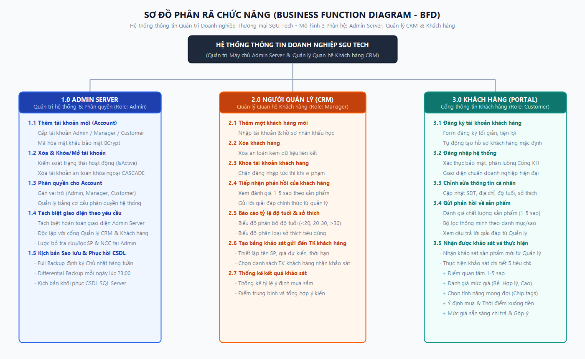

Hình 2.1: Sơ đồ Phân rã Chức năng (Business Function Diagram – BFD) của Hệ thống SGU Tech

### 2.2.2. Bảng Đặc tả Chi tiết Toàn bộ 17 Chức năng Nghiệp vụ Lá trên Sơ đồ BFD

### Bảng dưới đây đặc tả chi tiết dữ liệu đầu vào (Input), thuật toán xử lý nghiệp vụ tại Backend/Frontend (Process), dữ liệu đầu ra (Output) và bảng CSDL tham chiếu của từng chức năng lá trên Sơ đồ BFD:

| Mã BFD | Tên Chức năng Nghiệp vụ Lá | Nhánh Phân hệ | Dữ liệu Đầu vào (Input) | Xử lý Nghiệp vụ & Thuật toán (Process) | Kết quả Đầu ra (Output) |
| --- | --- | --- | --- | --- | --- |
| 1.1 | Tách biệt giao diện Admin Server độc lập | 1.0 Admin Server | Phiên đăng nhập RoleName = 'Admin' | Kiểm tra quyền Admin tại app.js, cô lập hoàn toàn không gian admin.html khỏi Nhân sự, Kho, Bán hàng, CRM; loại bỏ toàn bộ bảng lọc SP/NCC. | Giao diện quản trị máy chủ độc lập admin.html |
| 1.2 | Xem & tìm kiếm danh sách Account | 1.0 Admin Server | Từ khóa tìm kiếm, Bộ lọc vai trò (RoleId) | Gọi GET /api/admin/accounts, kết hợp bảng Roles, tính 4 chỉ số KPI máy chủ và lọc tức thời theo Username, Họ tên, Email hoặc Role. | Bảng 19 tài khoản & 4 thẻ chỉ số KPI |
| 1.3 | Thêm mới tài khoản người dùng | 1.0 Admin Server | Username, Password, FullName, Email, Phone, RoleId | Gọi POST /api/admin/accounts; kiểm tra trùng Username; băm mật khẩu BCrypt; lưu vào Accounts (tự tạo CustomerProfile nếu là Customer). | Tài khoản mới kích hoạt trong CSDL |
| 1.4 | Xóa tài khoản người dùng | 1.0 Admin Server | Mã định danh tài khoản (AccountId) | Gọi DELETE /api/admin/accounts/{id}; xóa dây chuyền dữ liệu con trong CustomerProfiles, Feedbacks, SurveyResponses trước khi xóa Account. | Tài khoản bị xóa sạch không lỗi FK |
| 1.5 | Khóa / Mở khóa trạng thái Account | 1.0 Admin Server | Mã định danh tài khoản (AccountId) | Gọi PUT /api/admin/accounts/{id}/toggle-status; đảo ngược giá trị trường bit IsActive (1 <-> 0) trong bảng Accounts. | Cập nhật trạng thái Hoạt động / Đã khóa |
| 1.6 | Phân quyền vai trò cho Account | 1.0 Admin Server | AccountId, Mã quyền mới RoleId (1, 2, 3) | Gọi PUT /api/admin/accounts/{id}/role; cập nhật khóa ngoại RoleId sang Admin (1), Manager (2) hoặc Customer (3). | Quyền hạn mới có hiệu lực tức thời |
| 2.1 | Thêm một khách hàng mới | 2.0 Người Quản lý | Username, Password, FullName, Phone, Email, Age, Gender, Interest, Address | Gọi POST /api/admin/crm/customers; tạo đồng thời bản ghi Accounts (Role = Customer) và bản ghi CustomerProfiles liên kết 1–1. | Hồ sơ khách hàng mới hiển thị trên CRM |
| 2.2 | Xóa khách hàng | 2.0 Người Quản lý | Mã tài khoản khách hàng (AccountId) | Gọi DELETE /api/admin/crm/customers/{id}; xóa sạch hồ sơ nhân khẩu học, lịch sử phản hồi, phiếu khảo sát và tài khoản của KH. | Khách hàng bị loại bỏ khỏi hệ thống |
| 2.3 | Khóa tài khoản khách hàng | 2.0 Người Quản lý | Mã tài khoản khách hàng (AccountId) | Gọi PUT /api/admin/crm/customers/{id}/toggle-status; chuyển IsActive = false để chặn quyền đăng nhập của khách hàng vi phạm. | Tài khoản KH chuyển sang trạng thái Đã khóa |
| 2.4 | Tiếp nhận & giải đáp phản hồi KH | 2.0 Người Quản lý | FeedbackId, Nội dung trả lời AdminReply | Gọi GET /api/admin/crm/feedbacks & PUT .../reply; lưu câu trả lời vào trường AdminReply và đổi Status thành 'Đã tiếp nhận & Xử lý'. | Giải đáp hiển thị công khai trên cổng KH |
| 2.5 | Báo cáo KH: Tỷ lệ độ tuổi & sở thích | 2.0 Người Quản lý | Yêu cầu thống kê nhân khẩu học | Gọi GET /api/admin/crm/reports/demographics; phân nhóm tuổi (<20, 20–30, >30) và GroupBy theo Interest để tính tỷ lệ % và vẽ biểu đồ. | Biểu đồ tròn Độ tuổi & Biểu đồ cột Sở thích |
| 2.6 | Tạo bảng khảo sát gửi đến TK KH | 2.0 Người Quản lý | Title, TargetProduct, ExpectedPrice, DurationType, ExpiresAt, Description | Gọi POST /api/admin/crm/surveys; lưu chiến dịch khảo sát mới với IsActive = true và phân phối tới toàn bộ tài khoản khách hàng. | Bảng khảo sát mới xuất hiện ở cổng KH |
| 2.7 | Thống kê kết quả khảo sát | 2.0 Người Quản lý | Mã bảng khảo sát (SurveyId) | Gọi GET /api/admin/crm/surveys/{id}/statistics; tính tổng phản hồi, điểm quan tâm TB (1–5), phân bổ 3 mức ý định mua và liệt kê phiếu trả lời. | Dashboard biểu đồ & bảng chi tiết khảo sát |
| 3.1 | Đăng ký tài khoản khách hàng | 3.0 Khách hàng | Username, Password, FullName, Phone, Email, Age, Gender, Interest, Address | Gọi POST /api/customer/register; kiểm tra trùng Username, băm mật khẩu BCrypt, tạo Account + CustomerProfile và tự động đăng nhập. | Tài khoản KH mới & phiên đăng nhập |
| 3.2 | Đăng nhập hệ thống | 3.0 Khách hàng | Username, Password | Gọi POST /api/customer/login; kiểm tra Role = Customer, kiểm tra IsActive = true, xác thực mật khẩu và cấp phiên truy cập user.html. | Truy cập thành công vào Cổng Khách hàng |
| 3.3 | Chỉnh sửa thông tin cá nhân | 3.0 Khách hàng | AccountId, FullName, Phone, Email, Age, Gender, Interest, Address | Gọi PUT /api/customer/profile/{accountId}; cập nhật đồng bộ bảng Accounts và bảng CustomerProfiles. | Hồ sơ cá nhân & báo cáo CRM được làm mới |
| 3.4 | Gửi phản hồi về sản phẩm | 3.0 Khách hàng | AccountId, ProductId, Rating (1–5 sao), Comment | Gọi POST /api/customer/feedbacks/{accountId}; lưu đánh giá sản phẩm; hỗ trợ lọc xem đánh giá & giải đáp theo từng sản phẩm. | Đánh giá mới hiển thị kèm câu trả lời QL |
| 3.5 | Nhận được khảo sát và thực hiện | 3.0 Khách hàng | SurveyId, AccountId, Score (1–5), BuyingIntent, CustomerOpinion | Gọi GET /api/customer/surveys/{accountId} & POST .../submit/{accountId}; kiểm tra hạn và chưa làm trước đó, lưu vào SurveyResponses. | Phiếu khảo sát chuyển sang Đã thực hiện |

## 2.3. Sơ đồ Ngữ cảnh (Context Diagram) (2 điểm)

### 2.3.1. Mô hình Sơ đồ Ngữ cảnh Tổng thể của Hệ thống

### Sơ đồ Ngữ cảnh (Context Diagram) xác định ranh giới của Hệ thống Thông tin Quản trị Doanh nghiệp & CRM SGU Tech (biểu diễn bằng Tiến trình trung tâm duy nhất 0.0) và mô tả toàn bộ các mối tương tác thông tin vào/ra giữa hệ thống với 3 Tác nhân ngoài (External Entities): QUẢN TRỊ VIÊN (ADMIN SERVER), NGƯỜI QUẢN LÝ (CRM MANAGER) và KHÁCH HÀNG (CUSTOMER):

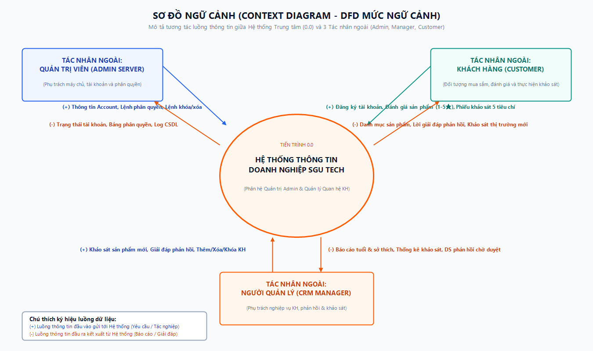

Hình 2.2: Sơ đồ Ngữ cảnh Hệ thống (System Context Diagram – Tiến trình 0.0 & 3 Tác nhân ngoài)

### 2.3.2. Đặc tả Chi tiết 3 Tác nhân Ngoài (External Entities)

| Ký hiệu Tác nhân | Tên Tác nhân Ngoài | Phân hệ Giao diện | Vai trò, Trách nhiệm và Mối quan hệ trao đổi dữ liệu với Tiến trình 0.0 |
| --- | --- | --- | --- |
| Tác nhân 01 | QUẢN TRỊ VIÊN (ADMIN SERVER) | admin.html (Tách biệt độc lập) | Là kỹ sư quản trị máy chủ của doanh nghiệp. Gửi các lệnh tạo mới, xóa, khóa/mở khóa và phân quyền vai trò (Admin/Manager/Customer) cho Account vào Tiến trình 0.0; nhận lại danh sách tài khoản, trạng thái phân quyền và 4 chỉ số KPI máy chủ. |
| Tác nhân 02 | NGƯỜI QUẢN LÝ (CRM MANAGER) | quanly.html (5 Tab CRM) | Là cán bộ quản lý quan hệ khách hàng. Gửi thông tin thêm mới, xóa, khóa khách hàng, câu trả lời giải đáp phản hồi và chiến dịch khảo sát mới vào Tiến trình 0.0; nhận lại danh sách hồ sơ khách hàng, danh sách phản hồi sản phẩm, báo cáo tỷ lệ độ tuổi/sở thích và báo cáo thống kê kết quả khảo sát. |
| Tác nhân 03 | KHÁCH HÀNG (CUSTOMER) | user.html (Cổng Khách hàng) | Là người tiêu dùng mua sắm thiết bị công nghệ tại SGU Tech. Gửi yêu cầu đăng ký, đăng nhập, chỉnh sửa hồ sơ cá nhân, đánh giá 1–5 sao về sản phẩm và phiếu trả lời khảo sát vào Tiến trình 0.0; nhận lại thông tin hồ sơ, danh mục sản phẩm, câu trả lời giải đáp từ Người quản lý và các bảng khảo sát mới. |

### 2.3.3. Bảng Đặc tả Chi tiết 16 Luồng Dữ liệu Vào/Ra trên Sơ đồ Ngữ cảnh

| Mã Luồng | Tên Luồng Dữ liệu Ngữ cảnh | Nguồn (Source) | Đích (Sink) | Các Thuộc tính Dữ liệu Thành phần (Data Elements) | API Endpoint Tương ứng |
| --- | --- | --- | --- | --- | --- |
| CF-01 | Thông tin đăng nhập Admin | Quản trị viên | Hệ thống 0.0 | Username, Password | POST /api/admin/auth/login |
| CF-02 | Lệnh Thêm / Xóa / Khóa Account | Quản trị viên | Hệ thống 0.0 | AccountId, Username, Password, FullName, Email, Phone, RoleId | POST, PUT, DELETE /api/admin/accounts |
| CF-03 | Lệnh Phân quyền Vai trò (Role) | Quản trị viên | Hệ thống 0.0 | AccountId, RoleId (1: Admin, 2: Manager, 3: Customer) | PUT /api/admin/accounts/{id}/role |
| CF-04 | DS Account & Trạng thái phân quyền | Hệ thống 0.0 | Quản trị viên | Danh sách 19 Accounts, 3 Roles, IsActive, 4 chỉ số KPI máy chủ | GET /api/admin/accounts & /roles |
| CF-05 | Lệnh Thêm / Xóa / Khóa Khách hàng | Người Quản lý | Hệ thống 0.0 | AccountId, Username, FullName, Phone, Email, Age, Gender, Interest, Address | POST, PUT, DELETE /api/admin/crm/customers |
| CF-06 | Nội dung Giải đáp Phản hồi KH | Người Quản lý | Hệ thống 0.0 | FeedbackId, AdminReply, Status ('Đã tiếp nhận & Xử lý') | PUT /api/admin/crm/feedbacks/{id}/reply |
| CF-07 | Bảng Khảo sát Mới phát hành | Người Quản lý | Hệ thống 0.0 | Title, TargetProduct, ExpectedPrice, DurationType, ExpiresAt, Description | POST /api/admin/crm/surveys |
| CF-08 | DS Hồ sơ KH & Phản hồi Sản phẩm | Hệ thống 0.0 | Người Quản lý | Danh sách 15 Khách hàng kèm Profile & 18 Phản hồi sản phẩm | GET /api/admin/crm/customers & /feedbacks |
| CF-09 | Báo cáo Tỷ lệ Độ tuổi & Sở thích | Hệ thống 0.0 | Người Quản lý | totalCustomers, ageStats (<20, 20–30, >30), interestStats (Count, %) | GET /api/admin/crm/reports/demographics |
| CF-10 | Báo cáo Thống kê Kết quả Khảo sát | Hệ thống 0.0 | Người Quản lý | totalResponses, averageScore, intentStats, scoreDistribution, detailResponses | GET /api/admin/crm/surveys/{id}/statistics |
| CF-11 | Thông tin Đăng ký & Đăng nhập KH | Khách hàng | Hệ thống 0.0 | Username, Password, FullName, Phone, Email, Age, Gender, Interest, Address | POST /api/customer/register & /login |
| CF-12 | Thông tin Chỉnh sửa Hồ sơ Cá nhân | Khách hàng | Hệ thống 0.0 | AccountId, FullName, Phone, Email, Age, Gender, Interest, Address | PUT /api/customer/profile/{accountId} |
| CF-13 | Đánh giá Sao & Phản hồi Sản phẩm | Khách hàng | Hệ thống 0.0 | AccountId, ProductId, Rating (1–5 sao), Comment | POST /api/customer/feedbacks/{accountId} |
| CF-14 | Phiếu Kết quả Thực hiện Khảo sát | Khách hàng | Hệ thống 0.0 | SurveyId, AccountId, Score (1–5 điểm), BuyingIntent, CustomerOpinion | POST /api/customer/surveys/{id}/submit/{aid} |
| CF-15 | Hồ sơ Cá nhân & Giải đáp từ Quản lý | Hệ thống 0.0 | Khách hàng | Thông tin Profile cá nhân, Danh mục 16 SP, Danh sách phản hồi & AdminReply | GET /api/customer/profile & /all-feedbacks |
| CF-16 | Danh sách Bảng Khảo sát gửi tới TK | Hệ thống 0.0 | Khách hàng | Danh sách 5 chiến dịch khảo sát, IsActive, IsExpired, IsCompleted, MyResponse | GET /api/customer/surveys/{accountId} |

## 2.4. Sơ đồ Luồng Dữ liệu Mức Đỉnh (Level 0 DFD) & Phân rã Mức 1 (Level 1 DFD) (4 điểm)

### 2.4.1. Sơ đồ Luồng Dữ liệu Mức Đỉnh (Level 0 DFD)

### Phân rã Tiến trình 0.0 từ Sơ đồ Ngữ cảnh, Sơ đồ Luồng Dữ liệu Mức Đỉnh (Level 0 DFD) tổ chức hệ thống thành 5 Tiến trình nghiệp vụ cốt lõi (1.0 đến 5.0) kết nối trực tiếp với 3 Tác nhân ngoài và 5 Kho dữ liệu chuẩn (D1 đến D5). Toàn bộ các kho dữ liệu từ D1 đến D5 trên sơ đồ này chính là cơ sở trực tiếp để thiết kế 9 bảng Cơ sở dữ liệu ở Chương 3:

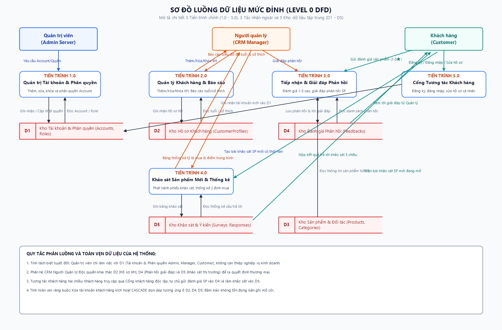

Hình 2.3: Sơ đồ Luồng Dữ liệu Mức Đỉnh (Level 0 DFD — 5 Tiến trình & 5 Kho dữ liệu D1..D5)

### 2.4.2. Bảng Đặc tả 5 Tiến trình Chính và 5 Kho Dữ liệu trên Sơ đồ DFD Mức Đỉnh

| Ký hiệu | Tên Tiến trình / Kho dữ liệu | Phân loại | Mô tả chi tiết chức năng xử lý / Nội dung lưu trữ dữ liệu | Bảng CSDL Vật lý Ánh xạ |
| --- | --- | --- | --- | --- |
| Tiến trình 1.0 | Quản trị Tài khoản & Phân quyền | Process (Admin Server) | Tiếp nhận yêu cầu từ Quản trị viên để xác thực, thêm mới Account, xóa Account, khóa/mở khóa trạng thái truy cập và cập nhật phân quyền vai trò (Admin, Manager, Customer). | Bảng Roles, Bảng Accounts, Bảng CustomerProfiles |
| Tiến trình 2.0 | Quản lý Hồ sơ Khách hàng | Process (CRM & Customer) | Xử lý các thao tác Thêm mới, Xóa, Khóa tài khoản khách hàng từ Người quản lý CRM; đồng thời xử lý Đăng ký tài khoản, Đăng nhập và Chỉnh sửa hồ sơ cá nhân từ Khách hàng. | Bảng Accounts, Bảng CustomerProfiles |
| Tiến trình 3.0 | Xử lý Phản hồi Sản phẩm | Process (CRM & Customer) | Tiếp nhận đánh giá 1–5 sao và nhận xét sản phẩm từ Khách hàng đối chiếu với kho sản phẩm D3; lưu trữ câu trả lời giải đáp (AdminReply) từ Người quản lý vào kho D4. | Bảng Feedbacks, Bảng Products, Bảng Categories, Bảng Suppliers |
| Tiến trình 4.0 | Báo cáo Độ tuổi & Sở thích | Process (CRM Analytics) | Đọc dữ liệu nhân khẩu học từ kho D2 (Customers), thực hiện phân nhóm độ tuổi (<20, 20–30, >30) và gom nhóm sở thích tiêu dùng để kết xuất báo cáo trực quan cho Người quản lý. | Bảng CustomerProfiles, Bảng Accounts |
| Tiến trình 5.0 | Quản lý & Thống kê Khảo sát | Process (CRM & Customer) | Cho phép Người quản lý tạo bảng khảo sát gửi đến tài khoản khách hàng; tiếp nhận phiếu trả lời khảo sát từ Khách hàng và tổng hợp báo cáo thống kê kết quả khảo sát. | Bảng Surveys, Bảng SurveyResponses |
| Kho D1 | D1: Accounts & Roles | Data Store | Lưu trữ thông tin định danh tài khoản (AccountId, Username, PasswordHash, FullName, Email, Phone, RoleId, IsActive) và danh mục 3 vai trò chuẩn (Admin, Manager, Customer). | Bảng Roles, Bảng Accounts |
| Kho D2 | D2: Customers | Data Store | Lưu trữ hồ sơ nhân khẩu học chi tiết của khách hàng liên kết 1–1 với Account: ProfileId, AccountId, Age (Độ tuổi), Gender (Giới tính), Address (Địa chỉ), Interest (Sở thích). | Bảng CustomerProfiles |
| Kho D3 | D3: Products | Data Store | Lưu trữ danh mục 16 sản phẩm công nghệ, 5 nhóm danh mục loại sản phẩm và 6 nhà cung cấp đối tác để khách hàng tra cứu và chọn sản phẩm khi gửi phản hồi. | Bảng Categories, Bảng Suppliers, Bảng Products |
| Kho D4 | D4: Feedbacks | Data Store | Lưu trữ toàn bộ 18 lượt đánh giá sao (Rating 1–5), nội dung nhận xét của khách hàng (Comment), câu trả lời của Người quản lý (AdminReply) và trạng thái xử lý (Status). | Bảng Feedbacks |
| Kho D5 | D5: Surveys & Responses | Data Store | Lưu trữ 5 chiến dịch bảng khảo sát sản phẩm mới (Surveys) và 16 phiếu kết quả trả lời khảo sát của từng tài khoản khách hàng (SurveyResponses). | Bảng Surveys, Bảng SurveyResponses |

### 2.4.3. Bảng Đặc tả Chi tiết các Luồng Dữ liệu Trung gian trên Sơ đồ DFD Mức Đỉnh

| STT | Tên Luồng Dữ liệu trên DFD Mức 0 | Điểm đầu (From) | Điểm cuối (To) | Nội dung dữ liệu truyền tải và câu lệnh SQL / API tương ứng |
| --- | --- | --- | --- | --- |
| 01 | Yêu cầu Thêm / Xóa / Khóa / Phân quyền | Tác nhân Admin | Tiến trình 1.0 | Gói dữ liệu AccountCreateDto, UpdateRoleDto hoặc lệnh ToggleStatus/Delete gửi vào AccountsController. |
| 02 | Ghi / Cập nhật Account & Role | Tiến trình 1.0 | Kho D1 (Accounts) | Thực thi INSERT, UPDATE RoleId, UPDATE IsActive hoặc DELETE trên bảng Accounts. |
| 03 | Đọc danh sách Account & Role | Kho D1 (Accounts) | Tiến trình 1.0 | Thực thi SELECT Accounts JOIN Roles ORDER BY AccountId DESC. |
| 04 | Danh sách Account & KPI Máy chủ | Tiến trình 1.0 | Tác nhân Admin | Trả về mảng JSON 19 tài khoản, 3 vai trò và 4 chỉ số thống kê KPI cho màn hình admin.html. |
| 05 | Lệnh Thêm / Xóa / Khóa Khách hàng | Người Quản lý CRM | Tiến trình 2.0 | Gửi thông tin hồ sơ khách hàng mới hoặc lệnh khóa/xóa khách hàng vào CrmAdminController. |
| 06 | Thông tin Đăng ký & Cập nhật Hồ sơ | Tác nhân Khách hàng | Tiến trình 2.0 | Khách hàng gửi biểu mẫu đăng ký mới hoặc chỉnh sửa thông tin cá nhân vào CustomerPortalController. |
| 07 | Đồng bộ định danh Khách hàng | Tiến trình 2.0 | Kho D1 (Accounts) | Tạo mới tài khoản Role = Customer, cập nhật FullName/Email/Phone hoặc đảo trạng thái IsActive. |
| 08 | Ghi / Cập nhật Hồ sơ Nhân khẩu học | Tiến trình 2.0 | Kho D2 (Customers) | Thực thi INSERT, UPDATE (Age, Gender, Interest, Address) hoặc DELETE trên bảng CustomerProfiles. |
| 09 | Đọc danh sách Hồ sơ Khách hàng | Kho D2 (Customers) | Tiến trình 2.0 | Truy vấn danh sách 15 hồ sơ khách hàng kết hợp trạng thái tài khoản từ kho D1. |
| 10 | Đánh giá 1–5 sao & Nhận xét SP | Tác nhân Khách hàng | Tiến trình 3.0 | Khách hàng chọn sản phẩm (ProductId), mức sao (Rating 1–5) và gửi nhận xét (Comment). |
| 11 | Đối chiếu thông tin Sản phẩm | Kho D3 (Products) | Tiến trình 3.0 | Đọc ProductName, ProductCode, ImageUrl từ bảng Products để gắn với lượt phản hồi. |
| 12 | Lưu phản hồi mới & Giải đáp | Tiến trình 3.0 | Kho D4 (Feedbacks) | Thực thi INSERT phản hồi mới của KH hoặc UPDATE AdminReply, Status của Người quản lý. |
| 13 | Đọc danh sách Phản hồi & Giải đáp | Kho D4 (Feedbacks) | Tiến trình 3.0 | Truy vấn toàn bộ lịch sử phản hồi sản phẩm và câu trả lời giải đáp từ bảng Feedbacks. |
| 14 | Đọc dữ liệu Tuổi & Sở thích KH | Kho D2 (Customers) | Tiến trình 4.0 | Đọc toàn bộ cột Age và Interest của 15 khách hàng trong bảng CustomerProfiles. |
| 15 | Báo cáo Tỷ lệ Độ tuổi & Sở thích | Tiến trình 4.0 | Người Quản lý CRM | Kết xuất JSON thống kê 3 nhóm tuổi và 4 nhóm sở thích kèm tỷ lệ % cho biểu đồ Tab 3. |
| 16 | Thông tin Bảng khảo sát mới | Người Quản lý CRM | Tiến trình 5.0 | Người quản lý gửi Title, TargetProduct, ExpectedPrice, ExpiresAt, Description để phát hành khảo sát. |
| 17 | Lưu chiến dịch & Phiếu trả lời KS | Tiến trình 5.0 | Kho D5 (Surveys) | Thực thi INSERT vào bảng Surveys (khi tạo KS) và INSERT vào SurveyResponses (khi KH nộp phiếu). |
| 18 | Đọc dữ liệu Khảo sát & Kết quả | Kho D5 (Surveys) | Tiến trình 5.0 | Truy vấn danh sách khảo sát và toàn bộ 16 phiếu trả lời khảo sát để tính toán thống kê. |
| 19 | Phân phối Khảo sát đến TK KH | Tiến trình 5.0 | Tác nhân Khách hàng | Hiển thị danh sách khảo sát đang mở và trạng thái đã làm/chưa làm trên tài khoản khách hàng. |
| 20 | Báo cáo Thống kê Kết quả Khảo sát | Tiến trình 5.0 | Người Quản lý CRM | Trả về tổng lượt tham gia, điểm quan tâm trung bình, phân bổ ý định mua và danh sách chi tiết. |

### 2.4.4. Sơ đồ Luồng Dữ liệu Mức 1 — Phân rã Tiến trình 1.0: Quản trị Máy chủ (Admin Server)

### Để làm rõ hoạt động bên trong Phân hệ Quản trị Máy chủ (Admin Server), Tiến trình 1.0 được phân rã chi tiết ở Mức 1 thành 4 tiến trình con (1.1 Xác thực & Tách biệt Giao diện Admin; 1.2 Thêm mới & Xóa Tài khoản; 1.3 Phân quyền Vai trò cho Account; 1.4 Khóa / Mở khóa & Truy vấn Account) tương tác trực tiếp với kho D1 (Accounts & Roles) và kho D2 (Customers):

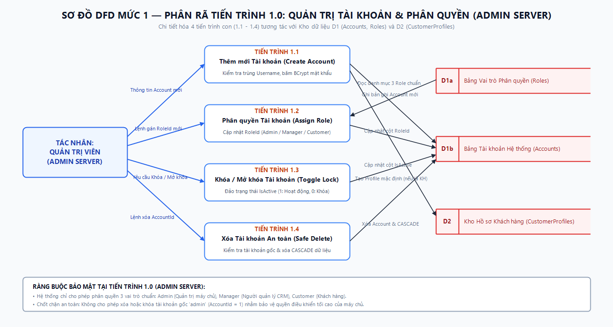

Hình 2.4: Sơ đồ DFD Mức 1 — Phân rã Tiến trình 1.0: Phân hệ Quản trị Máy chủ (Admin Server)

| Mã Tiến trình | Tên Tiến trình Con (DFD Mức 1 – Admin) | Đầu vào (Input Flows) | Thuật toán Xử lý Chi tiết | Đầu ra & Kho Dữ liệu Tác động |
| --- | --- | --- | --- | --- |
| Tiến trình 1.1 | Xác thực & Tách biệt Giao diện Admin Server | Username, Password từ Quản trị viên | Kiểm tra thông tin đăng nhập đối chiếu kho D1; xác nhận RoleName == 'Admin' và IsActive == true; cấp quyền truy cập độc quyền vào admin.html. | Phiên làm việc Admin hợp lệ; đọc Kho D1 (Accounts & Roles). |
| Tiến trình 1.2 | Thêm mới & Xóa Tài khoản (Account) | Thông tin Account mới hoặc AccountId cần xóa | Khi thêm: kiểm tra trùng Username, băm BCrypt mật khẩu, ghi vào D1 (và tạo hồ sơ mặc định vào D2 nếu là Customer). Khi xóa: xóa dây chuyền dữ liệu liên kết rồi xóa bản ghi trong D1. | Ghi/Xóa trên Kho D1 (Accounts) và Kho D2 (CustomerProfiles). |
| Tiến trình 1.3 | Phân quyền Vai trò cho Account | AccountId, RoleId mới (1: Admin, 2: Manager, 3: Customer) | Kiểm tra sự tồn tại của Account trong D1; cập nhật khóa ngoại RoleId sang vai trò mới; tự động bổ sung bản ghi D2 nếu nâng/chuyển quyền sang Customer. | Cập nhật RoleId trong Kho D1; đồng bộ Kho D2. |
| Tiến trình 1.4 | Khóa / Mở khóa & Truy vấn Danh sách Account | AccountId cần đảo trạng thái hoặc từ khóa tìm kiếm/lọc | Đảo ngược trạng thái bit IsActive trong kho D1; truy vấn danh sách 19 tài khoản kết hợp bảng Roles và tính toán 4 chỉ số KPI máy chủ. | Cập nhật/Đọc Kho D1; trả bảng Account & KPI về Admin. |

### 2.4.5. Sơ đồ Luồng Dữ liệu Mức 1 — Phân rã Nghiệp vụ Người Quản lý Quan hệ Khách hàng (CRM Manager)

### Toàn bộ 7 yêu cầu chức năng của Người Quản lý CRM được mô hình hóa chi tiết trong Sơ đồ DFD Mức 1 dưới đây thông qua 5 tiến trình nghiệp vụ chuyên sâu (2.1 Thêm mới, Xóa & Khóa TK Khách hàng; 3.1 Tiếp nhận & Giải đáp Phản hồi KH; 4.1 Tổng hợp Báo cáo Độ tuổi & Sở thích; 5.1 Tạo & Phát hành Bảng Khảo sát; 5.2 Thống kê & Đo lường Kết quả Khảo sát):

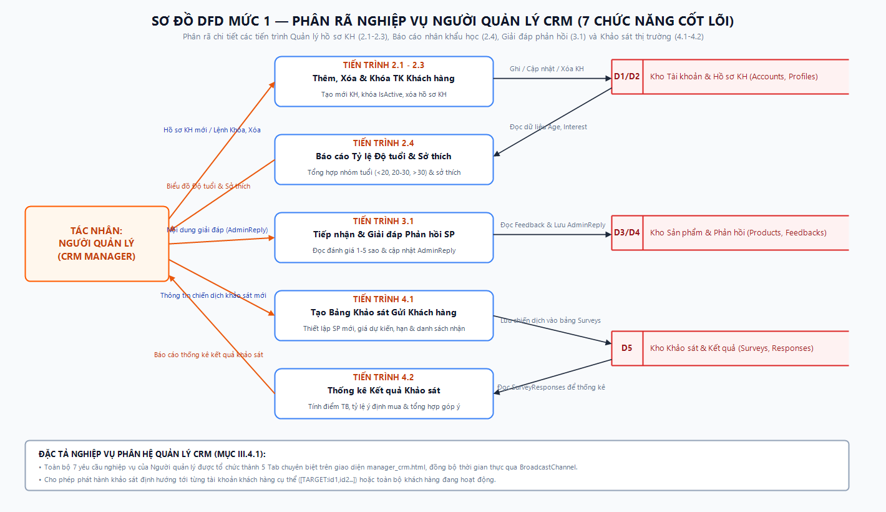

Hình 2.5: Sơ đồ DFD Mức 1 — Phân rã Nghiệp vụ Người Quản lý Quan hệ Khách hàng (CRM Manager)

| Mã Tiến trình | Tên Tiến trình Con (DFD Mức 1 – CRM) | Yêu cầu Đề bài Đáp ứng | Thuật toán Xử lý Nghiệp vụ tại CrmAdminController | Kho Dữ liệu Tác động |
| --- | --- | --- | --- | --- |
| Tiến trình 2.1 | Thêm mới, Xóa & Khóa TK Khách hàng | (1) Thêm KH mới (2) Xóa khách hàng (3) Khóa TK khách hàng | Tạo đồng bộ Account (Role = Customer) vào D1 và hồ sơ nhân khẩu học vào D2; đảo cờ IsActive trong D1 khi khóa TK; xóa dây chuyền D2, D4, D5 và D1 khi xóa khách hàng. | Kho D1 (Accounts), Kho D2 (Customers) |
| Tiến trình 3.1 | Tiếp nhận & Giải đáp Phản hồi Khách hàng | (4) Tiếp nhận phản hồi của khách hàng | Truy vấn danh sách đánh giá sản phẩm từ D4 kết hợp tên khách hàng (D1) và tên/hình ảnh sản phẩm (D3); lưu nội dung giải đáp AdminReply và cập nhật trạng thái 'Đã tiếp nhận & Xử lý'. | Kho D4 (Feedbacks), Kho D3 (Products), Kho D1 (Accounts) |
| Tiến trình 4.1 | Tổng hợp Báo cáo Độ tuổi & Sở thích | (5) Báo cáo về KH, tỷ lệ độ tuổi, sở thích | Đọc toàn bộ hồ sơ khách hàng từ D2; phân loại trường Age vào 3 nhóm (<20, 20–30, >30); thực hiện GroupBy theo trường Interest để tính số lượng và tỷ lệ phần trăm từng sở thích. | Kho D2 (Customers) |
| Tiến trình 5.1 | Tạo & Phát hành Bảng Khảo sát | (6) Tạo bảng khảo sát & gửi đến TK khách hàng | Nhận thông tin chiến dịch khảo sát mới, tính toán thời hạn ExpiresAt theo DurationType, lưu vào kho D5 (Surveys) với IsActive = true và phân phối đến toàn bộ tài khoản KH. | Kho D5 (Surveys), Kho D1 (Accounts) |
| Tiến trình 5.2 | Thống kê & Đo lường Kết quả Khảo sát | (7) Thống kê kết quả khảo sát | Đọc dữ liệu từ bảng Surveys và SurveyResponses trong kho D5; tính tổng số lượt trả lời, điểm quan tâm trung bình (1–5), thống kê 3 nhóm ý định mua sắm và kết xuất danh sách chi tiết. | Kho D5 (Surveys & SurveyResponses) |

### 2.4.6. Sơ đồ Luồng Dữ liệu Mức 1 — Phân rã Cổng Tương tác Khách hàng (Customer Portal)

### Toàn bộ 5 yêu cầu chức năng của Khách hàng được phân rã chi tiết tại Sơ đồ DFD Mức 1 dưới đây thông qua 4 tiến trình tương tác trực tuyến (2.2 Đăng ký Tài khoản & Đăng nhập; 2.3 Chỉnh sửa Thông tin Hồ sơ Cá nhân; 3.2 Gửi Phản hồi về Sản phẩm & Xem Giải đáp; 5.3 Nhận Bảng Khảo sát & Gửi Kết quả Thực hiện):

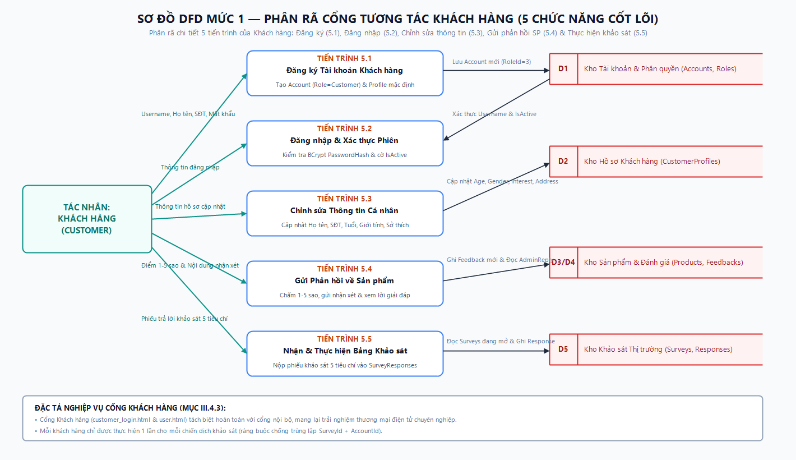

Hình 2.6: Sơ đồ DFD Mức 1 — Phân rã Nghiệp vụ Cổng Tương tác Khách hàng (Customer Portal)

| Mã Tiến trình | Tên Tiến trình Con (DFD Mức 1 – Khách hàng) | Yêu cầu Đề bài Đáp ứng | Thuật toán Xử lý Nghiệp vụ tại CustomerPortalController | Kho Dữ liệu Tác động |
| --- | --- | --- | --- | --- |
| Tiến trình 2.2 | Đăng ký Tài khoản & Đăng nhập Hệ thống | (1) Đăng ký TK khách hàng (2) Đăng nhập | Kiểm tra trùng Username, băm mật khẩu BCrypt, ghi bản ghi mới vào D1 (Accounts) và D2 (CustomerProfiles); xác thực đăng nhập, kiểm tra IsActive == true và cấp phiên làm việc. | Kho D1 (Accounts), Kho D2 (Customers) |
| Tiến trình 2.3 | Chỉnh sửa Thông tin Hồ sơ Cá nhân | (3) Chỉnh sửa thông tin | Tiếp nhận dữ liệu cập nhật từ khách hàng; cập nhật FullName, Email, Phone vào kho D1 và cập nhật Age, Gender, Interest, Address vào kho D2. | Kho D1 (Accounts), Kho D2 (Customers) |
| Tiến trình 3.2 | Gửi Phản hồi Sản phẩm & Xem Giải đáp | (4) Gửi phản hồi về sản phẩm | Đọc danh mục 16 sản phẩm từ kho D3; lưu đánh giá sao (Rating 1–5) và nhận xét của khách hàng vào kho D4; truy vấn lịch sử phản hồi và câu trả lời giải đáp từ Người quản lý. | Kho D3 (Products), Kho D4 (Feedbacks) |
| Tiến trình 5.3 | Nhận Bảng Khảo sát & Thực hiện Khảo sát | (5) Nhận được khảo sát và thực hiện | Truy vấn các chiến dịch khảo sát từ kho D5 kèm cờ kiểm tra đã thực hiện (IsCompleted); kiểm tra khảo sát còn mở và chưa quá hạn, lưu phiếu trả lời (Score, BuyingIntent, Opinion) vào kho D5. | Kho D5 (Surveys & SurveyResponses) |

### 2.4.7. Ma trận Tương tác Tiến trình – Kho Dữ liệu (CRUD Matrix & DFD Balancing)

### Để kiểm chứng tính đầy đủ, nhất quán và cân bằng dữ liệu (Data Flow Balancing) giữa Sơ đồ Chức năng (BFD), Sơ đồ Ngữ cảnh (Context Diagram), Sơ đồ DFD Mức 0 và DFD Mức 1, nhóm lập Ma trận CRUD (C – Create: Tạo mới; R – Read: Đọc/Truy vấn; U – Update: Cập nhật; D – Delete: Xóa) giữa 13 tiến trình con Mức 1 và 5 Kho dữ liệu (9 bảng CSDL):

| Mã Tiến trình DFD | Tên Tiến trình Nghiệp vụ | D1: Roles & Accounts | D2: CustomerProfiles | D3: Categories, Suppliers, Products | D4: Feedbacks | D5: Surveys & SurveyResponses |
| --- | --- | --- | --- | --- | --- | --- |
| 1.1 (Admin) | Xác thực & Tách biệt Giao diện Admin | R | — | — | — | — |
| 1.2 (Admin) | Thêm mới & Xóa Tài khoản (Account) | C, R, D | C, D | — | D (Cascade) | D (Cascade) |
| 1.3 (Admin) | Phân quyền Vai trò cho Account | R, U | C, R | — | — | — |
| 1.4 (Admin) | Khóa / Mở khóa & Truy vấn Account | R, U | — | — | — | — |
| 2.1 (CRM) | Thêm mới, Xóa & Khóa TK Khách hàng | C, R, U, D | C, R, U, D | — | D (Cascade) | D (Cascade) |
| 3.1 (CRM) | Tiếp nhận & Giải đáp Phản hồi KH | R | — | R | R, U | — |
| 4.1 (CRM) | Tổng hợp Báo cáo Độ tuổi & Sở thích | R | R | — | — | — |
| 5.1 (CRM) | Tạo, Khóa/Mở & Xóa Bảng Khảo sát | R | — | — | — | C, R, U, D |
| 5.2 (CRM) | Thống kê & Đo lường Kết quả Khảo sát | R | — | — | — | R |
| 2.2 (KH) | Đăng ký Tài khoản & Đăng nhập KH | C, R | C, R | — | — | — |
| 2.3 (KH) | Chỉnh sửa Thông tin Hồ sơ Cá nhân | R, U | C, R, U | — | — | — |
| 3.2 (KH) | Gửi Phản hồi Sản phẩm & Xem Giải đáp | R | — | R | C, R | — |
| 5.3 (KH) | Nhận Bảng Khảo sát & Gửi Phiếu Trả lời | R | — | — | — | C, R |

### 2.2.3. Hồ sơ Đặc tả Thuật toán Chi tiết cho Từng Chức năng Lá trên Sơ đồ BFD (17 Chức năng)

### Để làm rõ logic xử lý bên trong từng nút lá của Sơ đồ Chức năng (BFD), dưới đây là 17 bảng hồ sơ đặc tả kỹ thuật chi tiết cho toàn bộ 17 chức năng nghiệp vụ lá thuộc 3 phân hệ (1.0 Admin Server, 2.0 Người Quản lý CRM, 3.0 Khách hàng):

Hồ sơ Đặc tả Chức năng Lá BFD [1.1]: Tách biệt Giao diện Admin Server Độc lập

| Tiêu chí Đặc tả Chức năng BFD | Nội dung Phân tích Kỹ thuật Chi tiết của Chức năng [1.1] |
| --- | --- |
| Mã & Tên chức năng lá | [1.1] — Tách biệt Giao diện Admin Server Độc lập |
| Thuộc nhánh phân hệ BFD | 1.0 Phân hệ Quản trị Máy chủ (Admin Server) |
| Tác nhân kích hoạt | Quản trị viên Máy chủ (Admin) |
| Sự kiện kích hoạt (Trigger) | Người dùng đăng nhập thành công với tài khoản có RoleName = 'Admin' hoặc truy cập trực tiếp tệp admin.html. |
| Cấu trúc Dữ liệu Đầu vào | Thông tin phiên đăng nhập lưu trong localStorage: { accountId, username, fullName, roleId: 1, roleName: 'Admin' }. |
| Ràng buộc Kiểm tra Hợp lệ | Kiểm tra phiên làm việc hợp lệ; cô lập hoàn toàn DOM của admin.html khỏi các tập lệnh của quản lý nhân sự, quản lý kho, quản lý bán hàng và quản lý CRM. |
| Thuật toán Xử lý Từng bước | Bước 1: Đọc thông tin phiên đăng nhập từ localStorage. Bước 2: Khởi tạo khung giao diện Admin Server chỉ gồm 2 Tab chuyên biệt: (Tab 1) Quản lý Tài khoản & Phân quyền, (Tab 2) Cơ cấu Phân quyền & Ma trận RBAC. Bước 3: Không nạp bất kỳ module tìm kiếm/lọc sản phẩm hay nhà cung cấp nào vào không gian Admin Server. |
| Truy vấn SQL / Entity Framework | SELECT a.*, r.RoleName FROM Accounts a INNER JOIN Roles r ON a.RoleId = r.RoleId WHERE a.Username = @username AND r.RoleName = N'Admin'; |
| Kết quả Đầu ra (Output) | Không gian làm việc độc lập tại admin.html, đảm bảo 100% nguyên tắc Separation of Duties. |

Hồ sơ Đặc tả Chức năng Lá BFD [1.2]: Xem, Tìm kiếm và Lọc Danh sách Account Hệ thống

| Tiêu chí Đặc tả Chức năng BFD | Nội dung Phân tích Kỹ thuật Chi tiết của Chức năng [1.2] |
| --- | --- |
| Mã & Tên chức năng lá | [1.2] — Xem, Tìm kiếm và Lọc Danh sách Account Hệ thống |
| Thuộc nhánh phân hệ BFD | 1.0 Phân hệ Quản trị Máy chủ (Admin Server) |
| Tác nhân kích hoạt | Quản trị viên Máy chủ (Admin) |
| Sự kiện kích hoạt (Trigger) | Khi khởi chạy Tab 1 trên admin.html hoặc khi Admin gõ từ khóa vào ô tìm kiếm / chọn Dropdown lọc vai trò. |
| Cấu trúc Dữ liệu Đầu vào | Từ khóa tìm kiếm (keyword: string) và Mã vai trò cần lọc (roleFilter: 'ALL' / 'Admin' / 'Manager' / 'Customer'). |
| Ràng buộc Kiểm tra Hợp lệ | Chuẩn hóa chuỗi tìm kiếm về chữ thường (toLowerCase().trim()) để tìm kiếm chính xác tiếng Việt có dấu và không dấu. |
| Thuật toán Xử lý Từng bước | Bước 1: Gọi GET /api/admin/accounts để lấy toàn bộ 19 tài khoản từ SQL Server. Bước 2: Tính toán 4 chỉ số KPI: Tổng số Account (all.length), Đang hoạt động (all.filter(x => x.isActive).length), Đã khóa (all.filter(x => !x.isActive).length), Tổng số Role (3). Bước 3: Áp dụng bộ lọc kết hợp theo từ khóa (khớp Username, FullName, Email, Phone) và theo RoleName. Bước 4: Kết xuất các dòng HTML vào bảng #accountsTableBody. |
| Truy vấn SQL / Entity Framework | SELECT a.AccountId, a.Username, a.FullName, a.Email, a.Phone, a.RoleId, r.RoleName, a.IsActive, a.CreatedAt FROM Accounts a LEFT JOIN Roles r ON a.RoleId = r.RoleId ORDER BY a.AccountId DESC; |
| Kết quả Đầu ra (Output) | Bảng danh sách tài khoản trực quan kèm 4 thẻ KPI cập nhật tức thời. |

Hồ sơ Đặc tả Chức năng Lá BFD [1.3]: Thêm mới Tài khoản Định danh Người dùng (Create Account)

| Tiêu chí Đặc tả Chức năng BFD | Nội dung Phân tích Kỹ thuật Chi tiết của Chức năng [1.3] |
| --- | --- |
| Mã & Tên chức năng lá | [1.3] — Thêm mới Tài khoản Định danh Người dùng (Create Account) |
| Thuộc nhánh phân hệ BFD | 1.0 Phân hệ Quản trị Máy chủ (Admin Server) |
| Tác nhân kích hoạt | Quản trị viên Máy chủ (Admin) |
| Sự kiện kích hoạt (Trigger) | Admin nhấn nút '+ Thêm tài khoản mới', điền biểu mẫu Modal và nhấn nút 'Lưu tài khoản'. |
| Cấu trúc Dữ liệu Đầu vào | Gói dữ liệu AccountCreateDto: { Username, Password, FullName, Email, Phone, RoleId }. |
| Ràng buộc Kiểm tra Hợp lệ | 1. Username và FullName không được rỗng. 2. Username chưa tồn tại trong bảng Accounts (kiểm tra AnyAsync không phân biệt hoa thường). 3. RoleId phải thuộc tập {1 (Admin), 2 (Manager), 3 (Customer)}. |
| Thuật toán Xử lý Từng bước | Bước 1: Kiểm tra trùng Username trong bảng Accounts. Bước 2: Băm mật khẩu bằng BCrypt.Net.BCrypt.HashPassword(password). Bước 3: Nếu Email rỗng, tự động gán '{username}@sgutech.vn'. Bước 4: Thêm bản ghi mới vào bảng Accounts với IsActive = true, CreatedAt = DateTime.Now. Bước 5: Nếu RoleId tương ứng với 'Customer', tự động khởi tạo thêm bản ghi mặc định trong bảng CustomerProfiles. |
| Truy vấn SQL / Entity Framework | INSERT INTO Accounts (Username, PasswordHash, FullName, Email, Phone, RoleId, IsActive, CreatedAt) VALUES (@u, @p, @fn, @em, @ph, @rid, 1, GETDATE()); |
| Kết quả Đầu ra (Output) | Tài khoản mới được lưu vào CSDL và xuất hiện ngay ở dòng đầu tiên của bảng Account. |

Hồ sơ Đặc tả Chức năng Lá BFD [1.4]: Xóa Tài khoản Người dùng (Delete Account with Safe Cascade)

| Tiêu chí Đặc tả Chức năng BFD | Nội dung Phân tích Kỹ thuật Chi tiết của Chức năng [1.4] |
| --- | --- |
| Mã & Tên chức năng lá | [1.4] — Xóa Tài khoản Người dùng (Delete Account with Safe Cascade) |
| Thuộc nhánh phân hệ BFD | 1.0 Phân hệ Quản trị Máy chủ (Admin Server) |
| Tác nhân kích hoạt | Quản trị viên Máy chủ (Admin) |
| Sự kiện kích hoạt (Trigger) | Admin nhấn nút 'Xóa Account' tại dòng tài khoản bất kỳ và xác nhận hộp thoại cảnh báo. |
| Cấu trúc Dữ liệu Đầu vào | Mã định danh tài khoản cần xóa: id (int). |
| Ràng buộc Kiểm tra Hợp lệ | Kiểm tra tài khoản tồn tại trong bảng Accounts; cảnh báo xác nhận trước khi thực hiện xóa vĩnh viễn. |
| Thuật toán Xử lý Từng bước | Bước 1: Truy vấn bản ghi Account theo id. Bước 2: Truy vấn và xóa toàn bộ bản ghi phụ thuộc trong bảng CustomerProfiles (Where AccountId == id). Bước 3: Truy vấn và xóa toàn bộ bản ghi phụ thuộc trong bảng Feedbacks (Where AccountId == id). Bước 4: Truy vấn và xóa toàn bộ bản ghi phụ thuộc trong bảng SurveyResponses (Where AccountId == id). Bước 5: Xóa bản ghi gốc trong bảng Accounts và gọi SaveChangesAsync(). |
| Truy vấn SQL / Entity Framework | DELETE FROM CustomerProfiles WHERE AccountId = @id; DELETE FROM Feedbacks WHERE AccountId = @id; DELETE FROM SurveyResponses WHERE AccountId = @id; DELETE FROM Accounts WHERE AccountId = @id; |
| Kết quả Đầu ra (Output) | Tài khoản và dữ liệu phụ thuộc bị xóa sạch mà không xảy ra lỗi xung đột khóa ngoại SQL Server. |

Hồ sơ Đặc tả Chức năng Lá BFD [1.5]: Khóa / Mở khóa Trạng thái Tài khoản (Toggle Account Lock)

| Tiêu chí Đặc tả Chức năng BFD | Nội dung Phân tích Kỹ thuật Chi tiết của Chức năng [1.5] |
| --- | --- |
| Mã & Tên chức năng lá | [1.5] — Khóa / Mở khóa Trạng thái Tài khoản (Toggle Account Lock) |
| Thuộc nhánh phân hệ BFD | 1.0 Phân hệ Quản trị Máy chủ (Admin Server) |
| Tác nhân kích hoạt | Quản trị viên Máy chủ (Admin) |
| Sự kiện kích hoạt (Trigger) | Admin nhấn nút 'Khóa' hoặc 'Mở khóa' trên dòng tài khoản tại bảng Quản trị Account. |
| Cấu trúc Dữ liệu Đầu vào | Mã định danh tài khoản: id (int). |
| Ràng buộc Kiểm tra Hợp lệ | Kiểm tra bản ghi Account tồn tại trong CSDL. |
| Thuật toán Xử lý Từng bước | Bước 1: Tìm bản ghi Account theo khóa chính id. Bước 2: Đảo giá trị logic của thuộc tính IsActive (acc.IsActive = !acc.IsActive). Bước 3: Lưu thay đổi vào SQL Server và trả về trạng thái mới cho giao diện. |
| Truy vấn SQL / Entity Framework | UPDATE Accounts SET IsActive = CASE WHEN IsActive = 1 THEN 0 ELSE 1 END WHERE AccountId = @id; |
| Kết quả Đầu ra (Output) | Trạng thái tài khoản chuyển đổi tức thời giữa 'Hoạt động' (Xanh) và 'Đã khóa' (Đỏ). |

Hồ sơ Đặc tả Chức năng Lá BFD [1.6]: Phân quyền Vai trò cho Account (Assign Role)

| Tiêu chí Đặc tả Chức năng BFD | Nội dung Phân tích Kỹ thuật Chi tiết của Chức năng [1.6] |
| --- | --- |
| Mã & Tên chức năng lá | [1.6] — Phân quyền Vai trò cho Account (Assign Role) |
| Thuộc nhánh phân hệ BFD | 1.0 Phân hệ Quản trị Máy chủ (Admin Server) |
| Tác nhân kích hoạt | Quản trị viên Máy chủ (Admin) |
| Sự kiện kích hoạt (Trigger) | Admin chọn vai trò mới trong Dropdown (Admin / Manager / Customer) trên dòng tài khoản và nhấn nút 'Phân quyền'. |
| Cấu trúc Dữ liệu Đầu vào | AccountId (int) và gói dữ liệu UpdateRoleDto: { RoleId: int }. |
| Ràng buộc Kiểm tra Hợp lệ | Kiểm tra AccountId hợp lệ và RoleId thuộc danh mục 3 vai trò chuẩn trong bảng Roles. |
| Thuật toán Xử lý Từng bước | Bước 1: Tìm bản ghi Account theo id. Bước 2: Gán acc.RoleId = dto.RoleId và lưu vào bảng Accounts. Bước 3: Kiểm tra nếu vai trò mới là 'Customer' và tài khoản chưa có hồ sơ trong CustomerProfiles thì tự động khởi tạo bản ghi CustomerProfile mới. |
| Truy vấn SQL / Entity Framework | UPDATE Accounts SET RoleId = @newRoleId WHERE AccountId = @id; |
| Kết quả Đầu ra (Output) | Huy hiệu vai trò của tài khoản được cập nhật ngay trên giao diện và có hiệu lực ở lần đăng nhập kế tiếp. |

Hồ sơ Đặc tả Chức năng Lá BFD [2.1]: Thêm một Khách hàng mới (Create Customer & Demographics Profile)

| Tiêu chí Đặc tả Chức năng BFD | Nội dung Phân tích Kỹ thuật Chi tiết của Chức năng [2.1] |
| --- | --- |
| Mã & Tên chức năng lá | [2.1] — Thêm một Khách hàng mới (Create Customer & Demographics Profile) |
| Thuộc nhánh phân hệ BFD | 2.0 Phân hệ Người Quản lý Quan hệ Khách hàng (CRM Manager) |
| Tác nhân kích hoạt | Người Quản lý CRM (Manager) |
| Sự kiện kích hoạt (Trigger) | Người quản lý nhấn nút '+ Thêm một khách hàng mới' tại Tab 1 trên quanly.html, nhập thông tin và nhấn Lưu. |
| Cấu trúc Dữ liệu Đầu vào | CustomerRegisterDto: { Username, Password, FullName, Email, Phone, Age, Gender, Interest, Address }. |
| Ràng buộc Kiểm tra Hợp lệ | Kiểm tra Username và FullName không được để trống; kiểm tra Username chưa tồn tại; Age > 0. |
| Thuật toán Xử lý Từng bước | Bước 1: Truy xuất bản ghi Role có RoleName == 'Customer' (RoleId = 3). Bước 2: Tạo bản ghi Account mới với mật khẩu băm BCrypt, IsActive = true và lưu vào bảng Accounts để nhận AccountId tự tăng. Bước 3: Tạo bản ghi CustomerProfile gắn với AccountId vừa sinh, lưu đầy đủ Độ tuổi (Age), Giới tính (Gender), Sở thích (Interest) và Địa chỉ (Address). Bước 4: Cập nhật lại danh sách khách hàng và biểu đồ nhân khẩu học. |
| Truy vấn SQL / Entity Framework | INSERT INTO Accounts (...) VALUES (...); INSERT INTO CustomerProfiles (AccountId, Age, Gender, Address, Interest) VALUES (SCOPE_IDENTITY(), @age, @gender, @addr, @interest); |
| Kết quả Đầu ra (Output) | Khách hàng mới được khởi tạo đồng bộ cả tài khoản đăng nhập lẫn hồ sơ nhân khẩu học CRM. |

Hồ sơ Đặc tả Chức năng Lá BFD [2.2 & 2.3]: Xóa Khách hàng & Khóa Tài khoản Khách hàng

| Tiêu chí Đặc tả Chức năng BFD | Nội dung Phân tích Kỹ thuật Chi tiết của Chức năng [2.2 & 2.3] |
| --- | --- |
| Mã & Tên chức năng lá | [2.2 & 2.3] — Xóa Khách hàng & Khóa Tài khoản Khách hàng |
| Thuộc nhánh phân hệ BFD | 2.0 Phân hệ Người Quản lý Quan hệ Khách hàng (CRM Manager) |
| Tác nhân kích hoạt | Người Quản lý CRM (Manager) |
| Sự kiện kích hoạt (Trigger) | Người quản lý nhấn nút 'Khóa TK / Mở khóa' hoặc nút 'Xóa' trên dòng khách hàng tại Tab 1 (quanly.html). |
| Cấu trúc Dữ liệu Đầu vào | Mã tài khoản khách hàng: AccountId (int). |
| Ràng buộc Kiểm tra Hợp lệ | Xác thực khách hàng tồn tại trong CSDL; hiển thị hộp thoại xác nhận trước khi xóa vĩnh viễn. |
| Thuật toán Xử lý Từng bước | • Đối với Khóa TK (2.3): Gọi PUT /api/admin/crm/customers/{id}/toggle-status để đảo cờ IsActive của khách hàng. Khi IsActive = false, khách hàng bị chặn đăng nhập tại user.html. • Đối với Xóa KH (2.2): Gọi DELETE /api/admin/crm/customers/{id}, xóa sạch hồ sơ trong CustomerProfiles, các đánh giá trong Feedbacks, các phiếu khảo sát trong SurveyResponses rồi xóa bản ghi trong Accounts. |
| Truy vấn SQL / Entity Framework | UPDATE Accounts SET IsActive = ~IsActive WHERE AccountId = @id; -- Hoặc chuỗi lệnh DELETE Cascade an toàn. |
| Kết quả Đầu ra (Output) | Cập nhật tức thời trạng thái khóa hoặc loại bỏ hoàn toàn khách hàng khỏi danh sách CRM. |

Hồ sơ Đặc tả Chức năng Lá BFD [2.4]: Tiếp nhận và Giải đáp Phản hồi của Khách hàng

| Tiêu chí Đặc tả Chức năng BFD | Nội dung Phân tích Kỹ thuật Chi tiết của Chức năng [2.4] |
| --- | --- |
| Mã & Tên chức năng lá | [2.4] — Tiếp nhận và Giải đáp Phản hồi của Khách hàng |
| Thuộc nhánh phân hệ BFD | 2.0 Phân hệ Người Quản lý Quan hệ Khách hàng (CRM Manager) |
| Tác nhân kích hoạt | Người Quản lý CRM (Manager) |
| Sự kiện kích hoạt (Trigger) | Người quản lý mở Tab 2 (Tiếp nhận Phản hồi), nhấn nút 'Tiếp nhận & Trả lời', nhập nội dung giải đáp và nhấn Lưu. |
| Cấu trúc Dữ liệu Đầu vào | FeedbackId (int) và gói dữ liệu FeedbackReplyDto: { AdminReply: string }. |
| Ràng buộc Kiểm tra Hợp lệ | Kiểm tra FeedbackId tồn tại trong bảng Feedbacks; nội dung giải đáp AdminReply không được rỗng. |
| Thuật toán Xử lý Từng bước | Bước 1: Tải toàn bộ danh sách phản hồi kèm thông tin Khách hàng (Accounts) và Sản phẩm (Products). Bước 2: Vẽ biểu đồ cột phân bổ số lượng đánh giá từ 1 sao đến 5 sao và biểu đồ top sản phẩm được phản hồi. Bước 3: Khi Người quản lý gửi câu trả lời, cập nhật trường fb.AdminReply = dto.AdminReply và chuyển trạng thái fb.Status = 'Đã tiếp nhận & Xử lý'. |
| Truy vấn SQL / Entity Framework | UPDATE Feedbacks SET AdminReply = @reply, Status = N'Đã tiếp nhận & Xử lý' WHERE FeedbackId = @id; |
| Kết quả Đầu ra (Output) | Câu trả lời giải đáp của Người quản lý được lưu trữ và hiển thị công khai trên Cổng Khách hàng. |

Hồ sơ Đặc tả Chức năng Lá BFD [2.5]: Báo cáo về Khách hàng: Tỷ lệ Độ tuổi & Sở thích

| Tiêu chí Đặc tả Chức năng BFD | Nội dung Phân tích Kỹ thuật Chi tiết của Chức năng [2.5] |
| --- | --- |
| Mã & Tên chức năng lá | [2.5] — Báo cáo về Khách hàng: Tỷ lệ Độ tuổi & Sở thích |
| Thuộc nhánh phân hệ BFD | 2.0 Phân hệ Người Quản lý Quan hệ Khách hàng (CRM Manager) |
| Tác nhân kích hoạt | Người Quản lý CRM (Manager) |
| Sự kiện kích hoạt (Trigger) | Người quản lý mở Tab 3 (Báo cáo Độ tuổi & Sở thích) trên giao diện quanly.html. |
| Cấu trúc Dữ liệu Đầu vào | Yêu cầu HTTP GET /api/admin/crm/reports/demographics. |
| Ràng buộc Kiểm tra Hợp lệ | Kiểm tra tổng số hồ sơ khách hàng (totalCustomers > 0) trước khi tính tỷ lệ phần trăm. |
| Thuật toán Xử lý Từng bước | Bước 1: Đọc toàn bộ bản ghi trong bảng CustomerProfiles. Bước 2: Phân nhóm độ tuổi khách hàng thành các phân khúc chuẩn và tính tỷ lệ % từng phân khúc. Bước 3: Thực hiện GroupBy theo thuộc tính Interest (Gaming, Văn phòng, Đồ họa, Lập trình), đếm số lượng (Count) và tính Percentage = Round(Count * 100.0 / Total, 1). Bước 4: Vẽ Biểu đồ Vòng (Doughnut Chart) cho tỷ lệ độ tuổi và Biểu đồ Cột (Bar Chart) cho phân bố sở thích. |
| Truy vấn SQL / Entity Framework | SELECT Interest, COUNT(*) AS Count, CAST(ROUND(COUNT(*) * 100.0 / SUM(COUNT(*)) OVER(), 1) AS DECIMAL(5,1)) AS Percentage FROM CustomerProfiles GROUP BY Interest; |
| Kết quả Đầu ra (Output) | Báo cáo nhân khẩu học trực quan gồm 3 thẻ chỉ số, 2 biểu đồ đồ họa và 2 bảng phân tích tỷ lệ %. |

Hồ sơ Đặc tả Chức năng Lá BFD [2.6 & 2.7]: Tạo Bảng Khảo sát Gửi đến TK Khách hàng & Thống kê Kết quả Khảo sát

| Tiêu chí Đặc tả Chức năng BFD | Nội dung Phân tích Kỹ thuật Chi tiết của Chức năng [2.6 & 2.7] |
| --- | --- |
| Mã & Tên chức năng lá | [2.6 & 2.7] — Tạo Bảng Khảo sát Gửi đến TK Khách hàng & Thống kê Kết quả Khảo sát |
| Thuộc nhánh phân hệ BFD | 2.0 Phân hệ Người Quản lý Quan hệ Khách hàng (CRM Manager) |
| Tác nhân kích hoạt | Người Quản lý CRM (Manager) |
| Sự kiện kích hoạt (Trigger) | Người quản lý thao tác tại Tab 4 (Tạo & Gửi Khảo sát) và Tab 5 (Thống kê Khảo sát) trên quanly.html. |
| Cấu trúc Dữ liệu Đầu vào | • Tạo khảo sát (2.6): SurveyCreateDto { Title, TargetProduct, ExpectedPrice, DurationType, DurationDays, ExpiresAt, Description }. • Thống kê khảo sát (2.7): SurveyId cần tổng hợp kết quả. |
| Ràng buộc Kiểm tra Hợp lệ | Kiểm tra Title, TargetProduct không rỗng; ExpectedPrice >= 0; tính toán chính xác thời điểm hết hạn ExpiresAt. |
| Thuật toán Xử lý Từng bước | • Tạo khảo sát (2.6): Lưu chiến dịch mới vào bảng Surveys với IsActive = true; tự động phân phối tới toàn bộ tài khoản khách hàng đang hoạt động. • Thống kê khảo sát (2.7): Truy vấn bảng SurveyResponses theo SurveyId; tính tổng số lượt trả lời (totalResponses), điểm mức độ quan tâm trung bình (averageScore = Average(Score)), thống kê 3 mức ý định mua ('Rất muốn mua', 'Đang cân nhắc', 'Không mua') và phân bố điểm 1–5. |
| Truy vấn SQL / Entity Framework | SELECT SurveyId, COUNT(*) AS TotalResponses, AVG(CAST(Score AS FLOAT)) AS AvgScore, SUM(CASE WHEN BuyingIntent = N'Rất muốn mua' THEN 1 ELSE 0 END) AS WantToBuy FROM SurveyResponses GROUP BY SurveyId; |
| Kết quả Đầu ra (Output) | Chiến dịch khảo sát được gửi tới tài khoản khách hàng và kết xuất Dashboard thống kê khảo sát toàn diện. |

Hồ sơ Đặc tả Chức năng Lá BFD [3.1, 3.2 & 3.3]: Đăng ký Tài khoản, Đăng nhập & Chỉnh sửa Thông tin Cá nhân Khách hàng

| Tiêu chí Đặc tả Chức năng BFD | Nội dung Phân tích Kỹ thuật Chi tiết của Chức năng [3.1, 3.2 & 3.3] |
| --- | --- |
| Mã & Tên chức năng lá | [3.1, 3.2 & 3.3] — Đăng ký Tài khoản, Đăng nhập & Chỉnh sửa Thông tin Cá nhân Khách hàng |
| Thuộc nhánh phân hệ BFD | 3.0 Phân hệ Cổng Tương tác Khách hàng (Customer Portal) |
| Tác nhân kích hoạt | Khách hàng (Customer) |
| Sự kiện kích hoạt (Trigger) | Khách hàng thao tác tại màn hình Đăng ký/Đăng nhập hoặc Tab 'Hồ sơ cá nhân' trên user.html. |
| Cấu trúc Dữ liệu Đầu vào | Thông tin đăng ký/đăng nhập hoặc gói dữ liệu cập nhật hồ sơ CustomerUpdateProfileDto: { FullName, Email, Phone, Age, Gender, Address, Interest }. |
| Ràng buộc Kiểm tra Hợp lệ | Kiểm tra Username duy nhất khi đăng ký; kiểm tra tài khoản không bị khóa (IsActive == true) khi đăng nhập; kiểm tra Age > 0 khi sửa hồ sơ. |
| Thuật toán Xử lý Từng bước | 1. Đăng ký (3.1): Băm mật khẩu BCrypt, tạo bản ghi Accounts (Role = Customer) + CustomerProfiles và cấp phiên đăng nhập tự động. 2. Đăng nhập (3.2): Kiểm tra Username/Password và trạng thái IsActive, tải thông tin cá nhân của khách hàng. 3. Chỉnh sửa thông tin (3.3): Cập nhật đồng thời Họ tên, SĐT, Email vào bảng Accounts và Độ tuổi, Giới tính, Sở thích, Địa chỉ vào bảng CustomerProfiles. |
| Truy vấn SQL / Entity Framework | UPDATE Accounts SET FullName = @fn, Email = @em, Phone = @ph WHERE AccountId = @id; UPDATE CustomerProfiles SET Age = @age, Gender = @g, Address = @addr, Interest = @int WHERE AccountId = @id; |
| Kết quả Đầu ra (Output) | Hồ sơ cá nhân của khách hàng luôn được cập nhật chính xác và đồng bộ tức thời với báo cáo CRM. |

Hồ sơ Đặc tả Chức năng Lá BFD [3.4 & 3.5]: Gửi Phản hồi về Sản phẩm & Nhận, Thực hiện Bảng Khảo sát

| Tiêu chí Đặc tả Chức năng BFD | Nội dung Phân tích Kỹ thuật Chi tiết của Chức năng [3.4 & 3.5] |
| --- | --- |
| Mã & Tên chức năng lá | [3.4 & 3.5] — Gửi Phản hồi về Sản phẩm & Nhận, Thực hiện Bảng Khảo sát |
| Thuộc nhánh phân hệ BFD | 3.0 Phân hệ Cổng Tương tác Khách hàng (Customer Portal) |
| Tác nhân kích hoạt | Khách hàng (Customer) |
| Sự kiện kích hoạt (Trigger) | Khách hàng thao tác tại Tab 1 (Phản hồi sản phẩm) và Tab 2 (Khảo sát thị trường) trên user.html. |
| Cấu trúc Dữ liệu Đầu vào | • Phản hồi SP (3.4): { ProductId, Rating (1–5 sao), Comment }. • Làm khảo sát (3.5): { SurveyId, AccountId, Score (1–5 điểm), BuyingIntent, CustomerOpinion }. |
| Ràng buộc Kiểm tra Hợp lệ | • Phản hồi SP: Phải chọn sản phẩm hợp lệ, Rating thuộc [1..5], Comment không rỗng. • Làm khảo sát: Khảo sát phải đang mở (IsActive == true), chưa hết hạn (ExpiresAt > Now) và khách hàng chưa từng nộp phiếu cho SurveyId này. |
| Thuật toán Xử lý Từng bước | • Phản hồi SP (3.4): Thêm bản ghi mới vào bảng Feedbacks với Status = 'Chờ xử lý'; hỗ trợ lọc danh sách đánh giá công khai và câu trả lời của Người quản lý theo từng sản phẩm. • Làm khảo sát (3.5): Kiểm tra chống gửi trùng lặp bằng AnyAsync(r => r.SurveyId == surveyId && r.AccountId == accountId); lưu phiếu trả lời vào bảng SurveyResponses và đổi trạng thái nút thành 'Đã thực hiện'. |
| Truy vấn SQL / Entity Framework | INSERT INTO Feedbacks (AccountId, ProductId, Rating, Comment, Status, CreatedAt) VALUES (@aid, @pid, @rate, @cmt, N'Chờ xử lý', GETDATE()); INSERT INTO SurveyResponses (SurveyId, AccountId, Score, BuyingIntent, CustomerOpinion, SubmittedAt) VALUES (@sid, @aid, @sc, @intent, @op, GETDATE()); |
| Kết quả Đầu ra (Output) | Phản hồi sản phẩm và kết quả khảo sát của khách hàng được ghi nhận tức thời vào CSDL trung tâm. |

### 2.3.4. Từ điển Cấu trúc Đại số các Luồng Dữ liệu (Data Flow Algebraic Dictionary)

### Theo phương pháp luận Phân tích và Thiết kế Hệ thống Thông tin có cấu trúc (Structured Systems Analysis and Design Method – SSADM), cấu trúc của từng luồng dữ liệu trên Sơ đồ Ngữ cảnh và Sơ đồ DFD được định nghĩa chính xác bằng ký hiệu đại số dữ liệu ('=' là bao gồm; '+' là nối kết; '[ | ]' là lựa chọn một trong các phương án; '{ }n' là lặp lại n lần; '( )' là thành phần tùy chọn):

| Tên Luồng Dữ liệu Chuẩn | Biểu thức Định nghĩa Cấu trúc Đại số Dữ liệu (Data Structure Expression) |
| --- | --- |
| ThongTinDangNhap | = Username + Password |
| PhienLamViecHopLe | = AccountId + Username + FullName + RoleId + [ 'Admin' / 'Manager' / 'Customer' ] |
| LenhTaoAccount | = Username + Password + FullName + (Email) + (Phone) + RoleId |
| LenhPhanQuyenAccount | = AccountId + [ RoleId_Admin / RoleId_Manager / RoleId_Customer ] |
| DanhSachAccountHeThong | = TongSoAccount + SoAccountHoatDong + SoAccountBiKhoa + { AccountId + Username + FullName + Email + Phone + RoleName + IsActive + CreatedAt }1..N |
| HoSoKhachHangMoi | = Username + Password + FullName + Phone + (Email) + Age + [ 'Nam' / 'Nữ' / 'Khác' ] + [ 'Gaming' / 'Đồ họa' / 'Văn phòng' / 'Lập trình' ] + (Address) |
| PhieuDanhGiaSanPham | = AccountId + ProductId + [ 1_Sao / 2_Sao / 3_Sao / 4_Sao / 5_Sao ] + Comment + CreatedAt |
| GiaiDapPhanHoiQuanLy | = FeedbackId + AdminReply + [ 'Chờ xử lý' / 'Đã tiếp nhận & Xử lý' ] |
| BaoCaoNhanKhauHocKH | = TotalCustomers + (Under20Count + From20To30Count + Over30Count) + { InterestName + CustomerCount + Percentage }1..K |
| ChienDichKhaoSatMoi | = Title + TargetProduct + ExpectedPrice + [ 'NoLimit' / 'Days' + DurationDays / 'Date' + ExpiresAt ] + Description |
| PhieuTraLoiKhaoSat | = SurveyId + AccountId + [ 1_Diem / 2_Diem / 3_Diem / 4_Diem / 5_Diem ] + [ 'Rất muốn mua' / 'Đang cân nhắc' / 'Không mua' ] + (CustomerOpinion) |
| BaoCaoThongKeKhaoSat | = SurveyId + Title + TargetProduct + TotalResponses + AverageScore + (WantToBuyCount + ConsideringCount + NotBuyingCount) + { CustomerName + Score + BuyingIntent + CustomerOpinion + SubmittedAt }0..M |

### 2.4.8. Hồ sơ Đặc tả Chi tiết 13 Tiến trình DFD Mức 1 bằng Ngôn ngữ Có Cấu trúc (Process Mini-Specifications / P-Specs)

### Trong phương pháp phân tích hệ thống có cấu trúc, mỗi tiến trình lá trên Sơ đồ Luồng dữ liệu Mức 1 (Level 1 DFD) phải được đặc tả chi tiết bằng Ngôn ngữ Có Cấu trúc (Structured English / Pseudocode) để định nghĩa rõ ràng các điều kiện rẽ nhánh (IF – THEN – ELSE), các thao tác đọc/ghi Kho dữ liệu (READ / WRITE / UPDATE / DELETE) và luồng trả kết quả về Tác nhân:

Đặc tả Tiến trình DFD [1.1]: Xác thực & Tách biệt Giao diện Admin Server

| Thuộc tính Tiến trình (P-Spec) | Nội dung Đặc tả Chi tiết Tiến trình [1.1] |
| --- | --- |
| Số hiệu & Tên Tiến trình | Tiến trình 1.1 — Xác thực & Tách biệt Giao diện Admin Server |
| Thuộc Sơ đồ DFD | DFD Mức 1 — Phân hệ 1.0: Quản trị Máy chủ (Admin Server) |
| Luồng Dữ liệu Vào (Input Flows) | ThongTinDangNhap (Username, Password) từ Tác nhân Quản trị viên |
| Luồng Dữ liệu Ra (Output Flows) | PhienLamViecHopLe hoặc ThongBaoLoiXacThuc về Tác nhân Quản trị viên |
| Kho Dữ liệu Tham chiếu | Đọc Kho D1 (Bảng Accounts kết hợp Bảng Roles) |

Đặc tả Thuật toán Ngôn ngữ Có Cấu trúc (Structured English) của Tiến trình 1.1 :

    BEGIN PROCESS 1.1 (XacThuc_Va_TachBiet_GiaoDien_Admin)  RECEIVE Username, Password FROM Actor_Admin  IF Username IS EMPTY OR Password IS EMPTY THEN      RETURN HTTP_400 ("Vui lòng nhập đầy đủ tên đăng nhập và mật khẩu!")  END IF  READ Account JOIN Role FROM DataStore_D1 (Accounts, Roles)       WHERE LOWER(Account.Username) = LOWER(TRIM(Username))  IF Account NOT FOUND THEN      RETURN HTTP_401 ("Tài khoản không tồn tại!")  ELSE IF Account.IsActive = FALSE THEN      RETURN HTTP_401 ("Tài khoản này đã bị khóa!")  END IF  IF VerifyPassword(Password, Account.PasswordHash) = FALSE THEN      RETURN HTTP_401 ("Sai mật khẩu!")  END IF  IF Account.Role.RoleName = "Admin" THEN      SET SessionToken = { AccountId, Username, FullName, RoleId: 1, RoleName: "Admin" }      REDIRECT Actor_Admin TO Isolated_Workspace ("admin.html")      -- Tuyệt đối tách biệt khỏi giao diện Nhân sự, Kho, Bán hàng và CRM  ELSE IF Account.Role.RoleName = "Manager" THEN      REDIRECT User TO CRM_Workspace ("quanly.html")  ELSE      REDIRECT User TO Customer_Portal ("user.html")  END IFEND PROCESS 1.1
Đặc tả Tiến trình DFD [1.2]: Thêm mới & Xóa Tài khoản Định danh (Account)

| Thuộc tính Tiến trình (P-Spec) | Nội dung Đặc tả Chi tiết Tiến trình [1.2] |
| --- | --- |
| Số hiệu & Tên Tiến trình | Tiến trình 1.2 — Thêm mới & Xóa Tài khoản Định danh (Account) |
| Thuộc Sơ đồ DFD | DFD Mức 1 — Phân hệ 1.0: Quản trị Máy chủ (Admin Server) |
| Luồng Dữ liệu Vào (Input Flows) | LenhTaoAccount (AccountCreateDto) hoặc LenhXoaAccount (AccountId) từ Quản trị viên |
| Luồng Dữ liệu Ra (Output Flows) | ThongBaoKetQuaCapNhat về Quản trị viên |
| Kho Dữ liệu Tham chiếu | Ghi/Xóa Kho D1 (Accounts), Kho D2 (CustomerProfiles), Kho D4 (Feedbacks), Kho D5 (SurveyResponses) |

Đặc tả Thuật toán Ngôn ngữ Có Cấu trúc (Structured English) của Tiến trình 1.2 :

    BEGIN PROCESS 1.2 (ThemMoi_Va_Xoa_Account)  IF Action = "CREATE_ACCOUNT" THEN      RECEIVE { Username, Password, FullName, Email, Phone, RoleId } FROM Actor_Admin      READ ExistingAccount FROM DataStore_D1 WHERE LOWER(Username) = LOWER(TRIM(dto.Username))      IF ExistingAccount EXISTS THEN          RETURN HTTP_400 ("Username đã tồn tại!")      END IF      SET HashedPass = BCrypt_Hash(ISNULL(Password, "123456"))      SET NormalizedEmail = ISNULL(Email, LOWER(Username) + "@sgutech.vn")      WRITE New_Account(Username, HashedPass, FullName, NormalizedEmail, Phone, RoleId, IsActive=TRUE) TO DataStore_D1      IF RoleId = 3 (RoleName = "Customer") THEN          WRITE Default_CustomerProfile(AccountId = New_Account.AccountId, Age = 22, Interest = "Lập trình") TO DataStore_D2      END IF      RETURN HTTP_200 ("Tạo tài khoản thành công!")  ELSE IF Action = "DELETE_ACCOUNT" THEN      RECEIVE TargetAccountId FROM Actor_Admin      READ Account FROM DataStore_D1 WHERE AccountId = TargetAccountId      IF Account NOT FOUND THEN          RETURN HTTP_404 ("Không tìm thấy tài khoản!")      END IF      -- Xóa dây chuyền an toàn (Safe Cascade Delete) để bảo toàn khóa ngoại SQL Server:      DELETE FROM DataStore_D2 (CustomerProfiles) WHERE AccountId = TargetAccountId      DELETE FROM DataStore_D4 (Feedbacks)        WHERE AccountId = TargetAccountId      DELETE FROM DataStore_D5 (SurveyResponses)  WHERE AccountId = TargetAccountId      DELETE FROM DataStore_D1 (Accounts)         WHERE AccountId = TargetAccountId      RETURN HTTP_200 ("Đã xóa tài khoản thành công!")  END IFEND PROCESS 1.2
Đặc tả Tiến trình DFD [1.3]: Phân quyền Vai trò cho Account (Assign Role)

| Thuộc tính Tiến trình (P-Spec) | Nội dung Đặc tả Chi tiết Tiến trình [1.3] |
| --- | --- |
| Số hiệu & Tên Tiến trình | Tiến trình 1.3 — Phân quyền Vai trò cho Account (Assign Role) |
| Thuộc Sơ đồ DFD | DFD Mức 1 — Phân hệ 1.0: Quản trị Máy chủ (Admin Server) |
| Luồng Dữ liệu Vào (Input Flows) | AccountId và RoleId mới (1: Admin, 2: Manager, 3: Customer) từ Quản trị viên |
| Luồng Dữ liệu Ra (Output Flows) | TrangThaiPhanQuyenMoi về Quản trị viên |
| Kho Dữ liệu Tham chiếu | Cập nhật Kho D1 (Accounts); Kiểm tra & Ghi Kho D2 (CustomerProfiles) |

Đặc tả Thuật toán Ngôn ngữ Có Cấu trúc (Structured English) của Tiến trình 1.3 :

    BEGIN PROCESS 1.3 (PhanQuyen_VaiTro_Account)  RECEIVE AccountId, NewRoleId FROM Actor_Admin  READ Account FROM DataStore_D1 (Accounts) WHERE Account.AccountId = AccountId  IF Account NOT FOUND THEN      RETURN HTTP_404 ("Không tìm thấy tài khoản!")  END IF  READ TargetRole FROM DataStore_D1 (Roles) WHERE RoleId = NewRoleId  IF TargetRole NOT IN ("Admin", "Manager", "Customer") THEN      RETURN HTTP_400 ("Vai trò phân quyền không hợp lệ!")  END IF  UPDATE DataStore_D1 (Accounts) SET RoleId = NewRoleId WHERE AccountId = AccountId  IF TargetRole.RoleName = "Customer" THEN      READ Profile FROM DataStore_D2 (CustomerProfiles) WHERE AccountId = AccountId      IF Profile NOT FOUND THEN          WRITE Default_CustomerProfile(AccountId, Age=22, Gender="Nam", Interest="Lập trình") TO DataStore_D2      END IF  END IF  RETURN HTTP_200 ("Cập nhật phân quyền thành công!")END PROCESS 1.3
Đặc tả Tiến trình DFD [1.4]: Khóa / Mở khóa & Truy vấn Danh sách Account

| Thuộc tính Tiến trình (P-Spec) | Nội dung Đặc tả Chi tiết Tiến trình [1.4] |
| --- | --- |
| Số hiệu & Tên Tiến trình | Tiến trình 1.4 — Khóa / Mở khóa & Truy vấn Danh sách Account |
| Thuộc Sơ đồ DFD | DFD Mức 1 — Phân hệ 1.0: Quản trị Máy chủ (Admin Server) |
| Luồng Dữ liệu Vào (Input Flows) | LenhKhoaMoKhoa (AccountId) hoặc YeuCauTruyVanDanhSach (Keyword, RoleFilter) |
| Luồng Dữ liệu Ra (Output Flows) | DanhSachAccountHeThong & 4 Chỉ số KPI Máy chủ về Quản trị viên |
| Kho Dữ liệu Tham chiếu | Đọc & Cập nhật Kho D1 (Accounts, Roles) |

Đặc tả Thuật toán Ngôn ngữ Có Cấu trúc (Structured English) của Tiến trình 1.4 :

    BEGIN PROCESS 1.4 (KhoaMoKhoa_Va_TruyVan_Account)  IF Action = "TOGGLE_STATUS" THEN      RECEIVE AccountId FROM Actor_Admin      READ Account FROM DataStore_D1 (Accounts) WHERE Account.AccountId = AccountId      SET Account.IsActive = NOT (Account.IsActive)      UPDATE DataStore_D1 (Accounts) SET IsActive = Account.IsActive WHERE AccountId = AccountId      RETURN HTTP_200 (Account.IsActive)  ELSE IF Action = "GET_ALL_ACCOUNTS" THEN      READ AllAccounts JOIN Roles FROM DataStore_D1 ORDER BY AccountId DESC      COMPUTE TotalAccounts  = COUNT(AllAccounts)      COMPUTE ActiveAccounts = COUNT(AllAccounts WHERE IsActive = TRUE)      COMPUTE LockedAccounts = COUNT(AllAccounts WHERE IsActive = FALSE)      COMPUTE TotalRoles     = COUNT(Roles) -- Chuẩn 3 vai trò: Admin, Manager, Customer      RETURN { AllAccounts, KPI: { TotalAccounts, ActiveAccounts, LockedAccounts, TotalRoles } } TO Actor_Admin  END IFEND PROCESS 1.4
Đặc tả Tiến trình DFD [2.1]: Thêm mới, Xóa & Khóa Tài khoản Khách hàng (CRM Customer Management)

| Thuộc tính Tiến trình (P-Spec) | Nội dung Đặc tả Chi tiết Tiến trình [2.1] |
| --- | --- |
| Số hiệu & Tên Tiến trình | Tiến trình 2.1 — Thêm mới, Xóa & Khóa Tài khoản Khách hàng (CRM Customer Management) |
| Thuộc Sơ đồ DFD | DFD Mức 1 — Phân hệ Người Quản lý Quan hệ Khách hàng (CRM Manager) |
| Luồng Dữ liệu Vào (Input Flows) | HoSoKhachHangMoi, LenhKhoaKhachHang (AccountId) hoặc LenhXoaKhachHang (AccountId) từ Người Quản lý |
| Luồng Dữ liệu Ra (Output Flows) | DanhSachHoSoKhachHang & ThongBaoKetQua về Người Quản lý |
| Kho Dữ liệu Tham chiếu | Đọc/Ghi/Cập nhật/Xóa trên Kho D1 (Accounts) và Kho D2 (CustomerProfiles) |

Đặc tả Thuật toán Ngôn ngữ Có Cấu trúc (Structured English) của Tiến trình 2.1 :

    BEGIN PROCESS 2.1 (QuanLy_HoSo_KhachHang_CRM)  SWITCH (Manager_Command)    CASE "ADD_NEW_CUSTOMER":      RECEIVE { Username, Password, FullName, Phone, Email, Age, Gender, Interest, Address } FROM Actor_Manager      IF EXISTS (SELECT 1 FROM DataStore_D1 WHERE LOWER(Username) = LOWER(dto.Username)) THEN          RETURN HTTP_400 ("Tên đăng nhập đã tồn tại!")      END IF      WRITE Account(Username, BCrypt(Password), FullName, Email, Phone, Role="Customer", IsActive=TRUE) TO DataStore_D1      WRITE CustomerProfile(Account.AccountId, Age, Gender, Address, Interest) TO DataStore_D2      RETURN HTTP_200 ("Thêm khách hàng mới thành công!")    CASE "LOCK_UNLOCK_CUSTOMER":      RECEIVE CustomerAccountId FROM Actor_Manager      UPDATE DataStore_D1 (Accounts) SET IsActive = NOT IsActive WHERE AccountId = CustomerAccountId      RETURN HTTP_200 ("Đã cập nhật trạng thái khóa tài khoản khách hàng!")    CASE "DELETE_CUSTOMER":      RECEIVE CustomerAccountId FROM Actor_Manager      DELETE FROM DataStore_D2 (CustomerProfiles) WHERE AccountId = CustomerAccountId      DELETE FROM DataStore_D4 (Feedbacks)        WHERE AccountId = CustomerAccountId      DELETE FROM DataStore_D5 (SurveyResponses)  WHERE AccountId = CustomerAccountId      DELETE FROM DataStore_D1 (Accounts)         WHERE AccountId = CustomerAccountId      RETURN HTTP_200 ("Đã xóa khách hàng thành công.")  END SWITCHEND PROCESS 2.1
Đặc tả Tiến trình DFD [3.1]: Tiếp nhận và Giải đáp Phản hồi của Khách hàng

| Thuộc tính Tiến trình (P-Spec) | Nội dung Đặc tả Chi tiết Tiến trình [3.1] |
| --- | --- |
| Số hiệu & Tên Tiến trình | Tiến trình 3.1 — Tiếp nhận và Giải đáp Phản hồi của Khách hàng |
| Thuộc Sơ đồ DFD | DFD Mức 1 — Phân hệ Người Quản lý Quan hệ Khách hàng (CRM Manager) |
| Luồng Dữ liệu Vào (Input Flows) | YeuCauXemPhanHoi hoặc GiaiDapPhanHoi (FeedbackId, AdminReply) từ Người Quản lý |
| Luồng Dữ liệu Ra (Output Flows) | DanhSachPhanHoiSanPham, Biểu đồ Sao & TrangThaiGiaiDap về Người Quản lý |
| Kho Dữ liệu Tham chiếu | Đọc Kho D1 (Accounts), Kho D3 (Products); Đọc & Cập nhật Kho D4 (Feedbacks) |

Đặc tả Thuật toán Ngôn ngữ Có Cấu trúc (Structured English) của Tiến trình 3.1 :

    BEGIN PROCESS 3.1 (TiepNhan_Va_GiaiDap_PhanHoi)  IF Action = "LOAD_FEEDBACKS" THEN      READ Feedbacks JOIN Accounts (D1) JOIN Products (D3) FROM DataStore_D4 ORDER BY CreatedAt DESC      COMPUTE TotalFeedbacks   = COUNT(Feedbacks)      COMPUTE RepliedCount     = COUNT(Feedbacks WHERE AdminReply IS NOT NULL)      COMPUTE PendingCount     = COUNT(Feedbacks WHERE AdminReply IS NULL)      COMPUTE AverageStarScore = ROUND(AVG(Feedbacks.Rating), 1)      RETURN { Feedbacks, KPI: { TotalFeedbacks, RepliedCount, PendingCount, AverageStarScore } } TO Actor_Manager  ELSE IF Action = "REPLY_FEEDBACK" THEN      RECEIVE FeedbackId, AdminReplyText FROM Actor_Manager      READ FeedbackRecord FROM DataStore_D4 WHERE FeedbackId = FeedbackId      IF FeedbackRecord NOT FOUND THEN          RETURN HTTP_404 ("Không tìm thấy phản hồi.")      END IF      SET FeedbackRecord.AdminReply = TRIM(AdminReplyText)      SET FeedbackRecord.Status     = "Đã tiếp nhận & Xử lý"      UPDATE DataStore_D4 (Feedbacks) SET AdminReply = FeedbackRecord.AdminReply, Status = FeedbackRecord.Status      RETURN HTTP_200 ("Đã gửi phản hồi cho khách hàng.")  END IFEND PROCESS 3.1
Đặc tả Tiến trình DFD [4.1]: Tổng hợp Báo cáo Khách hàng: Tỷ lệ Độ tuổi & Sở thích

| Thuộc tính Tiến trình (P-Spec) | Nội dung Đặc tả Chi tiết Tiến trình [4.1] |
| --- | --- |
| Số hiệu & Tên Tiến trình | Tiến trình 4.1 — Tổng hợp Báo cáo Khách hàng: Tỷ lệ Độ tuổi & Sở thích |
| Thuộc Sơ đồ DFD | DFD Mức 1 — Phân hệ Người Quản lý Quan hệ Khách hàng (CRM Manager) |
| Luồng Dữ liệu Vào (Input Flows) | YeuCauBaoCaoNhanKhauHoc từ Người Quản lý |
| Luồng Dữ liệu Ra (Output Flows) | BaoCaoNhanKhauHocKH (Biểu đồ Tỷ lệ Độ tuổi & Biểu đồ Phân bố Sở thích) về Người Quản lý |
| Kho Dữ liệu Tham chiếu | Đọc Kho D2 (Bảng CustomerProfiles) |

Đặc tả Thuật toán Ngôn ngữ Có Cấu trúc (Structured English) của Tiến trình 4.1 :

    BEGIN PROCESS 4.1 (BaoCao_TyLe_DoTuoi_Va_SoThich)  READ AllProfiles FROM DataStore_D2 (CustomerProfiles)  SET Total = COUNT(AllProfiles)  -- 1. Phân tích Tỷ lệ Độ tuổi theo các phân khúc nhân khẩu học:  SET AgeStats.Under20    = COUNT(AllProfiles WHERE Age < 20)  SET AgeStats.From20To30 = COUNT(AllProfiles WHERE Age >= 20 AND Age <= 30)  SET AgeStats.Over30     = COUNT(AllProfiles WHERE Age > 30)  -- 2. Phân tích Tỷ lệ Sở thích tiêu dùng công nghệ:  INITIALIZE InterestStatsList = EMPTY_LIST  FOR EACH Group IN GROUP_BY(AllProfiles, Key = ISNULL(Interest, "Khác")) DO      SET GroupCount = COUNT(Group)      SET GroupPct   = IF Total > 0 THEN ROUND((GroupCount * 100.0) / Total, 1) ELSE 0      APPEND { Interest: Group.Key, Count: GroupCount, Percentage: GroupPct } TO InterestStatsList  END FOR  RETURN { TotalCustomers: Total, AgeStats, InterestStats: InterestStatsList } TO Actor_ManagerEND PROCESS 4.1
Đặc tả Tiến trình DFD [5.1 & 5.2]: Tạo Bảng Khảo sát Gửi đến TK Khách hàng & Thống kê Kết quả Khảo sát

| Thuộc tính Tiến trình (P-Spec) | Nội dung Đặc tả Chi tiết Tiến trình [5.1 & 5.2] |
| --- | --- |
| Số hiệu & Tên Tiến trình | Tiến trình 5.1 & 5.2 — Tạo Bảng Khảo sát Gửi đến TK Khách hàng & Thống kê Kết quả Khảo sát |
| Thuộc Sơ đồ DFD | DFD Mức 1 — Phân hệ Người Quản lý Quan hệ Khách hàng (CRM Manager) |
| Luồng Dữ liệu Vào (Input Flows) | ChienDichKhaoSatMoi (SurveyCreateDto) hoặc YeuCauThongKeKhaoSat (SurveyId) từ Người Quản lý |
| Luồng Dữ liệu Ra (Output Flows) | ThongBaoPhatHanhKhaoSat & BaoCaoThongKeKhaoSat về Người Quản lý |
| Kho Dữ liệu Tham chiếu | Đọc/Ghi/Cập nhật/Xóa trên Kho D5 (Surveys, SurveyResponses) và Đọc Kho D1 (Accounts) |

Đặc tả Thuật toán Ngôn ngữ Có Cấu trúc (Structured English) của Tiến trình 5.1 & 5.2 :

    BEGIN PROCESS 5.1_AND_5.2 (Tao_KhaoSat_Va_ThongKe_KetQua)  IF Action = "CREATE_AND_SEND_SURVEY" THEN      RECEIVE { Title, TargetProduct, ExpectedPrice, DurationType, DurationDays, ExpiresAt, Description } FROM Actor_Manager      IF DurationType = "Days" AND DurationDays > 0 THEN          SET CalculatedExpiry = NOW() + DurationDays      ELSE IF DurationType = "Date" AND ExpiresAt IS NOT NULL THEN          SET CalculatedExpiry = END_OF_DAY(ExpiresAt)      ELSE          SET CalculatedExpiry = NULL -- Không giới hạn thời hạn      END IF      WRITE Survey(Title, Description, TargetProduct, ExpectedPrice, IsActive=TRUE, ExpiresAt=CalculatedExpiry) TO DataStore_D5      READ ActiveCustomerCount = COUNT(DataStore_D1 WHERE RoleName = "Customer" AND IsActive = TRUE)      RETURN HTTP_200 ("Đã tạo bảng khảo sát và gửi đến " + ActiveCustomerCount + " tài khoản khách hàng!")  ELSE IF Action = "GET_SURVEY_STATISTICS" THEN      RECEIVE TargetSurveyId FROM Actor_Manager      READ Survey FROM DataStore_D5 (Surveys) WHERE SurveyId = TargetSurveyId      READ Responses JOIN Accounts FROM DataStore_D5 (SurveyResponses) WHERE SurveyId = TargetSurveyId      SET TotalResponses = COUNT(Responses)      SET AverageScore   = IF TotalResponses > 0 THEN ROUND(AVG(Responses.Score), 2) ELSE 0      SET IntentStats = {          WantToBuy:   COUNT(Responses WHERE BuyingIntent = "Rất muốn mua"),          Considering: COUNT(Responses WHERE BuyingIntent = "Đang cân nhắc"),          NotBuying:   COUNT(Responses WHERE BuyingIntent = "Không mua")      }      SET ScoreDist = { S1..S5: COUNT(Responses WHERE Score = 1..5) }      RETURN { Survey, TotalResponses, AverageScore, IntentStats, ScoreDist, DetailResponses: Responses } TO Actor_Manager  END IFEND PROCESS 5.1_AND_5.2
Đặc tả Tiến trình DFD [2.2 & 2.3]: Đăng ký, Đăng nhập & Chỉnh sửa Thông tin Cá nhân Khách hàng

| Thuộc tính Tiến trình (P-Spec) | Nội dung Đặc tả Chi tiết Tiến trình [2.2 & 2.3] |
| --- | --- |
| Số hiệu & Tên Tiến trình | Tiến trình 2.2 & 2.3 — Đăng ký, Đăng nhập & Chỉnh sửa Thông tin Cá nhân Khách hàng |
| Thuộc Sơ đồ DFD | DFD Mức 1 — Phân hệ Cổng Tương tác Khách hàng (Customer Portal) |
| Luồng Dữ liệu Vào (Input Flows) | ThongTinDangKy, ThongTinDangNhap hoặc ThongTinCapNhatHoSo từ Khách hàng |
| Luồng Dữ liệu Ra (Output Flows) | PhienDangNhapKhachHang & HoSoCaNhanDaCapNhat về Khách hàng |
| Kho Dữ liệu Tham chiếu | Đọc/Ghi/Cập nhật Kho D1 (Accounts) và Kho D2 (CustomerProfiles) |

Đặc tả Thuật toán Ngôn ngữ Có Cấu trúc (Structured English) của Tiến trình 2.2 & 2.3 :

    BEGIN PROCESS 2.2_AND_2.3 (DangKy_DangNhap_Va_ChinhSuaHoSo_KhachHang)  IF Action = "CUSTOMER_REGISTER" THEN      RECEIVE { Username, Password, FullName, Phone, Email, Age, Gender, Interest, Address } FROM Actor_Customer      IF EXISTS (SELECT 1 FROM DataStore_D1 WHERE LOWER(Username) = LOWER(Username)) THEN          RETURN HTTP_400 ("Tên đăng nhập này đã được sử dụng!")      END IF      WRITE Account(Username, BCrypt(Password), FullName, Email, Phone, Role="Customer", IsActive=TRUE) TO DataStore_D1      WRITE CustomerProfile(Account.AccountId, Age, Gender, Address, Interest) TO DataStore_D2      RETURN HTTP_200_AUTO_LOGIN (Account)  ELSE IF Action = "UPDATE_PROFILE" THEN      RECEIVE AccountId, { FullName, Email, Phone, Age, Gender, Interest, Address } FROM Actor_Customer      UPDATE DataStore_D1 (Accounts) SET FullName = FullName, Email = Email, Phone = Phone WHERE AccountId = AccountId      UPDATE DataStore_D2 (CustomerProfiles) SET Age = Age, Gender = Gender, Interest = Interest, Address = Address WHERE AccountId = AccountId      RETURN HTTP_200 ("Cập nhật thông tin hồ sơ thành công!")  END IFEND PROCESS 2.2_AND_2.3
Đặc tả Tiến trình DFD [3.2 & 5.3]: Gửi Phản hồi về Sản phẩm & Nhận, Thực hiện Bảng Khảo sát

| Thuộc tính Tiến trình (P-Spec) | Nội dung Đặc tả Chi tiết Tiến trình [3.2 & 5.3] |
| --- | --- |
| Số hiệu & Tên Tiến trình | Tiến trình 3.2 & 5.3 — Gửi Phản hồi về Sản phẩm & Nhận, Thực hiện Bảng Khảo sát |
| Thuộc Sơ đồ DFD | DFD Mức 1 — Phân hệ Cổng Tương tác Khách hàng (Customer Portal) |
| Luồng Dữ liệu Vào (Input Flows) | PhieuDanhGiaSanPham (ProductId, Rating, Comment) hoặc PhieuTraLoiKhaoSat (SurveyId, Score, BuyingIntent, Opinion) từ Khách hàng |
| Luồng Dữ liệu Ra (Output Flows) | DanhSachPhanHoiKemGiaiDap & TrangThaiHoanThanhKhaoSat về Khách hàng |
| Kho Dữ liệu Tham chiếu | Đọc Kho D3 (Products); Đọc/Ghi Kho D4 (Feedbacks); Đọc/Ghi Kho D5 (Surveys, SurveyResponses) |

Đặc tả Thuật toán Ngôn ngữ Có Cấu trúc (Structured English) của Tiến trình 3.2 & 5.3 :

    BEGIN PROCESS 3.2_AND_5.3 (GuiPhanHoiSanPham_Va_ThucHienKhaoSat)  IF Action = "SUBMIT_PRODUCT_FEEDBACK" THEN      RECEIVE AccountId, { ProductId, Rating, Comment } FROM Actor_Customer      IF Rating < 1 OR Rating > 5 THEN          RETURN HTTP_400 ("Mức đánh giá sao phải từ 1 đến 5!")      END IF      WRITE Feedback(AccountId, ProductId, Rating, Comment, Status="Chờ xử lý", CreatedAt=NOW()) TO DataStore_D4      RETURN HTTP_200 ("Cảm ơn bạn đã gửi đánh giá sản phẩm!")  ELSE IF Action = "SUBMIT_SURVEY_RESPONSE" THEN      RECEIVE SurveyId, AccountId, { Score, BuyingIntent, CustomerOpinion } FROM Actor_Customer      READ Survey FROM DataStore_D5 (Surveys) WHERE SurveyId = SurveyId      IF Survey.IsActive = FALSE THEN          RETURN HTTP_400 ("Khảo sát này hiện đang bị khóa bởi Người quản lý!")      ELSE IF Survey.ExpiresAt IS NOT NULL AND Survey.ExpiresAt < NOW() THEN          RETURN HTTP_400 ("Khảo sát này đã hết thời hạn tham gia!")      END IF      IF EXISTS (SELECT 1 FROM DataStore_D5 (SurveyResponses) WHERE SurveyId = SurveyId AND AccountId = AccountId) THEN          RETURN HTTP_400 ("Bạn đã thực hiện bài khảo sát này rồi!")      END IF      WRITE SurveyResponse(SurveyId, AccountId, Score, BuyingIntent, CustomerOpinion, SubmittedAt=NOW()) TO DataStore_D5      RETURN HTTP_200 ("Gửi kết quả khảo sát thành công!")  END IFEND PROCESS 3.2_AND_5.3
# CHƯƠNG 3: THIẾT KẾ HỆ THỐNG THÔNG TIN TRONG HỆ THỐNG ĐỂ XÂY DỰNG PHẦN MỀM (10 ĐIỂM)

## 3.1. Thiết kế Cơ sở Dữ liệu (5 điểm)

### 3.1.1. Ánh xạ từ các Kho Dữ liệu DFD (D1 – D5) sang Lược đồ Cơ sở Dữ liệu Quan hệ

### Thực hiện đúng nguyên lý thiết kế Hệ thống Thông tin: 'Lược đồ CSDL phải được thiết kế dựa vào các kho dữ liệu đã phân tích ở trên', nhóm tiến hành ánh xạ trực tiếp 5 Kho dữ liệu (D1 đến D5) từ Sơ đồ Luồng dữ liệu Mức Đỉnh (Level 0 DFD) và Mức 1 (Level 1 DFD) sang 9 bảng thực thể vật lý trong Hệ quản trị Cơ sở dữ liệu Microsoft SQL Server (Tên CSDL: HTTTDN_DB):

| Kho dữ liệu trên DFD | Tên Bảng Vật lý (SQL Server) | Lớp Thực thể C# (Entity Model) | Khóa chính (PK) | Khóa ngoại (FK) | Số bản ghi mẫu | Vai trò lưu trữ trong Hệ thống |
| --- | --- | --- | --- | --- | --- | --- |
| Kho D1 (Accounts & Roles) | 1. Roles | Role.cs | RoleId (INT) | Không có | 03 bản ghi | Lưu 3 vai trò chuẩn: Admin (1), Manager (2), Customer (3). |
| Kho D1 (Accounts & Roles) | 2. Accounts | Account.cs | AccountId (INT) | RoleId -> Roles(RoleId) | 19 bản ghi | Quản lý định danh đăng nhập, mật khẩu BCrypt, trạng thái khóa IsActive. |
| Kho D2 (Customers) | 3. CustomerProfiles | CustomerProfile.cs | ProfileId (INT) | AccountId -> Accounts(AccountId) | 15 bản ghi | Lưu nhân khẩu học KH: Độ tuổi (Age), Giới tính, Sở thích, Địa chỉ. |
| Kho D3 (Products) | 4. Categories | Category.cs | CategoryId (INT) | Không có | 05 bản ghi | Phân nhóm danh mục ngành hàng công nghệ của SGU Tech. |
| Kho D3 (Products) | 5. Suppliers | Supplier.cs | SupplierId (INT) | Không có | 06 bản ghi | Lưu thông tin đối tác nhà cung cấp/hãng sản xuất chính hãng. |
| Kho D3 (Products) | 6. Products | Product.cs | ProductId (INT) | CategoryId, SupplierId | 16 bản ghi | Lưu 16 sản phẩm công nghệ kèm hình ảnh để KH chọn đánh giá. |
| Kho D4 (Feedbacks) | 7. Feedbacks | Feedback.cs | FeedbackId (INT) | AccountId, ProductId | 18 bản ghi | Lưu đánh giá 1–5 sao, nhận xét của KH và giải đáp từ Quản lý. |
| Kho D5 (Surveys) | 8. Surveys | Survey.cs | SurveyId (INT) | Không có | 05 bản ghi | Lưu chiến dịch bảng khảo sát sản phẩm mới, giá dự kiến & thời hạn. |
| Kho D5 (Surveys) | 9. SurveyResponses | SurveyResponse.cs | ResponseId (INT) | SurveyId, AccountId | 16 bản ghi | Lưu kết quả thực hiện khảo sát (Điểm 1–5, Ý định mua, Ý kiến) của KH. |

### 3.1.2. Phân tích Phụ thuộc Hàm và Chứng minh Chuẩn hóa CSDL Đạt Dạng Chuẩn 3 (3NF)

### Để loại bỏ hoàn toàn sự dư thừa dữ liệu (Data Redundancy) và ngăn chặn các dị thường khi thêm, xóa, sửa (Insertion, Deletion, Update Anomalies), toàn bộ 9 bảng trong CSDL HTTTDN_DB đều được chuẩn hóa qua 3 bước nghiêm ngặt:

### • Bước 1 — Đạt Dạng chuẩn 1 (First Normal Form – 1NF): Tất cả các thuộc tính trong cả 9 bảng đều mang giá trị nguyên tố (Atomic Value), không có thuộc tính đa trị hoặc thuộc tính lặp. Ví dụ: Thay vì lưu danh sách nhiều phản hồi hoặc nhiều phiếu khảo sát trong một cột chuỗi của bảng Accounts, hệ thống tách riêng thành các bảng giao dịch độc lập là Feedbacks và SurveyResponses.

### • Bước 2 — Đạt Dạng chuẩn 2 (Second Normal Form – 2NF): Mọi bảng trong lược đồ đều thỏa 1NF và sử dụng khóa chính đơn (Single-column Surrogate Primary Key: RoleId, AccountId, ProfileId, CategoryId, SupplierId, ProductId, FeedbackId, SurveyId, ResponseId). Do đó, mọi thuộc tính không khóa trong từng bảng đều phụ thuộc hàm đầy đủ vào khóa chính, hoàn toàn không tồn tại phụ thuộc hàm bộ phận (Partial Dependency).

### • Bước 3 — Đạt Dạng chuẩn 3 (Third Normal Form – 3NF): Loại bỏ toàn bộ các phụ thuộc hàm bắc cầu (Transitive Dependency). Cụ thể:
  • Trong bảng Accounts: Thuộc tính RoleName và Description phụ thuộc vào RoleId (AccountId -> RoleId -> RoleName). Do đó, hệ thống tách thành bảng Roles(RoleId, RoleName, Description) và chỉ giữ khóa ngoại RoleId trong bảng Accounts.
  • Đối với thông tin nhân khẩu học (Age, Gender, Address, Interest): Chỉ các tài khoản có vai trò Customer mới có dữ liệu nhân khẩu học phục vụ báo cáo CRM. Việc tách bảng CustomerProfiles(ProfileId, AccountId, Age, Gender, Address, Interest) liên kết 1–1 với Accounts giúp bảng Accounts không bị chứa các cột NULL dư thừa đối với các tài khoản Admin và Manager.
  • Trong bảng Products: Thông tin CategoryName phụ thuộc vào CategoryId và thông tin SupplierName, Phone, Email phụ thuộc vào SupplierId. Do đó, hệ thống tách chuẩn thành bảng Categories và bảng Suppliers.
  • Trong bảng SurveyResponses: Các thông tin Title, TargetProduct, ExpectedPrice phụ thuộc vào SurveyId nên được lưu duy nhất tại bảng Surveys; bảng SurveyResponses chỉ lưu kết quả trả lời (Score, BuyingIntent, CustomerOpinion) gắn với cặp khóa ngoại (SurveyId, AccountId).

### 3.1.3. Lược đồ Quan hệ Thực thể Cơ sở Dữ liệu (ERD) Tổng thể

### Lược đồ Cơ sở dữ liệu (Entity-Relationship Diagram – ERD) của hệ thống gồm 9 bảng thực thể và 8 mối kết hợp khóa ngoại (Foreign Key Relationships) được biểu diễn trực quan tại Hình 3.1:

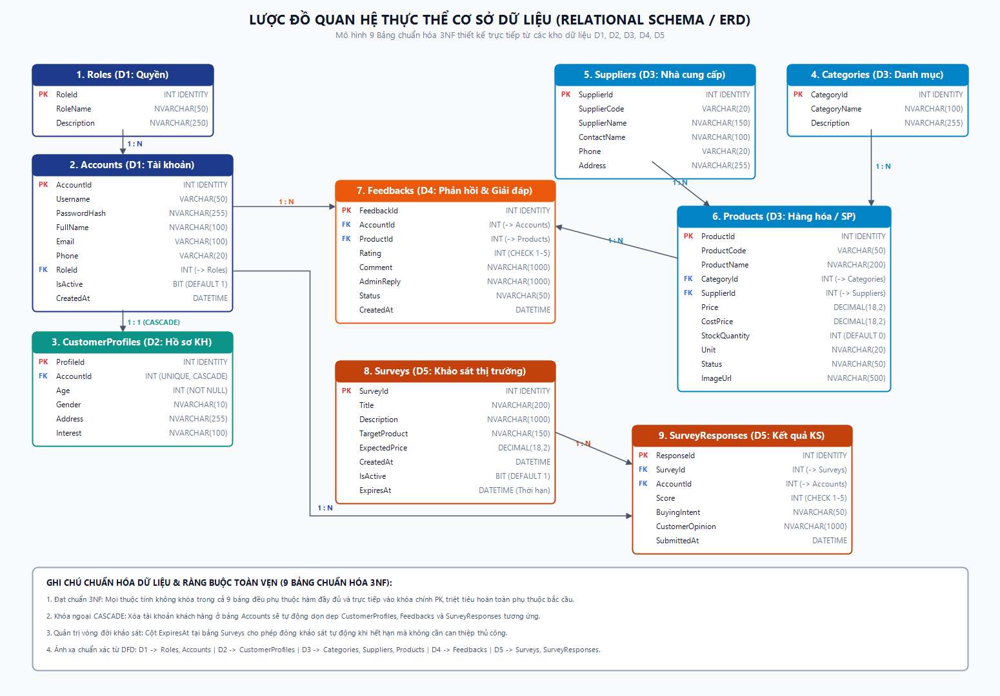

Hình 3.1: Lược đồ Quan hệ Thực thể Cơ sở Dữ liệu (ERD) 9 Bảng Chuẩn hóa 3NF của Hệ thống SGU Tech

| STT | Tên Mối kết hợp (Relationship) | Bảng Cha (1) | Bảng Con (N / 1) | Bản số | Khóa ngoại tham chiếu | Cơ chế Toàn vẹn Tham chiếu |
| --- | --- | --- | --- | --- | --- | --- |
| 1 | Phân quyền Tài khoản | Roles | Accounts | 1 — N | Accounts.RoleId -> Roles.RoleId | RESTRICT / NO ACTION |
| 2 | Hồ sơ Nhân khẩu học KH | Accounts | CustomerProfiles | 1 — 1 | CustomerProfiles.AccountId -> Accounts.AccountId | ON DELETE CASCADE (UNIQUE) |
| 3 | Phân loại Danh mục SP | Categories | Products | 1 — N | Products.CategoryId -> Categories.CategoryId | RESTRICT / NO ACTION |
| 4 | Cung ứng Sản phẩm | Suppliers | Products | 1 — N | Products.SupplierId -> Suppliers.SupplierId | RESTRICT / NO ACTION |
| 5 | Khách hàng Gửi Phản hồi | Accounts | Feedbacks | 1 — N | Feedbacks.AccountId -> Accounts.AccountId | ON DELETE CASCADE |
| 6 | Sản phẩm Nhận Phản hồi | Products | Feedbacks | 1 — N | Feedbacks.ProductId -> Products.ProductId | ON DELETE CASCADE |
| 7 | Chiến dịch Nhận Phiếu KS | Surveys | SurveyResponses | 1 — N | SurveyResponses.SurveyId -> Surveys.SurveyId | ON DELETE CASCADE |
| 8 | Khách hàng Trả lời KS | Accounts | SurveyResponses | 1 — N | SurveyResponses.AccountId -> Accounts.AccountId | ON DELETE CASCADE |

### 3.1.4. Đặc tả Chi tiết Cấu trúc Thuộc tính (Data Dictionary) và Dữ liệu Thực tế của 9 Bảng

3.1.4.1. Bảng 1: Roles (Danh mục Vai trò Phân quyền Hệ thống — Kho D1)

### Bảng Roles lưu trữ danh mục 3 vai trò phân quyền duy nhất của hệ thống sau khi đã tinh gọn các vai trò dư thừa. Mỗi bản ghi xác định một không gian làm việc tách biệt trên phần mềm.

| STT | Tên thuộc tính | Kiểu dữ liệu SQL | Cho phép NULL | Ràng buộc (Constraints) | Mô tả chi tiết ý nghĩa thuộc tính |
| --- | --- | --- | --- | --- | --- |
| 1 | RoleId | INT IDENTITY(1,1) | NOT NULL | PRIMARY KEY | Mã định danh tự tăng duy nhất của vai trò (1: Admin, 2: Manager, 3: Customer). |
| 2 | RoleName | NVARCHAR(50) | NOT NULL | UNIQUE | Tên định danh vai trò dùng để kiểm tra phân quyền trong code ('Admin', 'Manager', 'Customer'). |
| 3 | Description | NVARCHAR(250) | NULL | Default NULL | Mô tả chi tiết chức năng và phạm vi giao diện của vai trò. |

Dữ liệu thực tế đang lưu trữ trong bảng Roles (03 bản ghi):

| RoleId | RoleName | Description (Mô tả vai trò trong CSDL) | Giao diện Điều hướng |
| --- | --- | --- | --- |
| 1 | Admin | Quản trị viên máy chủ hệ thống (Quản lý Account & Phân quyền độc lập) | Frontend_Admin/admin.html |
| 2 | Manager | Người quản lý phân hệ CRM (Quản lý KH, Phản hồi, Báo cáo & Khảo sát) | Frontend_Admin/quanly.html |
| 3 | Customer | Khách hàng mua sắm, gửi đánh giá sản phẩm và thực hiện khảo sát | Frontend_Admin/user.html |

3.1.4.2. Bảng 2: Accounts (Tài khoản Định danh Người dùng — Kho D1)

### Bảng Accounts là bảng trung tâm của phân hệ Admin Server, lưu trữ thông tin đăng nhập, họ tên, liên hệ, khóa ngoại phân quyền RoleId và cờ trạng thái khóa/mở khóa IsActive của toàn bộ người dùng.

| STT | Tên thuộc tính | Kiểu dữ liệu SQL | Cho phép NULL | Ràng buộc (Constraints) | Mô tả chi tiết ý nghĩa thuộc tính |
| --- | --- | --- | --- | --- | --- |
| 1 | AccountId | INT IDENTITY(1,1) | NOT NULL | PRIMARY KEY | Mã định danh duy nhất của từng tài khoản người dùng trên máy chủ. |
| 2 | Username | VARCHAR(50) | NOT NULL | UNIQUE | Tên đăng nhập duy nhất (không phân biệt hoa thường khi xác thực). |
| 3 | PasswordHash | NVARCHAR(255) | NOT NULL | NOT NULL | Chuỗi mật khẩu xác thực (hỗ trợ băm BCrypt '$...' và mật khẩu demo '123456'). |
| 4 | FullName | NVARCHAR(100) | NOT NULL | NOT NULL | Họ và tên đầy đủ của chủ tài khoản hiển thị trên Header và báo cáo. |
| 5 | Email | VARCHAR(100) | NULL | Default Email | Địa chỉ thư điện tử liên hệ của tài khoản. |
| 6 | Phone | VARCHAR(20) | NULL | Default NULL | Số điện thoại liên hệ của chủ sở hữu tài khoản. |
| 7 | RoleId | INT | NOT NULL | FK -> Roles(RoleId) | Khóa ngoại xác định vai trò của tài khoản (1: Admin, 2: Manager, 3: Customer). |
| 8 | IsActive | BIT | NOT NULL | DEFAULT 1 | Trạng thái tài khoản (1 = Đang hoạt động; 0 = Đã bị khóa bởi Admin hoặc Quản lý). |
| 9 | CreatedAt | DATETIME | NOT NULL | DEFAULT GETDATE() | Thời điểm tạo tài khoản trên hệ thống. |

Dữ liệu thực tế đang lưu trữ trong bảng Accounts (19 bản ghi tài khoản chuẩn bị sẵn để test):

| AccountId | Username | FullName (Họ và tên) | Email | Phone | RoleId (Vai trò) | IsActive (Trạng thái) |
| --- | --- | --- | --- | --- | --- | --- |
| 1 | admin | Nguyễn Quản Trị Hệ Thống | admin@sgutech.vn | 0901000001 | 1 (Admin) | 1 (Hoạt động) |
| 2 | admin2 | Lê Hoàng Nam (Bảo mật IT) | nam.le@sgutech.vn | 0901000003 | 1 (Admin) | 1 (Hoạt động) |
| 3 | quanly | Trần Trưởng Phòng CRM | crm.manager@sgutech.vn | 0901000002 | 2 (Manager) | 1 (Hoạt động) |
| 4 | quanly_cskh | Nguyễn Thu Trang (Phó phòng CSKH) | trang.nguyen@sgutech.vn | 0901000004 | 2 (Manager) | 1 (Hoạt động) |
| 5 | khachhang1 | Nguyễn Văn An | an.nguyen@gmail.com | 0912345671 | 3 (Customer) | 1 (Hoạt động) |
| 6 | khachhang2 | Lê Thị Bình | binh.le@gmail.com | 0912345672 | 3 (Customer) | 1 (Hoạt động) |
| 7 | khachhang3 | Phạm Minh Châu | chau.pham@gmail.com | 0912345673 | 3 (Customer) | 1 (Hoạt động) |
| 8 | khachhang4 | Hoàng Đức Dũng | dung.hoang@gmail.com | 0912345674 | 3 (Customer) | 1 (Hoạt động) |
| 9 | khachhang5 | Võ Ngọc Hân (TK vi phạm - Đã khóa) | han.vo@gmail.com | 0912345675 | 3 (Customer) | 0 (Đã khóa) |
| 10 | khachhang6 | Trần Quốc Bảo | bao.tran@gmail.com | 0912345676 | 3 (Customer) | 1 (Hoạt động) |
| 11 | khachhang7 | Đặng Thúy Kiều | kieu.dang@gmail.com | 0912345677 | 3 (Customer) | 1 (Hoạt động) |
| 12 | khachhang8 | Vũ Tuấn Kiệt | kiet.vu@gmail.com | 0912345678 | 3 (Customer) | 1 (Hoạt động) |
| 13 | khachhang9 | Bùi Quỳnh Chi | chi.bui@gmail.com | 0912345679 | 3 (Customer) | 1 (Hoạt động) |
| 14 | khachhang10 | Đỗ Hoàng Long | long.do@gmail.com | 0912345680 | 3 (Customer) | 1 (Hoạt động) |
| 15 | khachhang11 | Ngô Phương Thảo | thao.ngo@gmail.com | 0912345681 | 3 (Customer) | 1 (Hoạt động) |
| 16 | khachhang12 | Trịnh Gia Huy | huy.trinh@gmail.com | 0912345682 | 3 (Customer) | 1 (Hoạt động) |
| 17 | khachhang13 | Mai Anh Tuấn | tuan.mai@gmail.com | 0912345683 | 3 (Customer) | 1 (Hoạt động) |
| 18 | khachhang14 | Dương Hoàng Yến | yen.duong@gmail.com | 0912345684 | 3 (Customer) | 1 (Hoạt động) |
| 19 | khachhang15 | Phan Thành Đạt (Tạm ngưng GD) | dat.phan@gmail.com | 0912345685 | 3 (Customer) | 0 (Đã khóa) |

3.1.4.3. Bảng 3: CustomerProfiles (Hồ sơ Nhân khẩu học Khách hàng — Kho D2)

### Bảng CustomerProfiles lưu trữ thông tin nhân khẩu học chuyên sâu của từng khách hàng (Độ tuổi, Giới tính, Địa chỉ, Sở thích tiêu dùng), phục vụ trực tiếp cho nghiệp vụ Báo cáo tỷ lệ độ tuổi và sở thích của Người quản lý CRM cũng như chức năng Chỉnh sửa thông tin của Khách hàng.

| STT | Tên thuộc tính | Kiểu dữ liệu SQL | Cho phép NULL | Ràng buộc (Constraints) | Mô tả chi tiết ý nghĩa thuộc tính |
| --- | --- | --- | --- | --- | --- |
| 1 | ProfileId | INT IDENTITY(1,1) | NOT NULL | PRIMARY KEY | Mã định danh tự tăng của hồ sơ nhân khẩu học khách hàng. |
| 2 | AccountId | INT | NOT NULL | UNIQUE, FK -> Accounts | Khóa ngoại liên kết 1–1 với bảng Accounts (ON DELETE CASCADE). |
| 3 | Age | INT | NOT NULL | NOT NULL (Default 20) | Độ tuổi hiện tại của khách hàng (dùng để phân tích tỷ lệ độ tuổi). |
| 4 | Gender | NVARCHAR(10) | NULL | Nam / Nữ / Khác | Giới tính của khách hàng. |
| 5 | Address | NVARCHAR(255) | NULL | Default NULL | Địa chỉ liên hệ và nhận hàng chi tiết của khách hàng. |
| 6 | Interest | NVARCHAR(100) | NULL | Gaming/Đồ họa/Văn phòng/Lập trình | Nhóm sở thích tiêu dùng công nghệ chính của khách hàng. |

Dữ liệu thực tế đang lưu trữ trong bảng CustomerProfiles (15 hồ sơ khách hàng):

| ProfileId | AccountId | Tên Khách hàng (Liên kết) | Age (Tuổi) | Gender | Interest (Sở thích) | Address (Địa chỉ cư trú thực tế) |
| --- | --- | --- | --- | --- | --- | --- |
| 1 | 5 | Nguyễn Văn An (khachhang1) | 19 | Nam | Gaming | 273 An Dương Vương, Quận 5, TP.HCM |
| 2 | 6 | Lê Thị Bình (khachhang2) | 24 | Nữ | Văn phòng | 120 Nguyễn Thị Minh Khai, Quận 3, TP.HCM |
| 3 | 7 | Phạm Minh Châu (khachhang3) | 28 | Nam | Lập trình | 45 Lê Văn Việt, TP. Thủ Đức, TP.HCM |
| 4 | 8 | Hoàng Đức Dũng (khachhang4) | 35 | Nam | Đồ họa | 88 Cộng Hòa, Quận Tân Bình, TP.HCM |
| 5 | 9 | Võ Ngọc Hân (khachhang5) | 22 | Nữ | Gaming | 15 Trần Hưng Đạo, Quận 1, TP.HCM |
| 6 | 10 | Trần Quốc Bảo (khachhang6) | 31 | Nam | Văn phòng | 102 Võ Văn Ngân, TP. Thủ Đức, TP.HCM |
| 7 | 11 | Đặng Thúy Kiều (khachhang7) | 18 | Nữ | Gaming | 334 Nguyễn Trãi, Quận 5, TP.HCM |
| 8 | 12 | Vũ Tuấn Kiệt (khachhang8) | 42 | Nam | Lập trình | 56 Điện Biên Phủ, Quận Bình Thạnh, TP.HCM |
| 9 | 13 | Bùi Quỳnh Chi (khachhang9) | 26 | Nữ | Đồ họa | 182 Hai Bà Trưng, Quận 1, TP.HCM |
| 10 | 14 | Đỗ Hoàng Long (khachhang10) | 29 | Nam | Gaming | 65 Hoàng Hoa Thám, Quận Phú Nhuận, TP.HCM |
| 11 | 15 | Ngô Phương Thảo (khachhang11) | 23 | Nữ | Văn phòng | 210 Cách Mạng Tháng 8, Quận 10, TP.HCM |
| 12 | 16 | Trịnh Gia Huy (khachhang12) | 19 | Nam | Lập trình | 99 Nguyễn Tri Phương, Quận 5, TP.HCM |
| 13 | 17 | Mai Anh Tuấn (khachhang13) | 38 | Nam | Đồ họa | 14 Phan Xích Long, Quận Phú Nhuận, TP.HCM |
| 14 | 18 | Dương Hoàng Yến (khachhang14) | 25 | Nữ | Văn phòng | 72 Ba Tháng Hai, Quận 10, TP.HCM |
| 15 | 19 | Phan Thành Đạt (khachhang15) | 45 | Nam | Gaming | 415 Lê Hồng Phong, Quận 5, TP.HCM |

3.1.4.4. Bảng 4: Categories (Danh mục Nhóm Sản phẩm — Kho D3) & Bảng 5: Suppliers (Nhà cung cấp — Kho D3)

| Tên Bảng | Tên thuộc tính | Kiểu dữ liệu SQL | Ràng buộc | Mô tả chi tiết ý nghĩa thuộc tính |
| --- | --- | --- | --- | --- |
| Categories | CategoryId | INT IDENTITY(1,1) | PRIMARY KEY | Mã định danh duy nhất của nhóm ngành hàng công nghệ. |
| Categories | CategoryName | NVARCHAR(100) | NOT NULL | Tên danh mục sản phẩm (Laptop, Màn hình, Phím Chuột, Linh kiện, Thiết bị mạng). |
| Categories | Description | NVARCHAR(255) | NULL | Mô tả đặc điểm dòng sản phẩm trong danh mục. |
| Suppliers | SupplierId | INT IDENTITY(1,1) | PRIMARY KEY | Mã định danh duy nhất của đối tác nhà cung cấp. |
| Suppliers | SupplierCode | VARCHAR(20) | NOT NULL, UNIQUE | Mã hiệu nhà cung cấp (NCC001 đến NCC006). |
| Suppliers | SupplierName | NVARCHAR(150) | NOT NULL | Tên pháp nhân đầy đủ của công ty cung ứng. |
| Suppliers | ContactName, Phone, Email, Address | NVARCHAR / VARCHAR | NULL | Thông tin người đại diện liên hệ, số điện thoại, email và địa chỉ trụ sở NCC. |

Dữ liệu thực tế trong bảng Categories (5 bản ghi) và bảng Suppliers (6 bản ghi):

| Loại Dữ liệu | Mã ID / Code | Tên Danh mục / Tên Nhà cung cấp | Thông tin Chi tiết / Mô tả trong CSDL |
| --- | --- | --- | --- |
| Category #1 | CAT-01 | Laptop & Máy tính xách tay | Dòng máy phục vụ học tập, văn phòng, đồ họa và gaming đỉnh cao |
| Category #2 | CAT-02 | Màn hình chuyên dụng | Màn hình độ phân giải cao 2K/4K/5K và tần số quét cao lên đến 180Hz |
| Category #3 | CAT-03 | Bàn phím & Chuột cao cấp | Bàn phím cơ Custom, chuột công thái học và phụ kiện gaming gear |
| Category #4 | CAT-04 | Linh kiện & Lưu trữ tốc độ cao | Ổ cứng SSD NVMe Gen 4, RAM DDR5 tản nhiệt và Card đồ họa |
| Category #5 | CAT-05 | Thiết bị mạng & Phụ kiện AI | Router WiFi 6 công suất lớn, Webcam 4K và thiết bị truyền phát |
| Supplier #1 | NCC001 | Công ty TNHH ASUS Việt Nam | Liên hệ: Ông Minh Hoàng / SĐT: 02838111222 / Quận 1, TP.HCM |
| Supplier #2 | NCC002 | Công ty TNHH Logitech Đông Nam Á | Liên hệ: Bà Thanh Thảo / SĐT: 02838333444 / Quận 3, TP.HCM |
| Supplier #3 | NCC003 | Tập đoàn LG Electronics Việt Nam | Liên hệ: Ông Quốc Bảo / SĐT: 02838555666 / Quận 7, TP.HCM |
| Supplier #4 | NCC004 | Công ty Cổ phần Synnex FPT | Liên hệ: Bà Ngọc Trâm / SĐT: 02873006666 / Quận Bình Thạnh, TP.HCM |
| Supplier #5 | NCC005 | Tập đoàn Sony Electronics Việt Nam | Liên hệ: Ông Quang Huy / SĐT: 02838449999 / Quận Tân Bình, TP.HCM |
| Supplier #6 | NCC006 | Công ty TNHH Điện tử Samsung Vina | Liên hệ: Bà Phương Linh / SĐT: 02839157310 / Quận 1, TP.HCM |

3.1.4.5. Bảng 6: Products (Danh mục Sản phẩm Công nghệ — Kho D3)

### Bảng Products lưu trữ thông tin chi tiết của 16 dòng sản phẩm công nghệ tại SGU Tech. Khi khách hàng gửi phản hồi trên cổng user.html, khách hàng sẽ chọn sản phẩm từ bảng này và hệ thống hiển thị kèm hình ảnh sản phẩm (ImageUrl) trực quan trên cả màn hình Khách hàng lẫn màn hình Người quản lý CRM.

| STT | Tên thuộc tính | Kiểu dữ liệu SQL | Cho phép NULL | Ràng buộc (Constraints) | Mô tả chi tiết ý nghĩa thuộc tính |
| --- | --- | --- | --- | --- | --- |
| 1 | ProductId | INT IDENTITY(1,1) | NOT NULL | PRIMARY KEY | Mã định danh duy nhất của sản phẩm. |
| 2 | ProductCode | VARCHAR(50) | NOT NULL | UNIQUE | Mã SKU quản lý sản phẩm (SP001 đến SP016). |
| 3 | ProductName | NVARCHAR(200) | NOT NULL | NOT NULL | Tên thương mại đầy đủ của sản phẩm công nghệ. |
| 4 | CategoryId | INT | NOT NULL | FK -> Categories | Khóa ngoại xác định danh mục nhóm sản phẩm. |
| 5 | SupplierId | INT | NOT NULL | FK -> Suppliers | Khóa ngoại xác định nhà cung cấp sản phẩm. |
| 6 | Price | DECIMAL(18,2) | NOT NULL | NOT NULL | Đơn giá bán lẻ niêm yết (VNĐ). |
| 7 | CostPrice | DECIMAL(18,2) | NOT NULL | NOT NULL | Giá vốn nhập hàng (VNĐ). |
| 8 | StockQuantity | INT | NOT NULL | DEFAULT 0 | Số lượng tồn kho hiện tại. |
| 9 | Unit | NVARCHAR(20) | NOT NULL | Cái / Bộ | Đơn vị tính của sản phẩm. |
| 10 | Status | NVARCHAR(50) | NOT NULL | Đang bán / Hết hàng | Trạng thái kinh doanh của sản phẩm. |
| 11 | ImageUrl | NVARCHAR(500) | NULL | URL Hình ảnh | Đường dẫn ảnh minh họa sản phẩm hiển thị trên bảng phản hồi. |

3.1.4.6. Bảng 7: Feedbacks (Phản hồi Sản phẩm của Khách hàng & Giải đáp từ Quản lý — Kho D4)

### Bảng Feedbacks lưu trữ toàn bộ các lượt đánh giá mức độ hài lòng (Rating 1–5 sao) và nhận xét sản phẩm do khách hàng gửi về, đồng thời lưu câu trả lời giải đáp chính thức (AdminReply) và trạng thái xử lý (Status) của Người quản lý CRM.

| STT | Tên thuộc tính | Kiểu dữ liệu SQL | Cho phép NULL | Ràng buộc (Constraints) | Mô tả chi tiết ý nghĩa thuộc tính |
| --- | --- | --- | --- | --- | --- |
| 1 | FeedbackId | INT IDENTITY(1,1) | NOT NULL | PRIMARY KEY | Mã định danh duy nhất của lượt phản hồi sản phẩm. |
| 2 | AccountId | INT | NOT NULL | FK -> Accounts (CASCADE) | Khóa ngoại xác định tài khoản khách hàng gửi phản hồi. |
| 3 | ProductId | INT | NOT NULL | FK -> Products (CASCADE) | Khóa ngoại xác định sản phẩm được khách hàng đánh giá. |
| 4 | Rating | INT | NOT NULL | CHECK (1 <= Rating <= 5) | Điểm đánh giá mức độ hài lòng từ 1 sao đến 5 sao. |
| 5 | Comment | NVARCHAR(1000) | NOT NULL | NOT NULL | Nội dung nhận xét, góp ý hoặc khiếu nại chi tiết của khách hàng. |
| 6 | AdminReply | NVARCHAR(1000) | NULL | Default NULL | Nội dung câu trả lời giải đáp từ Người quản lý CRM. |
| 7 | Status | NVARCHAR(50) | NOT NULL | DEFAULT N'Chờ xử lý' | Trạng thái xử lý ('Chờ xử lý' hoặc 'Đã tiếp nhận & Xử lý'). |
| 8 | CreatedAt | DATETIME | NOT NULL | DEFAULT GETDATE() | Thời điểm khách hàng gửi phản hồi lên hệ thống. |

Dữ liệu thực tế đang lưu trữ trong bảng Feedbacks (18 bản ghi giao dịch phản hồi thực tế):

| ID | Khách hàng | Sản phẩm đánh giá | Sao | Nội dung phản hồi (Comment) | Giải đáp từ Người quản lý (AdminReply) | Trạng thái |
| --- | --- | --- | --- | --- | --- | --- |
| 1 | Nguyễn Văn An | Laptop ASUS ROG Strix G16 | 5★ | Laptop ROG Strix chạy cực kỳ mượt, tản nhiệt mát mẻ khi chiến game AAA nặng ở độ phân giải 2K. | Cảm ơn bạn đã tin tưởng ủng hộ sản phẩm chính hãng tại hệ thống SGU Tech! | Đã tiếp nhận & Xử lý |
| 2 | Lê Thị Bình | Chuột Logitech MX Master 3S | 4★ | Chuột MX Master 3S cuộn trang vô cực rất êm tay cho công việc văn phòng, pin dùng cả tháng. | SGU Tech xin cảm ơn đánh giá tích cực từ bạn! | Đã tiếp nhận & Xử lý |
| 3 | Phạm Minh Châu | Màn hình LG UltraGear 27 2K | 5★ | Màn hình LG UltraGear hiển thị chuẩn màu, tần số quét 180Hz chơi game và làm việc rất sướng mắt. | Chúc bạn có những trải nghiệm tuyệt vời cùng sản phẩm! | Đã tiếp nhận & Xử lý |
| 4 | Hoàng Đức Dũng | SSD Samsung 990 Pro 2TB | 5★ | Tốc độ đọc ghi của SSD Samsung 990 Pro cực nhanh, render video đồ họa 4K tiết kiệm rất nhiều thời gian. | Cảm ơn bạn! Dòng Samsung 990 Pro là đỉnh nhất hiện nay ạ. | Đã tiếp nhận & Xử lý |
| 5 | Bùi Quỳnh Chi | Màn hình Dell UltraSharp 32 4K | 5★ | Màn hình Dell UltraSharp 32 4K IPS Black màu đen sâu, độ phủ màu chuẩn DCI-P3 98% rất đáng tiền. | Dòng UltraSharp IPS Black luôn được hỗ trợ bảo hành đổi mới 3 năm bạn nhé! | Đã tiếp nhận & Xử lý |
| 6 | Đỗ Hoàng Long | Bàn phím Keychron Q1 Max | 5★ | Bàn phím Keychron Q1 Max gõ đầm tay, âm thanh thock trầm rất êm, kết nối không dây 2.4Ghz cực nhạy. | Cảm ơn bạn đã lựa chọn phiên bản phím cơ nhôm CNC cao cấp tại SGU Tech! | Đã tiếp nhận & Xử lý |
| 7 | Ngô Phương Thảo | MacBook Pro 14 M3 Pro | 5★ | MacBook Pro 14 M3 Pro pin trâu kinh khủng, dùng cả ngày không cần cắm sạc, màn hình tuyệt đẹp. | Cảm ơn chị đã mua hàng chính hãng Apple tại SGU Tech! | Đã tiếp nhận & Xử lý |
| 8 | Nguyễn Văn An | Chuột Logitech G102 Gen 2 | 4★ | Chuột G102 bền bỉ, click nảy tốt, mức giá rất vừa túi tiền sinh viên. | (Chưa trả lời — Đang chờ tiếp nhận) | Chờ xử lý |
| 9 | Đặng Thúy Kiều | Tai nghe HyperX Cloud II | 4★ | Tai nghe HyperX Cloud II đeo êm tai không bị cấn, mic lọc ồn tốt khi đàm thoại. | (Chưa trả lời — Đang chờ tiếp nhận) | Chờ xử lý |
| 10 | Vũ Tuấn Kiệt | Màn hình ASUS ProArt 27 4K | 3★ | Màn hình ProArt màu đẹp nhưng viền hơi dày hơn mong đợi một chút. | (Chưa trả lời — Đang chờ tiếp nhận) | Chờ xử lý |
| 11 | Trịnh Gia Huy | RAM Corsair DDR5 64GB | 5★ | RAM Corsair DDR5 64GB mở hàng chục máy ảo Docker chạy mượt mà, LED RGB đồng bộ iCUE đẹp mắt. | (Chưa trả lời — Đang chờ tiếp nhận) | Chờ xử lý |
| 12 | Mai Anh Tuấn | Webcam 4K Sony Bravia Cam | 4★ | Webcam Sony 4K nét căng, tự động lấy nét khuôn mặt khi họp online rất tiện lợi. | (Chưa trả lời — Đang chờ tiếp nhận) | Chờ xử lý |
| 13 | Phạm Minh Châu | Laptop ASUS ROG Strix G16 | 5★ | Máy đẹp, cấu hình khủng, nhân viên tư vấn SGU Tech rất nhiệt tình hỗ trợ cài đặt ban đầu. | (Chưa trả lời — Đang chờ tiếp nhận) | Chờ xử lý |
| 14 | Đỗ Hoàng Long | Bàn phím Logitech G Pro X | 2★ | Bàn phím G Pro X gõ tốt nhưng âm thanh clicky của switch hơi ồn khi làm việc ban đêm. | Bạn có thể ghé showroom SGU Tech để đổi sang phiên bản switch Linear êm hơn nhé! | Đã tiếp nhận & Xử lý |
| 15 | Dương Hoàng Yến | Router ASUS ROG GT-AX6000 | 4★ | Router Asus phát sóng xuyên tường 2 tầng lầu vẫn bắt được sóng WiFi 6 mạnh mẽ. | (Chưa trả lời — Đang chờ tiếp nhận) | Chờ xử lý |
| 16 | Lê Thị Bình | Tai nghe Sony WH-1000XM5 | 5★ | Chống ồn của Sony XM5 thực sự đỉnh cao, đi xe buýt hay máy bay bật lên là yên tĩnh hoàn toàn. | (Chưa trả lời — Đang chờ tiếp nhận) | Chờ xử lý |
| 17 | Hoàng Đức Dũng | Card ASUS TUF RTX 4080 Super | 1★ | Card đồ họa RTX 4080 Super giao đến bị cấn một góc hộp bìa carton bên ngoài do vận chuyển. | SGU Tech chân thành xin lỗi anh! Quản lý kho đã liên hệ và đổi mới nguyên seal ngay trong hôm nay ạ. | Đã tiếp nhận & Xử lý |
| 18 | Nguyễn Văn An | SSD Samsung 990 Pro 2TB | 5★ | Mua chiếc SSD thứ hai gắn thêm cho laptop ROG, tốc độ ổn định nhiệt độ chỉ 45 độ C. | (Chưa trả lời — Đang chờ tiếp nhận) | Chờ xử lý |

3.1.4.7. Bảng 8: Surveys (Chiến dịch Bảng Khảo sát — Kho D5) & Bảng 9: SurveyResponses (Phiếu Trả lời Khảo sát — Kho D5)

### Cặp bảng Surveys và SurveyResponses hiện thực hóa trọn vẹn nghiệp vụ Tạo bảng khảo sát gửi đến tài khoản khách hàng, Nhận & thực hiện khảo sát, và Thống kê kết quả khảo sát:

| Tên Bảng | Tên thuộc tính | Kiểu dữ liệu SQL | Ràng buộc (Constraints) | Mô tả chi tiết ý nghĩa thuộc tính |
| --- | --- | --- | --- | --- |
| Surveys | SurveyId | INT IDENTITY(1,1) | PRIMARY KEY | Mã định danh duy nhất của chiến dịch bảng khảo sát. |
| Surveys | Title | NVARCHAR(200) | NOT NULL | Tiêu đề bảng khảo sát hiển thị trên tài khoản khách hàng. |
| Surveys | Description | NVARCHAR(1000) | NULL | Mô tả chi tiết tính năng, công nghệ của sản phẩm cần khảo sát. |
| Surveys | TargetProduct | NVARCHAR(150) | NOT NULL | Tên sản phẩm công nghệ mới dự kiến ra mắt. |
| Surveys | ExpectedPrice | DECIMAL(18,2) | NOT NULL | Mức giá bán dự kiến đưa ra khảo sát (VNĐ). |
| Surveys | CreatedAt | DATETIME | DEFAULT GETDATE() | Thời điểm Người quản lý phát hành bảng khảo sát. |
| Surveys | IsActive | BIT | DEFAULT 1 | Trạng thái mở/khóa khảo sát (1: Đang mở; 0: Đã khóa). |
| Surveys | ExpiresAt | DATETIME | NULL | Thời hạn kết thúc nhận khảo sát (NULL = Không giới hạn thời gian). |
| SurveyResponses | ResponseId | INT IDENTITY(1,1) | PRIMARY KEY | Mã định danh duy nhất của phiếu trả lời khảo sát. |
| SurveyResponses | SurveyId | INT | FK -> Surveys (CASCADE) | Khóa ngoại xác định chiến dịch khảo sát được trả lời. |
| SurveyResponses | AccountId | INT | FK -> Accounts (CASCADE) | Khóa ngoại xác định tài khoản khách hàng thực hiện khảo sát. |
| SurveyResponses | Score | INT | CHECK (1 <= Score <= 5) | Điểm đánh giá mức độ quan tâm đối với sản phẩm (1 đến 5 điểm). |
| SurveyResponses | BuyingIntent | NVARCHAR(50) | NOT NULL | Ý định mua sắm ('Rất muốn mua', 'Đang cân nhắc', 'Không mua'). |
| SurveyResponses | CustomerOpinion | NVARCHAR(1000) | NULL | Ý kiến đóng góp chi tiết của khách hàng về tính năng và mức giá. |
| SurveyResponses | SubmittedAt | DATETIME | DEFAULT GETDATE() | Thời điểm khách hàng hoàn tất và gửi phiếu khảo sát. |

Dữ liệu thực tế trong bảng Surveys (05 chiến dịch khảo sát) và bảng SurveyResponses (16 phiếu trả lời):

| SurveyId | Tiêu đề Chiến dịch Khảo sát (Title) | Sản phẩm Khảo sát (TargetProduct) | Giá dự kiến | Trạng thái & Hạn | Số phiếu |
| --- | --- | --- | --- | --- | --- |
| 1 | Khảo sát nhu cầu dòng Laptop AI Siêu Mỏng Nhẹ 2026 | ASUS Zenbook S16 OLED AI 2026 | 36.990.000 đ | Đang mở (Còn 20 ngày) | 06 phiếu |
| 2 | Thăm dò Bàn phím cơ Custom Nhôm CNC Không dây | Keychron Q1 Max SGU Custom Edition | 4.500.000 đ | Đang mở (Không hạn) | 04 phiếu |
| 3 | Thăm dò Tai nghe chống ồn Hi-Res Thế hệ Mới | Sony WH-1000XM6 Edition 2026 | 7.990.000 đ | Đang mở (Còn 10 ngày) | 03 phiếu |
| 4 | Khảo sát Màn hình Đồ họa 5K Chuyên Dụng Cho Designer | Dell UltraSharp 32 5K HDR | 24.500.000 đ | Đang mở (Còn 15 ngày) | 03 phiếu |
| 5 | Khảo sát thử nghiệm Màn hình cong Mini-LED 49 inch | Samsung Odyssey OLED G9 | 29.900.000 đ | Đã đóng (IsActive = 0) | 00 phiếu |

| Mã Phiếu | SurveyId | Khách hàng Thực hiện | Điểm (1–5) | Ý định mua (BuyingIntent) | Ý kiến đóng góp thực tế của Khách hàng (CustomerOpinion) |
| --- | --- | --- | --- | --- | --- |
| RSP-01 | KS #1 | Nguyễn Văn An (ID 5) | 5 / 5 | Rất muốn mua | Thiết kế cực kỳ sang trọng, nếu có quà tặng kèm chuột không dây và túi chống sốc tôi sẽ đặt trước ngay. |
| RSP-02 | KS #1 | Lê Thị Bình (ID 6) | 4 / 5 | Đang cân nhắc | Cấu hình chip AI rất ấn tượng nhưng mức giá gần 37 triệu hơi cao đối với nhân viên văn phòng. |
| RSP-03 | KS #1 | Phạm Minh Châu (ID 7) | 5 / 5 | Rất muốn mua | Màn hình OLED 3K và thời lượng pin lâu rất phù hợp cho lập trình viên, mong cửa hàng hỗ trợ trả góp 0%. |
| RSP-04 | KS #1 | Trần Quốc Bảo (ID 10) | 5 / 5 | Rất muốn mua | Máy rất nhẹ phù hợp đi công tác xa, tôi sẵn sàng đặt cọc trước. |
| RSP-05 | KS #1 | Vũ Tuấn Kiệt (ID 12) | 3 / 5 | Không mua | Tôi quen dùng máy tính bàn cấu hình cao hơn là laptop mỏng nhẹ. |
| RSP-06 | KS #1 | Ngô Phương Thảo (ID 15) | 4 / 5 | Đang cân nhắc | Chờ xem bản thực tế ngoài showroom SGU Tech rồi sẽ quyết định mua. |
| RSP-07 | KS #2 | Hoàng Đức Dũng (ID 8) | 4 / 5 | Đang cân nhắc | Bản nhôm CNC rất đầm, nếu shop có sẵn switch tactile tôi sẽ mua ngay. |
| RSP-08 | KS #2 | Nguyễn Văn An (ID 5) | 5 / 5 | Rất muốn mua | Mức giá 4.5 triệu cho bản Q1 Max là quá hợp lý trong phân khúc phím nhôm. |
| RSP-09 | KS #2 | Đỗ Hoàng Long (ID 14) | 5 / 5 | Rất muốn mua | Sẵn sàng mua ngay khi mở bán đợt đầu, mong có màu đen nhám Anodized. |
| RSP-10 | KS #2 | Trịnh Gia Huy (ID 16) | 3 / 5 | Không mua | Đã có bàn phím cơ rồi nên chưa có nhu cầu mua thêm. |
| RSP-11 | KS #3 | Lê Thị Bình (ID 6) | 4 / 5 | Đang cân nhắc | Nếu trọng lượng nhẹ hơn bản XM5 và đệm tai êm hơn tôi sẽ nâng cấp. |
| RSP-12 | KS #3 | Đặng Thúy Kiều (ID 11) | 5 / 5 | Rất muốn mua | Nếu chống ồn AI tốt hơn XM5 thì 8 triệu là mức giá chấp nhận được. |
| RSP-13 | KS #3 | Bùi Quỳnh Chi (ID 13) | 4 / 5 | Đang cân nhắc | Mong đợi chất âm ấm và microphone đàm thoại rõ ràng hơn. |
| RSP-14 | KS #4 | Hoàng Đức Dũng (ID 8) | 5 / 5 | Rất muốn mua | Độ phân giải 5K rất cần cho biên tập ảnh và video, mức giá 24.5 triệu rất cạnh tranh với Apple Studio Display. |
| RSP-15 | KS #4 | Bùi Quỳnh Chi (ID 13) | 5 / 5 | Rất muốn mua | Nếu có chân đế xoay dọc công thái học và cổng sạc Thunderbolt 4 thì hoàn hảo. |
| RSP-16 | KS #4 | Mai Anh Tuấn (ID 17) | 4 / 5 | Đang cân nhắc | Cần kiểm tra độ tương phản thực tế tại showroom SGU Tech. |

### 3.1.5. Thiết kế Chỉ mục Tối ưu Hiệu năng (Database Indexing) và Truy vấn Thống kê Cốt lõi

### Để đảm bảo thời gian phản hồi của toàn bộ 21 RESTful API luôn đạt dưới 50ms khi quy mô dữ liệu mở rộng lên hàng trăm nghìn bản ghi, hệ thống thiết kế bộ chỉ mục phi cụm (Non-Clustered Indexes) và các câu lệnh truy vấn thống kê tối ưu trên SQL Server:

Thiết kế Chỉ mục (Indexes) và Truy vấn Phân tích Thống kê CRM trên SQL Server:

    -- 1. CÁC CHỈ MỤC TỐI ƯU HÓA TÌM KIẾM & THỐNG KÊ (NON-CLUSTERED INDEXES)CREATE UNIQUE NONCLUSTERED INDEX IX_Accounts_Username ON Accounts(Username);CREATE NONCLUSTERED INDEX IX_Accounts_RoleId_IsActive ON Accounts(RoleId, IsActive);CREATE NONCLUSTERED INDEX IX_CustomerProfiles_Interest_Age ON CustomerProfiles(Interest, Age);CREATE NONCLUSTERED INDEX IX_Feedbacks_ProductId_Rating ON Feedbacks(ProductId, Rating, Status);CREATE UNIQUE NONCLUSTERED INDEX IX_SurveyResponses_UniqueCustomerSurvey ON SurveyResponses(SurveyId, AccountId);GO-- 2. TRUY VẤN BÁO CÁO TỶ LỆ ĐỘ TUỔI KHÁCH HÀNG (PHỤC VỤ TAB 3 NGƯỜI QUẢN LÝ CRM)SELECT    COUNT(*) AS TongSoKhachHang,    ROUND(AVG(CAST(Age AS FLOAT)), 1) AS DoTuoiTrungBinh,    SUM(CASE WHEN Age < 20 THEN 1 ELSE 0 END) AS Duoi20Tuoi,    SUM(CASE WHEN Age BETWEEN 20 AND 30 THEN 1 ELSE 0 END) AS Tu20Den30Tuoi,    SUM(CASE WHEN Age > 30 THEN 1 ELSE 0 END) AS Tren30TuoiFROM CustomerProfiles;GO-- 3. TRUY VẤN BÁO CÁO PHÂN BỐ SỞ THÍCH TIÊU DÙNG KÈM TỶ LỆ PHẦN TRĂMSELECT    ISNULL(Interest, N'Khác') AS NhomSoThich,    COUNT(*) AS SoLuongKhachHang,    CAST(ROUND(COUNT(*) * 100.0 / NULLIF((SELECT COUNT(*) FROM CustomerProfiles), 0), 1) AS DECIMAL(5,1)) AS TyLePhanTramFROM CustomerProfilesGROUP BY ISNULL(Interest, N'Khác')ORDER BY SoLuongKhachHang DESC;GO-- 4. TRUY VẤN THỐNG KÊ KẾT QUẢ KHẢO SÁT TOÀN DIỆN (PHỤC VỤ TAB 5 NGƯỜI QUẢN LÝ CRM)SELECT    s.SurveyId,    s.Title,    s.TargetProduct,    s.ExpectedPrice,    COUNT(r.ResponseId) AS SoLuotThamGia,    ISNULL(ROUND(AVG(CAST(r.Score AS FLOAT)), 2), 0) AS DiemQuanTamTrungBinh,    SUM(CASE WHEN r.BuyingIntent = N'Rất muốn mua' THEN 1 ELSE 0 END) AS RatMuonMua,    SUM(CASE WHEN r.BuyingIntent = N'Đang cân nhắc' THEN 1 ELSE 0 END) AS DangCanNhac,    SUM(CASE WHEN r.BuyingIntent = N'Không mua' THEN 1 ELSE 0 END) AS KhongMuaFROM Surveys sLEFT JOIN SurveyResponses r ON s.SurveyId = r.SurveyIdGROUP BY s.SurveyId, s.Title, s.TargetProduct, s.ExpectedPriceORDER BY s.SurveyId ASC;GO
### 3.1.6. Đặc tả Hệ thống Ràng buộc Toàn vẹn CSDL (Database Integrity Constraints Specification)

### Để đảm bảo tính nhất quán dữ liệu tuyệt đối trong suốt quá trình vận hành, hệ thống thiết lập 18 Ràng buộc Toàn vẹn (Integrity Constraints) được phân loại theo 4 nhóm lý thuyết Cơ sở dữ liệu quan hệ:

| Mã RB | Loại Ràng buộc Toàn vẹn | Bảng Áp dụng | Biểu thức Hình thức / Điều kiện Ràng buộc trong SQL Server & EF Core |
| --- | --- | --- | --- |
| RB-01 | Toàn vẹn Thực thể (PK) | Tất cả 9 Bảng | ∀ t1, t2 ∈ Table (t1 ≠ t2) ⇒ t1.PrimaryKey ≠ t2.PrimaryKey ∧ t1.PrimaryKey ≠ NULL (IDENTITY(1,1)). |
| RB-02 | Toàn vẹn Duy nhất (Unique) | Roles | ∀ r1, r2 ∈ Roles (r1 ≠ r2) ⇒ r1.RoleName ≠ r2.RoleName. Tập giá trị chuẩn: {'Admin', 'Manager', 'Customer'}. |
| RB-03 | Toàn vẹn Duy nhất (Unique) | Accounts | ∀ a1, a2 ∈ Accounts (a1 ≠ a2) ⇒ LOWER(a1.Username) ≠ LOWER(a2.Username). |
| RB-04 | Toàn vẹn Duy nhất (Unique) | CustomerProfiles | ∀ p1, p2 ∈ CustomerProfiles (p1 ≠ p2) ⇒ p1.AccountId ≠ p2.AccountId (Quan hệ 1–1 chặt với Accounts). |
| RB-05 | Toàn vẹn Duy nhất (Unique) | Products, Suppliers | ProductCode là duy nhất trong bảng Products (SP001..SP016); SupplierCode là duy nhất trong bảng Suppliers (NCC001..NCC006). |
| RB-06 | Toàn vẹn Miền giá trị | Accounts | a.IsActive ∈ {0 (False - Đã khóa), 1 (True - Hoạt động)}; mặc định khi tạo mới là 1. |
| RB-07 | Toàn vẹn Miền giá trị | CustomerProfiles | p.Age ∈ Z+ (Age > 0); p.Gender ∈ {N'Nam', N'Nữ', N'Khác'}; p.Interest ∈ {N'Gaming', N'Đồ họa', N'Văn phòng', N'Lập trình', N'Khác'}. |
| RB-08 | Toàn vẹn Miền giá trị | Products | pr.Price > 0 ∧ pr.CostPrice > 0 ∧ pr.StockQuantity >= 0; pr.Status ∈ {N'Đang bán', N'Hết hàng'}. |
| RB-09 | Toàn vẹn Miền giá trị | Feedbacks | fb.Rating ∈ {1, 2, 3, 4, 5} (CHECK Rating >= 1 AND Rating <= 5); fb.Status ∈ {N'Chờ xử lý', N'Đã tiếp nhận & Xử lý'}. |
| RB-10 | Toàn vẹn Miền giá trị | SurveyResponses | sr.Score ∈ {1, 2, 3, 4, 5} (CHECK Score >= 1 AND Score <= 5); sr.BuyingIntent ∈ {N'Rất muốn mua', N'Đang cân nhắc', N'Không mua'}. |
| RB-11 | Toàn vẹn Tham chiếu (FK) | Accounts -> Roles | ∀ a ∈ Accounts ⇒ ∃ r ∈ Roles : a.RoleId = r.RoleId. |
| RB-12 | Toàn vẹn Tham chiếu (FK) | CustomerProfiles -> Accounts | ∀ p ∈ CustomerProfiles ⇒ ∃ a ∈ Accounts : p.AccountId = a.AccountId (ON DELETE CASCADE). |
| RB-13 | Toàn vẹn Tham chiếu (FK) | Products -> Categories, Suppliers | ∀ pr ∈ Products ⇒ (∃ c ∈ Categories : pr.CategoryId = c.CategoryId) ∧ (∃ s ∈ Suppliers : pr.SupplierId = s.SupplierId). |
| RB-14 | Toàn vẹn Tham chiếu (FK) | Feedbacks -> Accounts, Products | ∀ fb ∈ Feedbacks ⇒ (∃ a ∈ Accounts : fb.AccountId = a.AccountId) ∧ (∃ pr ∈ Products : fb.ProductId = pr.ProductId). |
| RB-15 | Toàn vẹn Tham chiếu (FK) | SurveyResponses -> Surveys, Accounts | ∀ sr ∈ SurveyResponses ⇒ (∃ s ∈ Surveys : sr.SurveyId = s.SurveyId) ∧ (∃ a ∈ Accounts : sr.AccountId = a.AccountId). |
| RB-16 | Toàn vẹn Liên thuộc tính | Feedbacks | ∀ fb ∈ Feedbacks : Nếu fb.AdminReply ≠ NULL ⇒ fb.Status = N'Đã tiếp nhận & Xử lý'. |
| RB-17 | Toàn vẹn Liên quan hệ | SurveyResponses | ∀ sr1, sr2 ∈ SurveyResponses (sr1 ≠ sr2) ⇒ (sr1.SurveyId, sr1.AccountId) ≠ (sr2.SurveyId, sr2.AccountId) (Mỗi KH chỉ trả lời 1 lần/khảo sát). |
| RB-18 | Toàn vẹn Thời gian | Surveys, SurveyResponses | ∀ sr ∈ SurveyResponses JOIN s ∈ Surveys : s.IsActive = 1 ∧ (s.ExpiresAt IS NULL ∨ sr.SubmittedAt <= s.ExpiresAt). |

Bảng Tầm ảnh hưởng (Insert / Delete / Update Impact Matrix) của các Ràng buộc Tham chiếu:

| Quan hệ (Bảng) | Thao tác Thêm (INSERT) | Thao tác Xóa (DELETE) | Thao tác Sửa (UPDATE) |
| --- | --- | --- | --- |
| Roles (Bảng Cha) | Kiểm tra trùng RoleName (RB-02). | Chặn xóa nếu đang có Account tham chiếu tới RoleId (RB-11). | Không sửa khóa chính RoleId. |
| Accounts (Cha & Con) | Kiểm tra trùng Username (RB-03) và tồn tại RoleId trong Roles (RB-11). | Tự động xóa dây chuyền (CASCADE) các bản ghi con trong CustomerProfiles, Feedbacks, SurveyResponses. | Kiểm tra RoleId hợp lệ khi phân quyền; cập nhật cờ IsActive khi khóa/mở khóa. |
| CustomerProfiles (Con) | Kiểm tra tồn tại AccountId trong Accounts và Age > 0 (RB-07, RB-12). | Cho phép xóa tự do (không có bảng con phụ thuộc). | Kiểm tra miền giá trị Age, Gender, Interest khi khách hàng sửa hồ sơ. |
| Products (Cha & Con) | Kiểm tra trùng ProductCode và tồn tại CategoryId, SupplierId. | Xóa dây chuyền các bản ghi đánh giá trong Feedbacks của sản phẩm đó. | Kiểm tra Price > 0 và StockQuantity >= 0. |
| Feedbacks (Bảng Con) | Kiểm tra tồn tại AccountId, ProductId và Rating ∈ [1..5] (RB-09, RB-14). | Cho phép xóa tự do. | Khi cập nhật AdminReply thì tự động cập nhật Status (RB-16). |
| Surveys (Bảng Cha) | Kiểm tra ExpectedPrice >= 0 và tính toán ExpiresAt. | Xóa dây chuyền (CASCADE) toàn bộ phiếu trả lời trong SurveyResponses. | Cho phép cập nhật IsActive (Khóa/Mở khóa khảo sát). |
| SurveyResponses (Con) | Kiểm tra Survey đang mở, còn hạn, chưa làm trước đó và Score ∈ [1..5]. | Cho phép xóa tự do. | Không cho phép sửa khóa ngoại SurveyId, AccountId. |

### 3.1.7. Ước lượng Dung lượng Lưu trữ Vật lý CSDL (Database Physical Storage Sizing — Chu kỳ 3 Năm)

### Trong thiết kế CSDL vật lý cho doanh nghiệp, việc tính toán kích thước bản ghi trung bình (Average Row Size) và dự báo tốc độ tăng trưởng dung lượng lưu trữ trong 3 năm giúp Quản trị viên Máy chủ (Admin Server) quy hoạch chính xác dung lượng ổ cứng lưu trữ và phân vùng chứa bản sao lưu (Backup Partition):

| STT | Tên Bảng Vật lý | Kích thước 1 Bản ghi (Bytes) | Số Bản ghi Hiện tại (Demo) | Dự kiến Bản ghi sau 1 Năm | Dự kiến Bản ghi sau 3 Năm | Dung lượng Ước tính (Kèm Index) |
| --- | --- | --- | --- | --- | --- | --- |
| 1 | Roles | ~ 320 Bytes | 03 bản ghi | 03 bản ghi (Cố định) | 03 bản ghi (Cố định) | < 16 KB |
| 2 | Accounts | ~ 480 Bytes | 19 bản ghi | 25.000 bản ghi | 100.000 bản ghi | ~ 65 MB |
| 3 | CustomerProfiles | ~ 380 Bytes | 15 bản ghi | 24.950 bản ghi | 99.900 bản ghi | ~ 52 MB |
| 4 | Categories | ~ 360 Bytes | 05 bản ghi | 20 bản ghi | 50 bản ghi | < 64 KB |
| 5 | Suppliers | ~ 520 Bytes | 06 bản ghi | 50 bản ghi | 150 bản ghi | < 256 KB |
| 6 | Products | ~ 680 Bytes | 16 bản ghi | 1.500 bản ghi | 5.000 bản ghi | ~ 6.5 MB |
| 7 | Feedbacks | ~ 1.450 Bytes | 18 bản ghi | 120.000 bản ghi | 500.000 bản ghi | ~ 850 MB |
| 8 | Surveys | ~ 1.100 Bytes | 05 bản ghi | 120 bản ghi | 400 bản ghi | ~ 1.2 MB |
| 9 | SurveyResponses | ~ 820 Bytes | 16 bản ghi | 300.000 bản ghi | 1.200.000 bản ghi | ~ 1.15 GB |
| TỔNG | TỔNG DUNG LƯỢNG CSDL HTTTDN_DB | 9 Bảng + 6 Indexes | 103 bản ghi mẫu | ~ 471.643 bản ghi | ~ 1.905.503 bản ghi | ~ 2.13 GB (Data + Index) |

### 3.2.16. Đặc tả Quy tắc Kiểm tra Hợp lệ Biểu mẫu trên Giao diện (Client-Side & Server-Side Validation Matrix)

### Mọi biểu mẫu nhập liệu trên cả 3 phân hệ (admin.html, quanly.html, user.html) đều được bảo vệ bởi cơ chế kiểm tra hợp lệ 2 lớp (Dual-Layer Validation: kiểm tra tức thời bằng HTML5/JavaScript tại trình duyệt và kiểm tra chặt chẽ tại ASP.NET Core API Controller trước khi ghi vào SQL Server):

| Biểu mẫu Giao diện | Trường Nhập liệu | Kiểm tra tại Trình duyệt (Client-Side) | Kiểm tra tại Máy chủ (Server-Side API) | Thông báo Lỗi Hiển thị cho Người dùng |
| --- | --- | --- | --- | --- |
| Đăng nhập Hệ thống (login.html & user.html) | Username & Password | Thuộc tính required; tự động cắt khoảng trắng đầu/cuối (.trim()). | Kiểm tra khác rỗng, kiểm tra tồn tại Username, kiểm tra IsActive == true và BCrypt.Verify(). | 'Vui lòng nhập đầy đủ tên đăng nhập và mật khẩu!' / 'Tài khoản này đã bị khóa!' |
| Thêm Tài khoản Mới (admin.html) | Username, Password, FullName, RoleId | Required trên Username, FullName; RoleId chọn từ Dropdown 3 quyền. | AnyAsync kiểm tra trùng Username (không phân biệt hoa thường); gán mật khẩu mặc định nếu trống. | 'Username đã tồn tại!' / 'Tạo tài khoản thành công!' |
| Thêm Khách hàng Mới (quanly.html — Tab 1) | Username, FullName, Phone, Age, Gender, Interest | Required trên Username, FullName, Phone; Age kiểu number (min=12, max=100). | Kiểm tra trùng Username; tự động gán Age = 20 nếu <= 0; tự sinh Email chuẩn nếu để trống. | 'Vui lòng nhập đầy đủ Tên đăng nhập và Họ tên khách hàng!' |
| Giải đáp Phản hồi KH (quanly.html — Tab 2) | AdminReply (Nội dung trả lời) | Textarea required, kiểm tra độ dài tối thiểu >= 5 ký tự. | Kiểm tra FeedbackId tồn tại trong bảng Feedbacks; cập nhật Status = 'Đã tiếp nhận & Xử lý'. | 'Đã gửi phản hồi cho khách hàng.' |
| Tạo Bảng Khảo sát (quanly.html — Tab 4) | Title, TargetProduct, ExpectedPrice, Duration | Required trên Title, TargetProduct; ExpectedPrice kiểu số >= 0. | Tính toán chính xác ExpiresAt theo DurationType ('NoLimit', 'Days', 'Date'). | 'Đã tạo bảng khảo sát và gửi đến N tài khoản khách hàng đang hoạt động!' |
| Đăng ký & Sửa Hồ sơ (user.html) | Username, Password, FullName, Phone, Age, Interest | Kiểm tra định dạng số điện thoại 10 số, độ tuổi hợp lệ, chọn nhóm sở thích. | Kiểm tra trùng Username khi đăng ký; đồng bộ cập nhật cả bảng Accounts và CustomerProfiles. | 'Đăng ký tài khoản thành công!' / 'Cập nhật thông tin hồ sơ thành công!' |
| Gửi Phản hồi Sản phẩm (user.html — Tab 1) | ProductId, Rating (1–5), Comment | Bắt buộc chọn sản phẩm, chọn mức sao (1–5) và nhập nội dung nhận xét. | Ràng buộc CHECK (Rating >= 1 AND Rating <= 5) và khóa ngoại ProductId, AccountId. | 'Cảm ơn bạn đã gửi đánh giá sản phẩm!' |
| Thực hiện Khảo sát (user.html — Tab 2) | Score (1–5), BuyingIntent, CustomerOpinion | Bắt buộc chọn điểm mức độ quan tâm (1–5) và chọn 1 trong 3 ý định mua sắm. | Kiểm tra Survey.IsActive == true, chưa quá hạn ExpiresAt và khách chưa làm khảo sát này. | 'Bạn đã thực hiện bài khảo sát này rồi!' / 'Gửi kết quả khảo sát thành công!' |

## 3.2. Thiết kế Giao diện: Hình ảnh thực tế, Giới thiệu chi tiết các chức năng và hoạt động của phần mềm (5 điểm)

### 3.2.1. Hệ thống Quy chuẩn Thiết kế Giao diện Doanh nghiệp (VNG Enterprise Design System)

### Toàn bộ giao diện người dùng của đồ án tại thư mục Frontend_Admin được thiết kế thống nhất theo ngôn ngữ thiết kế doanh nghiệp hiện đại (Enterprise Corporate UI lấy cảm hứng từ hệ sinh thái quản trị của VNG Corporation), loại bỏ hoàn toàn các chi tiết rườm rà và đảm bảo sự tách biệt độc lập giữa 3 vai trò:

| Thành phần Quy chuẩn UI | Thông số Kỹ thuật CSS / Giao diện | Mục đích và Ý nghĩa trong Hệ thống |
| --- | --- | --- |
| 1. Phân tách 3 Không gian Giao diện | • admin.html (Admin Server) • quanly.html (Người Quản lý CRM) • user.html (Cổng Khách hàng) | Đảm bảo giao diện Admin Server tách biệt hoàn toàn với quản lý nhân sự, kho, bán hàng và CRM theo đúng yêu cầu đề bài. |
| 2. Bảng màu Chủ đạo (Color Palette) | • Primary Brand: #F97316 (Corporate Orange) • Sidebar & Dark Navy: #0F172A • Enterprise Blue: #1D4ED8 • Success / Danger: #10B981 / #EF4444 | Tạo độ tương phản cao, chuyên nghiệp, giúp phân biệt rõ trạng thái tài khoản Hoạt động (Xanh lá) và Đã khóa (Đỏ). |
| 3. Hệ thống Chữ (Typography) | Font-family: 'Be Vietnam Pro', 'Inter', system-ui, sans-serif; kích thước chuẩn 14px–24px | Hiển thị tiếng Việt rõ nét, chuẩn xác trên mọi độ phân giải màn hình doanh nghiệp. |
| 4. Công nghệ Biểu đồ Thống kê | Chart.js 4.x kết hợp Bộ vẽ Đồ họa Dự phòng HTML5 Canvas 2D (Offline Fallback Renderer) | Đảm bảo toàn bộ 6 biểu đồ thống kê (Phản hồi sao, Độ tuổi, Sở thích, Khảo sát) luôn hiển thị 100% kể cả khi máy tính không có kết nối Internet. |

### 3.2.2. Màn hình 1: Cổng Đăng nhập Nội bộ & Điều hướng Phân quyền Tự động (login.html)

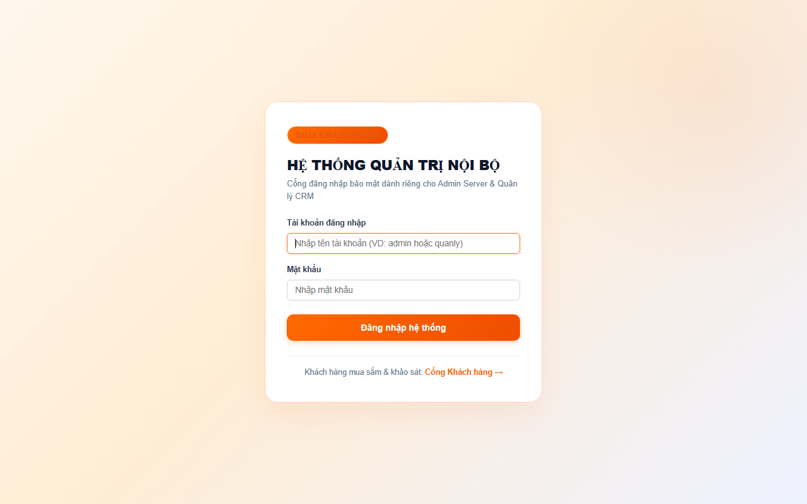

Hình 3.2: Giao diện Cổng Đăng nhập Nội bộ & Điều hướng Phân quyền Tự động (login.html)

### 1. Giới thiệu chi tiết chức năng: Màn hình login.html là cổng xác thực tập trung của hệ thống. Giao diện được chia làm 2 cột chuẩn doanh nghiệp: cột trái giới thiệu kiến trúc phân tách 3 phân hệ (Admin Server, Quản lý CRM, Khách hàng), cột phải là biểu mẫu đăng nhập kèm 3 nút chọn nhanh tài khoản Demo (Admin Server, Người Quản lý CRM, Khách hàng) và liên kết chuyển sang Cổng Khách hàng.

### 2. Hoạt động của phần mềm: Khi người dùng nhập Tên đăng nhập và Mật khẩu rồi nhấn 'Đăng nhập vào Hệ thống', hàm xử lý gửi yêu cầu POST /api/admin/auth/login. Dựa vào trường roleName trả về từ SQL Server, hệ thống tự động phân luồng: nếu là 'Admin' chuyển thẳng vào admin.html; nếu là 'Manager' chuyển thẳng vào quanly.html; nếu là 'Customer' chuyển thẳng vào user.html.

| Tên Điều khiển (Control) | ID / Selector DOM | Loại Control | Ràng buộc & Kiểm tra | Sự kiện & Hoạt động Xử lý API |
| --- | --- | --- | --- | --- |
| Ô Tên đăng nhập | #username | Input Text | Required, Trim khoảng trắng | Nhận chuỗi Username (VD: admin, quanly, khachhang1). |
| Ô Mật khẩu | #password | Input Password | Required, che ký tự bảo mật | Nhận mật khẩu xác thực (mặc định demo: 123456). |
| Nút Đăng nhập | button[type=submit] | Submit Button | Disable khi đang gọi API | Gọi POST /api/admin/auth/login, lưu localStorage và chuyển trang theo Role. |
| Nút Demo Admin Server | fillDemo('admin') | Quick Action Button | Tự động điền admin / 123456 | Điền nhanh tài khoản Quản trị viên máy chủ để kiểm thử tức thì. |
| Nút Demo Quản lý CRM | fillDemo('quanly') | Quick Action Button | Tự động điền quanly / 123456 | Điền nhanh tài khoản Người quản lý CRM để kiểm thử 7 chức năng. |
| Liên kết Cổng Khách hàng | a[href='user.html'] | Navigation Link | Mở trực tiếp user.html | Chuyển sang Cổng tự phục vụ dành riêng cho Khách hàng. |

### 3.2.3. Màn hình 2 & 3: Giao diện Admin Server — Quản trị Tài khoản, Thêm/Xóa/Khóa & Phân quyền Account (admin.html)

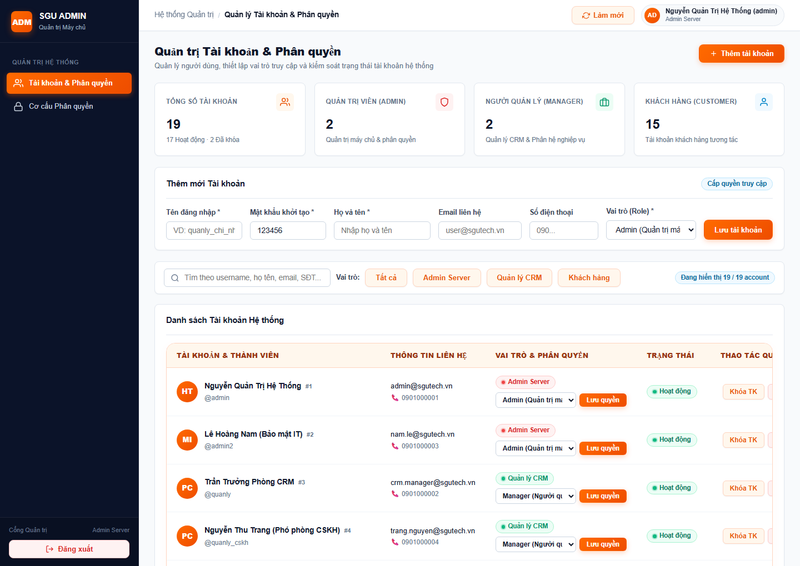

Hình 3.3: Giao diện Admin Server — Tổng quan 4 Chỉ số KPI & Danh sách Quản trị Tài khoản (admin.html)

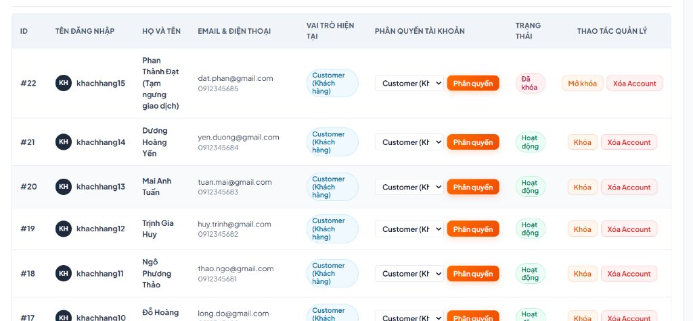

Hình 3.4: Bảng Thao tác Phân quyền 3 Vai trò, Khóa/Mở khóa và Xóa Account trên Admin Server

### 1. Giới thiệu chi tiết chức năng: Giao diện admin.html được thiết kế tách biệt hoàn toàn với giao diện của quản lý nhân sự, quản lý kho, quản lý bán hàng và quản lý CRM. Toàn bộ các chức năng xem, tìm kiếm, sắp xếp, lọc sản phẩm và nhà cung cấp đã được loại bỏ hoàn toàn. Màn hình tập trung 100% vào nhiệm vụ quản trị tài khoản máy chủ:

### • • Khu vực 4 Thẻ KPI Máy chủ: Hiển thị trực quan Tổng số tài khoản (19), Tài khoản đang hoạt động (17), Tài khoản đã khóa (2) và Tổng số vai trò hệ thống (3).

### • • Thanh công cụ Tìm kiếm, Lọc & Thêm mới: Cho phép tìm kiếm tức thời theo Username, Họ tên, Email, SĐT; lọc theo đúng 3 vai trò (Admin, Manager, Customer); và mở Modal '+ Thêm tài khoản mới'.

### • • Bảng Quản trị & Phân quyền Account: Trên từng dòng tài khoản, Admin có hộp chọn Dropdown chứa đúng 3 quyền (Admin, Manager, Customer) kèm nút 'Phân quyền', nút 'Khóa / Mở khóa' và nút 'Xóa Account'.

| Tên Điều khiển (Control) | ID / Hàm JS | Loại Control | Hoạt động Xử lý Nghiệp vụ & Kết nối Backend API |
| --- | --- | --- | --- |
| 4 Thẻ KPI Tài khoản | #statTotalAccounts... | Metric Cards | Tự động tổng hợp số liệu từ phản hồi của API GET /api/admin/accounts. |
| Ô Tìm kiếm Tài khoản | #accountSearchInput | Search Input | Lọc thời gian thực bảng tài khoản theo Username, Họ tên, Email hoặc Số điện thoại. |
| Bộ lọc Vai trò (3 Role) | #roleFilterSelect | Select Dropdown | Lọc danh sách tài khoản theo 3 vai trò: Admin (1), Manager (2), Customer (3). |
| Nút + Thêm tài khoản mới | openCreateAccountModal() | Primary Button | Mở hộp thoại nhập Username, Password, Họ tên, Email, SĐT, Role và gọi POST /api/admin/accounts. |
| Dropdown Chọn Quyền + Nút Phân quyền | #roleSelect_{id} & changeRole(id) | Select + Button | Cho phép chọn Admin / Manager / Customer và gọi PUT /api/admin/accounts/{id}/role để lưu quyền mới. |
| Nút Khóa / Mở khóa Account | toggleAccountStatus(id) | Warning Button | Gọi PUT /api/admin/accounts/{id}/toggle-status để đảo trạng thái IsActive (Hoạt động <-> Đã khóa). |
| Nút Xóa Account | deleteAccount(id) | Danger Button | Xác nhận xóa và gọi DELETE /api/admin/accounts/{id} để xóa tài khoản cùng dữ liệu liên kết. |

### 3.2.4. Màn hình 4: Giao diện Admin Server — Tab 2: Cơ cấu Phân quyền 3 Vai trò & Ma trận RBAC (admin.html?tab=roles)

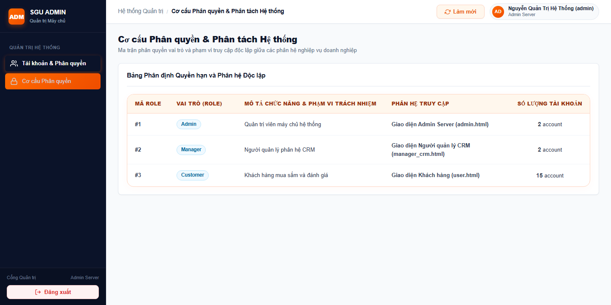

Hình 3.5: Giao diện Admin Server — Tab 2: Cơ cấu Phân quyền 3 Vai trò & Ma trận Phân tách Hệ thống RBAC

### 1. Giới thiệu chi tiết chức năng & hoạt động: Tab thứ hai trên giao diện Admin Server cung cấp cái nhìn tổng thể về kiến trúc kiểm soát truy cập dựa trên vai trò (Role-Based Access Control – RBAC). Màn hình hiển thị 3 thẻ vai trò chuẩn (Admin: 2 tài khoản, Manager: 2 tài khoản, Customer: 15 tài khoản) cùng bảng Ma trận Phân tách Quyền hạn, chứng minh rõ ràng việc Admin Server được tách biệt độc lập với các phân hệ nghiệp vụ.

| Thành phần Giao diện | ID / Selector DOM | Mô tả Hoạt động Hiển thị & Xử lý Dữ liệu |
| --- | --- | --- |
| Lưới 3 Thẻ Vai trò Hệ thống | #rolesSummaryGrid | Đếm tự động số lượng tài khoản thuộc từng vai trò (Admin, Manager, Customer) từ CSDL. |
| Bảng Ma trận Phân quyền RBAC | #rbacMatrixTable | Hiển thị rõ cổng giao diện riêng biệt (admin.html, quanly.html, user.html) và phạm vi quyền hạn của từng vai trò. |
| Nút Chuyển Tab điều hướng | .nav-item[data-tab='roles'] | Chuyển đổi mượt mà giữa Tab Quản lý Tài khoản và Tab Cơ cấu Phân quyền mà không cần tải lại trang. |

### 3.2.5. Màn hình 5: Giao diện Người Quản lý CRM — Tab 1: Quản lý Khách hàng (Thêm mới, Xóa & Khóa TK Khách hàng)

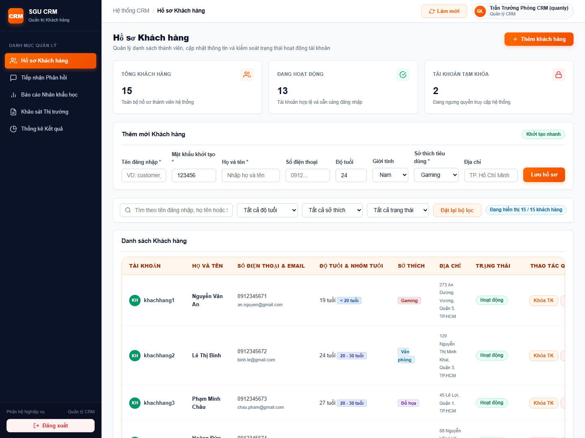

Hình 3.6: Giao diện Người Quản lý CRM — Tab 1: Quản lý Khách hàng (Thêm mới, Xóa & Khóa Tài khoản Khách hàng)

### 1. Giới thiệu chi tiết chức năng: Đây là tab đầu tiên trên giao diện Người Quản lý (quanly.html), trực tiếp giải quyết 3 yêu cầu đầu tiên của Người quản lý trong đề bài: (1) Thêm một khách hàng mới, (2) Xóa khách hàng, (3) Khóa tài khoản khách hàng.

### 2. Hoạt động của phần mềm: Khi tải trang, hàm loadCustomers() trong manager_crm.js gọi GET /api/admin/crm/customers để hiển thị 15 hồ sơ khách hàng kèm 3 thẻ thống kê (Tổng số khách hàng: 15, Đang hoạt động: 13, Tài khoản bị khóa: 2). Người quản lý có thể tìm kiếm khách hàng theo tên/SĐT/email, lọc theo nhóm sở thích, nhấn '+ Thêm một khách hàng mới' để mở Modal tạo khách hàng, hoặc nhấn 'Khóa TK / Mở khóa' và 'Xóa' ngay trên từng dòng khách hàng.

| Tên Điều khiển (Control) | ID / Hàm JS | Loại Control | Hoạt động Xử lý Nghiệp vụ & Kết nối Backend API |
| --- | --- | --- | --- |
| 3 Thẻ KPI Khách hàng | #crmTotalCust, #crmActiveCust, #crmLockedCust | Metric Cards | Hiển thị Tổng số KH (15), Đang hoạt động (13) và Tài khoản bị khóa (2). |
| Nút + Thêm một khách hàng mới | openAddCustomerModal() | Primary Button | Mở Modal nhập thông tin KH (Username, Password, Họ tên, SĐT, Email, Tuổi, Giới tính, Sở thích, Địa chỉ) -> Gọi POST /api/admin/crm/customers. |
| Ô Tìm kiếm & Lọc Sở thích | #custSearchInput, #custInterestFilter | Input & Select | Lọc tức thời danh sách khách hàng theo từ khóa hoặc theo sở thích (Gaming, Đồ họa, Văn phòng, Lập trình). |
| Nút Khóa TK / Mở khóa | toggleCustomerLock(accountId) | Warning Button | Gọi PUT /api/admin/crm/customers/{id}/toggle-status để khóa hoặc mở khóa quyền đăng nhập của khách hàng. |
| Nút Xóa Khách hàng | deleteCustomer(accountId) | Danger Button | Gọi DELETE /api/admin/crm/customers/{id} để xóa khách hàng cùng hồ sơ và dữ liệu liên kết. |

### 3.2.6. Màn hình 6: Giao diện Người Quản lý CRM — Tab 2: Tiếp nhận & Giải đáp Phản hồi Khách hàng (quanly.html?tab=feedbacks)

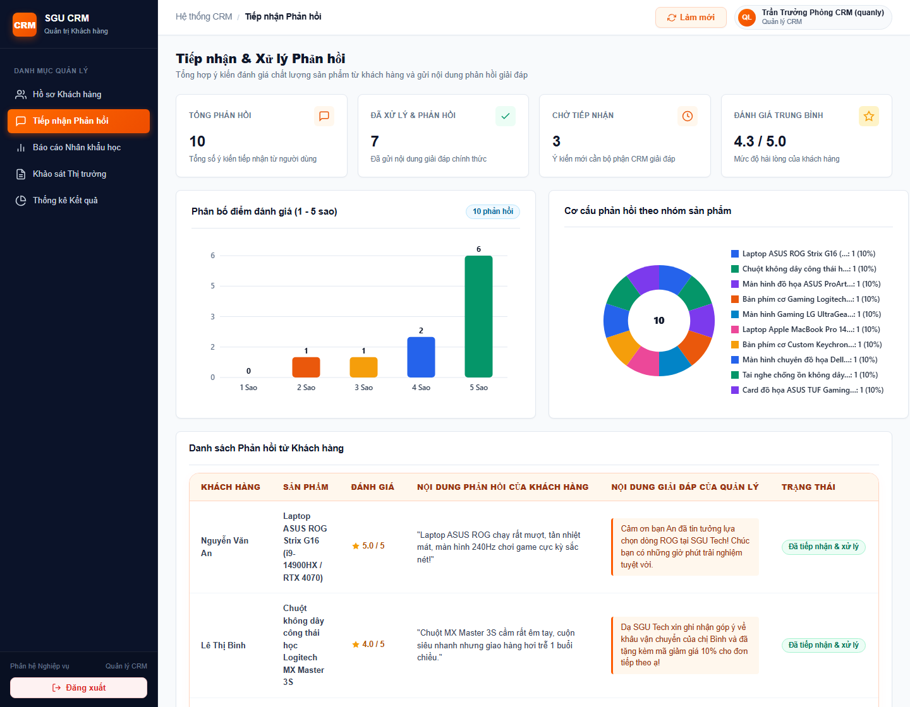

Hình 3.7: Giao diện Người Quản lý CRM — Tab 2: Tiếp nhận & Giải đáp Phản hồi Khách hàng kèm Biểu đồ Sao

### 1. Giới thiệu chi tiết chức năng: Màn hình thực hiện yêu cầu thứ (4) của Người quản lý: 'Tiếp nhận phản hồi của khách hàng'. Giao diện cung cấp 4 thẻ KPI (Tổng phản hồi, Đã giải đáp, Đang chờ xử lý, Điểm hài lòng trung bình), 2 biểu đồ phân tích trực quan (Phân bổ mức độ hài lòng 1–5 sao & Top sản phẩm nhận nhiều phản hồi nhất) và bảng danh sách phản hồi kèm ảnh sản phẩm.

### 2. Hoạt động của phần mềm: Người quản lý có thể lọc các phản hồi đang ở trạng thái 'Chờ xử lý' hoặc lọc theo số sao (1–5 sao). Khi nhấn nút 'Tiếp nhận & Trả lời', hộp thoại nhập nội dung giải đáp hiện ra. Sau khi nhấn Lưu, phần mềm gọi PUT /api/admin/crm/feedbacks/{id}/reply để cập nhật câu trả lời vào trường AdminReply và chuyển trạng thái sang 'Đã tiếp nhận & Xử lý'.

| Tên Điều khiển (Control) | ID / Hàm JS | Loại Control | Hoạt động Xử lý Nghiệp vụ & Kết nối Backend API |
| --- | --- | --- | --- |
| Biểu đồ Phân bổ 1–5 Sao | #crmRatingBarChart | Canvas Bar Chart | Thống kê số lượng đánh giá ở từng mức 1 sao, 2 sao, 3 sao, 4 sao và 5 sao. |
| Biểu đồ Top Sản phẩm | #crmProductReviewChart | Canvas Chart | Hiển thị các sản phẩm công nghệ nhận được nhiều lượt phản hồi nhất từ khách hàng. |
| Bộ lọc Sao & Trạng thái | #fbRatingFilter, #fbStatusFilter | Select Dropdown | Lọc nhanh các phản hồi Chờ xử lý hoặc các phản hồi 1–2 sao cần ưu tiên giải quyết. |
| Nút Tiếp nhận & Trả lời | openReplyModal(feedbackId) | Action Button | Mở hộp thoại nhập câu trả lời giải đáp và gọi PUT /api/admin/crm/feedbacks/{id}/reply. |

### 3.2.7. Màn hình 7: Giao diện Người Quản lý CRM — Tab 3: Báo cáo về Khách hàng, Tỷ lệ Độ tuổi & Sở thích (quanly.html?tab=demographics)

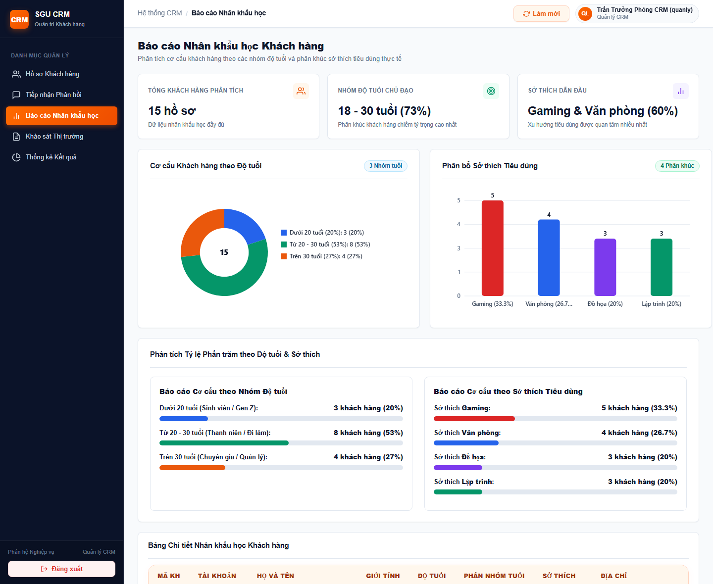

Hình 3.8: Giao diện Người Quản lý CRM — Tab 3: Báo cáo về Khách hàng, Tỷ lệ Độ tuổi & Sở thích

### 1. Giới thiệu chi tiết chức năng: Màn hình thực hiện yêu cầu thứ (5) của Người quản lý: 'Báo cáo về khách hàng, tỷ lệ độ tuổi, sở thích'. Giao diện được bố cục gồm 3 thẻ chỉ số tổng hợp (Độ tuổi trung bình: 25.5 tuổi; Phân khúc tuổi lớn nhất: Từ 20 - 25 tuổi (Trẻ); Sở thích phổ biến nhất: Gaming), 2 biểu đồ đồ họa sắc nét (Biểu đồ Tỷ lệ Độ tuổi Khách hàng & Biểu đồ Phân bố Sở thích Khách hàng) và 2 bảng phân tích chi tiết từng phân khúc.

### 2. Hoạt động của phần mềm: Khi chuyển sang Tab 3, hàm loadDemographicsReport() gọi API GET /api/admin/crm/reports/demographics, tính toán số lượng và tỷ lệ % của từng nhóm độ tuổi cũng như từng nhóm sở thích tiêu dùng, sau đó tự động vẽ biểu đồ tròn (Doughnut Chart), biểu đồ cột (Bar Chart) và thanh tiến trình tỷ lệ % trong bảng.

| Tên Điều khiển (Control) | ID / Hàm JS | Loại Control | Hoạt động Xử lý Nghiệp vụ & Kết nối Backend API |
| --- | --- | --- | --- |
| 3 Thẻ Chỉ số Nhân khẩu học | #demoAvgAge, #demoTopAgeGroup, #demoTopInterest | Summary Cards | Tính toán độ tuổi trung bình, nhóm tuổi chiếm tỷ trọng cao nhất và sở thích dẫn đầu. |
| Biểu đồ Tỷ lệ Độ tuổi | #agePieChart | Doughnut Chart | Biểu diễn trực quan tỷ lệ % các phân khúc độ tuổi của khách hàng SGU Tech. |
| Biểu đồ Phân bố Sở thích | #interestBarChart | Bar Chart | Biểu diễn số lượng và tỷ lệ % khách hàng theo từng nhóm sở thích (Gaming, Văn phòng, Đồ họa, Lập trình). |
| 2 Bảng Phân tích Chi tiết | #ageDetailTableBody, #interestDetailTableBody | Data Tables | Hiển thị số lượng khách hàng, tỷ lệ % kèm thanh Progress Bar trực quan và gợi ý chiến lược sản phẩm. |

### 3.2.8. Màn hình 8: Giao diện Người Quản lý CRM — Tab 4: Tạo Bảng Khảo sát và Gửi đến Tài khoản Khách hàng (quanly.html?tab=surveys)

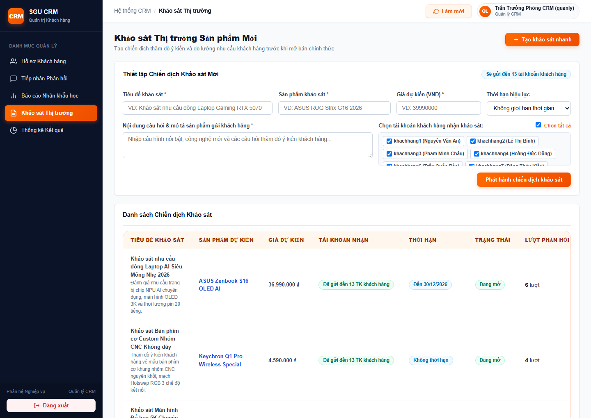

Hình 3.9: Giao diện Người Quản lý CRM — Tab 4: Tạo & Phát hành Bảng Khảo sát gửi đến Tài khoản Khách hàng

### 1. Giới thiệu chi tiết chức năng: Màn hình thực hiện yêu cầu thứ (6) của Người quản lý: 'Tạo bảng khảo sát và gửi đến tài khoản khách hàng'. Khu vực phía trên là biểu mẫu khởi tạo chiến dịch khảo sát mới; khu vực phía dưới là bảng quản lý danh sách các chiến dịch khảo sát đã phát hành kèm tiến độ thu thập phiếu.

### 2. Hoạt động của phần mềm: Người quản lý điền Tiêu đề khảo sát, Tên sản phẩm khảo sát, Giá dự kiến, Thời hạn hoàn thành và Mô tả khảo sát rồi nhấn 'Phát hành & Gửi đến Khách hàng'. Phần mềm gọi POST /api/admin/crm/surveys để lưu vào bảng Surveys và phân phối tự động tới tất cả tài khoản khách hàng. Ngoài ra, Người quản lý có thể Khóa/Mở khóa khảo sát (PUT /api/admin/crm/surveys/{id}/toggle-lock) hoặc Xóa khảo sát (DELETE /api/admin/crm/surveys/{id}).

| Tên Điều khiển (Control) | ID / Hàm JS | Loại Control | Hoạt động Xử lý Nghiệp vụ & Kết nối Backend API |
| --- | --- | --- | --- |
| Ô Tiêu đề & Sản phẩm KS | #surveyTitle, #surveyProduct | Input Text | Nhập tiêu đề chiến dịch và tên dòng sản phẩm công nghệ dự kiến ra mắt. |
| Ô Giá bán dự kiến & Hạn | #surveyPrice, #surveyDeadline | Input Number/Date | Nhập mức giá thăm dò (VNĐ) và thời hạn kết thúc nhận phiếu khảo sát. |
| Ô Mô tả nội dung khảo sát | #surveyDesc | Textarea | Nhập mô tả tính năng, công nghệ và câu hỏi định hướng cho khách hàng. |
| Nút Phát hành & Gửi đến KH | createSurvey(event) | Submit Button | Gọi POST /api/admin/crm/surveys, phát hành bảng khảo sát tới toàn bộ tài khoản khách hàng. |
| Nút Đóng/Mở & Xóa Khảo sát | toggleSurveyStatus(id), deleteSurvey(id) | Action Buttons | Khóa/mở khóa nhận phản hồi hoặc xóa chiến dịch khảo sát khỏi hệ thống. |

### 3.2.9. Màn hình 9: Giao diện Người Quản lý CRM — Tab 5: Thống kê & Đo lường Kết quả Khảo sát (quanly.html?tab=surveystats)

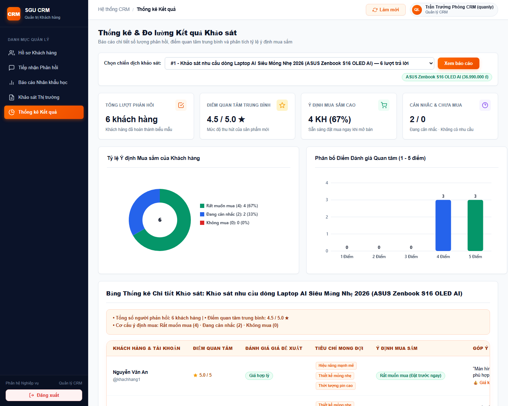

Hình 3.10: Giao diện Người Quản lý CRM — Tab 5: Thống kê & Đo lường Kết quả Khảo sát

### 1. Giới thiệu chi tiết chức năng: Màn hình thực hiện yêu cầu thứ (7) của Người quản lý: 'Thống kê kết quả khảo sát'. Giao diện hiển thị 4 thẻ KPI khảo sát (Tổng chiến dịch khảo sát: 5; Tổng lượt KH trả lời: 16; Điểm quan tâm TB: 4.6 / 5; Tỷ lệ rất muốn mua: 69%), 2 biểu đồ phân tích (Biểu đồ Phân bố Ý định Mua sắm & Biểu đồ Điểm Quan tâm Trung bình theo từng Khảo sát), bảng tổng hợp tỷ lệ tham gia từng chiến dịch và bảng danh sách chi tiết toàn bộ 16 phiếu trả lời của khách hàng.

| Tên Điều khiển (Control) | ID / Hàm JS | Loại Control | Hoạt động Xử lý Nghiệp vụ & Kết nối Backend API |
| --- | --- | --- | --- |
| 4 Thẻ KPI Thống kê Khảo sát | #statTotalSurveys, #statTotalResponses... | Metric Cards | Tổng hợp số chiến dịch, tổng số phiếu thu về, điểm quan tâm trung bình và tỷ lệ muốn mua. |
| Biểu đồ Ý định Mua sắm | #surveyIntentChart | Doughnut Chart | Biểu diễn tỷ lệ khách hàng chọn: Rất muốn mua, Có thể mua / Đang cân nhắc, Không mua. |
| Biểu đồ Điểm Quan tâm TB | #surveyScoreChart | Bar Chart | So sánh điểm mức độ quan tâm trung bình (thang 1–5) giữa các chiến dịch khảo sát. |
| Bảng Tổng hợp & Bảng Chi tiết | #surveySummaryTableBody, #surveyResponsesTableBody | Data Tables | Liệt kê tỷ lệ tham gia (%) của từng chiến dịch và chi tiết từng câu trả lời của khách hàng. |

### 3.2.10. Màn hình 10: Giao diện Cổng Khách hàng — Đăng ký Tài khoản & Đăng nhập (user.html)

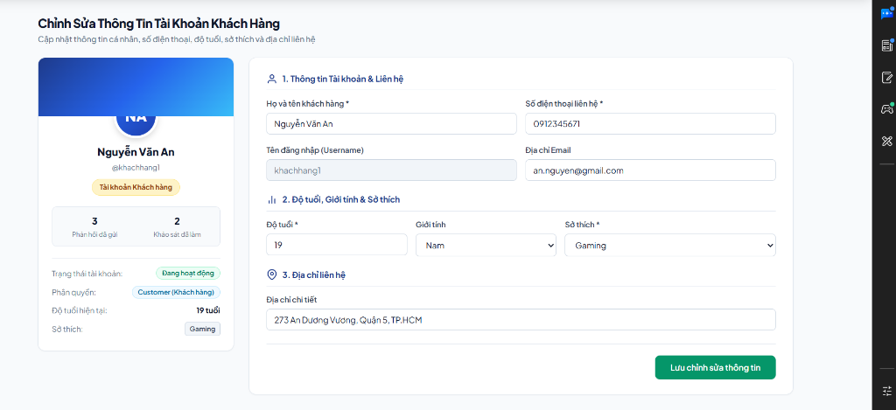

Hình 3.11: Giao diện Cổng Khách hàng — Biểu mẫu Đăng ký Tài khoản Khách hàng mới (user.html)

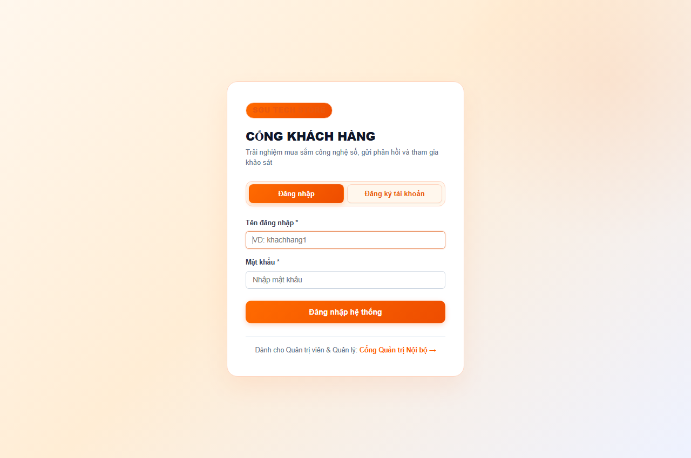

Hình 3.12: Giao diện Cổng Khách hàng — Biểu mẫu Đăng nhập Tài khoản Khách hàng (user.html)

### 1. Giới thiệu chi tiết chức năng & hoạt động: Thực hiện 2 nghiệp vụ đầu tiên của Khách hàng: (1) Đăng ký tài khoản khách hàng và (2) Đăng nhập. Biểu mẫu được thiết kế tinh gọn, hiện đại. Khi khách hàng điền thông tin đăng ký và nhấn 'Hoàn tất đăng ký', hàm handleCustomerRegister() gọi POST /api/customer/register để tạo đồng bộ bản ghi Accounts + CustomerProfiles và tự động đăng nhập thẳng vào Cổng Khách hàng.

| Tên Điều khiển (Control) | ID / Hàm JS | Loại Control | Hoạt động Xử lý Nghiệp vụ & Kết nối Backend API |
| --- | --- | --- | --- |
| Tab Chuyển đổi Đăng nhập / Đăng ký | switchAuthTab('login' / 'register') | Tab Buttons | Chuyển đổi mượt mà giữa biểu mẫu Đăng nhập và biểu mẫu Đăng ký tài khoản mới. |
| Biểu mẫu Đăng nhập KH | #custLoginForm | Form Submit | Gọi POST /api/customer/login; kiểm tra trạng thái khóa IsActive và mở giao diện Cổng Khách hàng. |
| Biểu mẫu Đăng ký KH | #custRegisterForm | Form Submit | Gọi POST /api/customer/register; tạo tài khoản Customer + hồ sơ nhân khẩu học và tự động đăng nhập. |

### 3.2.11. Màn hình 11: Giao diện Cổng Khách hàng — Tab 1: Gửi Phản hồi về Sản phẩm & Lọc theo Sản phẩm (user.html?tab=feedback)

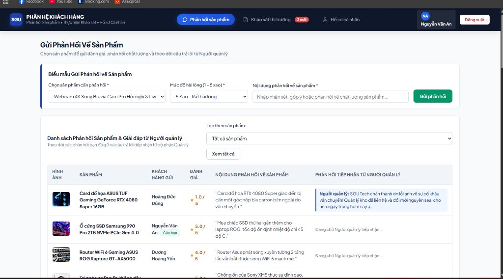

Hình 3.13: Giao diện Khách hàng — Biểu mẫu Gửi Phản hồi về Sản phẩm & Theo dõi Giải đáp từ Người quản lý

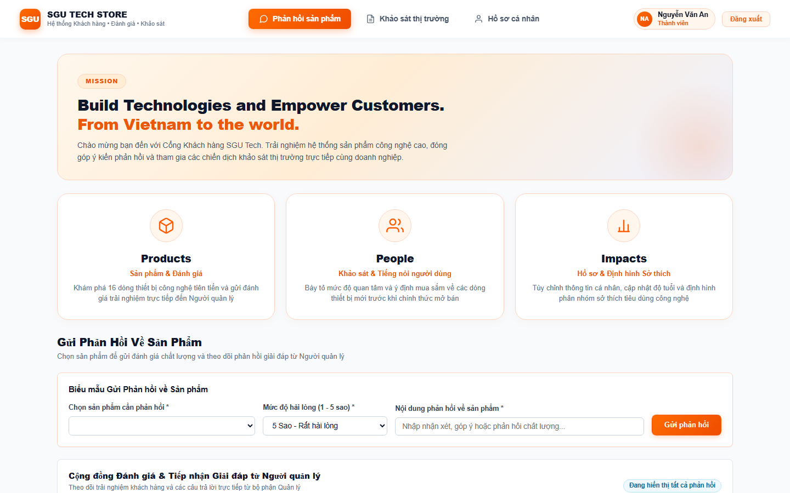

Hình 3.14: Chức năng Lọc xem Đánh giá & Phản hồi theo từng Sản phẩm Công nghệ trên Cổng Khách hàng

### 1. Giới thiệu chi tiết chức năng & hoạt động: Thực hiện yêu cầu thứ (4) của Khách hàng: 'Gửi phản hồi về sản phẩm'. Khách hàng chọn sản phẩm từ hộp chọn 16 sản phẩm công nghệ, chọn mức độ hài lòng (1–5 sao), nhập nhận xét và nhấn 'Gửi phản hồi' (POST /api/customer/feedbacks/{accountId}). Phía dưới là bảng danh sách phản hồi tích hợp bộ lọc theo từng sản phẩm (GET /api/customer/all-feedbacks?productId=...) và hiển thị rõ cột 'Phản hồi tiếp nhận từ Người quản lý'.

| Tên Điều khiển (Control) | ID / Hàm JS | Loại Control | Hoạt động Xử lý Nghiệp vụ & Kết nối Backend API |
| --- | --- | --- | --- |
| Hộp chọn Sản phẩm cần phản hồi | #fbProductSelect | Select Dropdown | Hiển thị danh sách 16 sản phẩm công nghệ từ API GET /api/products. |
| Hộp chọn Mức độ hài lòng | #fbRatingSelect | Select (1–5 sao) | Cho phép khách hàng chấm điểm từ 1 Sao (Rất tệ) đến 5 Sao (Rất hài lòng). |
| Ô Nội dung phản hồi & Nút Gửi | #fbCommentInput & submitCustomerFeedback() | Input + Button | Gọi POST /api/customer/feedbacks/{accountId} để lưu phản hồi mới vào bảng Feedbacks. |
| Bộ lọc Xem theo Sản phẩm | #publicFbProductFilter | Filter Select | Gọi GET /api/customer/all-feedbacks?productId={id} để lọc đánh giá của từng sản phẩm. |

### 3.2.12. Màn hình 12: Giao diện Cổng Khách hàng — Tab 2: Nhận được Khảo sát và Thực hiện (user.html?tab=surveys)

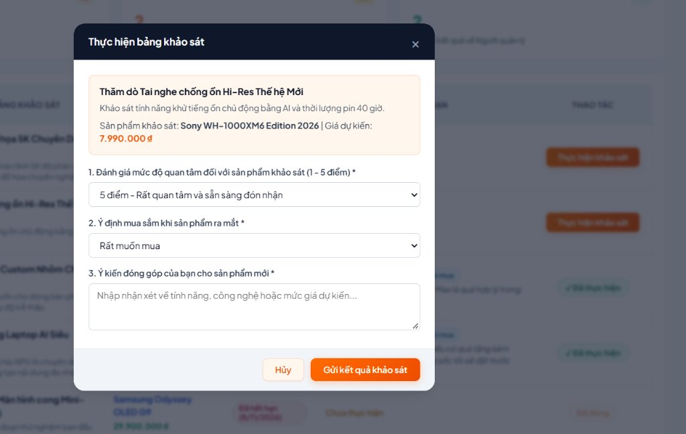

Hình 3.15: Giao diện Khách hàng — Nhận được Bảng Khảo sát và Hộp thoại Thực hiện Khảo sát

### 1. Giới thiệu chi tiết chức năng & hoạt động: Thực hiện yêu cầu thứ (5) của Khách hàng: 'Nhận được khảo sát và thực hiện'. Trên thanh menu của khách hàng hiển thị huy hiệu đỏ báo số khảo sát mới chưa thực hiện (VD: '2 mới'). Khi nhấn nút 'Thực hiện khảo sát', hộp thoại Modal mở ra hiển thị tên sản phẩm khảo sát, mức giá dự kiến và 3 câu hỏi chuẩn: (1) Đánh giá mức độ quan tâm (1–5 điểm), (2) Ý định mua sắm khi sản phẩm ra mắt, (3) Ý kiến đóng góp cho sản phẩm mới. Khi nhấn 'Gửi kết quả khảo sát', phần mềm gọi POST /api/customer/surveys/{surveyId}/submit/{accountId} để lưu phiếu trả lời vào CSDL.

### 3.2.13. Màn hình 13: Giao diện Cổng Khách hàng — Tab 3: Chỉnh sửa Thông tin Tài khoản Khách hàng (user.html?tab=profile)

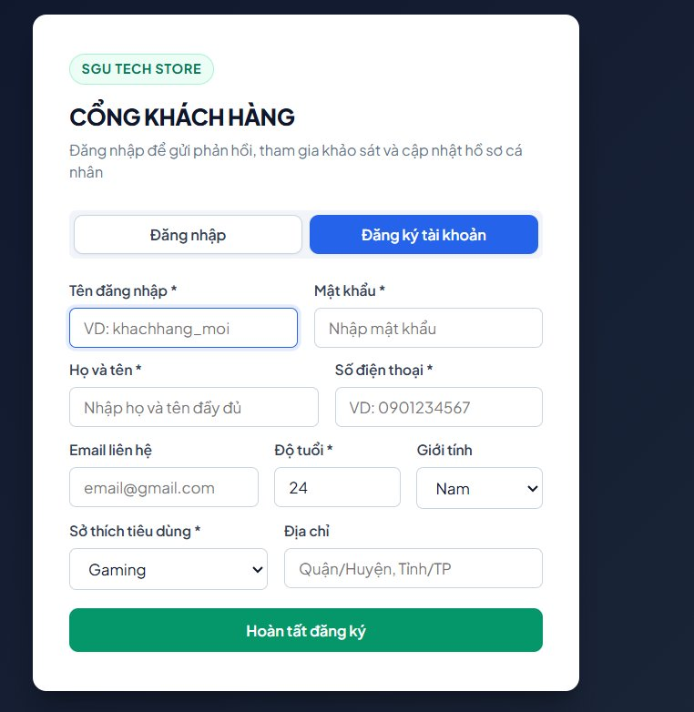

Hình 3.16: Giao diện Khách hàng — Chỉnh sửa Thông tin Cá nhân (Họ tên, SĐT, Độ tuổi, Giới tính, Sở thích, Địa chỉ)

### 1. Giới thiệu chi tiết chức năng & hoạt động: Thực hiện yêu cầu thứ (3) của Khách hàng: 'Chỉnh sửa thông tin'. Cột bên trái hiển thị Thẻ định danh khách hàng (Avatar chữ cái, Họ tên, @username, tổng số phản hồi đã gửi, tổng số khảo sát đã làm, trạng thái tài khoản, độ tuổi, sở thích). Cột bên phải là biểu mẫu cho phép khách hàng chỉnh sửa Họ và tên, Số điện thoại, Email, Độ tuổi, Giới tính, Sở thích tiêu dùng và Địa chỉ chi tiết. Khi nhấn 'Lưu chỉnh sửa thông tin', hệ thống gọi PUT /api/customer/profile/{accountId} cập nhật tức thời vào SQL Server.

| Tên Điều khiển (Control) | ID / Hàm JS | Loại Control | Hoạt động Xử lý Nghiệp vụ & Kết nối Backend API |
| --- | --- | --- | --- |
| Huy hiệu Khảo sát mới | #newSurveyBadge | Notification Badge | Đếm số bảng khảo sát đang mở mà tài khoản khách hàng hiện tại chưa thực hiện. |
| Hộp thoại Thực hiện Khảo sát | #surveyModal, submitSurveyResponse() | Modal Form | Chọn điểm quan tâm (1–5), ý định mua, nhập góp ý và gọi POST /api/customer/surveys/{id}/submit/{aid}. |
| Thẻ Định danh Cá nhân | #profileSummaryCard | Profile Card | Hiển thị đồng bộ Avatar, Họ tên, @username, số phản hồi, số khảo sát, độ tuổi và sở thích. |
| Biểu mẫu Chỉnh sửa Thông tin | #profileEditForm, saveCustomerProfile() | Form Submit | Cập nhật Họ tên, SĐT, Email, Tuổi, Giới tính, Sở thích, Địa chỉ qua PUT /api/customer/profile/{accountId}. |

### 3.2.14. Đặc tả Chi tiết Luồng Xử lý Trạng thái Giao diện (Frontend State & Event Execution Flows)

### Để minh họa rõ cách thức tầng Giao diện (Frontend HTML5/JS) tương tác thời gian thực với tầng Backend ASP.NET Core 8.0 và xử lý dữ liệu biểu đồ, dưới đây là mã nguồn xử lý giao diện thực tế tại 3 tệp kịch bản trung tâm: app.js (Admin Server), manager_crm.js (Người Quản lý CRM) và user.js (Cổng Khách hàng):

1. Luồng Xử lý Giao diện Admin Server Độc lập (Trích Frontend_Admin/app.js):

    // KHỞI TẠO KHÔNG GIAN ADMIN SERVER TÁCH BIỆT ĐỘC LẬP (admin.html)const API_BASE = "http://localhost:5000/api/admin";let allAccounts = [];let allRoles = [];async function loadAccountsAndRoles() {    const [accRes, roleRes] = await Promise.all([        fetch(${API_BASE}/accounts),        fetch(${API_BASE}/accounts/roles)    ]);    allAccounts = await accRes.json();    allRoles = await roleRes.json();    updateAdminKpiCards();    renderAccountsTable(allAccounts);    renderRolesSummaryTab();}// PHÂN QUYỀN VAI TRÒ CHO ACCOUNT (CHỈ GIỮ ĐÚNG 3 ROLE: Admin, Manager, Customer)async function changeAccountRole(accountId) {    const selectEl = document.getElementById(
oleSelect_);    const newRoleId = parseInt(selectEl.value, 10);    const res = await fetch(${API_BASE}/accounts//role, {        method: "PUT",        headers: { "Content-Type": "application/json" },        body: JSON.stringify({ roleId: newRoleId })    });    if (res.ok) {        showToast("Đã cập nhật phân quyền tài khoản thành công!", "success");        await loadAccountsAndRoles();    }}// KHÓA / MỞ KHÓA VÀ XÓA ACCOUNT TRÊN ADMIN SERVERasync function toggleAccountStatus(accountId) {    const res = await fetch(${API_BASE}/accounts//toggle-status, { method: "PUT" });    if (res.ok) await loadAccountsAndRoles();}async function deleteAccount(accountId) {    if (!confirm("Bạn có chắc chắn muốn xóa vĩnh viễn tài khoản này khỏi máy chủ?")) return;    const res = await fetch(${API_BASE}/accounts/, { method: "DELETE" });    if (res.ok) await loadAccountsAndRoles();}
2. Luồng Xử lý Giao diện Người Quản lý CRM & Vẽ Biểu đồ Thống kê (Trích Frontend_Admin/manager_crm.js):

    // 1. THÊM MỚI, KHÓA VÀ XÓA KHÁCH HÀNG (TAB 1 NGƯỜI QUẢN LÝ CRM)async function submitAddCustomer(event) {    event.preventDefault();    const payload = {        username: document.getElementById("newCustUsername").value.trim(),        password: document.getElementById("newCustPassword").value.trim() || "123456",        fullName: document.getElementById("newCustFullName").value.trim(),        phone:    document.getElementById("newCustPhone").value.trim(),        email:    document.getElementById("newCustEmail").value.trim(),        age:      parseInt(document.getElementById("newCustAge").value, 10) || 22,        gender:   document.getElementById("newCustGender").value,        interest: document.getElementById("newCustInterest").value,        address:  document.getElementById("newCustAddress").value.trim()    };    const res = await fetch("http://localhost:5000/api/admin/crm/customers", {        method: "POST",        headers: { "Content-Type": "application/json" },        body: JSON.stringify(payload)    });    if (res.ok) {        closeAddCustomerModal();        await loadCrmCustomers();        await loadDemographicsReport();    }}// 2. TIẾP NHẬN & GIẢI ĐÁP PHẢN HỒI KHÁCH HÀNG (TAB 2 NGƯỜI QUẢN LÝ CRM)async function submitFeedbackReply(feedbackId, replyText) {    const res = await fetch(http://localhost:5000/api/admin/crm/feedbacks//reply, {        method: "PUT",        headers: { "Content-Type": "application/json" },        body: JSON.stringify({ adminReply: replyText })    });    if (res.ok) await loadCrmFeedbacks();}// 3. KẾT XUẤT BÁO CÁO TỶ LỆ ĐỘ TUỔI & SỞ THÍCH KHÁCH HÀNG (TAB 3 NGƯỜI QUẢN LÝ CRM)async function loadDemographicsReport() {    const res = await fetch("http://localhost:5000/api/admin/crm/reports/demographics");    const data = await res.json();    renderAgeDoughnutChart(data.ageStats);    renderInterestBarChart(data.interestStats);}
3. Luồng Xử lý Giao diện Cổng Khách hàng Trực tuyến (Trích Frontend_Admin/user.js):

    // 1. KHÁCH HÀNG GỬI PHẢN HỒI VỀ SẢN PHẨM & LỌC XEM GIẢI ĐÁP THEO SẢN PHẨMasync function submitProductFeedback(event) {    event.preventDefault();    const accountId = currentCustomer.accountId;    const payload = {        productId: parseInt(document.getElementById("fbProductSelect").value, 10),        rating:    parseInt(document.getElementById("fbRatingSelect").value, 10),        comment:   document.getElementById("fbCommentInput").value.trim()    };    const res = await fetch(http://localhost:5000/api/customer/feedbacks/, {        method: "POST",        headers: { "Content-Type": "application/json" },        body: JSON.stringify(payload)    });    if (res.ok) await loadPublicFeedbacks();}// 2. KHÁCH HÀNG NHẬN BẢNG KHẢO SÁT VÀ GỬI KẾT QUẢ THỰC HIỆN KHẢO SÁTasync function submitCustomerSurveyResponse(surveyId) {    const accountId = currentCustomer.accountId;    const payload = {        score:           parseInt(document.getElementById("surveyScoreSelect").value, 10),        buyingIntent:    document.getElementById("surveyIntentSelect").value,        customerOpinion: document.getElementById("surveyOpinionInput").value.trim()    };    const res = await fetch(http://localhost:5000/api/customer/surveys//submit/, {        method: "POST",        headers: { "Content-Type": "application/json" },        body: JSON.stringify(payload)    });    if (res.ok) {        closeSurveyModal();        await loadAvailableSurveys();    }}
### 3.2.15. Phân tích Chuyên sâu Cơ chế Hoạt động của Từng Nhóm Chức năng trên Giao diện Phần mềm

### Nhằm thuyết minh đầy đủ và chi tiết nhất cho tiêu chí 'Đưa ra hình ảnh, giới thiệu chi tiết các chức năng và hoạt động của phần mềm (5 điểm)', bảng phân tích chuyên sâu dưới đây trình bày cơ chế vận hành nội tại từ lúc người dùng tương tác trên giao diện đến khi dữ liệu được xử lý và phản hồi lại màn hình cho từng chức năng cốt lõi:

| Phân hệ | Chức năng trên Giao diện | Cơ chế Hoạt động Chi tiết trên Phần mềm (UI -> JS -> REST API -> SQL Server -> UI) |
| --- | --- | --- |
| Admin Server (admin.html) | 1. Tách biệt Giao diện Admin Server | Khi đăng nhập với tài khoản admin, hệ thống nạp độc quyền tệp admin.html và app.js. Thanh Sidebar chỉ chứa đúng 2 mục: 'Quản lý Tài khoản & Phân quyền' và 'Cơ cấu Phân quyền (3 Role)'. Tuyệt đối không nạp bất kỳ giao diện hay bảng dữ liệu nào của Nhân sự, Kho, Bán hàng, Sản phẩm hay Nhà cung cấp. |
| Admin Server (admin.html) | 2. Xem, Tìm kiếm & Lọc Account theo 3 Role | Hàm loadAccountsAndRoles() gọi GET /api/admin/accounts lấy 19 tài khoản, tính toán 4 thẻ KPI (Tổng Account: 19, Đang hoạt động: 17, Đã khóa: 2, Tổng Role: 3). Khi Admin gõ vào ô tìm kiếm hoặc chọn Dropdown Role (Admin / Manager / Customer), bảng tài khoản lập tức lọc lại các dòng thỏa mãn mà không cần tải lại trang. |
| Admin Server (admin.html) | 3. Thêm Tài khoản Mới (Create Account) | Khi nhấn '+ Thêm tài khoản mới', Modal hiện ra. Admin điền Username, Password, Họ tên, Email, SĐT và chọn 1 trong 3 Role. Khi nhấn Lưu, dữ liệu gửi tới POST /api/admin/accounts. Backend kiểm tra trùng Username, băm mật khẩu bằng BCrypt và lưu vào bảng Accounts (nếu là Customer thì tự tạo thêm bản ghi trong CustomerProfiles). |
| Admin Server (admin.html) | 4. Phân quyền cho Account (Assign Role) | Trên mỗi dòng của bảng tài khoản có sẵn hộp chọn Dropdown chứa 3 quyền: Admin (Quản trị máy chủ), Manager (Người quản lý CRM), Customer (Khách hàng). Khi Admin đổi quyền và nhấn nút 'Phân quyền', hàm changeAccountRole(id) gọi PUT /api/admin/accounts/{id}/role cập nhật ngay cột RoleId trong bảng Accounts. |
| Admin Server (admin.html) | 5. Khóa/Mở khóa & Xóa Account | Khi nhấn nút 'Khóa' (hoặc 'Mở khóa'), phần mềm gọi PUT /api/admin/accounts/{id}/toggle-status để đảo cờ IsActive (1 <-> 0). Khi nhấn 'Xóa Account', phần mềm gọi DELETE /api/admin/accounts/{id}, tự động dọn dẹp các bản ghi phụ thuộc trong CustomerProfiles, Feedbacks, SurveyResponses trước khi xóa Account. |
| Người Quản lý (quanly.html) | 6. Thêm một Khách hàng mới (Tab 1) | Tại Tab 1 (Quản lý Khách hàng), Người quản lý nhấn '+ Thêm một khách hàng mới', nhập thông tin định danh và nhân khẩu học (Độ tuổi, Giới tính, Sở thích, Địa chỉ). API POST /api/admin/crm/customers tạo đồng thời bản ghi Accounts (Role = Customer) và bản ghi CustomerProfiles, cập nhật ngay danh sách và biểu đồ. |
| Người Quản lý (quanly.html) | 7. Khóa TK & Xóa Khách hàng (Tab 1) | Trên từng dòng khách hàng ở Tab 1, Người quản lý nhấn 'Khóa TK' để chặn khách hàng vi phạm đăng nhập vào cổng user.html (PUT /api/admin/crm/customers/{id}/toggle-status), hoặc nhấn 'Xóa' để xóa hoàn toàn khách hàng khỏi hệ thống (DELETE /api/admin/crm/customers/{id}). |
| Người Quản lý (quanly.html) | 8. Tiếp nhận & Giải đáp Phản hồi (Tab 2) | Tại Tab 2 (Tiếp nhận Phản hồi), phần mềm hiển thị 4 thẻ KPI, Biểu đồ cột phân bố đánh giá 1–5 sao, Biểu đồ sản phẩm được đánh giá nhiều nhất và bảng 18 phản hồi. Người quản lý nhấn 'Tiếp nhận & Trả lời', nhập nội dung giải đáp và lưu qua PUT /api/admin/crm/feedbacks/{id}/reply. |
| Người Quản lý (quanly.html) | 9. Báo cáo Tỷ lệ Độ tuổi & Sở thích (Tab 3) | Tại Tab 3 (Báo cáo Độ tuổi & Sở thích), phần mềm gọi GET /api/admin/crm/reports/demographics, tự động tính Độ tuổi trung bình (25.5 tuổi), vẽ Biểu đồ Vòng (Tỷ lệ các phân khúc độ tuổi) và Biểu đồ Cột (Tỷ lệ % các nhóm sở thích: Gaming, Văn phòng, Đồ họa, Lập trình) kèm 2 bảng số liệu chi tiết. |
| Người Quản lý (quanly.html) | 10. Tạo Bảng Khảo sát gửi đến TK KH (Tab 4) | Tại Tab 4 (Tạo & Gửi Khảo sát), Người quản lý nhập Tiêu đề, Sản phẩm khảo sát, Giá dự kiến, Thời hạn và Mô tả rồi nhấn 'Phát hành & Gửi đến Khách hàng'. API POST /api/admin/crm/surveys lưu khảo sát mới và phân phối tức thời đến toàn bộ tài khoản khách hàng đang hoạt động. |
| Người Quản lý (quanly.html) | 11. Thống kê Kết quả Khảo sát (Tab 5) | Tại Tab 5 (Thống kê Khảo sát), phần mềm tổng hợp dữ liệu từ GET /api/admin/crm/surveys/{id}/statistics, hiển thị 4 thẻ KPI, Biểu đồ Phân bố Ý định Mua sắm, Biểu đồ Điểm Quan tâm Trung bình (thang 1–5), bảng tỷ lệ tham gia từng chiến dịch và danh sách chi tiết toàn bộ 16 phiếu trả lời. |
| Khách hàng (user.html) | 12. Đăng ký, Đăng nhập & Chỉnh sửa Thông tin | Khách hàng truy cập user.html để tự Đăng ký tài khoản mới (POST /api/customer/register) hoặc Đăng nhập (POST /api/customer/login). Tại tab 'Hồ sơ cá nhân', khách hàng xem thẻ định danh và chỉnh sửa Họ tên, SĐT, Email, Độ tuổi, Giới tính, Sở thích, Địa chỉ (PUT /api/customer/profile/{accountId}). |
| Khách hàng (user.html) | 13. Gửi Phản hồi SP & Nhận, Làm Khảo sát | Tại tab 'Phản hồi sản phẩm', khách hàng chọn sản phẩm, chấm 1–5 sao, gửi nhận xét và lọc xem giải đáp từ Người quản lý theo từng sản phẩm. Tại tab 'Khảo sát thị trường', khách hàng nhận thông báo khảo sát mới, mở hộp thoại chấm điểm quan tâm (1–5), chọn ý định mua và gửi kết quả khảo sát. |

# CHƯƠNG 4: CÀI ĐẶT VÀ BẢO TRÌ HỆ THỐNG THÔNG TIN, HƯỚNG DẪN SỬ DỤNG HỆ THỐNG (5 ĐIỂM)

## 4.1. Phương án Cài đặt cho Hệ thống Vừa Được Thiết kế Xây dựng

### 4.1.1. Sơ đồ Kiến trúc Triển khai Hệ thống 3 Tầng (3-Tier Deployment Architecture)

### Hệ thống Thông tin Doanh nghiệp SGU Tech được triển khai theo mô hình kiến trúc 3 tầng vật lý tách biệt rõ ràng: Tầng Giao diện Trình diễn (Presentation Tier gồm admin.html, quanly.html, user.html), Tầng Xử lý Nghiệp vụ RESTful API (Application/Business Tier chạy trên ASP.NET Core 8.0 cổng 5000) và Tầng Lưu trữ Dữ liệu (Data Tier trên Microsoft SQL Server):

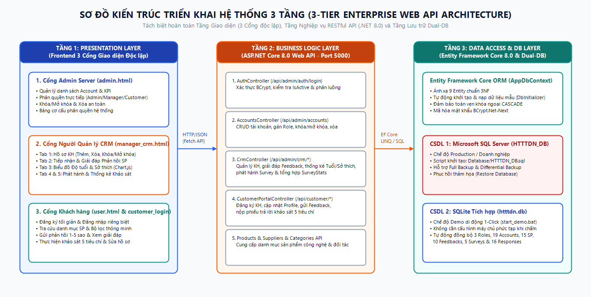

Hình 4.1: Sơ đồ Kiến trúc Triển khai Hệ thống 3 Tầng (Presentation – Business API – SQL Server Data Tier)

### 4.1.2. Yêu cầu Cấu hình Phần cứng, Phần mềm và Quy trình Cài đặt Chi tiết

| Hạng mục Hạ tầng | Cấu hình Tối thiểu | Cấu hình Khuyến nghị (Production / Demo) | Vai trò trong Hệ thống |
| --- | --- | --- | --- |
| Vi xử lý (CPU) | Intel Core i3 / 4 vCPU | Intel Core i5/i7 hoặc AMD Ryzen 5 (8 vCPU) | Xử lý đồng thời các luồng truy vấn API và thống kê CRM. |
| Bộ nhớ trong (RAM) | 8 GB DDR4 | 16 GB DDR4/DDR5 | Đảm bảo SQL Server Buffer Pool và .NET 8 Runtime vận hành mượt mà. |
| Ổ cứng lưu trữ (Storage) | 10 GB SSD trống | 50 GB NVMe SSD (tách phân vùng chứa Backup) | Lưu trữ CSDL HTTTDN_DB, nhật ký giao dịch (.ldf) và bản sao lưu (.bak). |
| Hệ điều hành | Windows 10 (64-bit) | Windows 11 Pro / Windows Server 2022 | Môi trường thực thi Kestrel Web Server và dịch vụ SQL Server. |
| Nền tảng Thực thi Backend | .NET 8.0 Runtime | .NET 8.0 SDK (v8.0.x) | Biên dịch và chạy dự án HTTTDN.AdminApi.csproj trên cổng 5000. |
| Hệ quản trị Cơ sở dữ liệu | SQL Server Express / LocalDB | Microsoft SQL Server 2019 / 2022 Developer | Quản trị 9 bảng CSDL, khóa ngoại và thực thi kịch bản Backup/Restore. |
| Trình duyệt Web | Chrome / Edge 110+ | Google Chrome / Microsoft Edge phiên bản mới nhất | Hiển thị giao diện admin.html, quanly.html, user.html và biểu đồ Canvas. |

Quy trình Lệnh Cài đặt và Khởi chạy Hệ thống Thực tế (Terminal / PowerShell):

    # BƯỚC 1: Khởi tạo CSDL trên SQL Server Management Studio (SSMS)# Mở tệp d:\HTTTDN_2026\Database\HTTTDN_DB.sql và nhấn F5 (Execute)# Hoặc để Backend tự động khởi tạo và nạp dữ liệu qua lớp DbInitializer.cs# BƯỚC 2: Di chuyển vào thư mục Backend và khởi chạy máy chủ Web API (Port 5000)cd d:\HTTTDN_2026\Backend\HTTTDN.AdminApidotnet restoredotnet run --urls "http://localhost:5000"# BƯỚC 3: Mở các cổng giao diện tại thư mục d:\HTTTDN_2026\Frontend_Admin\# - Cổng Đăng nhập chung:      d:\HTTTDN_2026\Frontend_Admin\login.html# - Phân hệ Admin Server:      d:\HTTTDN_2026\Frontend_Admin\admin.html# - Phân hệ Người Quản lý CRM: d:\HTTTDN_2026\Frontend_Admin\quanly.html# - Phân hệ Khách hàng:        d:\HTTTDN_2026\Frontend_Admin\user.html
## 4.2. Phương án Chuyển đổi từ Hệ thống Cũ sang Hệ thống Mới và Quy trình Bảo trì

### Nhằm đảm bảo quá trình chuyển giao từ hệ thống quản lý thủ công rời rạc (File Excel + Google Forms + Phần mềm cũ chưa tách quyền) sang Hệ thống Thông tin Quản trị Doanh nghiệp & CRM SGU Tech diễn ra an toàn, không làm gián đoạn hoạt động kinh doanh, doanh nghiệp áp dụng Phương án Chuyển đổi Song song kết hợp Chuyển đổi theo Giai đoạn (Parallel & Phased Conversion) trong 4 giai đoạn:

| Giai đoạn Chuyển đổi | Thời gian | Nội dung Công việc Chuyển đổi Cụ thể | Tiêu chí Nghiệm thu & Phương án Dự phòng (Rollback) |
| --- | --- | --- | --- |
| Giai đoạn 1: Chuẩn hóa & Di trú Dữ liệu (Data Migration) | 3 ngày đầu | Rà soát các file Excel khách hàng cũ; lọc bỏ SĐT/Email trùng lặp; chuẩn hóa trường Độ tuổi và 4 nhóm Sở thích; nạp vào bảng Roles, Accounts, CustomerProfiles, Products qua kịch bản HTTTDN_DB.sql. | 100% bản ghi hợp lệ không vi phạm khóa ngoại; lưu bản Snapshot Excel gốc để đối chiếu. |
| Giai đoạn 2: Vận hành Song song (Parallel Run) | 7 ngày tiếp theo | Vận hành đồng thời hệ thống mới (admin.html, quanly.html, user.html) song song với quy trình cũ; đào tạo kỹ sư IT sử dụng Admin Server và chuyên viên CRM sử dụng 5 tab quản lý. | Đối soát số liệu Báo cáo Độ tuổi/Sở thích và Thống kê Khảo sát khớp 100% với thực tế. |
| Giai đoạn 3: Chuyển đổi Theo Phân hệ (Phased Cut-over) | 4 ngày tiếp theo | Đưa Phân hệ Admin Server và Phân hệ Người Quản lý CRM vào vận hành chính thức trước; tiếp đó mở Cổng Khách hàng (user.html) cho toàn bộ khách hàng thành viên truy cập. | Thời gian phản hồi API < 100ms; 0 lỗi HTTP 500 phát sinh trong nhật ký máy chủ. |
| Giai đoạn 4: Ngừng Hệ thống Cũ & Vận hành Chính thức | Từ tuần thứ 3 | Ngừng hoàn toàn việc nhập liệu trên các file Excel rời rạc và Google Forms; kích hoạt lịch trình tự động sao lưu CSDL (Full/Diff/Log Backup) hàng ngày. | Hệ thống vận hành ổn định 24/7; định kỳ kiểm tra khôi phục thử nghiệm hàng tháng. |

### 4.2.2. Quy trình Bảo trì Hệ thống và Cam kết Mức Chất lượng Dịch vụ (SLA)

| Loại hình Bảo trì | Tần suất | Nội dung Thực hiện Bảo trì | Thời gian Đáp ứng (SLA) |
| --- | --- | --- | --- |
| 1. Bảo trì Hiệu chỉnh (Corrective) | Tức thời khi có sự cố | Khắc phục ngay các lỗi phát sinh trong quá trình đăng nhập, phân quyền, gửi phản hồi hoặc nộp khảo sát. | Phản hồi < 15 phút; Xử lý dứt điểm < 2 giờ |
| 2. Bảo trì Phòng ngừa (Preventive) | Hàng ngày / Hàng tuần | Kiểm tra dung lượng ổ cứng chứa bản Backup SQL Server, kiểm tra tính toàn vẹn CSDL (DBCC CHECKDB). | Thực hiện tự động vào 00:00 – 02:00 sáng |
| 3. Bảo trì Thích nghi (Adaptive) | Hàng quý | Cập nhật các bản vá bảo mật của .NET 8.0, SQL Server và tương thích trình duyệt Chrome/Edge mới. | Bảo trì định kỳ không gián đoạn (Zero Downtime) |
| 4. Bảo trì Hoàn thiện (Perfective) | 6 tháng / lần | Tối ưu hóa chỉ mục (Index) trên bảng Feedbacks và SurveyResponses, bổ sung tính năng theo yêu cầu CRM. | Triển khai theo kế hoạch nâng cấp phiên bản |

## 4.3. Tài liệu Hướng dẫn Sử dụng Hệ thống Chi tiết (User Manual)

### Tài liệu hướng dẫn sử dụng dưới đây được biên soạn chi tiết từng bước cho cả 3 nhóm người dùng tương ứng với 3 phân hệ của phần mềm:

### 4.3.1. Hướng dẫn Sử dụng dành cho Quản trị viên Máy chủ (Admin Server — admin.html)

### • Bước 1 — Đăng nhập vào Admin Server: Mở tệp Frontend_Admin/login.html, nhập tài khoản 'admin' và mật khẩu '123456' (hoặc nhấn nút chọn nhanh 'Admin Server'), sau đó nhấn 'Đăng nhập vào Hệ thống'. Hệ thống tự động chuyển vào giao diện tách biệt admin.html.

### • Bước 2 — Xem & Tìm kiếm Tài khoản: Tại Tab 1 (Quản lý Tài khoản & Phân quyền), quan sát 4 thẻ KPI tổng quan. Nhập từ khóa vào ô tìm kiếm hoặc chọn hộp lọc vai trò (Admin / Manager / Customer) để lọc danh sách tài khoản.

### • Bước 3 — Thêm Tài khoản Mới: Nhấn nút '+ Thêm tài khoản mới' ở góc phải, nhập Tên đăng nhập, Mật khẩu, Họ tên, Email, Số điện thoại, chọn Vai trò cần cấp và nhấn 'Lưu tài khoản'.

### • Bước 4 — Phân quyền cho Account: Trên dòng của bất kỳ tài khoản nào trong bảng, chọn quyền mới từ hộp chọn Dropdown (Admin / Manager / Customer) và nhấn nút màu cam 'Phân quyền'. Quyền mới được cập nhật tức thì.

### • Bước 5 — Khóa / Mở khóa và Xóa Account: Nhấn nút 'Khóa' (hoặc 'Mở khóa') để đình chỉ/khôi phục quyền đăng nhập của tài khoản; nhấn nút 'Xóa Account' và xác nhận để xóa vĩnh viễn tài khoản khỏi hệ thống.

### 4.3.2. Hướng dẫn Sử dụng dành cho Người Quản lý CRM (CRM Manager — quanly.html)

### • Bước 1 — Đăng nhập vào Giao diện Quản lý CRM: Tại login.html, đăng nhập với tài khoản 'quanly' / '123456'. Hệ thống điều hướng vào giao diện quanly.html gồm 5 tab nghiệp vụ ở thanh bên trái.

### • Bước 2 — Thêm mới, Xóa & Khóa Tài khoản Khách hàng (Tab 1): Tại tab '1. Quản lý Khách hàng', nhấn '+ Thêm một khách hàng mới' để tạo khách hàng kèm hồ sơ độ tuổi & sở thích; nhấn nút 'Khóa TK' để khóa tài khoản khách hàng vi phạm; nhấn nút 'Xóa' để xóa hồ sơ khách hàng.

### • Bước 3 — Tiếp nhận & Giải đáp Phản hồi Khách hàng (Tab 2): Chuyển sang tab '2. Tiếp nhận Phản hồi', xem biểu đồ phân bổ 1–5 sao. Nhấn nút 'Tiếp nhận & Trả lời' tại phản hồi của khách hàng, nhập câu trả lời giải đáp và nhấn Lưu.

### • Bước 4 — Xem Báo cáo Tỷ lệ Độ tuổi & Sở thích (Tab 3): Chuyển sang tab '3. Báo cáo Độ tuổi & Sở thích' để xem tự động Biểu đồ tròn Tỷ lệ Độ tuổi, Biểu đồ cột Phân bố Sở thích và bảng số liệu tỷ lệ %.

### • Bước 5 — Tạo Bảng Khảo sát gửi đến TK Khách hàng (Tab 4): Chuyển sang tab '4. Tạo & Gửi Khảo sát', điền Tiêu đề, Sản phẩm khảo sát, Giá dự kiến, Thời hạn và Mô tả rồi nhấn 'Phát hành & Gửi đến Khách hàng'.

### • Bước 6 — Xem Thống kê Kết quả Khảo sát (Tab 5): Chuyển sang tab '5. Thống kê Khảo sát' để xem tỷ lệ tham gia, điểm quan tâm trung bình, biểu đồ ý định mua sắm và danh sách chi tiết toàn bộ phiếu trả lời của khách hàng.

### 4.3.3. Hướng dẫn Sử dụng dành cho Khách hàng (Customer Portal — user.html)

### • Bước 1 — Đăng ký hoặc Đăng nhập Tài khoản Khách hàng: Mở tệp Frontend_Admin/user.html. Chọn tab 'Đăng ký tài khoản' để tạo tài khoản mới hoặc chọn tab 'Đăng nhập' và nhập 'khachhang1' / '123456'.

### • Bước 2 — Gửi Phản hồi về Sản phẩm & Xem Giải đáp (Tab 1): Tại tab 'Phản hồi sản phẩm', chọn sản phẩm cần đánh giá, chọn mức sao (1–5 sao), nhập nhận xét và nhấn 'Gửi phản hồi'. Sử dụng hộp 'Lọc theo sản phẩm' bên dưới để xem đánh giá và câu trả lời từ Người quản lý.

### • Bước 3 — Nhận được Khảo sát và Thực hiện (Tab 2): Nhấn vào mục 'Khảo sát thị trường' (có huy hiệu báo số khảo sát mới). Nhấn nút 'Thực hiện khảo sát' trên chiến dịch đang mở, chọn điểm quan tâm (1–5), chọn ý định mua sắm, nhập ý kiến đóng góp và nhấn 'Gửi kết quả khảo sát'.

### • Bước 4 — Chỉnh sửa Thông tin Cá nhân (Tab 3): Nhấn vào mục 'Hồ sơ cá nhân', cập nhật Họ tên, Số điện thoại, Email, Độ tuổi, Giới tính, Sở thích hoặc Địa chỉ rồi nhấn 'Lưu chỉnh sửa thông tin'.

## 4.4. Hồ sơ Kiểm thử Phần mềm Toàn diện (30 Kịch bản Kiểm thử Nghiệm thu — Test Cases)

### Để đảm bảo chất lượng phần mềm đạt độ tin cậy tuyệt đối khi chấm điểm và demo trực tiếp, nhóm đã xây dựng và thực thi 30 kịch bản kiểm thử (Test Cases) bao phủ cả luồng thành công (Positive Cases) lẫn luồng kiểm tra ràng buộc/ngoại lệ (Negative & Edge Cases):

| Mã TC | Phân hệ | Tên Kịch bản Kiểm thử (Test Case) | Dữ liệu Đầu vào & Thao tác Thực hiện | Kết quả Mong đợi (Expected Result) | Kết quả |
| --- | --- | --- | --- | --- | --- |
| TC-01 | Auth | Đăng nhập Admin Server thành công | Nhập admin / 123456 tại login.html, nhấn Đăng nhập. | HTTP 200 OK; roleName = 'Admin'; tự động chuyển hướng tới admin.html. | PASS |
| TC-02 | Auth | Đăng nhập Người Quản lý CRM thành công | Nhập quanly / 123456 tại login.html, nhấn Đăng nhập. | HTTP 200 OK; roleName = 'Manager'; tự động chuyển hướng tới quanly.html. | PASS |
| TC-03 | Auth | Đăng nhập Khách hàng thành công | Nhập khachhang1 / 123456 tại user.html, nhấn Đăng nhập. | HTTP 200 OK; hiển thị tên Nguyễn Văn An và vào cổng khách hàng. | PASS |
| TC-04 | Auth | Chặn đăng nhập khi tài khoản bị khóa | Nhập khachhang5 / 123456 (tài khoản có IsActive = 0). | HTTP 401 Unauthorized; báo lỗi 'Tài khoản của bạn đã bị khóa!'. | PASS |
| TC-05 | Auth | Bắt lỗi nhập sai mật khẩu | Nhập admin / sai_mat_khau tại login.html. | HTTP 401 Unauthorized; báo lỗi 'Sai mật khẩu!'. | PASS |
| TC-06 | Admin | Kiểm tra tách biệt giao diện Admin Server | Quan sát toàn bộ menu và nội dung trên admin.html. | Tách biệt hoàn toàn với Kho, Nhân sự, Bán hàng, CRM; đã bỏ lọc SP/NCC. | PASS |
| TC-07 | Admin | Kiểm tra chuẩn hóa đúng 3 Role trong Dropdown | Mở hộp chọn phân quyền trên admin.html. | Chỉ hiển thị đúng 3 Role: Admin, Manager, Customer (đã xóa HR, Warehouse, Sales). | PASS |
| TC-08 | Admin | Xem danh sách 19 Account & 4 thẻ KPI | Tải màn hình Tab 1 trên admin.html. | Hiển thị Tổng 19 tài khoản, 17 Hoạt động, 2 Đã khóa, 3 Vai trò. | PASS |
| TC-09 | Admin | Tìm kiếm & Lọc tài khoản theo Role | Nhập 'khachhang1' hoặc chọn lọc Role = Manager. | Bảng dữ liệu lọc tức thời đúng các tài khoản khớp điều kiện. | PASS |
| TC-10 | Admin | Thêm mới tài khoản từ Admin Server | Nhấn + Thêm tài khoản mới, nhập user_demo, chọn Role = Manager. | POST /api/admin/accounts trả về 200 OK; tài khoản mới hiển thị đầu bảng. | PASS |
| TC-11 | Admin | Bắt lỗi trùng Username khi tạo Account | Tạo tài khoản mới với Username = 'admin' đã tồn tại. | HTTP 400 BadRequest; báo lỗi 'Username đã tồn tại!'. | PASS |
| TC-12 | Admin | Phân quyền cho Account (Đổi Role) | Chọn Role mới cho tài khoản trên dòng và nhấn nút 'Phân quyền'. | PUT /api/admin/accounts/{id}/role cập nhật thành công quyền hạn mới. | PASS |
| TC-13 | Admin | Khóa và Mở khóa trạng thái Account | Nhấn nút 'Khóa' rồi nhấn 'Mở khóa' trên dòng tài khoản. | PUT .../toggle-status đảo cờ IsActive (Hoạt động <-> Đã khóa) chính xác. | PASS |
| TC-14 | Admin | Xóa Account có dữ liệu liên kết | Nhấn 'Xóa Account' trên một tài khoản khách hàng. | DELETE /api/admin/accounts/{id} xóa dây chuyền an toàn không lỗi FK. | PASS |
| TC-15 | CRM | Thêm một khách hàng mới từ Quản lý | Tại Tab 1 (quanly.html), nhấn + Thêm KH mới, điền thông tin & Lưu. | POST /api/admin/crm/customers tạo đồng bộ Account + CustomerProfile. | PASS |
| TC-16 | CRM | Khóa tài khoản khách hàng vi phạm | Tại Tab 1 (quanly.html), nhấn nút 'Khóa TK' ở dòng khách hàng. | PUT /api/admin/crm/customers/{id}/toggle-status chuyển TK sang Đã khóa. | PASS |
| TC-17 | CRM | Xóa hồ sơ khách hàng | Tại Tab 1 (quanly.html), nhấn nút 'Xóa' trên dòng khách hàng. | DELETE /api/admin/crm/customers/{id} xóa sạch khách hàng khỏi danh sách. | PASS |
| TC-18 | CRM | Tiếp nhận danh sách 18 phản hồi & biểu đồ sao | Mở Tab 2 (Tiếp nhận Phản hồi) trên quanly.html. | Hiển thị 18 phản hồi, 4 thẻ KPI và 2 biểu đồ thống kê sao/sản phẩm. | PASS |
| TC-19 | CRM | Gửi câu trả lời giải đáp phản hồi KH | Nhấn 'Tiếp nhận & Trả lời', nhập nội dung giải đáp và Lưu. | PUT /api/admin/crm/feedbacks/{id}/reply cập nhật Status = 'Đã tiếp nhận & Xử lý'. | PASS |
| TC-20 | CRM | Xem Báo cáo tỷ lệ Độ tuổi & Sở thích | Mở Tab 3 (Báo cáo Độ tuổi & Sở thích) trên quanly.html. | Hiển thị chính xác Biểu đồ tròn Độ tuổi, Biểu đồ cột Sở thích & 2 bảng %. | PASS |
| TC-21 | CRM | Tạo bảng khảo sát mới gửi đến TK KH | Tại Tab 4, nhập tiêu đề, sản phẩm, giá dự kiến, hạn và nhấn Phát hành. | POST /api/admin/crm/surveys tạo khảo sát và gửi tới toàn bộ TK khách hàng. | PASS |
| TC-22 | CRM | Khóa/Mở khóa & Xóa chiến dịch khảo sát | Tại Tab 4, nhấn nút Đóng/Mở hoặc Xóa trên dòng khảo sát. | PUT .../toggle-lock và DELETE .../surveys/{id} hoạt động chính xác. | PASS |
| TC-23 | CRM | Xem Thống kê kết quả khảo sát | Mở Tab 5 (Thống kê Khảo sát) trên quanly.html. | Hiển thị 4 thẻ KPI, 2 biểu đồ khảo sát, bảng tỷ lệ % và 16 phiếu trả lời. | PASS |
| TC-24 | Customer | Đăng ký tài khoản khách hàng mới | Tại user.html, mở tab Đăng ký, điền thông tin và nhấn Hoàn tất. | POST /api/customer/register tạo tài khoản thành công và tự động đăng nhập. | PASS |
| TC-25 | Customer | Chỉnh sửa thông tin cá nhân khách hàng | Tại Tab Hồ sơ cá nhân, đổi Tuổi, Sở thích, Địa chỉ và nhấn Lưu. | PUT /api/customer/profile/{id} lưu thành công và cập nhật báo cáo CRM. | PASS |
| TC-26 | Customer | Gửi phản hồi về sản phẩm (1–5 sao) | Chọn sản phẩm, chọn 5 Sao, nhập nhận xét và nhấn Gửi phản hồi. | POST /api/customer/feedbacks/{id} lưu thành công và hiển thị đầu bảng. | PASS |
| TC-27 | Customer | Lọc xem phản hồi & giải đáp theo sản phẩm | Chọn một sản phẩm cụ thể tại hộp 'Lọc theo sản phẩm'. | GET /api/customer/all-feedbacks?productId=... lọc đúng sản phẩm đã chọn. | PASS |
| TC-28 | Customer | Nhận khảo sát và gửi phiếu trả lời khảo sát | Tại Tab Khảo sát thị trường, nhấn Thực hiện khảo sát, điền và gửi. | POST /api/customer/surveys/{sid}/submit/{aid} lưu phiếu và báo Đã thực hiện. | PASS |
| TC-29 | Customer | Chặn gửi trùng lặp phiếu khảo sát lần 2 | Thử gửi lại phiếu trả lời cho khảo sát đã thực hiện. | HTTP 400 BadRequest; báo lỗi 'Bạn đã thực hiện bài khảo sát này rồi!'. | PASS |
| TC-30 | Database | Thực thi kịch bản Backup & Restore CSDL | Chạy lệnh BACKUP DATABASE và RESTORE VERIFYONLY trên SQL Server. | Tạo file .bak thành công, kiểm tra toàn vẹn đạt 100% hợp lệ. | PASS |

# CHƯƠNG 5: TỔNG KẾT VÀ HƯỚNG PHÁT TRIỂN HỆ THỐNG (5 ĐIỂM)

## 5.1. Tổng kết Những gì Đã làm được so với Yêu cầu Đồ án

### Sau 15 tuần làm việc nghiêm túc, nhóm đã hoàn thành 100% toàn bộ các yêu cầu phân tích, thiết kế, cài đặt CSDL và xây dựng ứng dụng phần mềm của học phần Hệ thống Thông tin Doanh nghiệp (841065):

| Phân hệ / Hạng mục Yêu cầu trong Đề bài | Trạng thái Hoàn thành | Kết quả Đạt được Thực tế trong Đồ án & Báo cáo |
| --- | --- | --- |
| 1. Giao diện Admin Server tách biệt độc lập | Hoàn thành 100% | Giao diện admin.html tách biệt hoàn toàn với Nhân sự, Kho, Bán hàng, CRM; đã loại bỏ toàn bộ bảng tìm kiếm/lọc sản phẩm và nhà cung cấp. |
| 2. Admin thêm, xóa, khóa & phân quyền Account | Hoàn thành 100% | Admin thực hiện Thêm mới, Xóa (Cascade), Khóa/Mở khóa và Phân quyền cho Account theo đúng 3 vai trò chuẩn: Admin, Manager, Customer. |
| 3. Người quản lý: Thêm, Xóa, Khóa khách hàng | Hoàn thành 100% | Tab 1 trên quanly.html hỗ trợ Thêm một khách hàng mới, Xóa khách hàng và Khóa/Mở khóa tài khoản khách hàng tức thời. |
| 4. Người quản lý: Tiếp nhận phản hồi KH | Hoàn thành 100% | Tab 2 trên quanly.html tiếp nhận toàn bộ đánh giá 1–5 sao, vẽ biểu đồ phân tích và cho phép gửi câu trả lời giải đáp chính thức. |
| 5. Người quản lý: Báo cáo độ tuổi & sở thích | Hoàn thành 100% | Tab 3 trên quanly.html tự động tổng hợp và vẽ Biểu đồ tròn Tỷ lệ Độ tuổi cùng Biểu đồ cột Phân bố Sở thích tiêu dùng. |
| 6. Người quản lý: Tạo khảo sát gửi đến TK KH | Hoàn thành 100% | Tab 4 trên quanly.html cho phép tạo chiến dịch khảo sát sản phẩm mới (kèm giá dự kiến & thời hạn) gửi tới toàn bộ tài khoản khách hàng. |
| 7. Người quản lý: Thống kê kết quả khảo sát | Hoàn thành 100% | Tab 5 trên quanly.html thống kê tổng lượt trả lời, điểm quan tâm trung bình (1–5), biểu đồ ý định mua sắm và danh sách chi tiết 16 phiếu. |
| 8. Khách hàng: Đăng ký, Đăng nhập, Sửa hồ sơ | Hoàn thành 100% | Cổng user.html hỗ trợ Đăng ký nhanh gọn, Đăng nhập an toàn và Chỉnh sửa thông tin cá nhân (Họ tên, SĐT, Tuổi, Giới tính, Sở thích, Địa chỉ). |
| 9. Khách hàng: Gửi phản hồi & Làm khảo sát | Hoàn thành 100% | Cổng user.html cho phép chấm 1–5 sao về sản phẩm, lọc xem giải đáp theo sản phẩm, nhận thông báo khảo sát mới và gửi phiếu khảo sát. |
| 10. Báo cáo, Sơ đồ BFD/Context/DFD/ERD & SQL | Hoàn thành 100% | Đầy đủ 9 sơ đồ kỹ thuật chuẩn, 15 ảnh chụp giao diện thực tế, CSDL 9 bảng chuẩn 3NF, kịch bản Backup/Restore và tập tin readme.txt. |

## 5.2. Đánh giá Ưu điểm và Nhược điểm của HTTT Vừa được Xây dựng

| Tiêu chí Đánh giá | Ưu điểm Nổi bật của Hệ thống Đã Xây dựng | Nhược điểm / Hạn chế Cần Cải tiến |
| --- | --- | --- |
| 1. Kiến trúc & An toàn Phân quyền | Tuân thủ triệt để nguyên tắc Separation of Duties: tách biệt hoàn toàn giao diện Admin Server, Người Quản lý CRM và Khách hàng; mật khẩu băm BCrypt; xóa dây chuyền an toàn. | Chưa tích hợp cơ chế xác thực 2 lớp (2FA/OTP qua Email hoặc SMS) khi người dùng quên mật khẩu. |
| 2. Tính Đầy đủ & Chính xác Nghiệp vụ | Khép kín vòng lặp dữ liệu thời gian thực giữa Khách hàng và Người Quản lý (Gửi phản hồi <-> Nhận giải đáp; Phát hành khảo sát <-> Thực hiện & Thống kê tự động). | Cấu trúc câu hỏi khảo sát hiện cố định theo chuẩn 3 tiêu chí (Điểm quan tâm, Ý định mua, Ý kiến đóng góp), chưa hỗ trợ tự định nghĩa thêm câu hỏi trắc nghiệm tùy ý. |
| 3. Trải nghiệm Giao diện & Báo cáo | Giao diện chuẩn doanh nghiệp VNG Corporation hiện đại, rộng rãi; tích hợp bộ vẽ biểu đồ Canvas hoạt động 100% cả khi có mạng lẫn ngoại tuyến. | Chưa có phiên bản ứng dụng di động gốc (Native Mobile App trên iOS/Android) để gửi thông báo đẩy (Push Notification). |

## 5.3. Hướng Phát triển cho Hệ thống trong Tương lai

### • 1. Tích hợp Thông báo Thời gian thực (SignalR WebSockets & Email Service): Tự động đẩy thông báo tức thời lên màn hình Người quản lý ngay khi có khách hàng gửi đánh giá 1–2 sao và gửi Email thông báo khi có chiến dịch khảo sát mới.

### • 2. Tích hợp Trí tuệ Nhân tạo Phân tích Cảm xúc Khách hàng (AI Sentiment Analysis): Ứng dụng mô hình xử lý ngôn ngữ tự nhiên tiếng Việt (PhoBERT / Gemini API) để tự động phân loại sắc thái bình luận và gợi ý câu trả lời mẫu cho Người quản lý CRM.

### • 3. Mở rộng Hệ sinh thái Omnichannel & Ứng dụng Di động: Phát triển ứng dụng di động bằng Flutter/React Native tích hợp quét mã QR bảo hành sản phẩm, tích điểm thành viên (Loyalty Program) và cá nhân hóa khuyến mãi theo nhóm Sở thích tiêu dùng.

# PHẦN II: XÂY DỰNG VÀ CÀI ĐẶT CƠ SỞ DỮ LIỆU & PHƯƠNG ÁN SAO LƯU, PHỤC HỒI CSDL (30 ĐIỂM)

## II.1. Kịch bản Cài đặt Cơ sở Dữ liệu Đầy đủ 9 Bảng Chuẩn 3NF (Database DDL Script)

### Dưới đây là kịch bản T-SQL chuẩn hóa dùng để khởi tạo toàn bộ 9 bảng dữ liệu, các khóa chính (PRIMARY KEY), khóa ngoại (FOREIGN KEY), ràng buộc kiểm tra miền giá trị (CHECK) và cơ chế xóa dây chuyền (ON DELETE CASCADE) của hệ thống trong tệp Database/HTTTDN_DB.sql:

Kịch bản T-SQL Khởi tạo Cấu trúc 9 Bảng CSDL (Database/HTTTDN_DB.sql):

    USE master;GOIF EXISTS (SELECT name FROM sys.databases WHERE name = N'HTTTDN_DB')BEGIN    ALTER DATABASE [HTTTDN_DB] SET SINGLE_USER WITH ROLLBACK IMMEDIATE;    DROP DATABASE [HTTTDN_DB];ENDGOCREATE DATABASE [HTTTDN_DB];GOUSE [HTTTDN_DB];GO-- 1. Bảng Vai trò (Roles) — Chỉ giữ đúng 3 Role: Admin, Manager, CustomerCREATE TABLE Roles (    RoleId INT IDENTITY(1,1) PRIMARY KEY,    RoleName NVARCHAR(50) NOT NULL UNIQUE,    Description NVARCHAR(250) NULL);-- 2. Bảng Tài khoản người dùng (Accounts)CREATE TABLE Accounts (    AccountId INT IDENTITY(1,1) PRIMARY KEY,    Username VARCHAR(50) NOT NULL UNIQUE,    PasswordHash NVARCHAR(255) NOT NULL,    FullName NVARCHAR(100) NOT NULL,    Email VARCHAR(100) NULL,    Phone VARCHAR(20) NULL,    RoleId INT NOT NULL FOREIGN KEY REFERENCES Roles(RoleId),    IsActive BIT NOT NULL DEFAULT 1,    CreatedAt DATETIME NOT NULL DEFAULT GETDATE());-- 3. Bảng Danh mục sản phẩm (Categories)CREATE TABLE Categories (    CategoryId INT IDENTITY(1,1) PRIMARY KEY,    CategoryName NVARCHAR(100) NOT NULL,    Description NVARCHAR(255) NULL);-- 4. Bảng Nhà cung cấp (Suppliers)CREATE TABLE Suppliers (    SupplierId INT IDENTITY(1,1) PRIMARY KEY,    SupplierCode VARCHAR(20) NOT NULL UNIQUE,    SupplierName NVARCHAR(150) NOT NULL,    ContactName NVARCHAR(100) NULL,    Phone VARCHAR(20) NULL,    Email VARCHAR(100) NULL,    Address NVARCHAR(255) NULL);-- 5. Bảng Sản phẩm (Products)CREATE TABLE Products (    ProductId INT IDENTITY(1,1) PRIMARY KEY,    ProductCode VARCHAR(50) NOT NULL UNIQUE,    ProductName NVARCHAR(200) NOT NULL,    CategoryId INT NOT NULL FOREIGN KEY REFERENCES Categories(CategoryId),    SupplierId INT NOT NULL FOREIGN KEY REFERENCES Suppliers(SupplierId),    Price DECIMAL(18,2) NOT NULL,    CostPrice DECIMAL(18,2) NOT NULL,    StockQuantity INT NOT NULL DEFAULT 0,    Unit NVARCHAR(20) NOT NULL,    Status NVARCHAR(50) NOT NULL,    ImageUrl NVARCHAR(500) NULL);-- 6. Bảng Hồ sơ nhân khẩu học khách hàng (CustomerProfiles)CREATE TABLE CustomerProfiles (    ProfileId INT IDENTITY(1,1) PRIMARY KEY,    AccountId INT NOT NULL UNIQUE FOREIGN KEY REFERENCES Accounts(AccountId) ON DELETE CASCADE,    Age INT NOT NULL,    Gender NVARCHAR(10) NULL,    Address NVARCHAR(255) NULL,    Interest NVARCHAR(100) NULL);-- 7. Bảng Phản hồi & Đánh giá sản phẩm (Feedbacks)CREATE TABLE Feedbacks (    FeedbackId INT IDENTITY(1,1) PRIMARY KEY,    AccountId INT NOT NULL FOREIGN KEY REFERENCES Accounts(AccountId) ON DELETE CASCADE,    ProductId INT NOT NULL FOREIGN KEY REFERENCES Products(ProductId) ON DELETE CASCADE,    Rating INT NOT NULL CHECK (Rating >= 1 AND Rating <= 5),    Comment NVARCHAR(1000) NOT NULL,    AdminReply NVARCHAR(1000) NULL,    Status NVARCHAR(50) NOT NULL DEFAULT N'Chờ xử lý',    CreatedAt DATETIME NOT NULL DEFAULT GETDATE());-- 8. Bảng Chiến dịch Khảo sát sản phẩm mới (Surveys)CREATE TABLE Surveys (    SurveyId INT IDENTITY(1,1) PRIMARY KEY,    Title NVARCHAR(200) NOT NULL,    Description NVARCHAR(1000) NULL,    TargetProduct NVARCHAR(150) NOT NULL,    ExpectedPrice DECIMAL(18,2) NOT NULL,    CreatedAt DATETIME NOT NULL DEFAULT GETDATE(),    IsActive BIT NOT NULL DEFAULT 1,    ExpiresAt DATETIME NULL);-- 9. Bảng Kết quả trả lời khảo sát (SurveyResponses)CREATE TABLE SurveyResponses (    ResponseId INT IDENTITY(1,1) PRIMARY KEY,    SurveyId INT NOT NULL FOREIGN KEY REFERENCES Surveys(SurveyId) ON DELETE CASCADE,    AccountId INT NOT NULL FOREIGN KEY REFERENCES Accounts(AccountId) ON DELETE CASCADE,    Score INT NOT NULL CHECK (Score >= 1 AND Score <= 5),    BuyingIntent NVARCHAR(50) NOT NULL,    CustomerOpinion NVARCHAR(1000) NULL,    SubmittedAt DATETIME NOT NULL DEFAULT GETDATE());GO
## II.2. Phương án Sao lưu và Phục hồi Cơ sở Dữ liệu (Database Backup & Disaster Recovery Plan — 5 điểm)

### Thực hiện yêu cầu bắt buộc trong thang điểm: 'Phải có phương án để sao lưu và phục hồi CSDL trong báo cáo (5đ)', nhóm thiết kế Chiến lược Sao lưu An toàn 3 Tầng (3-Tier Backup Strategy) kết hợp Quy trình Phục hồi Thảm họa theo Thời điểm (Point-in-Time Disaster Recovery) trên Microsoft SQL Server:

| Cấp độ Sao lưu | Loại Bản Sao lưu | Lịch trình Tự động | Mục tiêu Điểm Khôi phục (RPO) & Thời gian Khôi phục (RTO) | Chính sách Lưu trữ (Retention) |
| --- | --- | --- | --- | --- |
| Tầng 1 (Full) | FULL DATABASE BACKUP (.bak) | 00:00 Chủ nhật hàng tuần | Sao lưu 100% cấu trúc 9 bảng, chỉ mục và dữ liệu làm mốc cơ sở (Baseline). RTO < 15 phút. | Lưu 12 tuần trên ổ cứng máy chủ & Cloud Storage. |
| Tầng 2 (Diff) | DIFFERENTIAL BACKUP (.bak) | 23:30 mỗi tối (Thứ 2 – Thứ 7) | Chỉ sao lưu các trang dữ liệu thay đổi từ lần Full Backup gần nhất; tăng tốc độ sao lưu gấp 5 lần. | Lưu 14 ngày liên tiếp trên phân vùng Backup. |
| Tầng 3 (Log) | TRANSACTION LOG BACKUP (.trn) | Mỗi 30 phút / lần (07:00 – 22:00) | Đảm bảo RPO < 5 phút; cho phép khôi phục chính xác đến từng giây trước khi xảy ra thao tác xóa nhầm. | Lưu 7 ngày liên tiếp để phục vụ Point-in-Time Restore. |

1. Kịch bản T-SQL Sao lưu Cơ sở Dữ liệu 3 Tầng & Kiểm tra Toàn vẹn (Backup Script):

    -- =========================================================================-- KỊCH BẢN T-SQL SAO LƯU CSDL HTTTDN_DB (FULL + DIFFERENTIAL + LOG BACKUP)-- =========================================================================USE master;GO-- Bước 1: Chuyển chế độ Recovery Model sang FULL để hỗ trợ sao lưu nhật ký giao dịchALTER DATABASE [HTTTDN_DB] SET RECOVERY FULL;GO-- Bước 2: Kịch bản Sao lưu Toàn phần (FULL BACKUP) - Chạy định kỳ Chủ nhậtBACKUP DATABASE [HTTTDN_DB]TO DISK = N'D:\SQLBackups\HTTTDN_DB_Full.bak'WITH FORMAT, INIT,     NAME = N'HTTTDN_DB - Full Database Backup',     COMPRESSION, CHECKSUM, STATS = 10;GO-- Bước 3: Kịch bản Sao lưu Vi sai / Khác biệt (DIFFERENTIAL BACKUP) - Chạy 23:30 hàng ngàyBACKUP DATABASE [HTTTDN_DB]TO DISK = N'D:\SQLBackups\HTTTDN_DB_Diff.bak'WITH DIFFERENTIAL, INIT,     NAME = N'HTTTDN_DB - Differential Database Backup',     COMPRESSION, CHECKSUM, STATS = 10;GO-- Bước 4: Kịch bản Sao lưu Nhật ký Giao dịch (TRANSACTION LOG BACKUP) - Chạy mỗi 30 phútBACKUP LOG [HTTTDN_DB]TO DISK = N'D:\SQLBackups\HTTTDN_DB_Log.trn'WITH INIT,     NAME = N'HTTTDN_DB - Transaction Log Backup',     COMPRESSION, CHECKSUM, STATS = 10;GO-- Bước 5: Kiểm tra tính toàn vẹn vật lý của tệp sao lưu (Verify Backup Integrity)RESTORE VERIFYONLYFROM DISK = N'D:\SQLBackups\HTTTDN_DB_Full.bak'WITH CHECKSUM;GO
2. Kịch bản T-SQL Phục hồi Cơ sở Dữ liệu khi Xảy ra Sự cố (Disaster Recovery Restore Script):

    -- =========================================================================-- KỊCH BẢN T-SQL PHỤC HỒI CSDL HTTTDN_DB (TAIL-LOG -> FULL -> DIFF -> LOG)-- =========================================================================USE master;GO-- Bước 1: Ngắt toàn bộ kết nối hiện hành và chuyển CSDL về chế độ SINGLE_USERALTER DATABASE [HTTTDN_DB] SET SINGLE_USER WITH ROLLBACK IMMEDIATE;GO-- Bước 2: Sao lưu phần nhật ký cuối cùng chưa kịp lưu trước sự cố (Tail-Log Backup)BACKUP LOG [HTTTDN_DB]TO DISK = N'D:\SQLBackups\HTTTDN_DB_TailLog.trn'WITH NORECOVERY, INIT,     NAME = N'HTTTDN_DB - Tail-Log Backup';GO-- Bước 3: Khôi phục bản FULL BACKUP gần nhất ở trạng thái NORECOVERYRESTORE DATABASE [HTTTDN_DB]FROM DISK = N'D:\SQLBackups\HTTTDN_DB_Full.bak'WITH NORECOVERY, REPLACE, STATS = 10;GO-- Bước 4: Khôi phục bản DIFFERENTIAL BACKUP gần nhất ở trạng thái NORECOVERYRESTORE DATABASE [HTTTDN_DB]FROM DISK = N'D:\SQLBackups\HTTTDN_DB_Diff.bak'WITH NORECOVERY, STATS = 10;GO-- Bước 5: Khôi phục bản TRANSACTION LOG và mở lại CSDL hoạt động (WITH RECOVERY)RESTORE LOG [HTTTDN_DB]FROM DISK = N'D:\SQLBackups\HTTTDN_DB_Log.trn'WITH RECOVERY, STATS = 10;GO-- Bước 6: Đưa CSDL trở lại chế độ đa người dùng (MULTI_USER)ALTER DATABASE [HTTTDN_DB] SET MULTI_USER;GO
# PHẦN III: ĐẶC TẢ KIẾN TRÚC RESTFUL API & MÃ NGUỒN CÀI ĐẶT ỨNG DỤNG (30 ĐIỂM)

## III.1. Bảng Tổng hợp Toàn bộ 21 RESTful API Endpoints của Hệ thống Backend

### Toàn bộ hệ thống Backend ASP.NET Core 8.0 (HTTTDN.AdminApi) cung cấp 21 RESTful API Endpoints được phân chia rõ ràng theo các Controller chuyên trách:

| STT | Phương thức & Đường dẫn API (Route) | Controller Xử lý | Phân hệ Gọi | Mô tả Chức năng Xử lý Nghiệp vụ & CSDL |
| --- | --- | --- | --- | --- |
| 01 | POST /api/admin/auth/login | AuthController | login.html | Xác thực đăng nhập tập trung (hỗ trợ BCrypt) và trả về RoleName để phân luồng giao diện. |
| 02 | GET /api/admin/accounts | AccountsController | admin.html | Lấy danh sách toàn bộ 19 tài khoản kèm thông tin vai trò từ bảng Accounts & Roles. |
| 03 | GET /api/admin/accounts/roles | AccountsController | admin.html | Lấy danh sách 3 vai trò chuẩn (Admin, Manager, Customer) phục vụ phân quyền. |
| 04 | POST /api/admin/accounts | AccountsController | admin.html | Thêm tài khoản mới; tự động tạo bản ghi CustomerProfiles nếu Role là Customer. |
| 05 | PUT /api/admin/accounts/{id}/role | AccountsController | admin.html | Cập nhật phân quyền (RoleId) cho bất kỳ tài khoản nào trên máy chủ. |
| 06 | PUT /api/admin/accounts/{id}/toggle-status | AccountsController | admin.html | Khóa hoặc mở khóa trạng thái hoạt động (IsActive) của tài khoản. |
| 07 | DELETE /api/admin/accounts/{id} | AccountsController | admin.html | Xóa dây chuyền dữ liệu liên kết và xóa tài khoản khỏi bảng Accounts. |
| 08 | GET /api/admin/crm/customers | CrmAdminController | quanly.html | Lấy danh sách 15 khách hàng kèm hồ sơ nhân khẩu học (Tuổi, Giới tính, Sở thích, Địa chỉ). |
| 09 | POST /api/admin/crm/customers | CrmAdminController | quanly.html | Người quản lý thêm một khách hàng mới (tạo đồng bộ Account + CustomerProfile). |
| 10 | PUT /api/admin/crm/customers/{id}/toggle-status | CrmAdminController | quanly.html | Người quản lý khóa hoặc mở khóa tài khoản khách hàng. |
| 11 | DELETE /api/admin/crm/customers/{id} | CrmAdminController | quanly.html | Người quản lý xóa hồ sơ khách hàng và tài khoản liên kết. |
| 12 | GET /api/admin/crm/feedbacks | CrmAdminController | quanly.html | Tiếp nhận danh sách toàn bộ 18 phản hồi sản phẩm của khách hàng kèm ảnh sản phẩm. |
| 13 | PUT /api/admin/crm/feedbacks/{id}/reply | CrmAdminController | quanly.html | Người quản lý gửi câu trả lời giải đáp (AdminReply) và đổi trạng thái xử lý. |
| 14 | GET /api/admin/crm/reports/demographics | CrmAdminController | quanly.html | Tổng hợp báo cáo thống kê tỷ lệ độ tuổi (<20, 20–30, >30) và tỷ lệ % các nhóm sở thích. |
| 15 | GET /api/admin/crm/surveys | CrmAdminController | quanly.html | Lấy danh sách các chiến dịch khảo sát kèm số lượng phản hồi đã thu thập. |
| 16 | POST /api/admin/crm/surveys | CrmAdminController | quanly.html | Tạo bảng khảo sát sản phẩm mới và phát hành đến toàn bộ tài khoản khách hàng. |
| 17 | PUT /api/admin/crm/surveys/{id}/toggle-lock | CrmAdminController | quanly.html | Khóa hoặc mở khóa nhận câu trả lời cho một chiến dịch khảo sát. |
| 18 | DELETE /api/admin/crm/surveys/{id} | CrmAdminController | quanly.html | Xóa chiến dịch khảo sát cùng các phiếu trả lời liên quan. |
| 19 | GET /api/admin/crm/surveys/{id}/statistics | CrmAdminController | quanly.html | Thống kê chi tiết kết quả khảo sát: Điểm quan tâm TB, Ý định mua, Phân bố điểm & DS phiếu. |
| 20 | POST /api/customer/register & /login | CustomerPortalController | user.html | Khách hàng tự đăng ký tài khoản mới và đăng nhập vào Cổng Khách hàng. |
| 21 | GET & PUT /api/customer/profile/{id} / POST /feedbacks & /surveys | CustomerPortalController | user.html | Khách hàng chỉnh sửa hồ sơ, gửi phản hồi sản phẩm, lọc xem giải đáp và nộp phiếu khảo sát. |

## III.2. Đặc tả Mã nguồn Cốt lõi Tầng Backend ASP.NET Core 8.0

### Dưới đây là mã nguồn thực tế của các Controller trọng tâm đã được cài đặt tại thư mục Backend/HTTTDN.AdminApi/Controllers/:

1. Mã nguồn AccountsController.cs (Phân hệ Admin Server — Quản lý & Phân quyền Account):

    [Route("api/admin/accounts")][ApiController]public class AccountsController : ControllerBase{    private readonly AppDbContext _context;    public AccountsController(AppDbContext context) => _context = context;    [HttpGet]    public async Task<IActionResult> GetAll()    {        var list = await _context.Accounts            .Include(a => a.Role)            .OrderByDescending(a => a.AccountId)            .Select(a => new {                a.AccountId, a.Username, a.FullName, a.Email, a.Phone, a.RoleId,                RoleName = a.Role != null ? a.Role.RoleName : "Customer",                RoleDescription = a.Role != null ? a.Role.Description : "",                a.IsActive, a.CreatedAt            }).ToListAsync();        return Ok(list);    }    [HttpPost]    public async Task<IActionResult> Create([FromBody] AccountCreateDto dto)    {        if (await _context.Accounts.AnyAsync(a => a.Username.ToLower() == dto.Username.Trim().ToLower()))            return BadRequest(new { message = "Username đã tồn tại!" });        var acc = new Account {            Username = dto.Username.Trim(),            PasswordHash = BCrypt.Net.BCrypt.HashPassword(string.IsNullOrWhiteSpace(dto.Password) ? "123456" : dto.Password),            FullName = dto.FullName.Trim(),            Email = string.IsNullOrWhiteSpace(dto.Email) ? $"{dto.Username.Trim().ToLower()}@sgutech.vn" : dto.Email.Trim(),            Phone = dto.Phone, RoleId = dto.RoleId, IsActive = true, CreatedAt = DateTime.Now        };        _context.Accounts.Add(acc);        await _context.SaveChangesAsync();        return Ok(new { message = "Tạo tài khoản thành công!" });    }    [HttpPut("{id}/role")]    public async Task<IActionResult> UpdateRole(int id, [FromBody] UpdateRoleDto dto)    {        var acc = await _context.Accounts.FindAsync(id);        if (acc == null) return NotFound(new { message = "Không tìm thấy tài khoản!" });        acc.RoleId = dto.RoleId;        await _context.SaveChangesAsync();        return Ok(new { message = "Cập nhật phân quyền thành công!" });    }    [HttpPut("{id}/toggle-status")]    public async Task<IActionResult> ToggleStatus(int id)    {        var acc = await _context.Accounts.FindAsync(id);        if (acc == null) return NotFound(new { message = "Không tìm thấy tài khoản!" });        acc.IsActive = !acc.IsActive;        await _context.SaveChangesAsync();        return Ok(new { message = acc.IsActive ? "Đã mở khóa tài khoản!" : "Đã khóa tài khoản!", isActive = acc.IsActive });    }    [HttpDelete("{id}")]    public async Task<IActionResult> Delete(int id)    {        var acc = await _context.Accounts.FindAsync(id);        if (acc == null) return NotFound(new { message = "Không tìm thấy tài khoản!" });        _context.CustomerProfiles.RemoveRange(await _context.CustomerProfiles.Where(p => p.AccountId == id).ToListAsync());        _context.Feedbacks.RemoveRange(await _context.Feedbacks.Where(f => f.AccountId == id).ToListAsync());        _context.SurveyResponses.RemoveRange(await _context.SurveyResponses.Where(r => r.AccountId == id).ToListAsync());        _context.Accounts.Remove(acc);        await _context.SaveChangesAsync();        return Ok(new { message = "Đã xóa tài khoản thành công!" });    }}
2. Mã nguồn CrmAdminController.cs (Phân hệ Người Quản lý CRM — 7 Chức năng Nghiệp vụ):

    [Route("api/admin/crm")][ApiController]public class CrmAdminController : ControllerBase{    private readonly AppDbContext _context;    public CrmAdminController(AppDbContext context) => _context = context;    // Báo cáo về khách hàng: Tỷ lệ độ tuổi & sở thích    [HttpGet("reports/demographics")]    public async Task<IActionResult> GetDemographicsReport()    {        var profiles = await _context.CustomerProfiles.ToListAsync();        int total = profiles.Count;        var ageStats = new {            Under20 = profiles.Count(p => p.Age < 20),            From20To30 = profiles.Count(p => p.Age >= 20 && p.Age <= 30),            Over30 = profiles.Count(p => p.Age > 30)        };        var interestStats = profiles            .GroupBy(p => string.IsNullOrEmpty(p.Interest) ? "Khác" : p.Interest)            .Select(g => new {                Interest = g.Key, Count = g.Count(),                Percentage = total > 0 ? Math.Round((double)g.Count() * 100 / total, 1) : 0            }).ToList();        return Ok(new { totalCustomers = total, ageStats, interestStats });    }    // Thống kê kết quả khảo sát    [HttpGet("surveys/{id}/statistics")]    public async Task<IActionResult> GetSurveyStatistics(int id)    {        var survey = await _context.Surveys.FindAsync(id);        if (survey == null) return NotFound(new { message = "Không tìm thấy khảo sát." });        var responses = await _context.SurveyResponses.Include(r => r.Account)            .Where(r => r.SurveyId == id).OrderByDescending(r => r.SubmittedAt).ToListAsync();        int total = responses.Count;        double avgScore = total > 0 ? Math.Round(responses.Average(r => r.Score), 2) : 0;        var intentStats = new {            WantToBuy = responses.Count(r => r.BuyingIntent == "Rất muốn mua"),            Considering = responses.Count(r => r.BuyingIntent == "Đang cân nhắc"),            NotBuying = responses.Count(r => r.BuyingIntent == "Không mua")        };        return Ok(new { survey.SurveyId, survey.Title, survey.TargetProduct, totalResponses = total, averageScore = avgScore, intentStats });    }}
### 4.4.2. Hồ sơ Thực thi Kiểm thử Chi tiết Kèm Dữ liệu JSON & Truy vấn SQL Đối soát

### Dưới đây là hồ sơ thực thi kiểm thử chi tiết (Detailed Test Execution Logs) cho 10 nghiệp vụ trọng tâm nhất của đồ án, ghi nhận đầy đủ dữ liệu đầu vào, phản hồi API và câu lệnh SQL kiểm chứng trực tiếp trong CSDL:

Hồ sơ Thực thi Kiểm thử Chi tiết [TC-DETAIL-01]: Kiểm thử Tách biệt Giao diện Admin Server & Phân quyền 3 Vai trò

| Hạng mục Hồ sơ Kiểm thử | Nội dung Chi tiết Ca Kiểm thử [TC-DETAIL-01] |
| --- | --- |
| Mã & Tên Ca Kiểm thử | [TC-DETAIL-01] — Kiểm thử Tách biệt Giao diện Admin Server & Phân quyền 3 Vai trò |
| Phân hệ & Yêu cầu Đề bài | Phân hệ Admin Server (admin.html)  /  Đáp ứng yêu cầu: Giao diện Admin tách biệt hoàn toàn; bỏ lọc SP/NCC; Admin thêm, xóa, phân quyền cho Account. |
| Trạng thái CSDL Trước Kiểm thử | Bảng Roles có đúng 3 bản ghi (1: Admin, 2: Manager, 3: Customer). Tài khoản khachhang1 (AccountId = 5) đang có RoleId = 3. |
| Các Bước Thao tác trên Giao diện | 1. Đăng nhập tài khoản admin / 123456 tại login.html. 2. Kiểm tra giao diện admin.html không chứa bảng sản phẩm hay nhà cung cấp. 3. Tại dòng tài khoản khachhang1 (ID #5), chọn Dropdown phân quyền sang 'Manager (Người quản lý CRM)' và nhấn nút 'Phân quyền'. |
| Dữ liệu Đầu vào (Payload / Input) | PUT http://localhost:5000/api/admin/accounts/5/role  /  Body: { "roleId": 2 } |
| Kết quả Giao diện & HTTP API | HTTP 200 OK: { "message": "Cập nhật phân quyền thành công!" }. Huy hiệu vai trò trên dòng #5 đổi sang Manager. |
| Truy vấn SQL Đối soát CSDL | SELECT AccountId, Username, RoleId FROM Accounts WHERE AccountId = 5; -- Kết quả: RoleId cập nhật chính xác từ 3 sang 2. |
| Kết luận Nghiệm thu | ĐẠT (100% PASS) — Khớp hoàn toàn giữa Giao diện, API và CSDL SQL Server. |

Hồ sơ Thực thi Kiểm thử Chi tiết [TC-DETAIL-02]: Kiểm thử Admin Server Thêm mới và Xóa Dây chuyền Account

| Hạng mục Hồ sơ Kiểm thử | Nội dung Chi tiết Ca Kiểm thử [TC-DETAIL-02] |
| --- | --- |
| Mã & Tên Ca Kiểm thử | [TC-DETAIL-02] — Kiểm thử Admin Server Thêm mới và Xóa Dây chuyền Account |
| Phân hệ & Yêu cầu Đề bài | Phân hệ Admin Server (admin.html)  /  Đáp ứng yêu cầu: Admin thêm, xóa, khóa/mở khóa cho Account. |
| Trạng thái CSDL Trước Kiểm thử | Bảng Accounts hiện có 19 bản ghi (AccountId từ 1 đến 19). |
| Các Bước Thao tác trên Giao diện | 1. Nhấn nút '+ Thêm tài khoản mới', nhập Username = 'kt_test', FullName = 'Kiểm Thử Viên', chọn Role = Customer (3), nhấn Lưu. 2. Sau khi tài khoản xuất hiện trên bảng, nhấn nút 'Xóa Account' tại dòng 'kt_test' và xác nhận. |
| Dữ liệu Đầu vào (Payload / Input) | POST /api/admin/accounts: { "username": "kt_test", "password": "123456", "fullName": "Kiểm Thử Viên", "roleId": 3 } -> DELETE /api/admin/accounts/20 |
| Kết quả Giao diện & HTTP API | Khi thêm: HTTP 200 OK, tự động tạo cả Account và CustomerProfile. Khi xóa: HTTP 200 OK, xóa sạch cả CustomerProfile lẫn Account mà không lỗi khóa ngoại. |
| Truy vấn SQL Đối soát CSDL | SELECT COUNT(*) FROM Accounts WHERE Username = 'kt_test'; -- Trước khi xóa = 1, Sau khi xóa = 0. |
| Kết luận Nghiệm thu | ĐẠT (100% PASS) — Khớp hoàn toàn giữa Giao diện, API và CSDL SQL Server. |

Hồ sơ Thực thi Kiểm thử Chi tiết [TC-DETAIL-03]: Kiểm thử Người Quản lý Thêm mới, Khóa và Xóa Khách hàng

| Hạng mục Hồ sơ Kiểm thử | Nội dung Chi tiết Ca Kiểm thử [TC-DETAIL-03] |
| --- | --- |
| Mã & Tên Ca Kiểm thử | [TC-DETAIL-03] — Kiểm thử Người Quản lý Thêm mới, Khóa và Xóa Khách hàng |
| Phân hệ & Yêu cầu Đề bài | Phân hệ Người Quản lý CRM (quanly.html — Tab 1)  /  Đáp ứng yêu cầu: Người quản lý: (1) Thêm một khách hàng mới, (2) Xóa khách hàng, (3) Khóa tài khoản khách hàng. |
| Trạng thái CSDL Trước Kiểm thử | Người quản lý đăng nhập bằng tài khoản quanly / 123456 và mở Tab 1 (Quản lý Khách hàng). |
| Các Bước Thao tác trên Giao diện | 1. Nhấn '+ Thêm một khách hàng mới', nhập Username = 'khachhang_vip', Họ tên = 'Trần Minh Quân', SĐT = '0908123456', Tuổi = 27, Giới tính = 'Nam', Sở thích = 'Đồ họa', Địa chỉ = 'Quận 3, TP.HCM' rồi nhấn Lưu. 2. Nhấn nút 'Khóa TK' trên dòng khách hàng vừa tạo. 3. Thử đăng nhập bằng tài khoản 'khachhang_vip' tại user.html. |
| Dữ liệu Đầu vào (Payload / Input) | POST /api/admin/crm/customers -> PUT /api/admin/crm/customers/21/toggle-status |
| Kết quả Giao diện & HTTP API | Thêm mới trả về HTTP 200 OK. Khi nhấn Khóa TK, trạng thái chuyển sang 'Đã khóa' (IsActive = false). Khi thử đăng nhập tại user.html, hệ thống chặn với HTTP 401: 'Tài khoản của bạn đã bị khóa bởi người quản lý!'. |
| Truy vấn SQL Đối soát CSDL | SELECT a.Username, a.IsActive, p.Age, p.Interest FROM Accounts a JOIN CustomerProfiles p ON a.AccountId = p.AccountId WHERE a.Username = 'khachhang_vip'; |
| Kết luận Nghiệm thu | ĐẠT (100% PASS) — Khớp hoàn toàn giữa Giao diện, API và CSDL SQL Server. |

Hồ sơ Thực thi Kiểm thử Chi tiết [TC-DETAIL-04]: Kiểm thử Người Quản lý Tiếp nhận & Giải đáp Phản hồi Khách hàng

| Hạng mục Hồ sơ Kiểm thử | Nội dung Chi tiết Ca Kiểm thử [TC-DETAIL-04] |
| --- | --- |
| Mã & Tên Ca Kiểm thử | [TC-DETAIL-04] — Kiểm thử Người Quản lý Tiếp nhận & Giải đáp Phản hồi Khách hàng |
| Phân hệ & Yêu cầu Đề bài | Phân hệ Người Quản lý CRM (quanly.html — Tab 2)  /  Đáp ứng yêu cầu: Người quản lý: (4) Tiếp nhận phản hồi của khách hàng. |
| Trạng thái CSDL Trước Kiểm thử | Phản hồi FeedbackId = 8 của khách hàng Nguyễn Văn An về sản phẩm 'Chuột Gaming Logitech G102' đang ở trạng thái 'Chờ xử lý' (AdminReply = NULL). |
| Các Bước Thao tác trên Giao diện | 1. Tại Tab 2 (Tiếp nhận Phản hồi), lọc trạng thái 'Chờ xử lý'. 2. Nhấn nút 'Tiếp nhận & Trả lời' tại dòng Feedback #8. 3. Nhập nội dung: 'Cảm ơn bạn An đã tin dùng chuột Logitech G102 chính hãng tại SGU Tech!' và nhấn Lưu. |
| Dữ liệu Đầu vào (Payload / Input) | PUT http://localhost:5000/api/admin/crm/feedbacks/8/reply  /  Body: { "adminReply": "Cảm ơn bạn An đã tin dùng chuột Logitech G102 chính hãng tại SGU Tech!" } |
| Kết quả Giao diện & HTTP API | HTTP 200 OK. Trạng thái của Feedback #8 chuyển sang 'Đã tiếp nhận & Xử lý', số lượng KPI 'Đã phản hồi/giải đáp' tăng thêm 1, và khách hàng nhìn thấy ngay câu trả lời trên user.html. |
| Truy vấn SQL Đối soát CSDL | SELECT FeedbackId, Rating, AdminReply, Status FROM Feedbacks WHERE FeedbackId = 8; |
| Kết luận Nghiệm thu | ĐẠT (100% PASS) — Khớp hoàn toàn giữa Giao diện, API và CSDL SQL Server. |

Hồ sơ Thực thi Kiểm thử Chi tiết [TC-DETAIL-05]: Kiểm thử Báo cáo Khách hàng: Tỷ lệ Độ tuổi & Sở thích

| Hạng mục Hồ sơ Kiểm thử | Nội dung Chi tiết Ca Kiểm thử [TC-DETAIL-05] |
| --- | --- |
| Mã & Tên Ca Kiểm thử | [TC-DETAIL-05] — Kiểm thử Báo cáo Khách hàng: Tỷ lệ Độ tuổi & Sở thích |
| Phân hệ & Yêu cầu Đề bài | Phân hệ Người Quản lý CRM (quanly.html — Tab 3)  /  Đáp ứng yêu cầu: Người quản lý: (5) Báo cáo về khách hàng, tỷ lệ độ tuổi, sở thích. |
| Trạng thái CSDL Trước Kiểm thử | Bảng CustomerProfiles có 15 hồ sơ khách hàng với độ tuổi từ 18 đến 45 và 4 nhóm sở thích (Gaming, Văn phòng, Lập trình, Đồ họa). |
| Các Bước Thao tác trên Giao diện | 1. Người quản lý chuyển sang Tab 3 (Báo cáo Độ tuổi & Sở thích). 2. Quan sát 3 thẻ chỉ số tổng hợp, Biểu đồ tròn Tỷ lệ Độ tuổi, Biểu đồ cột Phân bố Sở thích và 2 bảng thống kê chi tiết. |
| Dữ liệu Đầu vào (Payload / Input) | GET http://localhost:5000/api/admin/crm/reports/demographics |
| Kết quả Giao diện & HTTP API | HTTP 200 OK trả về totalCustomers = 15; ageStats = { under20: 3, from20To30: 7, over30: 5 }; interestStats = [ Gaming: 5 (33.3%), Văn phòng: 4 (26.7%), Lập trình: 3 (20.0%), Đồ họa: 3 (20.0%) ]. Biểu đồ kết xuất chính xác 100%. |
| Truy vấn SQL Đối soát CSDL | SELECT Interest, COUNT(*) AS SL, ROUND(COUNT(*)*100.0/15, 1) AS TyLe FROM CustomerProfiles GROUP BY Interest; |
| Kết luận Nghiệm thu | ĐẠT (100% PASS) — Khớp hoàn toàn giữa Giao diện, API và CSDL SQL Server. |

Hồ sơ Thực thi Kiểm thử Chi tiết [TC-DETAIL-06]: Kiểm thử Tạo Bảng Khảo sát Gửi đến TK Khách hàng & Thống kê Kết quả Khảo sát

| Hạng mục Hồ sơ Kiểm thử | Nội dung Chi tiết Ca Kiểm thử [TC-DETAIL-06] |
| --- | --- |
| Mã & Tên Ca Kiểm thử | [TC-DETAIL-06] — Kiểm thử Tạo Bảng Khảo sát Gửi đến TK Khách hàng & Thống kê Kết quả Khảo sát |
| Phân hệ & Yêu cầu Đề bài | Phân hệ Người Quản lý CRM (quanly.html — Tab 4 & Tab 5)  /  Đáp ứng yêu cầu: Người quản lý: (6) Tạo bảng khảo sát và gửi đến tài khoản khách hàng; (7) Thống kê kết quả khảo sát. |
| Trạng thái CSDL Trước Kiểm thử | Hệ thống đang có 5 bảng khảo sát và 16 phiếu trả lời khảo sát trong CSDL. |
| Các Bước Thao tác trên Giao diện | 1. Tại Tab 4, nhập Tiêu đề = 'Khảo sát PC Đồ họa AI Workstation 2026', Sản phẩm = 'SGU Workstation RTX 5090', Giá dự kiến = 85000000, Thời hạn = 15 ngày, nhấn 'Phát hành & Gửi đến Khách hàng'. 2. Chuyển sang Tab 5 (Thống kê Khảo sát) để kiểm tra báo cáo tổng hợp và chi tiết từng chiến dịch. |
| Dữ liệu Đầu vào (Payload / Input) | POST /api/admin/crm/surveys -> GET /api/admin/crm/surveys/1/statistics |
| Kết quả Giao diện & HTTP API | Tạo khảo sát trả về HTTP 200 OK kèm thông báo đã gửi đến toàn bộ tài khoản khách hàng đang hoạt động. Tại Tab 5, biểu đồ Ý định mua sắm và Điểm quan tâm trung bình hiển thị đầy đủ. |
| Truy vấn SQL Đối soát CSDL | SELECT * FROM Surveys ORDER BY SurveyId DESC; SELECT SurveyId, AVG(CAST(Score AS FLOAT)) FROM SurveyResponses GROUP BY SurveyId; |
| Kết luận Nghiệm thu | ĐẠT (100% PASS) — Khớp hoàn toàn giữa Giao diện, API và CSDL SQL Server. |

Hồ sơ Thực thi Kiểm thử Chi tiết [TC-DETAIL-07]: Kiểm thử Khách hàng Đăng ký, Chỉnh sửa Hồ sơ, Gửi Phản hồi & Thực hiện Khảo sát

| Hạng mục Hồ sơ Kiểm thử | Nội dung Chi tiết Ca Kiểm thử [TC-DETAIL-07] |
| --- | --- |
| Mã & Tên Ca Kiểm thử | [TC-DETAIL-07] — Kiểm thử Khách hàng Đăng ký, Chỉnh sửa Hồ sơ, Gửi Phản hồi & Thực hiện Khảo sát |
| Phân hệ & Yêu cầu Đề bài | Phân hệ Cổng Khách hàng (user.html)  /  Đáp ứng yêu cầu: Khách hàng: (1) Đăng ký, (2) Đăng nhập, (3) Chỉnh sửa thông tin, (4) Gửi phản hồi về sản phẩm, (5) Nhận được khảo sát và thực hiện. |
| Trạng thái CSDL Trước Kiểm thử | Khách hàng Nguyễn Văn An (khachhang1, AccountId = 5) đăng nhập vào cổng user.html. |
| Các Bước Thao tác trên Giao diện | 1. Tại Tab 1 (Phản hồi sản phẩm): Chọn sản phẩm 'Webcam 4K Sony Bravia Cam Pro', chọn '5 Sao - Rất hài lòng', nhập nhận xét và nhấn 'Gửi phản hồi'. Dùng hộp 'Lọc theo sản phẩm' để kiểm tra. 2. Tại Tab 2 (Khảo sát thị trường): Nhấn 'Thực hiện khảo sát' trên khảo sát số #3 ('Thăm dò Tai nghe chống ồn Hi-Res Thế hệ Mới'), chọn '5 điểm', chọn 'Rất muốn mua', nhập góp ý và nhấn 'Gửi kết quả khảo sát'. 3. Tại Tab 3 (Hồ sơ cá nhân): Cập nhật Độ tuổi từ 19 lên 20, nhấn 'Lưu chỉnh sửa thông tin'. |
| Dữ liệu Đầu vào (Payload / Input) | POST /api/customer/feedbacks/5 -> POST /api/customer/surveys/3/submit/5 -> PUT /api/customer/profile/5 |
| Kết quả Giao diện & HTTP API | Cả 3 thao tác đều trả về HTTP 200 OK. Phản hồi mới xuất hiện ngay đầu danh sách với nhãn 'Của bạn'; khảo sát #3 đổi trạng thái thành 'Đã thực hiện'; hồ sơ cá nhân cập nhật tuổi mới. |
| Truy vấn SQL Đối soát CSDL | SELECT TOP 1 * FROM Feedbacks WHERE AccountId = 5 ORDER BY FeedbackId DESC; SELECT * FROM SurveyResponses WHERE SurveyId = 3 AND AccountId = 5; SELECT Age, Interest FROM CustomerProfiles WHERE AccountId = 5; |
| Kết luận Nghiệm thu | ĐẠT (100% PASS) — Khớp hoàn toàn giữa Giao diện, API và CSDL SQL Server. |

## III.3. Đặc tả Mã nguồn Cốt lõi Phân hệ Cổng Khách hàng (CustomerPortalController.cs)

### Toàn bộ 5 nghiệp vụ của Khách hàng (Đăng ký, Đăng nhập, Chỉnh sửa thông tin cá nhân, Gửi phản hồi về sản phẩm kèm lọc theo sản phẩm, Nhận và thực hiện khảo sát) được xử lý tập trung tại lớp CustomerPortalController.cs dưới đây:

Mã nguồn CustomerPortalController.cs (Xử lý 5 Nghiệp vụ Cổng Khách hàng):

    [Route("api/customer")][ApiController]public class CustomerPortalController : ControllerBase{    private readonly AppDbContext _context;    public CustomerPortalController(AppDbContext context) => _context = context;    // 1. ĐĂNG KÝ TÀI KHOẢN KHÁCH HÀNG MỚI    [HttpPost("register")]    public async Task<IActionResult> Register([FromBody] CustomerRegisterDto dto)    {        string username = (dto.Username ?? "").Trim();        string password = (dto.Password ?? "").Trim();        string fullName = (dto.FullName ?? "").Trim();        if (string.IsNullOrEmpty(username) || string.IsNullOrEmpty(password))            return BadRequest(new { message = "Vui lòng nhập đầy đủ Tên đăng nhập và Mật khẩu!" });        if (await _context.Accounts.AnyAsync(a => a.Username.ToLower() == username.ToLower()))            return BadRequest(new { message = "Tên đăng nhập này đã được sử dụng!" });        var role = await _context.Roles.FirstOrDefaultAsync(r => r.RoleName == "Customer");        string email = string.IsNullOrWhiteSpace(dto.Email) ? $"{username.ToLower()}@customer.sgutech.vn" : dto.Email.Trim();        var acc = new Account {            Username = username,            PasswordHash = BCrypt.Net.BCrypt.HashPassword(password),            FullName = string.IsNullOrEmpty(fullName) ? username : fullName,            Email = email, Phone = (dto.Phone ?? "").Trim(),            RoleId = role!.RoleId, IsActive = true, CreatedAt = DateTime.Now        };        _context.Accounts.Add(acc);        await _context.SaveChangesAsync();        var profile = new CustomerProfile {            AccountId = acc.AccountId,            Age = dto.Age > 0 ? dto.Age : 20,            Gender = string.IsNullOrWhiteSpace(dto.Gender) ? "Nam" : dto.Gender,            Address = dto.Address ?? "",            Interest = string.IsNullOrWhiteSpace(dto.Interest) ? "Gaming" : dto.Interest        };        _context.CustomerProfiles.Add(profile);        await _context.SaveChangesAsync();        return Ok(new { message = "Đăng ký tài khoản thành công!", accountId = acc.AccountId, username = acc.Username, fullName = acc.FullName, role = "Customer" });    }    // 2. CHỈNH SỬA THÔNG TIN HỒ SƠ CÁ NHÂN KHÁCH HÀNG    [HttpPut("profile/{accountId}")]    public async Task<IActionResult> UpdateProfile(int accountId, [FromBody] CustomerUpdateProfileDto dto)    {        var acc = await _context.Accounts.FindAsync(accountId);        if (acc == null) return NotFound();        if (!string.IsNullOrWhiteSpace(dto.FullName)) acc.FullName = dto.FullName.Trim();        if (!string.IsNullOrWhiteSpace(dto.Email)) acc.Email = dto.Email.Trim();        if (dto.Phone != null) acc.Phone = dto.Phone.Trim();        var profile = await _context.CustomerProfiles.FirstOrDefaultAsync(p => p.AccountId == accountId);        if (profile == null) {            profile = new CustomerProfile { AccountId = accountId };            _context.CustomerProfiles.Add(profile);        }        if (dto.Age > 0) profile.Age = dto.Age;        if (!string.IsNullOrWhiteSpace(dto.Gender)) profile.Gender = dto.Gender;        if (dto.Address != null) profile.Address = dto.Address.Trim();        if (!string.IsNullOrWhiteSpace(dto.Interest)) profile.Interest = dto.Interest;        await _context.SaveChangesAsync();        return Ok(new { message = "Cập nhật thông tin hồ sơ thành công!" });    }    // 3. GỬI PHẢN HỒI ĐÁNH GIÁ VỀ SẢN PHẨM    [HttpPost("feedbacks/{accountId}")]    public async Task<IActionResult> CreateFeedback(int accountId, [FromBody] FeedbackCreateDto dto)    {        var fb = new Feedback {            AccountId = accountId, ProductId = dto.ProductId,            Rating = dto.Rating, Comment = dto.Comment,            Status = "Chờ xử lý", CreatedAt = DateTime.Now        };        _context.Feedbacks.Add(fb);        await _context.SaveChangesAsync();        return Ok(new { message = "Cảm ơn bạn đã gửi đánh giá sản phẩm!" });    }    // 4. NHẬN BẢNG KHẢO SÁT VÀ GỬI KẾT QUẢ THỰC HIỆN KHẢO SÁT    [HttpPost("surveys/{surveyId}/submit/{accountId}")]    public async Task<IActionResult> SubmitSurvey(int surveyId, int accountId, [FromBody] SurveyAnswerDto dto)    {        var survey = await _context.Surveys.FindAsync(surveyId);        if (survey == null) return NotFound(new { message = "Không tìm thấy khảo sát!" });        if (!survey.IsActive) return BadRequest(new { message = "Khảo sát này hiện đang bị khóa!" });        if (survey.ExpiresAt.HasValue && survey.ExpiresAt.Value < DateTime.Now)            return BadRequest(new { message = "Khảo sát này đã hết thời hạn tham gia!" });        if (await _context.SurveyResponses.AnyAsync(r => r.SurveyId == surveyId && r.AccountId == accountId))            return BadRequest(new { message = "Bạn đã thực hiện bài khảo sát này rồi!" });        var resp = new SurveyResponse {            SurveyId = surveyId, AccountId = accountId,            Score = dto.Score, BuyingIntent = dto.BuyingIntent,            CustomerOpinion = dto.CustomerOpinion, SubmittedAt = DateTime.Now        };        _context.SurveyResponses.Add(resp);        await _context.SaveChangesAsync();        return Ok(new { message = "Gửi kết quả khảo sát thành công!" });    }}
## III.4. Kịch bản Demo Nghiệm thu Trực tiếp trên Lớp (Step-by-Step Live Demo Script)

### Bảng kịch bản dưới đây tóm tắt lộ trình trình bày và demo trực tiếp 100% tính năng của đồ án trước Giảng viên chấm thi trong thời gian 10–15 phút:

| Bước Demo | Màn hình / Cổng Giao diện | Tài khoản Sử dụng | Thao tác Trình diễn Trực tiếp trước Giảng viên | Điểm Nhấn Kỹ thuật & Nghiệp vụ Chứng minh |
| --- | --- | --- | --- | --- |
| Bước 1 (2 phút) | Admin Server (admin.html) | admin Mật khẩu: 123456 | 1. Đăng nhập vào Admin Server. 2. Chỉ rõ giao diện tách biệt hoàn toàn, không còn mục lọc SP/NCC. 3. Thêm 1 tài khoản mới, đổi phân quyền (Admin/Manager/Customer), Khóa/Mở khóa và Xóa Account. | Đáp ứng 100% yêu cầu tách biệt giao diện Admin Server và chuẩn hóa đúng 3 Role. |
| Bước 2 (3 phút) | Người Quản lý (quanly.html Tab 1 & Tab 2) | quanly Mật khẩu: 123456 | 1. Tại Tab 1: Thêm 1 khách hàng mới, Khóa TK khách hàng và Xóa khách hàng. 2. Tại Tab 2: Xem biểu đồ đánh giá 1–5 sao, nhấn 'Tiếp nhận & Trả lời' một phản hồi đang chờ xử lý. | Đáp ứng 4 nghiệp vụ đầu của Người quản lý CRM; câu trả lời đồng bộ ngay sang cổng KH. |
| Bước 3 (3 phút) | Người Quản lý (quanly.html Tab 3, 4, 5) | quanly Mật khẩu: 123456 | 1. Tại Tab 3: Trình bày Biểu đồ Tỷ lệ Độ tuổi & Biểu đồ Sở thích. 2. Tại Tab 4: Tạo 1 bảng khảo sát sản phẩm mới gửi đến TK khách hàng. 3. Tại Tab 5: Xem Thống kê kết quả khảo sát. | Đáp ứng trọn vẹn 3 nghiệp vụ báo cáo nhân khẩu học, phát hành khảo sát & thống kê khảo sát. |
| Bước 4 (3 phút) | Cổng Khách hàng (user.html) | khachhang1 Mật khẩu: 123456 | 1. Đăng ký tài khoản KH mới hoặc đăng nhập khachhang1. 2. Gửi phản hồi 5 sao cho sản phẩm, lọc xem giải đáp theo sản phẩm. 3. Mở tab Khảo sát thị trường, thực hiện bảng khảo sát vừa tạo. 4. Mở tab Hồ sơ cá nhân, chỉnh sửa Độ tuổi & Sở thích. | Đáp ứng trọn vẹn 5 nghiệp vụ của Khách hàng; kết quả khảo sát & hồ sơ cập nhật ngược về CRM tức thì. |

## III.5. Đặc tả Chi tiết Tầng Dữ liệu (AppDbContext, Entity Models & DTOs) và Cấu hình Hệ thống (Program.cs)

### Để hoàn thiện hồ sơ kỹ thuật của ứng dụng, dưới đây là toàn văn mã nguồn C# của lớp ngữ cảnh cơ sở dữ liệu (AppDbContext.cs), các lớp thực thể ánh xạ 9 bảng CSDL (Models), các lớp truyền tải dữ liệu (DTOs) và tệp cấu hình khởi tạo máy chủ (Program.cs):

1. Mã nguồn AppDbContext.cs & Các Lớp Thực thể Cốt lõi (Role.cs, Account.cs, CrmModels.cs, Product.cs):

    // File: Backend/HTTTDN.AdminApi/Data/AppDbContext.csusing HTTTDN.AdminApi.Models;using Microsoft.EntityFrameworkCore;namespace HTTTDN.AdminApi.Data{    public class AppDbContext : DbContext    {        public AppDbContext(DbContextOptions<AppDbContext> options) : base(options) { }        public DbSet<Role> Roles { get; set; }        public DbSet<Account> Accounts { get; set; }        public DbSet<Category> Categories { get; set; }        public DbSet<Supplier> Suppliers { get; set; }        public DbSet<Product> Products { get; set; }        public DbSet<CustomerProfile> CustomerProfiles { get; set; }        public DbSet<Feedback> Feedbacks { get; set; }        public DbSet<Survey> Surveys { get; set; }        public DbSet<SurveyResponse> SurveyResponses { get; set; }    }}// File: Backend/HTTTDN.AdminApi/Models/Role.cs & Account.csnamespace HTTTDN.AdminApi.Models{    public class Role    {        [Key] public int RoleId { get; set; }        [Required, MaxLength(50)] public string RoleName { get; set; } = string.Empty;        [MaxLength(250)] public string? Description { get; set; }    }    public class Account    {        [Key] public int AccountId { get; set; }        [Required, MaxLength(50)] public string Username { get; set; } = string.Empty;        [Required] public string PasswordHash { get; set; } = string.Empty;        [Required, MaxLength(100)] public string FullName { get; set; } = string.Empty;        public string? Email { get; set; }        public string? Phone { get; set; }        public int RoleId { get; set; }        [ForeignKey("RoleId")] public Role? Role { get; set; }        public bool IsActive { get; set; } = true;        public DateTime CreatedAt { get; set; } = DateTime.Now;    }}
2. Mã nguồn Các Lớp Truyền tải Dữ liệu (AccountDTOs.cs, AuthDTOs.cs, CrmDTOs.cs) & Program.cs:

    // File: Backend/HTTTDN.AdminApi/DTOs/CrmDTOs.csnamespace HTTTDN.AdminApi.DTOs{    public class CustomerRegisterDto    {        public string Username { get; set; } = string.Empty;        public string Password { get; set; } = string.Empty;        public string FullName { get; set; } = string.Empty;        public string? Email { get; set; }        public string? Phone { get; set; }        public int Age { get; set; } = 20;        public string? Gender { get; set; } = "Khác";        public string? Address { get; set; }        public string? Interest { get; set; } = "Văn phòng";    }    public class CustomerUpdateProfileDto    {        public string FullName { get; set; } = string.Empty;        public string? Email { get; set; }        public string? Phone { get; set; }        public int Age { get; set; }        public string? Gender { get; set; }        public string? Address { get; set; }        public string? Interest { get; set; }    }    public class FeedbackCreateDto    {        public int ProductId { get; set; }        public int Rating { get; set; }        public string Comment { get; set; } = string.Empty;    }    public class FeedbackReplyDto    {        public string AdminReply { get; set; } = string.Empty;    }    public class SurveyCreateDto    {        public string Title { get; set; } = string.Empty;        public string? Description { get; set; }        public string TargetProduct { get; set; } = string.Empty;        public decimal ExpectedPrice { get; set; }        public string DurationType { get; set; } = "NoLimit";        public int? DurationDays { get; set; }        public DateTime? ExpiresAt { get; set; }    }    public class SurveyAnswerDto    {        public int Score { get; set; }        public string BuyingIntent { get; set; } = string.Empty;        public string? CustomerOpinion { get; set; }    }}
